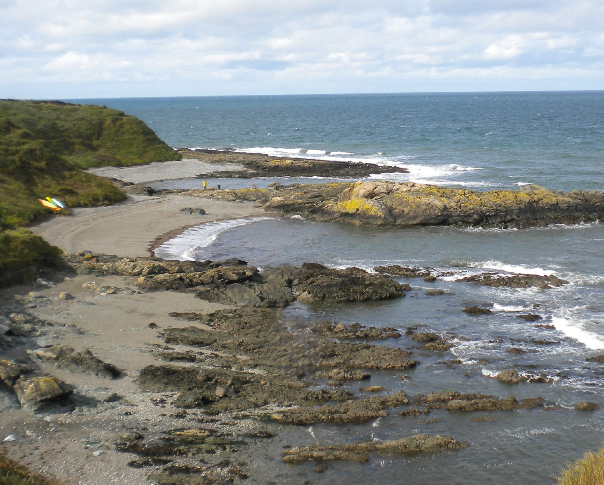
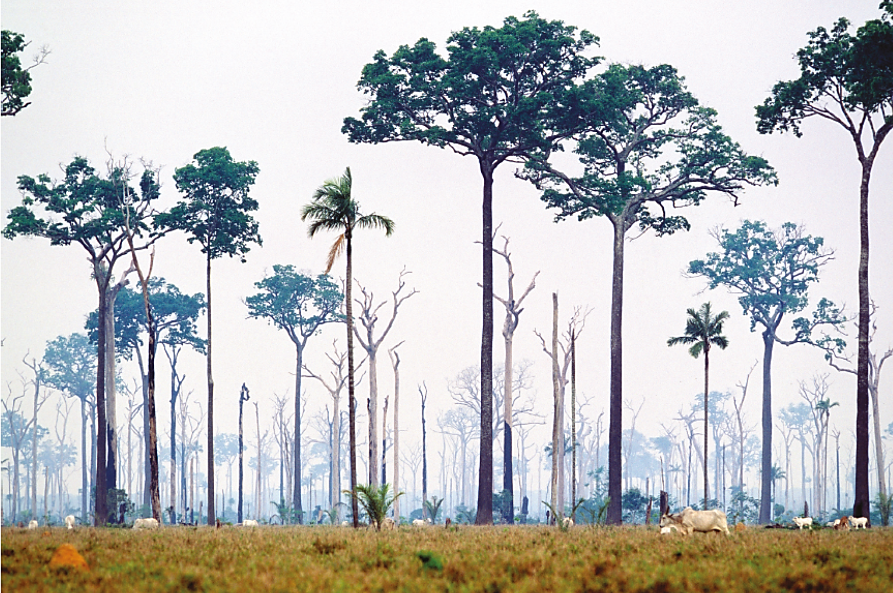
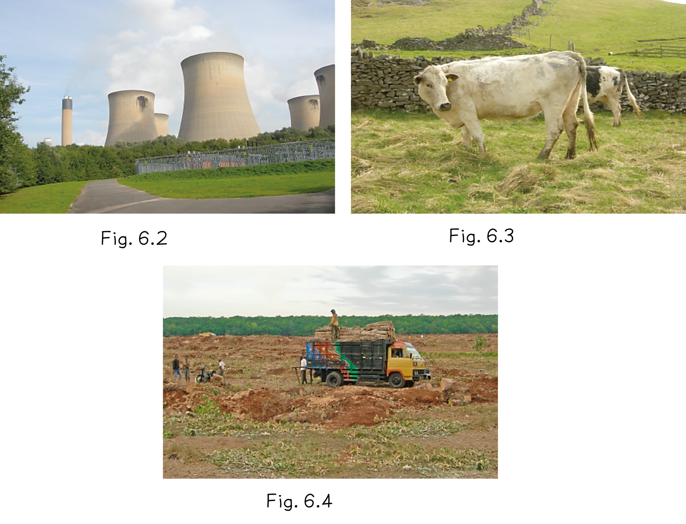
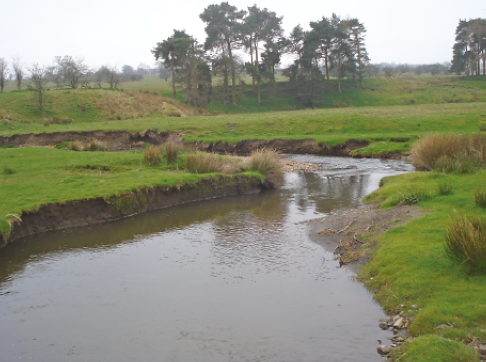

# Exam Questions — Images & GIS
**Geographical Skills** · Cambridge (CIE) IGCSE geography (0460 & 0976)
> Source: [https://www.savemyexams.com/igcse/geography/cie/25/topic-questions/](https://www.savemyexams.com/igcse/geography/cie/25/topic-questions/) · 7 questions across 1 sets

## Exam Questions (7 questions)

### Q1 — medium — 4 marks

**Q1** [4 marks]

Study the photograph of a coastal landscape.

Identify the main process and its features that helped shape the coastline.

### Q2 — medium — 5 marks

**Q2** [5 marks]

Explain how GIS can help decision-makers reduce the impacts of flooding.

### Q3 — easy — 1 marks

**Q3** [1 mark]

A flood risk map shows red zones near rivers and green zones on higher land. Which zone is safer for a hospital and why?

### Q4 — medium — 4 marks

**Q4** [4 marks]

Study Fig. 4.2, which shows an area of Brazil that has been partially deforested.

*Fig. 4.2 *

Describe the vegetation shown in Fig. 4.2.

*Source: Nov 2023 0460/23 Q4B II*

### Q5 — easy — 1 marks

**Q5** [1 mark]

Study Fig. 4.2, which shows an area of Brazil that has been partially deforested.

*Fig. 4.2 *

Identify the type of farming shown in Fig. 4.2.

*Source: Nov 2023 0460/23 Q4B*

### Q6 — easy — 3 marks

**Q6** [3 marks]

Study Figs. 6.2, 6.3 and 6.4, which are photographs of economic activities that increase greenhouse gases in the atmosphere.

*Figs. 6.2, 3 and 4*

Explain how each of the economic activities shown in Figs. 6.2, 6.3 and 6.4 increases greenhouse gases in the atmosphere.

*Source: Nov 2019 0460/13 Q6B I*

### Q7 — easy — 1 marks

**Q7** [1 mark]

*Fig. 4.1*

What river feature is shown in Fig. 4.1?

*Source: Nov 2019 0460/13 Q4A I*

