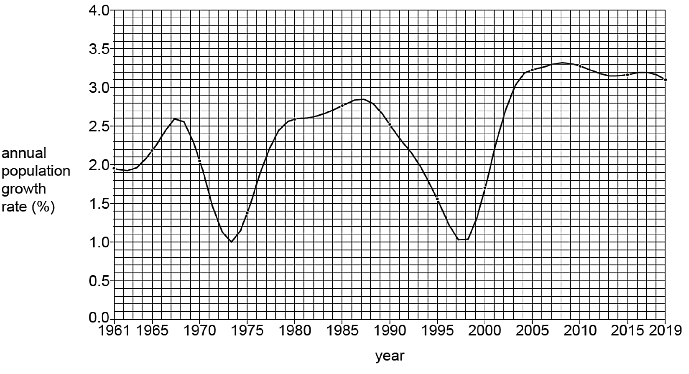
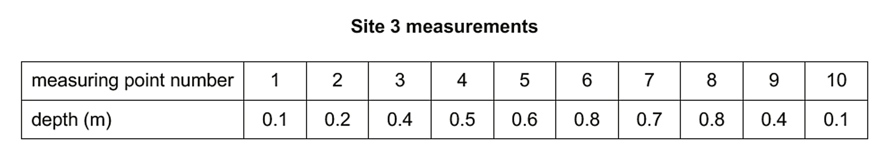
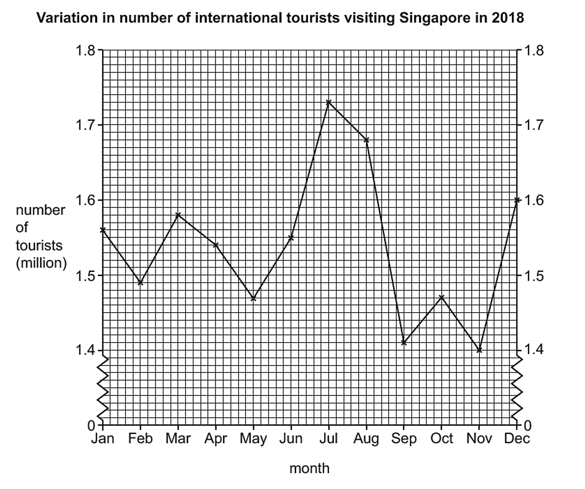

# Exam Questions — Mathematical Skills
**Geographical Skills** · Cambridge (CIE) IGCSE geography (0460 & 0976)
> Source: [https://www.savemyexams.com/igcse/geography/cie/25/topic-questions/](https://www.savemyexams.com/igcse/geography/cie/25/topic-questions/) · 5 questions across 1 sets

## Exam Questions (5 questions)

### Q1 — medium — 4 marks

**Q1** [4 marks]

Deforestation in Country Y has increased from 8,000 km² in 2000 to 12,000 km² in 2010.

Calculate the percentage increase of deforestation in Country Y.

Show your workings.

### Q2 — medium — 4 marks

**Q2** [4 marks]

Fig. 2.1 shows the annual population growth rate of Burundi, Africa, between 1961 and 2019.

*Fig. 2.1*

Using Fig. 2.1, describe the overall pattern of the annual population growth rate between 1961 and 2019.

Use statistics in your answer.

*Source: Nov 2023 0460/21 Q2A I*

### Q3 — easy — 1 marks

**Q3** [1 mark]

Students were studying how a river changes downstream. The students calculated the average depth of the river. Table 2.1 shows the depth of the river at the different measuring points across the channel at site 3.

*Table 2.1*

Use the results in Table 2.1 to calculate the average depth at site 3.

*Source: Nov 2023 0460/41 Q2D III*

### Q4 — easy — 3 marks

**Q4** [3 marks]

Fig. 1.1 shows the number of international tourists visiting Singapore during 2018.

*Fig. 1.1*

Describe the variation in the number of international tourists during the year.

Use statistics in your answer.

*Source: Nov 2023 0460/41 Q1A I*

### Q5 — easy — 1 marks

**Q5** [1 mark]

Study Fig. 1.1, which shows information about birth rates and death rates in Mexico (an LIC) between 1900 and 2060 (estimated).

*Fig. 1.1*

Calculate the natural population growth rate of Mexico in 2010.

You should show your calculations.
