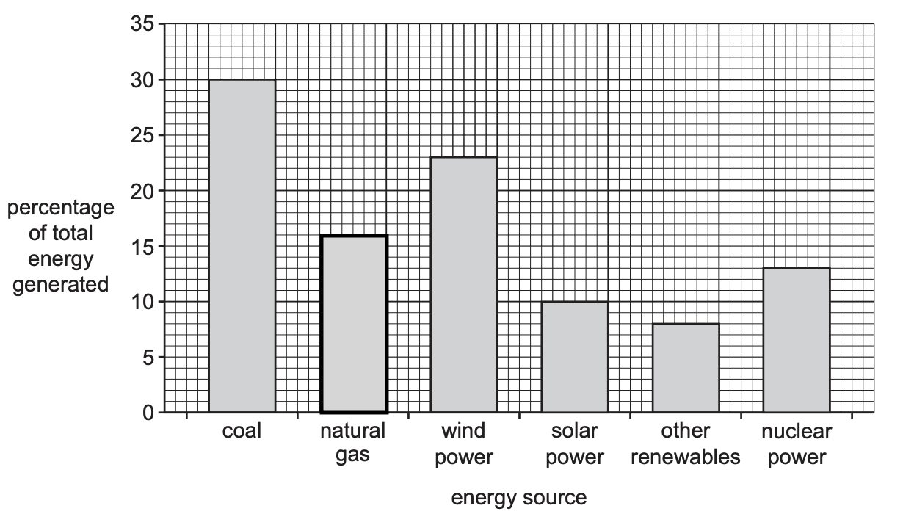
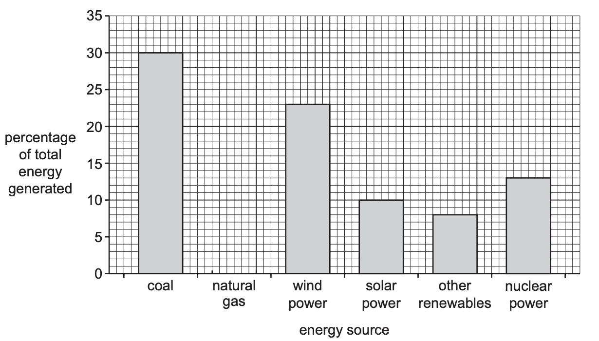
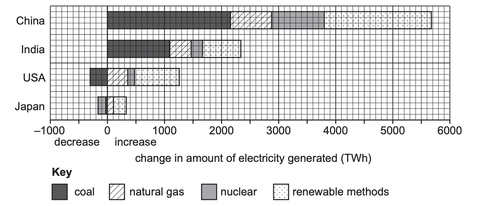

# Exam Questions — Energy Production
**Resource Provision** · Cambridge (CIE) IGCSE geography (0460 & 0976)
> Source: [https://www.savemyexams.com/igcse/geography/cie/25/topic-questions/](https://www.savemyexams.com/igcse/geography/cie/25/topic-questions/) · 4 questions across 1 sets

## Exam Questions (4 questions)

### Q1 — medium — 5 marks

**Q1** [5 marks]

Study Fig 6.1. Germany generated twice as much electricity from renewable sources in 2019 than it did in 2010. Suggest reasons for this increase.

*Fig 6.1*

*Source: Nov 2022 0460/12 Q6A (IV)*

### Q2 — easy — 6 marks

**Q2** [1 mark]

Study Fig. 6.1, which shows information about the generation of electricity in Germany (a HIC in Europe) in 2019.

*Fig 6.1*

Complete Fig. 6.1 to show the following information: percentage of electricity produced from natural gas = 16%

*Source: Nov 2022 0460/12 Q6A (I)*

**Q2** [2 marks]

**Extract:**

Study Fig. 6.1, which shows information about the generation of electricity in Germany (a HIC in Europe) in 2019.

Bar chart of energy sources: coal 30%, natural gas 20%, wind 25%, solar 10%, other renewables 5%, nuclear 15%; y-axis is percentage.

Name two types of renewable energy which could be included in the bar for ‘other renewables’.

*Source: Nov 2022 0460/12 Q6A (II)*

**Q2** [3 marks]

**Extract:**

Study Fig. 6.1, which shows information about the generation of electricity in Germany (a HIC in Europe) in 2019.

Using Fig. 6.1 only, compare the use of renewable and non-renewable energy in Germany. Use statistics in your answer.

*Source: Nov 2023 0460/12 Q6A (III)*

### Q3 — medium — 4 marks

**Q3** [4 marks]

Explain why the generation of electricity is predicted to increase in many countries

*Source: June 2023  0460/11 Q6A (IV)*

### Q4 — easy — 6 marks

**Q4** [1 mark]

Study Fig. 6.1, which shows information about the changes in methods of generating electricity in four countries which are predicted to occur by 2035.

*Fig 6.1*

What is the total increase in electricity generation which is predicted for India by 2035?

*Source: June 2023 0460/11 Q6A (I)*

**Q4** [2 marks]

**Extract:**

Study Fig. 6.1, which shows information about the changes in methods of generating electricity in four countries which are predicted to occur by 2035.

Using Fig. 6.1, identify the following:

– the country where the generation of electricity using nuclear power is predicted to decrease by 2035

– the country where the greatest amount of total extra electricity generated is predicted to be from renewable methods.

**Q4** [3 marks]

**Extract:**

Study Fig. 6.1, which shows information about the changes in methods of generating electricity in four countries which are predicted to occur by 2035.

Compare the predicted changes in the amount of electricity generated by 2035 in China and the USA. Do not use statistics in your answer.

*Source: June 2023 0460/11 Q6A (III)*

