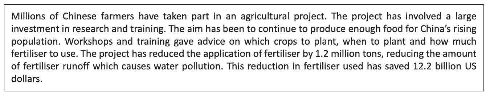
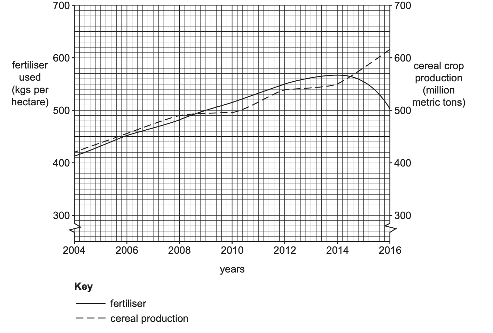
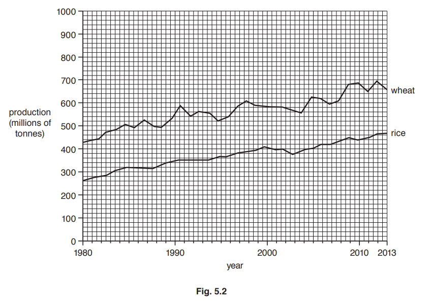

# Exam Questions — Food Production
**Resource Provision** · Cambridge (CIE) IGCSE geography (0460 & 0976)
> Source: [https://www.savemyexams.com/igcse/geography/cie/25/topic-questions/](https://www.savemyexams.com/igcse/geography/cie/25/topic-questions/) · 5 questions across 1 sets

## Exam Questions (5 questions)

### Q1 — easy — 4 marks

**Q1** [3 marks]

Fig. 5.2 describes an agricultural project which has been introduced in part of China.

*Fig 5.2*

Use evidence from Fig. 5.2 to show that this is a good example of sustainable agriculture.

*Source: Nov 2022 0460/22 Q5B (I)*

**Q1** [1 mark]

**Extract:**

Fig. 5.2 describes an agricultural project which has been introduced in part of China.

Text describing a project involving Chinese farmers reducing fertiliser use by 1.2 million tons, preventing water pollution and saving \$12.2 billion.

Suggest one reason why it might be difficult for some LICs to undertake this type of project.

*Source: Nov 2022 0460/22 Q5B (II)*

### Q2 — easy — 4 marks

**Q2** [1 mark]

Fig. 5.1 shows information about fertiliser use and cereal crop production in part of China.

*Fig 5.1*

What was the amount of cereal crop production in 2014?

*Source: Nov 2022 0460/22 Q5A (I)*

**Q2** [3 marks]

**Extract:**

Fig. 5.1 shows information about fertiliser use and cereal crop production in part of China.

Describe the relationship between fertiliser use and cereal crop production shown in Fig. 5.1.

*Source: Nov 2022 0460/22 Q5A(II)*

### Q3 — easy — 3 marks

**Q3** [3 marks]

Study Fig. 6.3, which shows information about grain production in Brazil between 1990 and 2014.

Compare the change in grain production in Brazil with the change in the area of land planted with grain and harvested between 1990 and 2014.

You should refer to years and use statistics in your answer.

*Source: June 2019 0460/12 Q6B*

### Q4 — easy — 3 marks

**Q4** [3 marks]

Study Fig. 5.2, which is a graph showing information about the world production of wheat and rice between 1980 and 2013.

Compare the world production of wheat and rice between 1980 and 2013. You should use statistics in your answer.

*Source: Nov 2019 0460/13 Q5B*

### Q5 — easy — 3 marks

**Q5** [3 marks]

Study Fig. 6.3, which shows recommendations which agricultural experts have given to subsistence farmers in areas such as the one shown in Fig. 6.1.

| **Recommendation 1**  Build a covered, concrete-lined well close to the farm. |
|---|
| **Recommendation 2**  Put electric fences around the fields of maize and millet. |
| **Recommendation 3**  Use some of the land to graze a small herd of goats. |

**Fig. 6.3**

(i)

Explain how each of the three recommendations in Fig. 6.3 may increase the farmers’ food supply.

-Build a covered, concrete-lined well close to the farm

-Put electric fences around the fields of maize and millet

-Use some land to graze a small herd of goats

*Source: Nov 2020 0460/12 Q6B*

