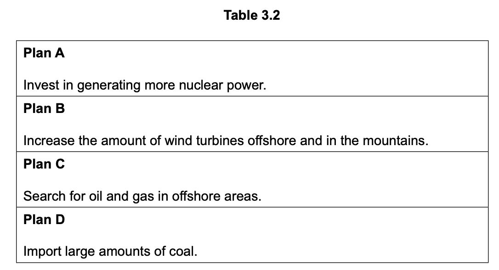

# Exam Questions — Impacts of Energy Production
**Resource Provision** · Cambridge (CIE) IGCSE geography (0460 & 0976)
> Source: [https://www.savemyexams.com/igcse/geography/cie/25/topic-questions/](https://www.savemyexams.com/igcse/geography/cie/25/topic-questions/) · 3 questions across 1 sets

## Exam Questions (3 questions)

### Q1 — hard — 7 marks

**Q1** [7 marks]

Describe and explain the energy mix of a country or area you have studied.

*Source: Specimen 0460/02 Q3C*

### Q2 — medium — 5 marks

**Q2** [5 marks]

Study Table 3.2, which shows four plans which a government is considering to provide future energy supplies.

Use plans B, C and D to choose the plan you think will be the most effective in providing future energy supplies.

*Source: Specimen 0460/02 Q3B (II)*

### Q3 — easy — 3 marks

**Q3** [3 marks]

Study Table 3.2, which shows four plans that a government is considering to provide future energy supplies.

**Table 3.2**

| **Plan A**  Invest in generating more nuclear power. |
|---|
| **Plan B**  Increase the number of wind turbines offshore and in the mountains. |
| **Plan C**  Search for oil and gas in offshore areas. |
| **Plan D**  Import large amounts of coal. |

Give **three **disadvantages of Plan A.

*Source: Specimen 0460/02 Q3B*

