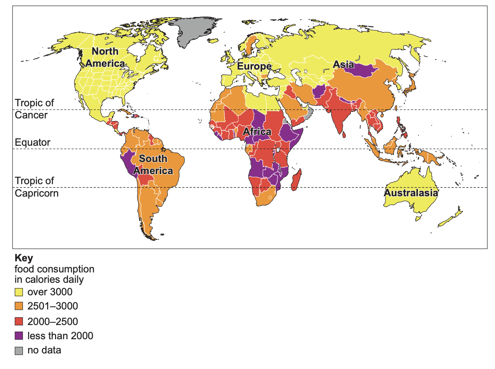

# Exam Questions — The Challenges of Food Supply
**Resource Provision** · Cambridge (CIE) IGCSE geography (0460 & 0976)
> Source: [https://www.savemyexams.com/igcse/geography/cie/25/topic-questions/](https://www.savemyexams.com/igcse/geography/cie/25/topic-questions/) · 5 questions across 1 sets

## Exam Questions (5 questions)

### Q1 — hard — 7 marks

**Q1** [7 marks]

Assess the impacts of food shortages on the population of Yemen.

### Q2 — hard — 7 marks

**Q2** [7 marks]

Evaluate the effectiveness of strategies used to improve food supply in Yemen.

### Q3 — hard — 7 marks

**Q3** [7 marks]

Describe and explain the causes of food shortages in a country or area you have studied.

### Q4 — medium — 5 marks

**Q4** [5 marks]

Explain why many people in some parts of the world do not have enough food to eat.

### Q5 — easy — 3 marks

**Q5** [3 marks]

Study Fig. 5.2 (Insert), which shows information about food consumption in different parts of the world.

*Fig 5.2*

Using information from Fig. 5.2, suggest where shortage of food is most likely.

*Source: June 2023 0460/11 Q5B (I)*

