# Exam Questions — Earthquakes & Volcanoes
**Tectonic Hazards** · Cambridge (CIE) IGCSE geography (0460 & 0976)
> Source: [https://www.savemyexams.com/igcse/geography/cie/25/topic-questions/](https://www.savemyexams.com/igcse/geography/cie/25/topic-questions/) · 16 questions across 1 sets

## Exam Questions (16 questions)

### Q1 — easy — 6 marks

**Q1** [1 mark]

Study Fig. 4.1, which is a map of earthquakes in part of South America in the 21st century.

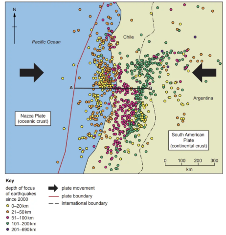

*Fig 4.1*

Define the term depth of focus?

*Source: June 2021 0460/13 Q4A*

**Q1** [2 marks]

**Extract:**

Study Fig. 4.1, which is a map of earthquakes in part of South America in the 21^st^ century.

Describe how the depth of focus of the earthquakes shown in Fig. 4.1 changes along line **A–B**. Use data in your answer.

*Source: June 2021 0460/13 Q4A (II)*

**Q1** [3 marks]

**Extract:**

Study Fig. 4.1, which is a map of earthquakes in part of South America in the 21^st^ century.

Explain why the depth of focus changes from **A** to **B** in Fig. 4.1.

*Source: June 2021 0460/13 Q4A (III)*

### Q2 — easy — 3 marks

**Q2** [3 marks]

Study Fig. 3.2, which is a map showing information about earthquakes which caused more than 10 000 deaths in different parts of the world (1900-2011).

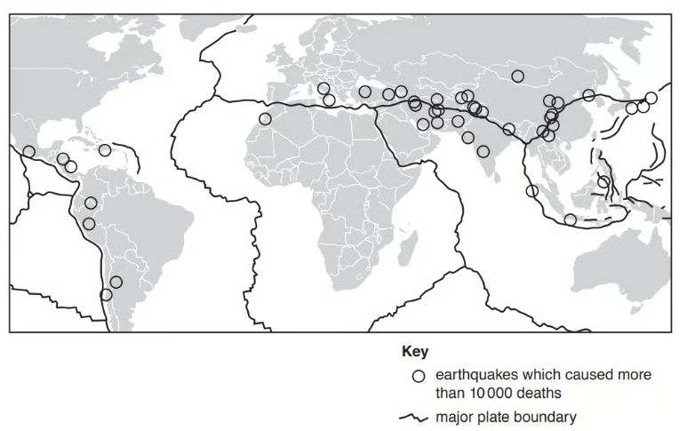

*Fig 3.2*

The distribution of earthquakes is uneven. Describe the distribution of the areas where earthquakes caused more than 10 000 deaths between 1900 and 2011.

*Source: Nov 2019 0460/13 Q3B*

### Q3 — medium — 3 marks

**Q3** [3 marks]

Study Fig 1.1, which shows an earthquake at a plate boundary.

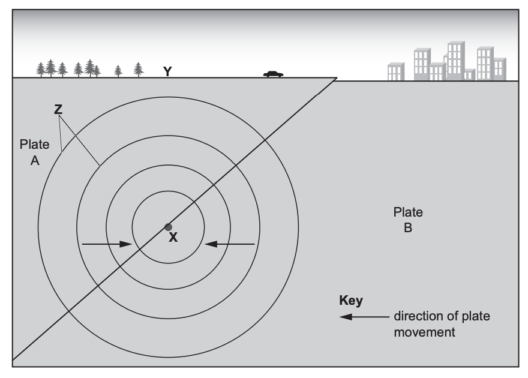

*Fig 1.1*

Explain why earthquakes occur at plate boundaries, such as the one shown in Fig 1.1.

*Source: June 2023 0460/11 Q3B (II)*

### Q4 — easy — 3 marks

**Q4** [3 marks]

Study Fig 1.1, which shows an earthquake at a plate boundary.

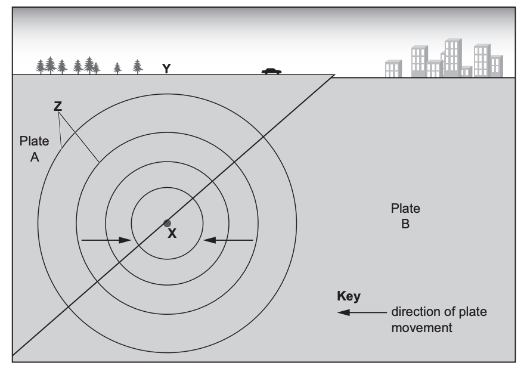

*Fig 1.1*

Identify the features labelled X, Y and Z on Fig 1.1.

*Source: Jun 2023 0460/11 Q3B (I)*

### Q5 — hard — 7 marks

**Q5** [7 marks]

Explain why a volcanic eruption occurred in a detailed specific example you have studied.

Name of detailed specific example.....................................................................

### Q6 — hard — 7 marks

**Q6** [7 marks]

Explain why an earthquake occurred in a detailed specific example you have studied.

Name of detailed specific example.....................................................................

### Q7 — medium — 4 marks

**Q7** [4 marks]

The strongest earthquake in history was at Bio-Bio in Chile, in 1960, with a magnitude of 9.5. The location of Bio-Bio is shown in Fig. 3.1.

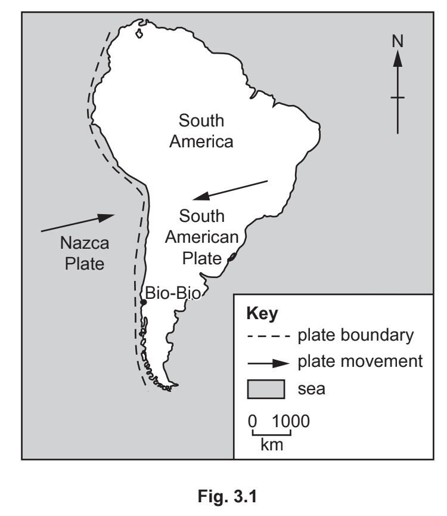

Using evidence from Fig. 3.1, explain the cause of the Bio-Bio earthquake.

*Source: Oct 2020 0460/21 Q3B*

### Q8 — medium — 4 marks

**Q8** [4 marks]

Explain how an earthquake occurs at a conservative plate margin

### Q9 — easy — 3 marks

**Q9** [3 marks]

Study Fig 1, which shows the location of earthquakes and their magnitude

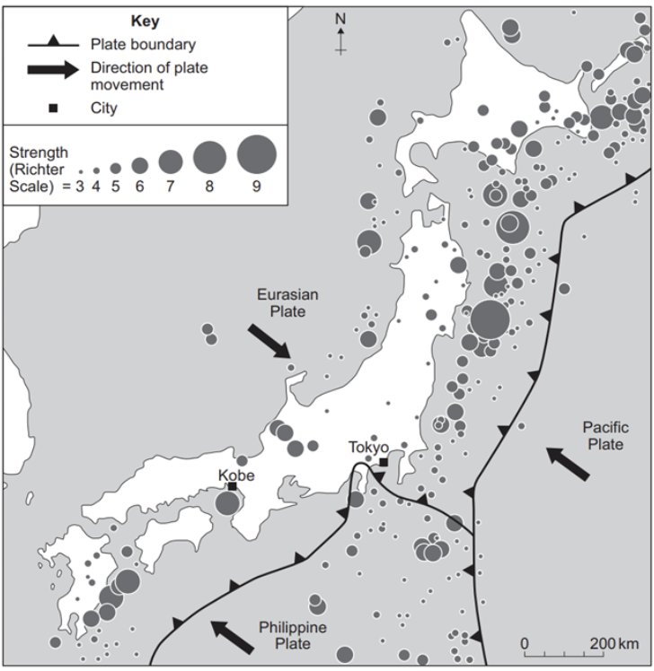

**Figure 1 – A Map showing the location of earthquakes and their magnitude**

Describe the distribution of earthquakes shown in Figure 1

### Q10 — easy — 2 marks

**Q10** [2 marks]

Shield volcanoes are often formed on constructive (divergent) plate boundaries. Describe **two **characteristics of a shield volcano.

*Source: June 2020 0460/11 Q3A (II)*

### Q11 — easy — 1 marks

**Q11** [1 mark]

Study Fig. 3.1, which shows three different types of plate boundary.

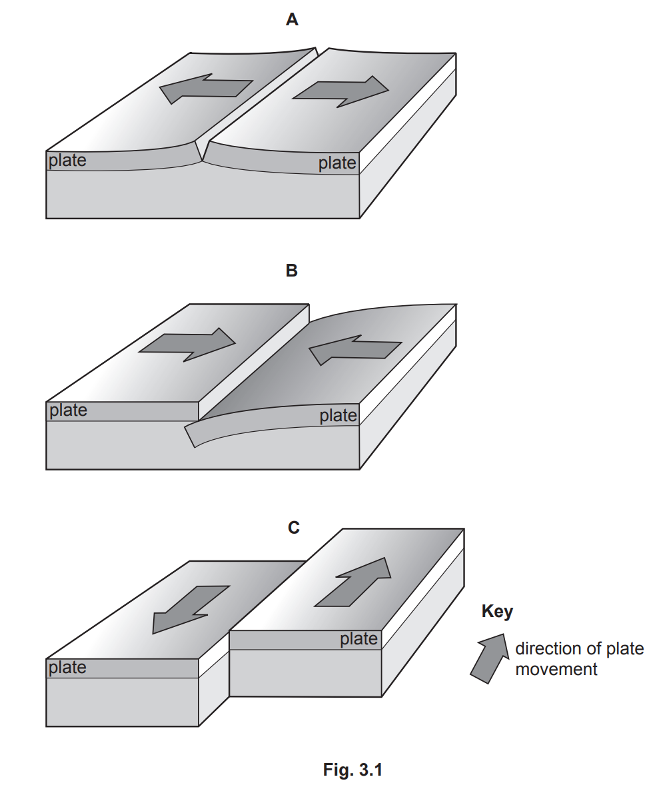

Which diagram, **A**, **B** or **C**, shows a conservative plate boundary?

[1]

*Source: June 2020 0460/11 Q3A*

### Q12 — easy — 1 marks

**Q12** [1 mark]

Study Fig 1, which shows the distribution of earthquakes

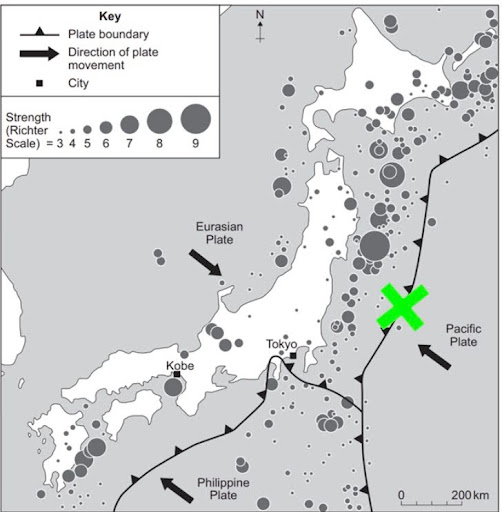

State the type of plate boundary at X

### Q13 — medium — 5 marks

**Q13** [5 marks]

Figure 1.3 shows information about a volcanic eruption on Whakaari.

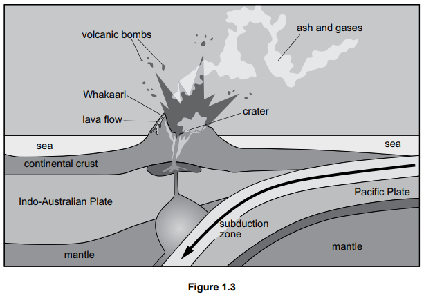

Use Figure 1.3 to explain why a volcanic eruption occurred on Whakaari.

### Q14 — easy — 3 marks

**Q14** [3 marks]

Figure 1.2 shows the location of Whakaari, New Zealand, where a volcano erupted in 2019.

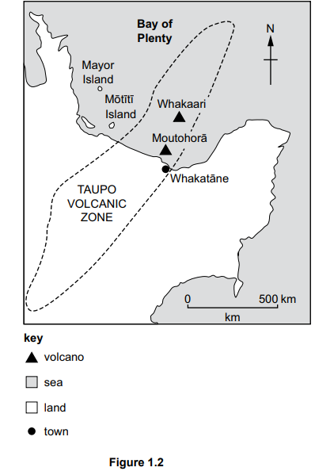

Use Figure 1.2 to describe the location of Whakaari.

*Source: Specimen 0460/1 Q1B(I)*

### Q15 — medium — 4 marks

**Q15** [4 marks]

Describe the distribution of earthquakes shown in Figure 1.1.

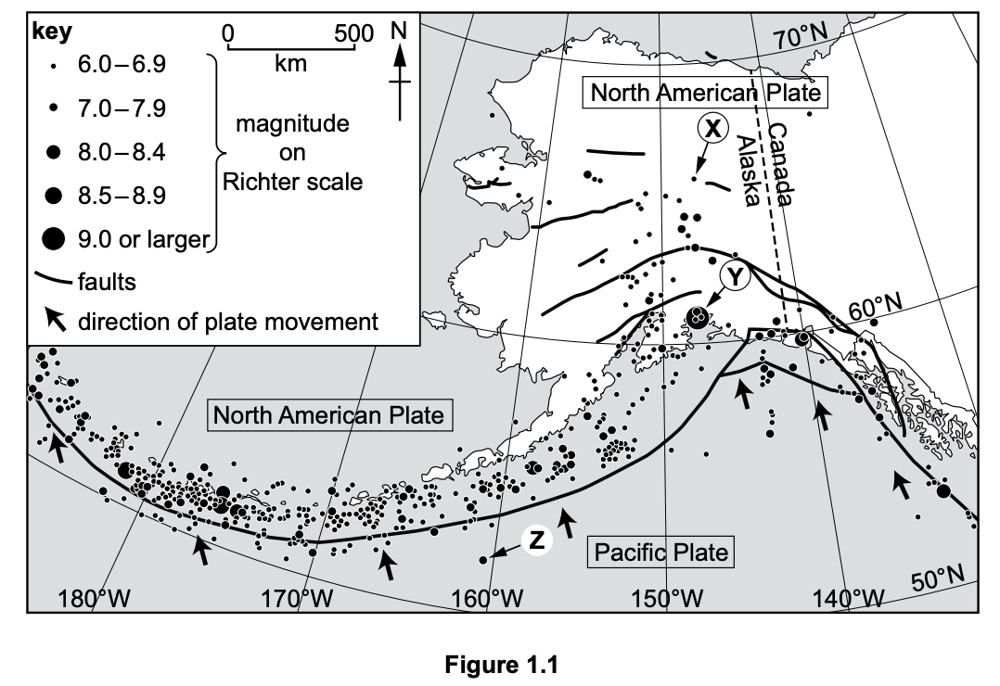

### Q16 — easy — 2 marks

**Q16** [1 mark]

Study Figure 1.1, a map showing the location and magnitude of earthquakes in Alaska, USA.

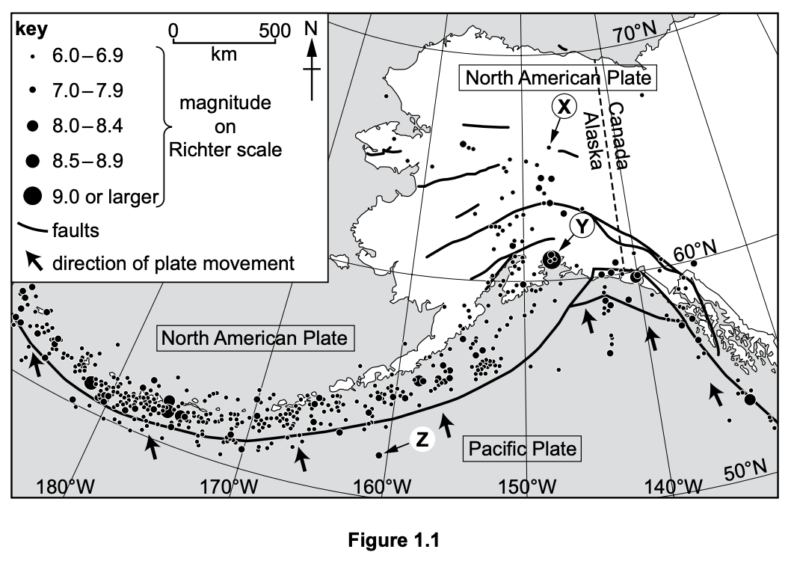

In which direction is the Pacific Plate moving?

*Source:  0460/01 Q1A(I)*

**Q16** [1 mark]

**Extract:**

- Accept latitude in the range 66°N to 68°N and longitude in the range 146°W to 148°W.
- Ignore reversal of the labels "latitude" and "longitude" provided the values and N/W directions are correct.

State the latitude and longitude of the earthquake labelled **X **in Figure 1.1
