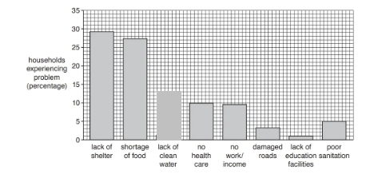

# Mark Schemes — Impacts of Earthquakes & Volcanoes
**Tectonic Hazards** · Cambridge (CIE) IGCSE geography (0460 & 0976)

## Exam Questions (16 questions)

### Q1
Different methods of measuring and monitoring earthquakes and volcanic activity have varying levels of effectiveness **[KU]**.

Seismometers are highly effective for detecting and measuring earthquake magnitude, providing precise data on ground motion and enabling the calculation of earthquake intensity using the Richter or moment magnitude scales **[KU]**. These instruments can detect earthquakes from great distances and provide real-time data for early warning systems, making them essential for earthquake monitoring networks **[KU]**.

GPS technology is extremely effective for measuring ground deformation, detecting subtle movements in the Earth's crust that may indicate impending seismic or volcanic activity **[KU]**. This method provides continuous monitoring and can detect movements as small as millimetres, making it valuable for long-term hazard assessment **[KU]**.

Satellite imagery and remote sensing are effective for monitoring volcanic activity over large areas, detecting thermal anomalies, gas emissions, and ground deformation without requiring ground-based equipment in dangerous locations **[KU]**. However, these methods may be limited by weather conditions and require specialist interpretation **[KU]**.

> **[mark-scheme]**
> The command word is 'assess' which means that the answer needs to evaluate the strengths and limitations of different measurement methods for earthquakes and volcanoes.
> 
> **Mark allocation**
> 
> This is a level of response answer. Each point made in the answer does not equal a mark.
> 
> - AO focus = AO1 **[KU]**
> - A top level 3 (7 mark) answer will have a balanced, developed and evidenced answer that demonstrates knowledge and understanding **[KU]** of various measurement methods and evaluates their effectiveness.
> 
> **Common errors**
> 
> Common errors where students lose marks:
> 
> - Simply describing methods without assessing their effectiveness
> - Focusing only on one type of hazard (earthquakes or volcanoes) without considering both
> - Lack of specific examples or technical details about measurement techniques
> 
> **Alternative content**
> 
> The answer above is just one example of a response to this question. Other information that could be used in the answer includes:
> 
> - Tiltmeters for measuring ground tilting
> - Gas monitoring equipment for detecting volcanic emissions
> - Limitations of different methods in various environments

### Q2
People continue to live in areas of tectonic activity for several interconnected reasons **[KU]**. Economic opportunities are a major factor, as volcanic soils are extremely fertile for agriculture, supporting crops like tomatoes and grapes on the slopes of Mount Etna in Sicily **[KU]**. This agricultural productivity provides livelihoods for millions of people who depend on farming for income **[KU]**.

Geothermal energy resources attract populations to tectonically active areas, as countries like Iceland and New Zealand harness this renewable energy source for heating and electricity generation **[KU]**. Tourism also draws people to these regions, with volcanic landscapes and hot springs creating significant economic opportunities in places like Mount Merapi in Indonesia **[KU]**.

Social and cultural factors play an important role, as many communities have deep historical and spiritual connections to their land, making relocation emotionally and culturally difficult **[KU]**. Additionally, people think there is a low probability of major tectonic events occurring during their lifetime. This leads to risk acceptance, especially when people have experienced only minor tremors or eruptions **[KU]**.

> **[mark-scheme]**
> The command word is 'explain' which means that the answer needs to include reasons and causes for why people live in areas of tectonic activity.
> 
> **Mark allocation**
> 
> This is a level of response answer. Each point made in the answer does not equal a mark.
> 
> - AO focus = AO1 **[KU]**
> - A top level 3 (7 mark) answer will have a balanced, developed and evidenced answer that demonstrates knowledge and understanding **[KU]** of the various reasons why people choose to live in tectonically active areas.
> 
> **Common errors**
> 
> Common errors where students lose marks:
> 
> - A lack of specific examples to support the reasons given
> - Focusing only on economic reasons without considering social, cultural or other factors
> - Confusing the reasons people live there with the impacts of tectonic activity
> 
> **Alternative content**
> 
> The answer above is just one example of a response to this question. Other information that could be used in the answer includes:
> 
> - A lack of alternative locations
> - Government policies

### Q3
People may continue to live in areas vulnerable to tectonic hazards for economic reasons **[1]**

Fertile soils from volcanic activity support agriculture **[1]**

Lack of resources or opportunities to relocate elsewhere **[1]**

Family and friends are all in the area**[1]**

> **[mark-scheme]**
> **Mark allocation**
> 
> - One mark **[1 mark]** is awarded for each valid point
> 
> **Alternative content**
> 
> The answer above is just one example of a response to this question. Other information that could be used in the answer includes:
> 
> - Employment opportunities in mining/geothermal energy
> - Tourism industry benefits from volcanic/tectonic landscapes
> - Government investment in hazard monitoring/early warning systems
> - Perception that hazards are infrequent/low probability events
> - Belief in religious protection or fatalistic attitudes
> - Improved building standards reduce perceived risk

> **[exam-tip]**
> For this question you do not need to outline what the tectonic hazards are, just ensure that you have stated the factors which encourage people to remain in vulnerable areas.

### Q4
The impact of earthquakes can also be affected by the quality of buildings, **[1] **and the level of education people have about how to prepare for earthquakes. **[1] **Access to affected areas can also vary** [1] **this may also affect international aid  reaching those people who need it.** [1]**

> **[mark-scheme]**
> **Mark allocation**
> 
> - One mark** [1] **is awarded for each valid point
> 
> **Alternative content**
> 
> The answer above is just one example of a response to this question. Other information that could be used in the answer includes:
> 
> - Variation in emergency services/health care **[1]**
> - Depth of focus/shallow depth of focus more destructive **[1]**
> - Time of day/if people are at work/in schools there is likely to be less deaths **[1]**
> - Variation in population density/if high there will be more impact **[1]**
> - Variation in access to food/water **[1]**
> - Variation in ability to monitor/study faultline movements **[1]**
> - Impacts will depends on physical characteristics of location or e.g. impacts will be worse if settlements are built on former lake beds/sediment/on a steep slope **[1]**
> - There may be more impacts if an earthquake causes a tsunami/availability of tsunami warning/tsunami defences  **[1]**

> **[exam-tip]**
> For this question you do not need to outline what the impacts are, just ensure that you have stated the factors which may lead to different impacts.

### Q5
Buildings can be constructed with a range of features including using steel beams **[1] **as cross bars to strength the walls. **[1] **Windows can also be protected by using shutters** [1]** or shatterproof glass to reduce flying glass. **[1]**

> **[mark-scheme]**
> **Mark allocation**
> 
> - one mark **[1] **for each valid point.
> 
> **Alternative content**
> 
> The answer above is just one example of a response to this question. Other information that could be used in the answer includes:
> 
> - Build deep/stronger/sturdier foundations/base **[1]**
> - Reinforce/use concrete/bricks for buildings/walls/roofs **[1]**
> - Use flexible building materials **[1]**
> - Use dampers/shock absorbers in base of building **[1]**
> - Computers controlled weights/counter balances on roof/weight on roof **[1]**
> - Use fire resistant materials **[1]**
> - Build low building/do not build high rise **[1]**
> - Use automatic cutoff for gas pipes/electricity cables **[1]**

> **[exam-tip]**
> Remember that during an earthquake it is the collapse of buildings which causes most deaths and injuries. This means that earthquake proofing can reduce deaths and injuries.

### Q6
Observation of the volcano means that signs of eruption can be seen** [1] **and an exclusion zone can be created around the volcano **[1] **and people erupted**. [1] **Emergency services can also be trained.** [1]**

> **[mark-scheme]**
> **Mark allocation**
> 
> - One mark **[1]** is awarded for each valid point
> 
> **Alternative content**
> 
> The answer above is just one example of a response to this question. Other information that could be used in the answer includes:
> 
> - Spray water on lava **[1]**
> - Dig diversion channels for lava **[1]**
> - Strengthen roofs of houses **[1]**
> - Wear masks to protect from ash **[1]**
> - Educate residents on action to take if the volcano erupts **[1]**
> - Store emergency provisions **[1]**

### Q7
> **[mark-scheme]**
> **Mark allocation**
> 
> Any** three** from the following:
> 
> - The earthquake in Indonesia was more powerful. **[1] **
> - The focus of the earthquake in Indonesia was shallower. **[1]**
> - The earthquake caused a tsunami in Indonesia.** [1]**
> - The tsunami in Indonesia flooded three settlements** [1]**

> **[exam-tip]**
> It is important in this answer to only use the information from Fig 3.2. Marks will not be awarded for general statements about factors which cause more deaths like building quality.

### Q8
After the 2023 Türkiye–Syria earthquake, several strategies were used to reduce the impacts of future events **[KU]**. In Türkiye, stricter building codes were introduced to make structures more earthquake-resistant, such as reinforcing concrete and improving foundations **[KU]**. This should make buildings safer, although past failures to enforce codes show it may not always work **[E]**.

Emergency planning was also improved, with better training for rescue services and education campaigns so people knew how to respond during quakes **[KU]**. These measures are valuable because they reduce deaths and injuries, but their effectiveness depends on regular practice and public awareness **[E]**.

The World Bank provided \$1 billion to rebuild stronger hospitals, schools, and infrastructure **[KU]**. This investment helps long-term recovery, though poorer regions may still struggle to access the benefits **[E]**. Early warning systems are being developed to give people seconds to protect themselves before shaking, but these are limited by cost and technology **[E]**.

In Syria, conflict has restricted earthquake strategies, so reliance on international aid has been vital** [KU]**. Overall, strategies in Türkiye are effective in theory but depend on enforcement and funding, while in Syria, political instability means reducing impacts is far more difficult **[E]**.

> **[mark-scheme]**
> The command word is 'assess' this means  that the answer needs to include judgement about the strategies used to reduce the impact of earthquakes.
> 
> **Mark allocation**
> 
> This is a level of response answer. Each point made in the answer does not equal a mark.
> 
> - AO focus = AO1 **[KU]** + AO3** [E]**
> - A top level 3 (7 mark) answer will have a balanced, developed and evidenced answer that demonstrates knowledge and understanding** [KU]** to evaluate (judge or decide) **[E]** how technology can reduce the impacts of earthquakes.
> 
> **Common errors**
> 
> - Common errors where students lose marks:
> 
>   - A lack of evaluation or judgement about the value of different technology types
>   - A lack of evidence or examples to support the answer
> 
> **Alternative content**
> 
> The answer above is just one example of a response to this question. Other information that could be used in the answer includes:
> 
> - Any alternative strategies that are used in different named examples.

### Q9
People are more likely to get warning of a volcanic eruption, **[1] ** as volcanic eruptions can be predicted. **[1] **The areas affected by eruptions tends to be smaller** [1]** and the lava moves slowly enough for people to be able to move away.** [1]**

> **[mark-scheme]**
> **Mark allocation**
> 
> - One mark **[1]** is awarded for each valid point
> 
> **Alternative content**
> 
> The answer above is just one example of a response to this question. Other information that could be used in the answer includes:
> 
> - Earthquakes cause the immediate collapse of buildings
> - Earthquakes may lead to a tsunami
> - Earthquakes are more likely to cause starvation/homelessness/spread of disease
> - Earthquakes are more likely to happen in densely populated areas
> - Lava flows can be diverted/redirected away from populated areas (e.g. using barriers or channels)

### Q10
In LICs there maybe a many reasons that earthquakes have a greater impact including lack of trained rescue teams, **[1] **poorer healthcare, **[1]** lack of emergency shelters **[1] **and lack of emergency planning. **[1]**

> **[mark-scheme]**
> **Mark allocation**
> 
> - One mark **[1]** is awarded for each valid point
> 
> **Alternative content**
> 
> The answer above is just one example of a response to this question. Other information that could be used in the answer includes:
> 
> - Weak/unstable buildings
> - Higher population density
> - Lack of education/earthquake awareness
> - Lack of first aid kits
> - Lack of access to areas affected
> - Lack of food/water/sanitation

### Q11
There were more fatalities on 26 July than on the 9 July. **[1]**

There were 63 injuries on the 26 July compared to 3 on the 9 July** [1]**

There was more building damage on the 9th July than on the 26th.** [1]**

> **[mark-scheme]**
> **Mark allocation**
> 
> - One mark **[1]** is awarded for each comparison between the 9th and 26th July.
> 
> **Alternative content**
> 
> The answer above is just one example of a response to this question. Other information that could be used in the answer includes:
> 
> - Comparison of the focus depth

### Q12
The eruption of the Tajogaite volcano on the Cumbre Vieja ridge in La Palma, Canary Islands, began in September 2021 and lasted for almost three months** [KU]**. It was measured at VEI 2–3 and caused serious problems for people and the environment **[KU]**.

Over 7,000 people had to be evacuated as lava flows threatened communities **[KU]**. Nearly 1,500 houses and 1,500 other buildings such as schools and shops were destroyed, leaving many people homeless **[KU].** Transport was disrupted when lava cut across the coastal highway, and almost 3,000 people lost access to clean water **[KU].** Agriculture was badly affected, with more than 400 hectares of banana plantations destroyed, which damaged farmers’ incomes **[KU]**. In total, about 1,300 hectares of land were covered in lava** [KU]**.

The eruption also disrupted tourism and flights when air quality was poor, adding to the economic problems. Damages were estimated at around €1 billion **[KU].** Although only one person died, the eruption exposed around 20,000 people to long-term impacts like poor air quality and job losses **[KU]**.

In conclusion, the Cumbre Vieja eruption caused social, economic, and environmental problems that had long-lasting effects on La Palma **[KU]**

> **[mark-scheme]**
> The command word is 'assess' this means  that the answer needs to include judgement about the relative value of different types of technology in reducing the impact of volcanic eruptions.
> 
> **Mark allocation**
> 
> This is a level of response answer. Each point made in the answer does not equal a mark.
> 
> - AO focus = AO1 **[KU]**
> - A top level 3 (7 mark) answer will have a balanced, developed and evidenced answer that demonstrates knowledge and understanding** [KU]** of the detailed specific example.
> 
> **Common errors**
> 
> - Common errors where students lose marks:
> 
>   - A lack of evidence or examples to support the answer
> 
> **Alternative content**
> 
> The answer above is just one example of a response to this question. Other information that could be used in the answer includes:
> 
> - Impact on tourism
> - Evacuations

### Q13
> **[mark-scheme]**
> Any **three** from:
> 
> - Lava **[1]**
> - Ash** [1]**
> - Volcanic bombs **[1]**
> - (Poisonous) fumes/gases** [1]**

> **[exam-tip]**
> Remember to only use information given in Fig 4.1 in your answer. Any general answers given such as pyroclastic flow will not be awarded a mark.

### Q14

*Fig 3.1*

**[1]**

> **[mark-scheme]**
> One mark will be awarded for accurate completion of the graph.
> 
> - In this task each small square = 1%
> **[mark-scheme]**
> **Mark allocation**
> 
> - (Lack of) **shelter ****[1]**
> - (Shortage of) **food ****[1]**
> **[mark-scheme]**
> Any **three **from:
> 
> - To drink/prevent dehydration** [1]**
> - Water pipes/treatment works may be damaged **[1]**
> - People cannot shower/wash **[1]**
> - No flush toilets **[1]**
> - Sewage may contaminate water supplies **[1]**
> - Disease/germs get into the water **[1]**
> - Waterborne diseases such as cholera spread** [1]**

> **[exam-tip]**
> Give specific reasons rather than vague consequences like homelessness or general 'lack of access'.
> 
> Make three separate, distinct points—rewording the same idea only scores once.

### Q15
Technology can significantly reduce the impacts of volcanic eruptions in several ways. Firstly, scientists can monitor seismic activity and volcanic gases to predict when a volcano might erupt. This allows early warnings to be issued and gives people time to evacuate safely **[KU]**. In Iceland, the eruption of Eyjafjallajökull in 2010 was predicted using seismic data, helping to reduce the impact on people **[KU]**.

Technology also helps during the eruption. Satellites and radar can track ash clouds so that planes can avoid them or airports can be closed, preventing dangerous incidents in the air **[KU]**. For example, the closure of Bali's international airport during the eruption of Mount Lewotobi Laki-Laki** [KU]**.

However, technology does have its limits. It cannot stop an eruption or control how powerful it is. Toxic gases and ash cannot be easily diverted, which still pose serious health risks and can cause long-term damage **[E]**. Not all countries can afford expensive monitoring equipment, meaning poorer areas may suffer more damage because of lack of early warning** [E]**.

In conclusion, while technology cannot prevent volcanic eruptions, it can play a major role in reducing their impacts, especially by giving people time to prepare. However, its effectiveness depends on the availability of resources and the type of eruption** [E].**

> **[mark-scheme]**
> The command word is 'assess' this means  that the answer needs to include judgement about the relative value of different types of technology in reducing the impact of volcanic eruptions.
> 
> **Mark allocation**
> 
> This is a level of response answer. Each point made in the answer does not equal a mark.
> 
> - AO focus = AO1 **[KU]** + AO3** [E]**
> - A top level 3 (7 mark) answer will have a balanced, developed and evidenced answer that demonstrates knowledge and understanding** [KU]** to evaluate (judge or decide) **[E]** how technology can reduce the impacts of volcanic eruption.
> 
> **Common errors**
> 
> - Common errors where students lose marks:
> 
>   - A lack of evaluation or judgement about the value of different technology types
>   - A lack of evidence or examples to support the answer
> 
> **Alternative content**
> 
> The answer above is just one example of a response to this question. Other information that could be used in the answer includes:
> 
> - Technology can be used to divert/slow down lava flows
> - Technology relating to improved transport and medical care
> - The magnitude of the eruption cannot be controlled

> **[exam-tip]**
> In the assess questions it does not explicitly state that you need to use real life examples to support your answer. However, to achieve maximum marks the examiner will expect you to apply your own knowledge of detailed specific examples.

### Q16
**Y = 9.0 or larger** **[1 mark]**

**Z = 7.0- 7.9** **[1 mark]**
> **[mark-scheme]**
> **Mark allocation**
> 
> - **Mercalli scale** **[1 mark]**
> - **moment magnitude scale ****[1 mark]**
