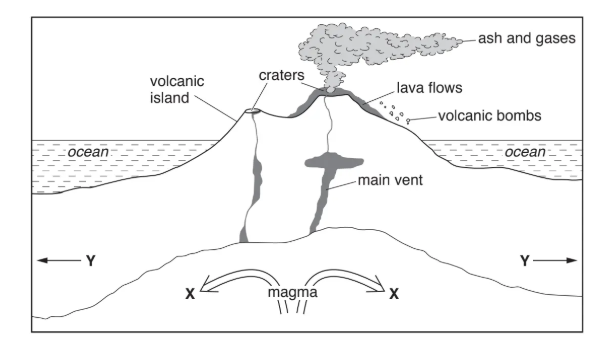
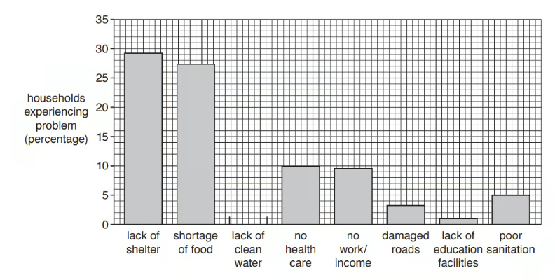
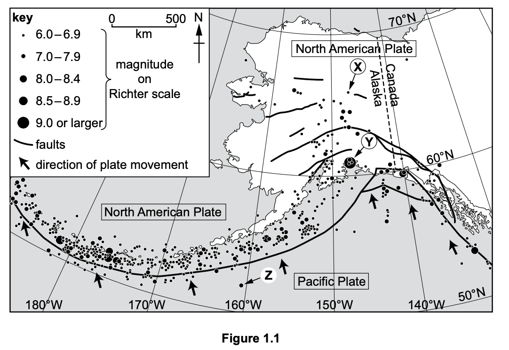

# Exam Questions — Impacts of Earthquakes & Volcanoes
**Tectonic Hazards** · Cambridge (CIE) IGCSE geography (0460 & 0976)
> Source: [https://www.savemyexams.com/igcse/geography/cie/25/topic-questions/](https://www.savemyexams.com/igcse/geography/cie/25/topic-questions/) · 16 questions across 1 sets

## Exam Questions (16 questions)

### Q1 — hard — 7 marks

**Q1** [7 marks]

Assess the effectiveness of different methods used to measure and monitor earthquakes and volcanic activity.

### Q2 — hard — 7 marks

**Q2** [7 marks]

Explain the reasons why people continue to live in areas of tectonic activity.

### Q3 — medium — 4 marks

**Q3** [4 marks]

Explain why people continue to live in areas vulnerable to tectonic hazards despite the risks.

### Q4 — medium — 4 marks

**Q4** [4 marks]

Explain why earthquakes of the same magnitude may have different impacts.

*Source: Nov 2020 0460/12 Q4A*

### Q5 — medium — 4 marks

**Q5** [4 marks]

Explain how new buildings can be earthquake-proofed, so that they are less likely to be damaged in an earthquake.

*Source: Nov 2019 0460/13 Q3A*

### Q6 — medium — 4 marks

**Q6** [4 marks]

Explain what can be done to reduce the impacts of eruptions on people who live near volcanoes.

*Source: June 2020 0460/11 Q3A*

### Q7 — easy — 3 marks

**Q7** [3 marks]

Study Fig. 3.2, which shows information about two earthquakes which occurred in 2018.

| Venezuela 21 August 2018  The August 2018 Venezuela earthquake measured 7.3 on the Richter scale and was one of the largest earthquakes ever to strike Venezuela. It occurred at a depth of 154 kilometres and was felt as far away as Bogotá, Colombia and Paramaribo, Suriname. The earthquake killed five people. |
|---|

| Indonesia 28 September 2018  Following the earthquake in Indonesia measuring 7.5 on the Richter scale, at a depth of 20kilometres, a tsunami occurred. This had a height of around 5 to 7 metres, and flooded the settlements of Palu, Donggala and Mamuju. At least 2256 people were confirmed killed, with hundreds more missing. |
|---|

**Fig.3.2**

Using information from Fig. 3.2 **only,** state **three** reasons why the earthquake in Indonesia caused more deaths and injuries than the earthquake in Venezuela.

*Source: March 2021 0460/12 Q3B*

### Q8 — hard — 7 marks

**Q8** [7 marks]

For a named area you have studied, assess the strategies used to reduce the impacts of earthquakes.

*Source: Nov 2022 0460/12 Q4C*

### Q9 — medium — 4 marks

**Q9** [4 marks]

Explain why earthquakes cause more deaths and injuries than volcanic eruptions.

*Source: Nov 2022 0460/12 Q4A(IV)*

### Q10 — medium — 4 marks

**Q10** [4 marks]

Suggest reasons why earthquakes in LICs such as the Philippines have a greater impact than earthquakes in the HICs such as the USA.

*Source: June 2023 0460/11 Q3A(IV)*

### Q11 — easy — 3 marks

**Q11** [3 marks]

Study the information in Table 1.

| 9 July 2019 | 26 July 2019 |
|---|---|
| 1 death | 8 deaths |
| 3 injuries | 63 injuries |
| 119 buildings damaged or destroyed | 19 buildings damaged or destroyed |
| Focus 24km deep | Focus 10km deep |
| 5.6 magnitude | 6 magnitude |

Use Table 1 to compare the impacts of the earthquakes in the Philippines on 9 July and 26 July 2019.

### Q12 — hard — 7 marks

**Q12** [7 marks]

For a named example you have studied, describe the problems caused by a volcanic eruption.

*Source: June 2023 0460/11 Q3*

### Q13 — easy — 3 marks

**Q13** [3 marks]

Study Fig 4.1, which shows a cross-section through a volcano.

*Fig 4.1*

Using Fig 4.1, identify three different hazards caused by a volcanic eruption which may causes injuries, deaths and damage.

### Q14 — easy — 6 marks

**Q14** [1 mark]

Study Fig. 3.1, which shows information about the problems faced by households after an earthquake in Port-au-Prince, Haiti.

*Figure 3.1*

Complete Fig. 3.1 by plotting the following information: 13% of households were affected by lack of clean water after the earthquake.

*Source: Nov 2019 0460/13 Q3A (I)*

**Q14** [2 marks]

**Extract:**

Study Fig. 3.1, which shows information about the problems faced by households after an earthquake in Port-au-Prince, Haiti.

Identify the two main problems caused by the earthquake in Haiti.

*Source: Nov 2019 0460/13 Q3A (II)*

**Q14** [3 marks]

Explain why it is necessary to provide clean water and sanitation after an earthquake.

### Q15 — hard — 7 marks

**Q15** [7 marks]

Assess the extent to which technology can reduce the impacts of volcanic eruptions.

*Source: Specimen 0460/01 Q1C*

### Q16 — easy — 4 marks

**Q16** [2 marks]

Identify the magnitude on the Richter scale of the earthquakes labelled **Y **and **Z **in Figure 1.1.

**Q16** [2 marks]

**Extract:**

Identify the magnitude on the Richter scale of the earthquakes labelled Y and Z in Figure 1.1.

Name two other scales which can be used to measure earthquakes.
