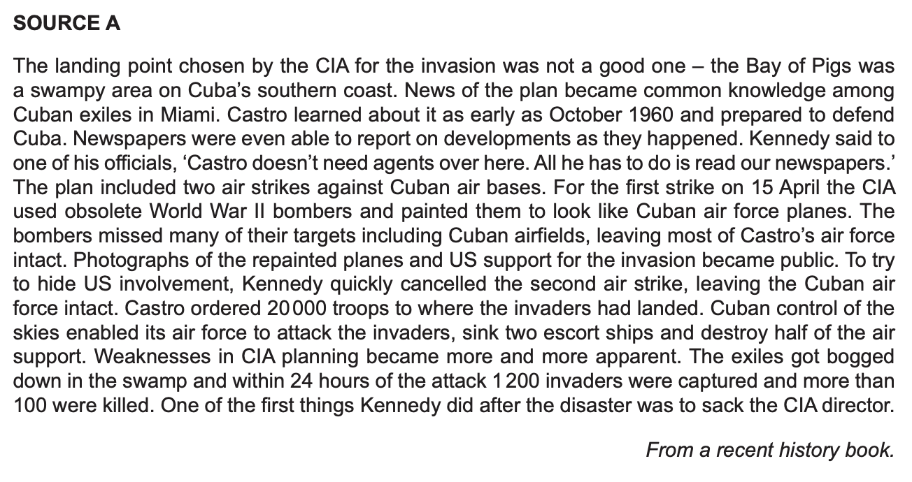
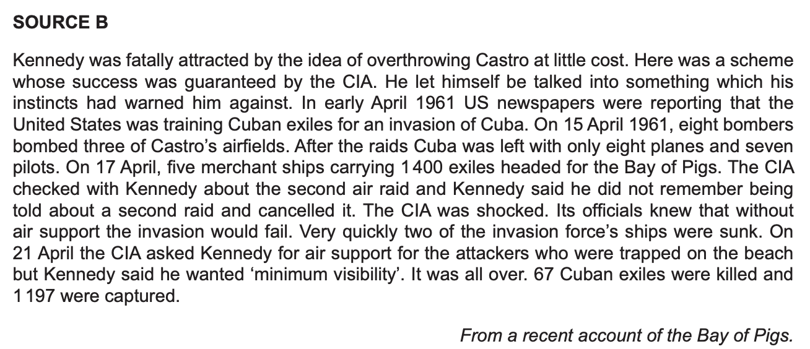
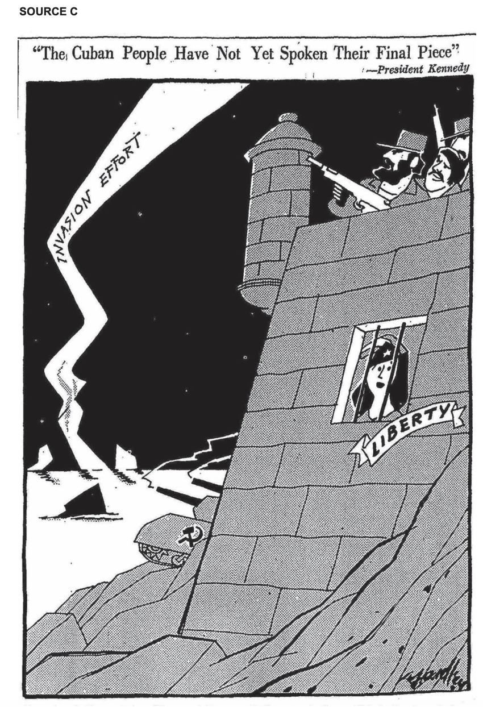
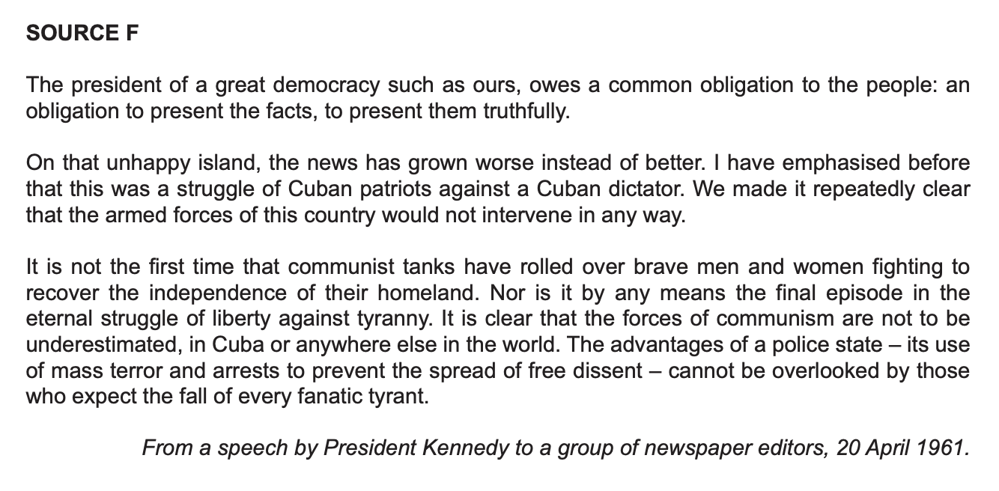
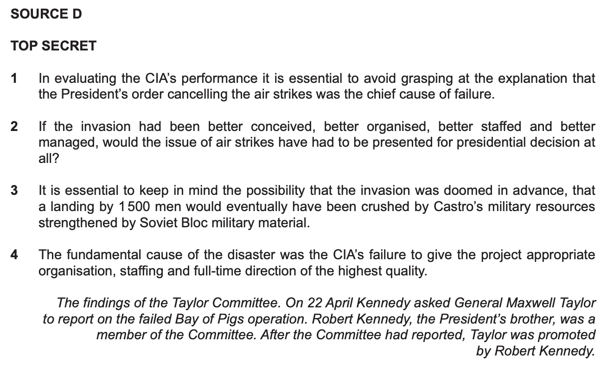
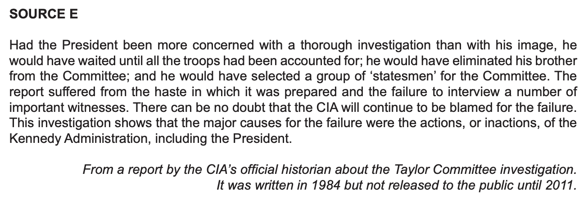

# Exam Questions — Did the United States Contain the Spread of Communism?
**The 20th Century: International Relations from 1919** · Cambridge (CIE) IGCSE history (0470 & 0977)
> Source: [https://www.savemyexams.com/igcse/history/cie/18/topic-questions/](https://www.savemyexams.com/igcse/history/cie/18/topic-questions/) · 17 questions across 1 sets

## Exam Questions (17 questions)

### Q1 — hard — 10 marks

**Q1** [10 marks]

**The Korean War ended in an armistice in 1953.**

How successful was the USA in the Korean War? Explain your answer.

### Q2 — hard — 10 marks

**Q2** [10 marks]

**American containment was tested in the Caribbean and in South East Asia.**

Which was the greater failure of American containment: Cuba or Vietnam? Explain your answer.

### Q3 — hard — 10 marks

**Q3** [10 marks]

**The USA applied containment in Korea, Cuba and Vietnam.**

'The United States failed to contain the spread of communism.' How far do you agree with this statement? Explain your answer.

### Q4 — medium — 6 marks

**Q4** [6 marks]

**The USA had a huge technological advantage in Vietnam.**

Why did the USA fail to defeat the Vietcong?

### Q5 — medium — 6 marks

**Q5** [6 marks]

**The USA attempted to overthrow Castro in 1961.**

Why did the Bay of Pigs invasion fail?

### Q6 — medium — 6 marks

**Q6** [6 marks]

**North Korea invaded South Korea in June 1950.**

Why did the USA get involved in the Korean War?

### Q7 — easy — 4 marks

**Q7** [4 marks]

**The last US troops left Vietnam in the 1970s.**

Describe the consequences of the Vietnam War for the USA.

### Q8 — easy — 4 marks

**Q8** [4 marks]

**In October 1962 the world came close to nuclear war.**

What happened during the 'Thirteen Days' of October 1962?

### Q9 — easy — 4 marks

**Q9** [4 marks]

**Korea was divided at the end of the Second World War.**

Describe how Korea was divided in 1945.

### Q10 — medium — 7 marks

**Q10** [7 marks]

Study Sources D and E. How far does Source E prove that Taylor’s findings (Source D) were wrong? Explain your answer using details of the sources and your knowledge.

### Q11 — medium — 8 marks

**Q11** [8 marks]

A cartoon published in an American newspaper, 21 April 1961

Study Source C. What is the message of this source? Explain your answer using details of the source and your knowledge.

### Q12 — medium — 9 marks

**Q12** [9 marks]

Study all the [sources](https://cdn.savemyexams.com/uploads/2025/09/55159_June%202024-Source%20File%20-%20converted.pdf). How far do these sources provide convincing evidence that President Kennedy was to blame for the failure of the Bay of Pigs invasion? Use the sources to explain your answer.

### Q13 — medium — 8 marks

**Q13** [8 marks]

Study Source F. Why did Kennedy make this speech on 20 April 1961? Explain your answer using details of the source and your knowledge.

### Q14 — medium — 10 marks

**Q14** [10 marks]

In October 1962 the world came close to nuclear war.

How far was Castro responsible for the Cuban Missile Crisis? Explain your answer.

### Q15 — medium — 6 marks

**Q15** [6 marks]

The United States supported the government of South Vietnam.

Why was Diem's government unpopular in South Vietnam?

### Q16 — easy — 4 marks

**Q16** [4 marks]

The United States feared that communism would keep spreading.

What was the 'domino theory'?

### Q17 — medium — 8 marks

**Q17** [8 marks]

