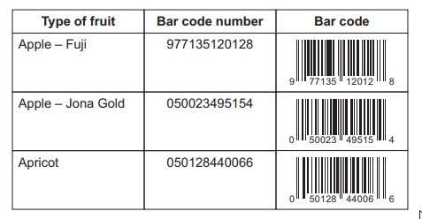
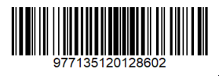
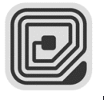

# Exam Questions — Components of Computer Systems
**1. Types & Components of Computer Systems** · Cambridge (CIE) IGCSE ict (0417 & 0983)
> Source: [https://www.savemyexams.com/igcse/ict/cie/21/topic-questions/](https://www.savemyexams.com/igcse/ict/cie/21/topic-questions/) · 27 questions across 1 sets

## Exam Questions (27 questions)

### Q1 — medium — 2 marks

**Q1** [2 marks]

Desktop computers commonly use Hard Disc Drives (HDD) rather than Solid State Drives (SSD).

**Describe two** advantages of using an HDD rather than an SSD in a desktop computer.

### Q2 — medium — 4 marks

**Q2** [4 marks]

A shopkeeper sells fruit and has created a table containing the name of the fruit, its bar code number and an image of the bar code.

Part of the table is shown.

**Describe **the advantages and disadvantages of entering the data by scanning the bar code rather than typing in the number.

*Source: June 2024 0417/13 Q13B*

### Q3 — easy — 2 marks

**Q3** [2 marks]

State **two **solid-state storage devices from the list below:

- Actuator
- Cloud
- CD-ROM drive
- DVD drive
- HDD
- Pen drive
- Sensor
- SSD

*Source: June 2024 0417/13 Q1*

### Q4 — easy — 3 marks

**Q4** [3 marks]

A shopkeeper sells fruit and has created a table containing the name of the fruit, its bar code number and an image of the bar code.

Part of the table is shown.

A bar code reader is an example of a direct data entry device.

State **three **other examples of direct data entry devices.

*Source: June 2024 0417/13 Q13C*

### Q5 — medium — 3 marks

**Q5** [3 marks]

State **three **advantages of using solid state storage devices rather than magnetic storage devices.

*Source: June 2024 0417/12 Q14*

### Q6 — medium — 4 marks

**Q6** [4 marks]

When a person changes their password they are asked to verify that it has been entered correctly by re-entering the password.

The keyboard used to enter the password is an input device.

**Explain **the differences between input and output devices.

*Source: June 2024 0417/12 Q13B*

### Q7 — easy — 4 marks

**Q7** [1 mark]

When a person changes their password they are asked to verify that it has been entered correctly by re-entering the password.

**State **the direct data entry device that is used to read the following types of data.

*Source: June 2024 0417/12 Q13C(I)*

**Q7** [1 mark]

*Source: June 2024 0417/12 Q13C(II)*

**Q7** [1 mark]

*Source: June 2024 0417/12 Q13C(III)*

**Q7** [1 mark]

*Source: June 2024 0417/12 Q13C(IV)*

### Q8 — easy — 2 marks

**Q8** [2 marks]

State **two **items of internal memory from the list below:

- Actuator
- Cloud
- DVD
- Memory stick
- Printer
- RAM
- ROM
- Sensor

*Source: June 2024 0417/2 Q1*

### Q9 — medium — 2 marks

**Q9** [2 marks]

Laptop computers use Solid State Drives (SSD) rather than Hard Disc Drives (HDD).

**Describe two** disadvantages of using an SSD rather than an HDD in a laptop computer.

*Source: June 2022 0417/12 Q6*

### Q10 — medium — 2 marks

**Q10** [2 marks]

Many laptop computers use the cloud to store data. A technician has produced a report on his laptop computer but has stored the report on a memory stick rather than storing it on the cloud.

**Describe two **advantages of using a memory stick rather than the cloud to store data.

*Source: June 2022 0417/11 Q4A*

### Q11 — medium — 4 marks

**Q11** [4 marks]

Portable hard drives can be Solid State Drives (SSDs) or Hard Disk Drives (HDDs).

**Explain **why the SSD may be better to use than the HDD.

*Source: June 2023 0417/11 Q11*

### Q12 — easy — 1 marks

**Q12** [1 mark]

**Tick (✓)** the most appropriate storage medium that should be used in each scenario.

| Scenario | Magnetic tape (✓) | RAM (✓) | ROM (✓) |
|---|---|---|---|
| To store the current instructions in use by a computer |   |   |   |
| To back up data from a school network server |   |   |   |
| To store data temporarily |   |   |   |
| To store the start-up instructions of a computer |   |   |   |

*Source: June 2021 0417/12 Q3*

### Q13 — easy — 2 marks

**Q13** [2 marks]

**State two** items that could be used to output data directly from a smartphone.

| **Blu-ray disc** | ** microphone** |
|---|---|
| **mouse** | **screen** |
| **SD card** | ** sensor ** |
| **speaker** | **webcam** |

*Source: June 2021 0417/12 Q2A*

### Q14 — easy — 2 marks

**Q14** [2 marks]

**State two** input devices that could be used in a smartphone.

| **HDD** | **magnetic stripe reader ** |
|---|---|
| **microphone** | **mouse** |
| **remote  control  ** | **speaker ** |
| ** touchpad** | **touch screen** |

*Source: June 2021 0417/11 Q2*

### Q15 — easy — 4 marks

**Q15** [2 marks]

A tablet computer has input and output devices.

**Give two **examples of input devices which are part of a tablet computer.

*Source: Nov 2021 0417/13 Q1A(I) & (II)*

**Q15** [2 marks]

**Give two **examples of output devices which are part of a tablet computer

*Source: Nov 2021 0417/13 Q1B*

### Q16 — easy — 1 marks

**Q16** [1 mark]

An air-conditioning system has been fitted in a hotel bedroom. The air-conditioning system will contain fans which operate at varying speeds.

**Name **the output device that operates the fan.

*Source: Nov 2021 0417/12 Q11C*

### Q17 — easy — 2 marks

**Q17** [2 marks]

Modern computers often do not have an optical drive.

**State two **ways music can be transferred onto a computer that does not contain an optical drive.

*Source: Nov 2021 0417/12 Q3B*

### Q18 — easy — 2 marks

**Q18** [2 marks]

A computer consists of both hardware and software.

**Give two **examples of input devices which are part of a laptop computer.

*Source: Nov 2021 0417/12 Q1A*

### Q19 — easy — 2 marks

**Q19** [2 marks]

**Identify two **input devices which are used in computer control systems.

*Source: June 2022 0417/13 Q3*

### Q20 — easy — 2 marks

**Q20** [2 marks]

**State two **storage devices.

| **Bridge** | **Digital camera** |
|---|---|
| **Magnetic tape** | **Linker** |
| **USB Memory stick** | **Mouse** |
| **Printer** | **Spreadsheet** |

*Source: June 2022 0417/13 Q1*

### Q21 — easy — 2 marks

**Q21** [2 marks]

A computer-controlled glasshouse is used to grow plants.

**Identify two **output devices used in this glasshouse.

*Source: June 2022 0417/12 Q2*

### Q22 — easy — 2 marks

**Q22** [2 marks]

**State two **input devices.

| **3D printer** | ** Actuator** |
|---|---|
| **CD ROM** | **Digital camera** |
| **Keyboard** | **Linker** |
| ** Monitor** | **Speaker** |

*Source: June 2022 0417/12 Q1*

### Q23 — easy — 2 marks

**Q23** [2 marks]

Martin wants to record a message for his students. His voice will be added to the presentation. He will also need to listen to his voice to make sure the sound is of good quality.

**Name two **devices that he will need.

*Source: June 2022 0417/11 Q9B*

### Q24 — easy — 1 marks

**Q24** [1 mark]

**Complete **the sentence using the most appropriate item from the list.

| **ADC** | **an applet** |
|---|---|
| **hardware** | **HDD** |
| **a router** | **a sensor ** |
| **software** | ** SSD** |

An input device used in measurement applications is called …

*Source: June 2022 0417/11 Q2D*

### Q25 — easy — 2 marks

**Q25** [2 marks]

A media student is creating a movie, in school, for a project.

He needs to take the movie home to edit it.

The student intends to use a CFast solid-state memory card to transport the movie files.

The student is unable to save the work on the memory card.

**Give two **error messages that may appear when attempting to save the work.

*Source: Specimen 2023 0471/01 Q13*

### Q26 — easy — 3 marks

**Q26** [1 mark]

For each of the following uses of data capture, **name one **appropriate direct data entry device.

The devices **must **be different in each case.

1. Contactless credit cards

*Source: Specimen 2023 0417/01 Q4A*

**Q26** [1 mark]

2. Multiple choice answers in an examination paper

*Source: Specimen 2023 0471/01 Q4B*

**Q26** [1 mark]

3. To scan items at a computerised till

*Source: Specimen 2023 0471/01 Q4C*

### Q27 — easy — 2 marks

**Q27** [2 marks]

One component of the internal memory of a computer is Random Access Memory (RAM).

**State two **characteristics of RAM.

*Source: Specimen 2023 0471/01 Q2*

