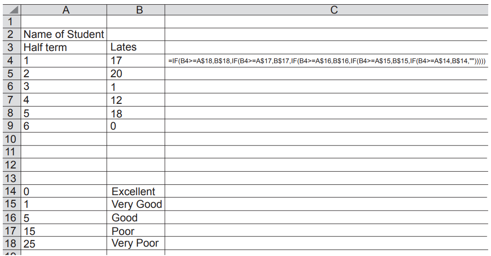
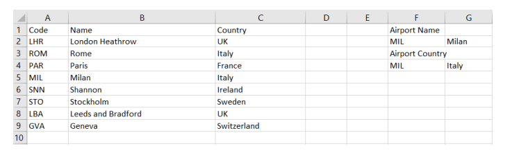
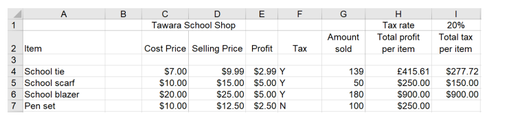
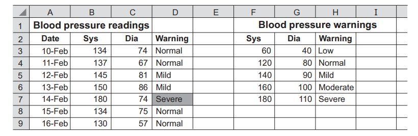
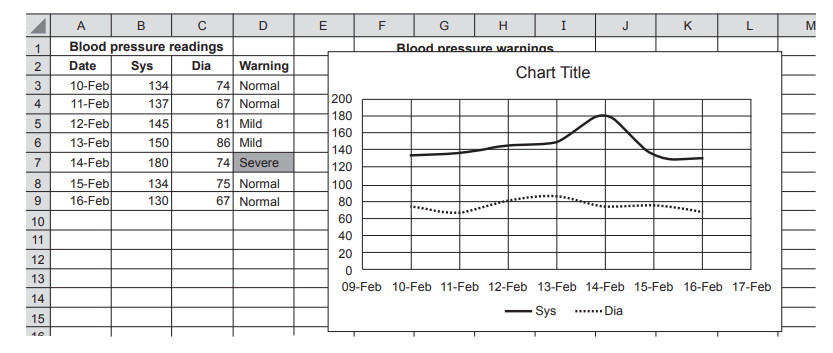
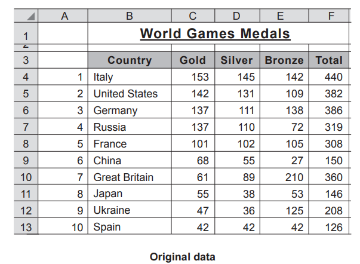
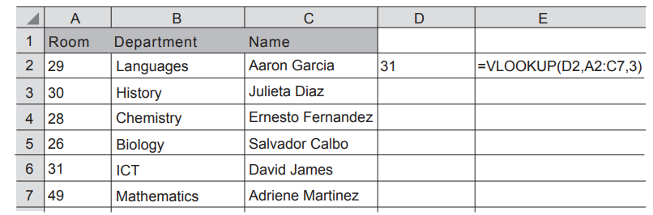

# Exam Questions — Create a Data Model
**11. Spreadsheets** · Cambridge (CIE) IGCSE ict (0417 & 0983)
> Source: [https://www.savemyexams.com/igcse/ict/cie/21/topic-questions/](https://www.savemyexams.com/igcse/ict/cie/21/topic-questions/) · 10 questions across 1 sets

## Exam Questions (10 questions)

### Q1 — hard — 4 marks

**Q1** [4 marks]

A teacher in the school has created a spreadsheet to display whether a student has good timekeeping when arriving at lessons. He has produced a formula but thinks it could be improved. The formula is:

=IF(B4>=A\$18,B\$18,IF(B4>=A\$17,B\$17,IF(B4>=A\$16,B\$16,IF(B4>=A\$15,B\$15,IF(B4>=A\$14,B\$14,"")))))

The teacher has improved the formula and has typed in =VLOOKUP(B4,A\$14:B\$18,2)

**Explain **the advantages of using this formula compared to the original one.

*Source: Nov 2021 0417/11 Q10D*

### Q2 — easy — 1 marks

**Q2** [1 mark]

A teacher in the school has created a spreadsheet to display whether a student has good timekeeping when arriving at lessons. He has produced a formula but thinks it could be improved. The formula is:

=IF(B4>=A\$18,B\$18,IF(B4>=A\$17,B\$17,IF(B4>=A\$16,B\$16,IF(B4>=A\$15,B\$15,IF(B4>=A\$14,B\$14,"")))))

**Write **down the value that should appear in cell C4.

### Q3 — hard — 6 marks

**Q3** [6 marks]

A student is creating a spreadsheet of airports for a project.

**Explain**, using examples, the differences between a function and a formula.

*Source: June 2022 0417/12 Q9C*

### Q4 — medium — 2 marks

**Q4** [2 marks]

Petr has set up a database for a science project on planets in the solar system. Part of the database is shown.

| `ID` | `Name_of_planet` | `Number_of_moons` | `Orbital_period` | `Rings` | `Gravity` | `Type_of_planet` | `First_observed` |
|---|---|---|---|---|---|---|---|
| 4 | Mars | 2 | 1.88 | N | 0.38 | Regular | 1610 |
| 5 | Ceres | 0 | 4.61 | N | 0.27 | Dwarf | 1801 |
| 7 | Saturn | 62 | 29 | Y | 1.16 | Gas Giant | 1610 |
| 9 | Neptune | 14 | 165 | Y | 1.21 | Gas Giant | 1846 |
| 10 | Pluto | 5 | 248 | N | 0.62 | Dwarf | 1930 |
| 11 | Haumea | 1 | 309 | N | 0.401 | Dwarf | 2004 |

Petr has copied the data from the Orbital_period field into a spreadsheet. The data for the orbital period for Mars, 1.88, is stored in cell A2. In cell B2 he has entered a function of:

ROUND(A2,0)

**Explain **in detail the function used in cell B2.

*Source: June 2021 0417/12 Q5D*

### Q5 — medium — 5 marks

**Q5** [5 marks]

Tawara school has a shop that sells items needed by pupils in school. Part of a spreadsheet with details of the items is shown.

Tax is paid on certain items sold in the shop. The tax rate that has to be paid is 20% of the selling price. If tax is to be paid on an item, then ‘Y’ is placed underneath the Tax heading.

The formula in I4 is: IF(F4=''Y'',(\$I\$1*D4*G4),'''')

**Explain**, in detail, what the formula does.

*Source: June 2021 0417/11 Q5C*

### Q6 — medium — 15 marks

**Q6** [5 marks]

A doctor measures the blood pressure of some of his patients regularly. The patients take home a blood pressure machine and record their results on a spreadsheet which the doctor has created. Part of the spreadsheet is shown.

When a reading produces a Severe or Low warning then the text automatically changes to a red font on a light red background.

**Explain **how the doctor could set up automatic colour change for these warnings on the spreadsheet.

*Source: Nov 2021 0417/13 Q12A*

**Q6** [3 marks]

The doctor has set up a named range called Bloodpressure for the cells F3 to H7.

**Explain **why the doctor has used a named range.

*Source: Nov 2021 0417/13 Q12B*

**Q6** [4 marks]

The formula =VLOOKUP(B3,Bloodpressure,3) has been entered into cell D3.

**Explain **what the formula does.

*Source: Nov 2021 0417/13 Q12C*

**Q6** [3 marks]

The doctor has created a graph of the readings for one patient and has displayed it on the spreadsheet. However, there are elements missing.

**Explain **how the doctor created the graph.

Write in your answer one improvement that could be made to the graph.

*Source: Nov 2021 0417/13 Q12D*

### Q7 — medium — 14 marks

**Q7** [6 marks]

You are creating a presentation on the World Games. You have created a spreadsheet showing the number of gold, silver and bronze medals awarded to different countries.

You are planning to create a graph in the presentation showing the country, the number of gold medals and the total number of medals.

**Explain **how you would create a vertical bar chart, showing the name of the country, the number of gold medals and the total number of medals awarded to each country, on a new slide in the presentation.

*Source: Nov 2021 0417/12 Q8A*

**Q7** [4 marks]

The total number of medals has been calculated manually and entered as a value. This could lead to errors.

**Explain **how you could create a formula to calculate the total number of medals awarded for Italy, using only the mouse.

*Source: Nov 21 0417/12 Q8B*

**Q7** [4 marks]

**Explain **how the data could be sorted by the total number of medals won by each country. The country with the largest number of medals should be at the top of the list.

### Q8 — medium — 8 marks

**Q8** [3 marks]

**Explain** the differences between a VLOOKUP function and a LOOKUP function.

*Source: Nov 2021 0417/11 Q10A*

**Q8** [3 marks]

A spreadsheet contains a list of staff and the rooms they work in at a school.

**Explain**, in detail, what the formula in cell E2 does.

*Source: Nov 2021 0417/11 Q10B(I)*

**Q8** [2 marks]

When certain room numbers are typed into cell D2 unexpected results appear in cell E2.

**Suggest **improvements that could be made to ensure the correct result is displayed.

*Source: Nov 2021 0417/11 Q10B(II)*

### Q9 — medium — 4 marks

**Q9** [4 marks]

A student is creating a spreadsheet of airports for a project.

The formula in G2 is:

=VLOOKUP(F2,A2:B9,2,0)

**Explain**, in detail, what the formula in G2 does

*Source: June 2022 0417/12 Q9A*

### Q10 — easy — 4 marks

**Q10** [1 mark]

Tawara school has a shop that sells items needed by pupils in school. Part of a spreadsheet with details of the items is shown.

**Write **down the number of rows that are shown in the spreadsheet that contain text.

*Source: June 2021 0417/11 Q5A*

**Q10** [1 mark]

**Write **down the number of columns that are shown in the spreadsheet that contain text

*Source: June 2021 0417/11 Q5B*

**Q10** [2 marks]

**Explain **the steps that need to be taken to display cell H4 as US dollars.

*Source: June 2021 0417/11 Q5D*

