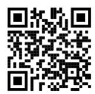

# Exam Questions — ICT Applications
**4. ICT Applications** · Cambridge (CIE) IGCSE ict (0417 & 0983)
> Source: [https://www.savemyexams.com/igcse/ict/cie/21/topic-questions/](https://www.savemyexams.com/igcse/ict/cie/21/topic-questions/) · 44 questions across 1 sets

## Exam Questions (44 questions)

### Q1 — easy — 1 marks

**Q1** [1 mark]

**Choose** which technology creates three-dimensional physical models from digital designs.

### Q2 — hard — 6 marks

**Q2** [6 marks]

**Discuss **the positive and negative effects of using microprocessor-controlled devices in autonomous vehicles.

*Source: June 2024 0417/13 Q4*

### Q3 — medium — 3 marks

**Q3** [3 marks]

A student is able to access a secure area of the school’s website using zero login.

Biometrics could be used as another method of accessing the secure area.

State **three **examples of biometric methods.

*Source: June 2024 0417/13 Q3B*

### Q4 — medium — 3 marks

**Q4** [3 marks]

An expert system can be used in medical diagnosis. An explanation system is a component of an expert system.

State **three **other components of an expert system.

*Source: June 2024 0417/13 Q9A*

### Q5 — easy — 2 marks

**Q5** [2 marks]

An expert system can be used in medical diagnosis. An explanation system is a component of an expert system.

**Explain **what is meant by an explanation system.

*Source: June 2024 0417/13 Q9B*

### Q6 — medium — 6 marks

**Q6** [3 marks]

**Explain **the following components of an expert system.

**User interface**

*Source: June 2024 0417/12 Q9A*

**Q6** [3 marks]

**Knowledge base**

*Source: June 2024 0417/12 Q9B*

### Q7 — medium — 6 marks

**Q7** [3 marks]

An expert system can be used to diagnose problems.

Explain the following components of an expert system.

**Rules base**

*Source: June 2024 0417/11 Q9A*

**Q7** [3 marks]

**Inference engine**

*Source: June 2024 0417/11 Q9B*

### Q8 — hard — 6 marks

**Q8** [6 marks]

RockIT Airlines representatives use a computer booking system to book flights for customers.

A representative from the airline types in the customer reference number, the number of passengers, departure time, departure date, departure airport and the destination airport.

A customer is planning to take a flight from London Heathrow Airport. The representative types in a code LHR for London Heathrow Airport. One of the reasons for using a code for the airport is to improve data accuracy.

**Describe **the processing and outputs involved in making the booking.

*Source: June 2021 0417/11 Q13C*

### Q9 — hard — 6 marks

**Q9** [6 marks]

Many banks have reduced the number of staff in their branches and replaced them with automatic teller machines (ATMs). These ATMs, which can be located within the bank, can be used by customers to deposit and withdraw money from their bank accounts.

ATMs can be used to deposit cheques.

**Describe **the computer processing involved in depositing a cheque at an ATM.

*Source: June 2021 0417/11 Q4A*

### Q10 — hard — 6 marks

**Q10** [6 marks]

Robots are used to spray paint cars in a car production company.

**Discuss **the advantages and disadvantages of the introduction of robots rather than employing humans to spray paint the cars.

*Source: Nov 2021 0417/11 Q9C*

### Q11 — hard — 8 marks

**Q11** [8 marks]

Tawara Tours has created a new online booking system to allow customers to book holidays. The system was written using modules.

Tawara Tours used to book holidays using a manual booking system. This used a pen and paper to make the bookings.

**Discuss **the advantages and disadvantages of using online booking systems rather than a manual booking system.

*Source: Nov 2021 0417/11 Q5B*

### Q12 — hard — 8 marks

**Q12** [8 marks]

Tawara Hotel uses magnetic stripe cards to allow guests access to their bedrooms. The hotel is changing the electronic lock it uses on its bedroom doors so the lock can work with RFID cards.

**Compare **the use of magnetic stripe cards and RFID cards for key entry.

Your answer **must **include similarities and differences.

*Source: June 2022 0417/13 Q8*

### Q13 — hard — 8 marks

**Q13** [8 marks]

Tawara Stores has realised that the number of people shopping for food online has increased over the past few years.

**Discuss **the advantages and disadvantages to the customer of shopping for food online.

*Source: June 2022 0417/13 Q7A*

### Q14 — hard — 8 marks

**Q14** [8 marks]

The manager of a cinema has purchased a new booking system. There are 26 rows in the cinema with 20 seats on a row. Each seat is identified by a unique ID. The seat ID consists of the row letter 5 followed by the position of the seat on the row. An example of the seat on row F position 12 would be F12.

He is setting up a test plan to test the system

**Discuss **the advantages and disadvantages of using manual booking systems rather than online booking systems.

*Source: June 2022 0417/13 Q5C*

### Q15 — hard — 6 marks

**Q15** [6 marks]

A car manufacturing company uses computer-controlled robots to manufacture its cars.

**Discuss **the advantages and disadvantages to the company of using computer-controlled robots rather than using humans to manufacture the cars.

*Source: June 2022 0417/12 Q11*

### Q16 — hard — 6 marks

**Q16** [6 marks]

A manager in a hospital has decided to ask a software company to develop a computer system. The system should allow patients to book all their medical appointments online.

**Discuss **the advantages and disadvantages to both the patients and the medical staff of this type of system.

*Source: Specimen 2023 0417/01 Q18A*

### Q17 — hard — 6 marks

**Q17** [6 marks]

**Compare **Optical Mark Readers (OMRs) with Optical Character Readers (OCRs).

Your answer **must **include similarities and differences.

*Source: June 2023 0417/11 Q8A*

### Q18 — medium — 4 marks

**Q18** [4 marks]

One of the uses of a smartphone is the sending and receiving of emails

**Describe four **other uses of a smartphone.

*Source: June 2021 0417/12 Q2B*

### Q19 — medium — 6 marks

**Q19** [6 marks]

Many banks have reduced the number of staff in their branches and replaced them with automatic teller machines (ATMs). These ATMs, which can be located within the bank, can be used by customers to deposit and withdraw money from their bank accounts.

Customers can visit these banks or use internet banking.

**Discuss **the advantages and disadvantages to a customer of visiting the bank rather than using internet banking.

*Source: June 2021 0417/11 Q4B*

### Q20 — medium — 10 marks

**Q20** [4 marks]

Many customers now use contactless payment and internet banking.

**Describe **the computer processing involved in using contactless bank cards to pay for purchases.

*Source: Nov 2021 0417/13 Q7A*

**Q20** [6 marks]

Fewer and fewer customers now use high street banks, preferring to bank online using the internet.

**Discuss **the advantages and disadvantages of internet banking for the customer.

*Source: Nov 2021 0417/13 Q7B*

### Q21 — medium — 6 marks

**Q21** [6 marks]

A library system has two tables; one for borrowers and one for books. Extracts from these tables are shown.

| Borrower_ID | Borrower_name | Contact_telephone | Contact_email |
|---|---|---|---|
| 5404 | Susan Stranks | 01632 960321 | [rockit@cambridgeinternational.org](mailto:rockit@cambridgeinternational.org) |
| 9867 | Fei Hong Zhao | 07700 900222 | [tawara@cambridgeinternational.org](mailto:tawara@cambridgeinternational.org) |

**Borrowers table**

| Book_ID | ISBN | Name_of_book | Author_of_book | Date_published | Borrower_ID | Date_due_back |
|---|---|---|---|---|---|---|
| 1 | 0859550153 | Bird of Prey | David James | 1977 | 5404 | 27/10/2021 |
| 34 | 3301028345 | The Fifth Man | Colin Turner | 1998 | 9324 | 05/10/2021 |
| 35 | 4237681321 | A View of the Temple | Yu Yan Zhang | 2017 | 8854 | 07/10/2021 |
| 59 | 4237681321 | A View of the Temple | Yu Yan Zhang | 2017 | 5404 | 27/10/2021 |

At the end of each day the tables are searched to issue reminders to borrowers about books that are overdue.

**Describe **the automatic processing involved in searching and issuing of reminders for overdue books.

*Source: Nov 2021 0417/13 Q4D*

### Q22 — medium — 8 marks

**Q22** [2 marks]

Rockit Motors recently created a new car sales website. The website uses internet shopping features. Customers can ask questions of the virtual salespeople on the website, and then purchase the car on the website.

**Describe two **other features of internet shopping.

*Source: Nov 2021 0417/12 Q7A*

**Q22** [6 marks]

**Discuss **the benefits and drawbacks of using internet shopping for Rockit Motors.

*Source: Nov 2021 0417/12 Q7B*

### Q23 — medium — 6 marks

**Q23** [6 marks]

People can manage their banking transactions using the internet. However, if the internet signal is poor telephone banking can be used.

A person wishes to use telephone banking without speaking to an operator to transfer money from one bank account to another.

**Describe **the steps needed to do this.

*Source: May/June 2022 13 Q14*

### Q24 — medium — 5 marks

**Q24** [5 marks]

The manager of a cinema has purchased a new booking system. There are 26 rows in the cinema with 20 seats on a row. Each seat is identified by a unique ID. The seat ID consists of the row letter 5 followed by the position of the seat on the row. An example of the seat on row F position 12 would be F12.

He is setting up a test plan to test the system.

When a ticket is produced for the new system it contains a QR code.

Here is an example of a QR code

**Describe **the benefits of using a QR code.

*Source: June 2022 0417/13 Q5B*

### Q25 — medium — 4 marks

**Q25** [4 marks]

A library is considering the way it issues books. The librarians are planning to use RFID rather than bar codes.

**Describe **the advantages of using RFID rather than bar codes.

*Source: June 2022 0417/12 Q5*

### Q26 — medium — 8 marks

**Q26** [4 marks]

A customer is booking a seat on a theatre’s online booking system. The customer reserves seats using the theatre’s website and a debit card. The website displays the seats that are available and a database stores the customer details, the payment details and the seat details.

When the customer enters their debit card details for a seat, the theatre’s computer communicates with the bank’s computer.

**Describe four **checks that the bank’s computer will make on the customer’s bank account.

*Source: June 2022 0417/11 Q15A*

**Q26** [4 marks]

**Describe **the processing carried out by the theatre’s computer when making a booking.

### Q27 — medium — 4 marks

**Q27** [4 marks]

Many bank cards now use contactless technology.

**Describe **the advantages and disadvantages of using these cards rather than cards that use chip and PIN.

*Source: June 2022 0417/11 Q5*

### Q28 — medium — 3 marks

**Q28** [3 marks]

A manager in a hospital has decided to ask a software company to develop a computer system. The system should allow patients to book all their medical appointments online.

The manager of the hospital has purchased an expert system to help diagnose their patients’ illnesses.

**Name three **components of an expert system.

*Source: Specimen 2023 0417/01 Q18B*

### Q29 — medium — 4 marks

**Q29** [4 marks]

Tawara Retail is an online store. This online store does not have physical shops. Customers buy products from this store using internet shopping.

**Describe **the advantages to Tawara Retail of offering internet shopping.

*Source: Specimen 2023 0417/01 Q12*

### Q30 — medium — 4 marks

**Q30** [4 marks]

Microprocessor-controlled devices in the home have had positive effects on people’s lifestyles. One of the positive effects of using these devices is that we can now set a cooker to switch on whilst we are out so that we arrive home to a cooked meal.

**Describe **the positive effects of using other microprocessor-controlled devices in the home

*Source: Specimen 2023 0417/01 Q11*

### Q31 — medium — 4 marks

**Q31** [4 marks]

A taxi company tracks the routes their cars have travelled and the current location of each one using a Global Positioning System (GPS).

A map showing the route taken and current location of each car is displayed on the office monitor

**Describe **in detail** **how this system could work.

*Source: Specimen 2023 0417/01 Q9*

### Q32 — medium — 4 marks

**Q32** [4 marks]

A smartphone has many uses, for example making and receiving telephone calls.

**Give four** other uses of a smartphone.

*Source: Specimen 2023 0417/01 Q6*

### Q33 — medium — 4 marks

**Q33** [4 marks]

Many media companies now provide media streaming for users to watch their television programmes.

**Describe **the benefits and drawbacks of media streaming.

*Source: June 2023 0417/11 Q12B*

### Q34 — easy — 4 marks

**Q34** [4 marks]

**Tick (✓)** whether the following are examples of control, measurement or modelling applications.

|   | control (✓) | measurement (✓) | modelling (✓) |
|---|---|---|---|
| Personal finance |   |   |   |
| Weather forecasting |   |   |   |
| Burglar alarms |   |   |   |
| Weather stations |   |   |   |

*Source: June 2021 0417/12 Q1*

### Q35 — easy — 2 marks

**Q35** [2 marks]

A road through a village has a speed limit of 45 kilometres per hour. The police are checking and recording the speed of vehicles passing through the village using measuring hardware and software, so they can produce a report of their findings.

**Explain **the difference between measurement and control when using microprocessors.

*Source: June 2021 0417/11 Q14A*

### Q36 — easy — 5 marks

**Q36** [2 marks]

**Identify two **applications that use expert systems.

*Source: Nov 2021 0417/13 Q3A*

**Q36** [3 marks]

**Identify** **three **components found in an expert system.

*Source: Nov 2021 0417/13 Q9B*

### Q37 — easy — 4 marks

**Q37** [4 marks]

MICR, OCR and OMR are examples of recognition systems.

**Tick (✓)** the most appropriate recognition system which relates to the following statements.

|   | MICR (✓) | OCR (✓) | OMR (✓) |
|---|---|---|---|
| This system magnetises the special characters on cheques in order to read them |   |   |   |
| This method is used to read car number plates |   |   |   |
| A bar code is an example of this system |   |   |   |
| If the media from this system is photocopied it cannot be read by the recognition system |   |   |   |

*Source: Nov 2021 0417/13 Q8B*

### Q38 — easy — 2 marks

**Q38** [2 marks]

Robots are used to spray paint cars in a car production company

**Describe two **other jobs that robots can perform in car production.

*Source: Nov 2021 0417/11 Q9A*

### Q39 — easy — 4 marks

**Q39** [4 marks]

Employees in the organisation are allowed to access the intranet using their smartphones.

The employees are required to secure their smartphones using either facial recognition, passwords or voice recognition.

**Tick (✓)** whether the following statements refer to facial recognition, password or voice recognition.

|   | Facial recognition (✓) | Password (✓) | Voice recognition (✓) |
|---|---|---|---|
| This method cannot access the smartphone unintentionally |   |   |   |
| The accuracy of this method can be affected by noise |   |   |   |
| This method requires the use of the smartphone’s camera |   |   |   |
| This method could be compromised by shoulder surfing |   |   |   |

*Source: Nov 2021 0417/11 Q8B*

### Q40 — easy — 1 marks

**Q40** [1 mark]

**Choose **which device produces solid objects.

*Source: Specimen 2023 0417/01 Q3*

### Q41 — easy — 2 marks

**Q41** [2 marks]

Many media companies now provide media streaming for users to watch their television programmes.

**Explain **what is meant by the term media streaming.

*Source: June 2023 0417/11 Q12A*

### Q42 — easy — 2 marks

**Q42** [2 marks]

**Identify two **uses of Optical Mark Recognition (OMR)

*Source: June 2023 0417/11 Q8B*

### Q43 — easy — 2 marks

**Q43** [2 marks]

A student has set up a password for his laptop computer. The password he has chosen is Px2zY!Cg3?bd

The student could have protected his laptop computer by using two-factor authentication. This could have combined his password with a biometric method.

**State two **examples of biometric methods he could use.

*Source: June 2023 0417 Q6B*

### Q44 — easy — 3 marks

**Q44** [3 marks]

A headteacher is setting up a newsletter to send to parents of pupils at a school. She has some photographs saved on storage devices that she needs to place in the newsletter.

**State two **communication methods which the headteacher could use to upload the photographs onto the school network.

*Source: June 2023 0417/11 Q3*

