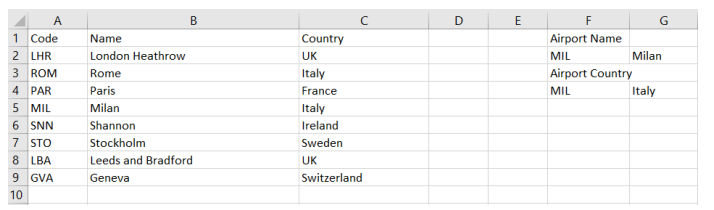

# Exam Questions — The Systems Life Cycle
**5. The Systems Life Cycle** · Cambridge (CIE) IGCSE ict (0417 & 0983)
> Source: [https://www.savemyexams.com/igcse/ict/cie/21/topic-questions/](https://www.savemyexams.com/igcse/ict/cie/21/topic-questions/) · 25 questions across 1 sets

## Exam Questions (25 questions)

### Q1 — medium — 4 marks

**Q1** [4 marks]

**Tick (✓)** the most appropriate type of testing to match the statements below.

|   | Alpha (✓) | Beta (✓) | User Acceptance (✓) |
|---|---|---|---|
| Testing is carried out by the software development team. |   |   |   |
| Testing is performed by a limited number of external users. |   |   |   |
| Testing confirms the system meets the user requirements. |   |   |   |
| Testing identifies bugs before the software is released to the public. |   |   |   |

### Q2 — medium — 1 marks

**Q2** [1 mark]

A shopkeeper sells fruit and has created a table containing the name of the fruit, its bar code number and an image of the bar code.

Part of the table is shown.

**State **and describe **two **validation checks that could be used for the bar code number.

### Q3 — hard — 5 marks

**Q3** [5 marks]

**Describe **the benefits and drawbacks of using parallel running.

*Source: June 2024 0417/13 Q11B*

### Q4 — easy — 2 marks

**Q4** [2 marks]

Parallel running can be used as a strategy to implemented new systems.

**Describe **what is meant by parallel running.

*Source: June 2024 0417/13 Q11A*

### Q5 — medium — 8 marks

**Q5** [5 marks]

A company with many branches is implementing a new system. The manager is planning to implement the new system either by pilot changeover or parallel running.

**Compare **pilot changeover and parallel running.

*Source: June 2024 0417/12 Q11A*

**Q5** [3 marks]

When the system is implemented, technical documentation is produced.

State **three **components that would be included in the technical documentation.

*Source: June 2024 0417/12 Q11B*

### Q6 — medium — 8 marks

**Q6** [2 marks]

Virtual reality can be used when training for sports.

State **two **other uses of virtual reality.

*Source: June 2024 0417/11 Q8A*

**Q6** [6 marks]

**Discuss **the impact of virtual reality on everyday life.

*Source: June 2024 0417/11 Q8B*

### Q7 — easy — 2 marks

**Q7** [2 marks]

The database includes primary and foreign keys.

A medical ID number is used as the primary key in the database. Examples of the medical ID number include:

556 442 8483

450 557 7104

485 777 3456

State **two **validation checks that could be used to check the medical ID number.

*Source: June 2024 0417/11 Q13D(I)*

### Q8 — easy — 2 marks

**Q8** [1 mark]

A new patient is attending a medical centre. He completes a form with his details and gives this to the secretary who enters the details into a database.

The age of the patient is stored on the patient's medical record.

**Explain **why it is not sensible to store the age of the patient in the database.

*Source: June 2024 0417/11 Q13C(II)*

**Q8** [1 mark]

**Explain **what change could be made to the database to solve this problem.

*Source: June 2024 0417/11 Q13C(II)*

### Q9 — easy — 1 marks

**Q9** [1 mark]

**Complete **the following sentence.

A conversation between a systems analyst and a member of staff that is part of the analysis is called...

*Source: June 2024 0417/11 Q2D*

### Q10 — hard — 6 marks

**Q10** [6 marks]

The owner of Tawara Hotels is planning a new computerised booking system. There are ten Tawara Hotels throughout the world. The current booking system allows people to book rooms in any of 7 the Tawara Hotels. He has employed a systems analyst to research the current system and then install the new system.

Before the new booking system is installed, the systems analyst has to decide on a method of implementation. One method of implementation is pilot running.

**Name** two other methods of implementation and **describe **two benefits of each.

*Source: Nov 2021 0417/12 Q7C*

### Q11 — hard — 6 marks

**Q11** [6 marks]

When a system is being planned, analysis needs to take place.

Questionnaires and interviews are examples of methods of researching existing systems.

**Evaluate**, by weighing up the advantages and disadvantages, each of these methods.

*Source: Nov 2021 0417/13 Q8*

### Q12 — hard — 6 marks

**Q12** [6 marks]

Different methods can be used to analyse a system.

**Discuss** the benefits and drawbacks of analysing a system by observing staff rather than looking at the current systems documentation.

*Source: June 2022 0417/12 Q12*

### Q13 — hard — 6 marks

**Q13** [6 marks]

A system can be analysed using different methods.

**Discuss **the advantages and disadvantages of analysing a system by interviewing staff rather than using questionnaires.

*Source: June 2022 0417/11 Q11*

### Q14 — hard — 3 marks

**Q14** [3 marks]

A developer is writing a program to record the results of examinations taken by students in a school.

The program will be tested to make sure that it works.

There are three types of test data that can be used to test a system: normal, abnormal and extreme.

**Explain **what is meant by **normal**, **abnormal **and **extreme **test data.

*Source: Specimen 2023 0417/01 Q7A*

### Q15 — medium — 7 marks

**Q15** [3 marks]

The owner of Tawara Hotels is planning a new computerised booking system. There are ten Tawara Hotels throughout the world. The current booking system allows people to book rooms in any of 7 the Tawara Hotels. He has employed a systems analyst to research the current system and then install the new system.

When analysing the current booking system, the systems analyst must identify the user requirements.

**Explain **why it is important for the systems analyst to do this.

*Source: June 2021 0417/12 Q7A*

**Q15** [4 marks]

**Tick (✓)** the relevant stage of the systems life cycle for each of the following activities.

| Activity | Analysis (✓) | Development and testing (✓) | Evaluation (✓) |
|---|---|---|---|
| Identifying the problems with the current system |   |   |   |
| Comparing the solution with the original task requirements |   |   |   |
| Create the file structure |   |   |   |
| Identify limitations to the new system and improvements to be made |   |   |   |

*Source: June 2021 0417/12 Q7B*

### Q16 — medium — 4 marks

**Q16** [4 marks]

**Tick (✓)** the most appropriate method of implementation to match the statements below.

|   | Direct (✓) | Parallel (✓) | Pilot (✓) |
|---|---|---|---|
| All of the benefits are immediate. |   |   |   |
| If the new system fails the whole of the old system is still operational. |   |   |   |
| This is the cheapest implementation method. |   |   |   |
| The system is implemented in one branch of the company. |   |   |   |

*Source: June 2021 0417/11 Q10*

### Q17 — medium — 2 marks

**Q17** [2 marks]

A school is planning to change the way it reports back to parents about their child’s academic progress. They plan to produce a mail merged document and then email this to parents.

They have created a spreadsheet which shows the pupil’s name, target, attainment and effort levels for Maths and the Science subjects.

Part of the spreadsheet is shown.

The attainment levels range from 1 to 9 and the effort levels range from 1 to 3. Before teachers are allowed to enter data, the spreadsheet needs to be tested.

**Write **down one example of** extreme data** to test the attainment field and **one **example of **abnormal data** to test the effort field.

*Source: Nov 2021 0417/12 Q10B*

### Q18 — medium — 4 marks

**Q18** [4 marks]

Rockit Motors recently created a new car sales website. The website uses internet shopping features. Customers can ask questions of the virtual salespeople on the website, and then purchase the car on the website.

Before the website became operational it needed to be tested. The web designer created a test plan including module and whole system testing.

**Explain **the difference between module and whole system testing.

*Source: Nov 2021 0417/12 Q7C*

### Q19 — medium — 6 marks

**Q19** [6 marks]

Tawara Tours has created a new online booking system to allow customers to book holidays. The system was written using modules.

**Describe **how the new system could be tested prior to it becoming operational.

*Source: Nov 2021 0417/11 Q5A*

### Q20 — medium — 2 marks

**Q20** [2 marks]

The manager of a cinema has purchased a new booking system. There are 26 rows in the cinema with 20 seats on a row. Each seat is identified by a unique ID. The seat ID consists of the row letter 5 followed by the position of the seat on the row. An example of the seat on row F position 12 would be F12.

He is setting up a test plan to test the system.

**Write **down **one **example of each of the following types of test data. The answers must be different in each case.

**Normal**

**Abnormal**

*Source: June 2022 0417/13 Q5A*

### Q21 — medium — 3 marks

**Q21** [3 marks]

A student is creating a spreadsheet of airports for a project.

The formula in G2 is:

=VLOOKUP(F2,A2:B9,2,0)

Before the spreadsheet can be used, data needs to be entered to test the spreadsheet.

There are three types of test data: **normal**, **abnormal **and **extreme**.

**Explain **what is meant by these three types of test data.

*Source: June 2022 0417/12 Q9B*

### Q22 — easy — 2 marks

**Q22** [2 marks]

RockIT Airlines representatives use a computer booking system to book flights for customers.

A representative from the airline types in the customer reference number, the number of passengers, departure time, departure date, departure airport and the destination airport.

A customer is planning to take a flight from London Heathrow Airport. The representative types in a code LHR for London Heathrow Airport. One of the reasons for using a code for the airport is to improve data accuracy.

Describe **two **other advantages of using a code rather than typing out the full name.

*Source: June 2021 0417/11 Q13A*

### Q23 — easy — 2 marks

**Q23** [2 marks]

A library system has two tables; one for borrowers and one for books. Extracts from these tables are shown.

| Borrower_ID | Borrower_name | Contact_telephone | Contact_email |
|---|---|---|---|
| 5404 | Susan Stranks | 01632 960321 | [rockit@cambridgeinternational.org](mailto:rockit@cambridgeinternational.org) |
| 9867 | Fei Hong Zhao | 07700 900222 | [tawara@cambridgeinternational.org](mailto:tawara@cambridgeinternational.org) |

**Borrowers table**

| Book_ID | ISBN | Name_of_book | Author_of_book | Date_published | Borrower_ID | Date_due_back |
|---|---|---|---|---|---|---|
| 1 | 0859550153 | Bird of Prey | David James | 1977 | 5404 | 27/10/2021 |
| 34 | 3301028345 | The Fifth Man | Colin Turner | 1998 | 9324 | 05/10/2021 |
| 35 | 4237681321 | A View of the Temple | Yu Yan Zhang | 2017 | 8854 | 07/10/2021 |
| 54 | 4237681321 | A View of the Temple | Yu Yan Zhang | 2017 | 5404 | 27/10/2021 |

**Books table**

The data type for `Contact_telephone` has been set as text.

**Explain **why this field has been set to text rather than integer.

*Source: Nov 2021 0417/13 Q4C*

### Q24 — easy — 4 marks

**Q24** [4 marks]

**Tick (✓)** whether the following advantages of analysing a system refer to looking at existing paperwork, observation or questionnaires.

|   | Looking at existing paperwork (✓) | Observation (✓) | Questionnaire (✓) |
|---|---|---|---|
| This method gives the systems analyst an overall view of the system |   |   |   |
| Individuals can remain anonymous |   |   |   |
| This method allows information to be collected that cannot be obtained from any other method |   |   |   |
| This method gives the quickest analysis of the data |   |   |   |

*Source: Nov 2021 0417/11 Q4*

### Q25 — easy — 3 marks

**Q25** [3 marks]

A systems analyst has been asked to carry out an analysis of a company’s current computer system.

**State three **methods of analysing the current system.

*Source: June 2023 0417/11 Q7A*

