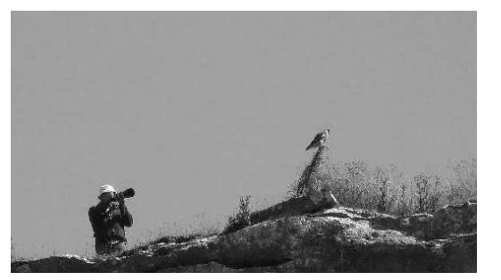
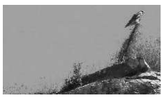

# Exam Questions — Manage Files Effectively
**8. Managing Files & Compression** · Cambridge (CIE) IGCSE ict (0417 & 0983)
> Source: [https://www.savemyexams.com/igcse/ict/cie/21/topic-questions/](https://www.savemyexams.com/igcse/ict/cie/21/topic-questions/) · 3 questions across 1 sets

## Exam Questions (3 questions)

### Q1 — medium — 4 marks

**Q1** [4 marks]

An image has been taken of a bird watcher and a bird. The original image has been saved as a jpg file type. You have been asked to remove parts of the image to just show the bird and to save it as a png file type to become the new image.

Original image

New image

**Explain **the differences between a **jpg **and a **png **file type.

*Source: June 2022 0417/13 Q11B*

### Q2 — hard — 6 marks

**Q2** [6 marks]

gif and jpg file formats are used to store images.

**Explain **the differences between the two file formats.

*Source: June 2023 0417/11 Q13B*

### Q3 — easy — 2 marks

**Q3** [2 marks]

gif and jpg file formats are used to store images.

**Give **one reason for using each of the file formats.

Each of your reasons **must **be different.

*Source: June 2023 0417/11 Q13A*

