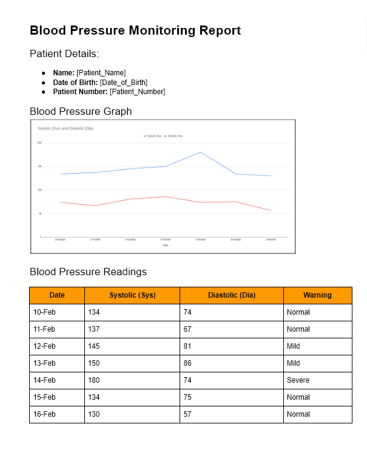
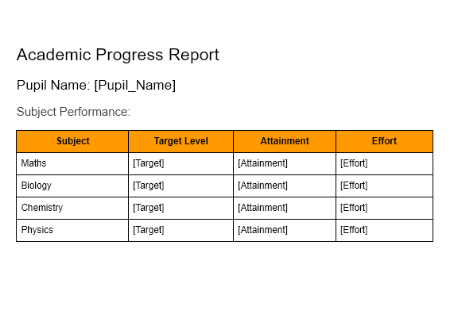

# Mark Schemes — Document Production
**9. Working with Documents** · Cambridge (CIE) IGCSE ict (0417 & 0983)

## Exam Questions (9 questions)

### Q1
Examples of the features that should be considered for the design include:

Any **four **of the following:

- Text size should be easy/large enough to read **[1 mark]**
- Font style should be easy to read **[1 mark]**
- Make good use of white space so data fills the certificate **[1 mark]**
- Enough space in which to enter the answers in the text boxes **[1 mark]**
- Make good use of colours to make it easy to read **[1 mark]**
- Use an organised layout to make it easy to read **[1 mark]**
- All information needs to be clearly visible **[1 mark]**
- Use of tick boxes to make data entry quicker/easier **[1 mark]**

### Q2
The student could create a new row and insert the picture by:

Any **four **of the following:

Max **three **from:

- Highlight Scientific name row **[1 mark]**
- Right click select insert **[1 mark]**
- Click Insert new row below **[1 mark]**

**OR**

- Highlight Pouched row **[1 mark]**
- Right click select insert **[1 mark]**
- Click Insert new row above **[1 mark]**

**AND **max **three **from:

- Click on right hand cell in the row **[1 mark]**
- Click insert…pictures Locate/select picture **[1 mark]**
- Insert the picture **[1 mark]**
- Format the picture **[1 mark]**

### Q3

*Example Document Layout*

> **[mark-scheme]**
> Any **five **of the following:
> 
> - Include Name, Date of birth Include Patient Number **[1 mark]**
> - Graph is displayed  **[1 mark]**
> - Must look like a hard copy report **[1 mark]**
> - Fills the report  **[1 mark]**
> - Suitable title at the top of the page title must relate to blood pressure readings  **[1 mark]**

### Q4
A corporate house style is required to:

Any **four **of the following:

- Ensures consistency across all documents **[1 mark]**
- Lets people know that the stationery/documents belong to the same Motor company **[1 mark]**
- Easier to recognise documents from the same company **[1 mark]**
- To reduce the time spent in setting up and formatting documents **[1 mark]**
- To reduce cost of setting up and formatting documents **[1 mark]**
- To reduce the risk of errors e.g. misspellings, logos omitted, etc. **[1 mark]**

### Q5

*Example Document Layout*

> **[mark-scheme]**
> Any **six **of the following:
> 
> - Name is clearly shown at the top of the data **[1 mark]**
> - Name must be on a line on its own **[1 mark]**
> - Information fills the report – Is there a large space at the bottom or side; use professional judgement **[1 mark]**
> - Suitable title at the top of the page above the name – title must relate academic progress/report **[1 mark]**
> - Must be a mail merge template or a document, a letter **[1 mark]**
> - The exact wording must be used for the following **[1 mark]**
> - Target level All four subjects: Maths, Biology, Chemistry and Physics 
> Attainment and Effort **[1 mark]**

### Q6
The table was created, without the text being entered by hand by:

Any **four **of the following:

- Load the document **[1 mark]**
- Highlight the text **[1 mark]**
- Click Insert then Table **[1 mark]**
- Select Convert text to table **[1 mark]**
- Click on 2 columns **[1 mark]**
- Click separate by : **[1 mark]**
- Click ok **[1 mark]**

### Q7
The student could create a table by:

Any **two **of the following:

- Select the position for the table **[1 mark]**
- Click on Insert then table **[1 mark]**
- Select/type in 2 columns and 5 rows **[1 mark]**
- Type in the data **[1 mark]**

### Q8
A corporate house style can be explained as:

Any **two** of the following:

- A set of rules **[1 mark]**
- House style states how all documents and written communication should be formatted **[1 mark]**
- Consistency across all documents in the portfolio of the company **[1 mark]**
- Used to promote the company **[1 mark]**
- Controls how the colours/font style/font size/font type/position of logo/justification of text/position and style of address details to be used **[1 mark]**
Headers and footers are needed to:

Any **two **of the following:

- To display descriptive information on each page **[1 mark]**
- Helps the user to navigate through the document **[1 mark]**
- Used for repeatable items **[1 mark]**
- Headers and footers can be on every page **[1 mark]**
- Maintains consistency in the document **[1 mark]**
- Saves time rather than writing the same things on each page **[1 mark]**

### Q9
Examples of the formatting features used in the paragraph include:

Any **four **of the following:

- Bold **[1 mark]**
- Full justification **[1 mark]**
- Highlight **[1 mark]**
- Underlined **[1 mark]**
- Italic **[1 mark]**
