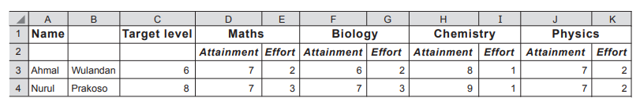
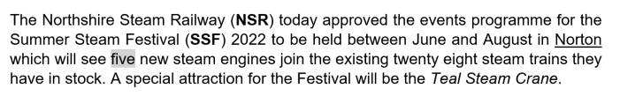

# Exam Questions — Document Production
**9. Working with Documents** · Cambridge (CIE) IGCSE ict (0417 & 0983)
> Source: [https://www.savemyexams.com/igcse/ict/cie/21/topic-questions/](https://www.savemyexams.com/igcse/ict/cie/21/topic-questions/) · 9 questions across 1 sets

## Exam Questions (9 questions)

### Q1 — medium — 4 marks

**Q1** [4 marks]

A college principal has decided that students can use mobile devices to take notes in lessons. Some students use laptop computers whilst others use smartphones.

There are safety issues related to bringing laptop computers into the college. The Network Manager has decided to produce a paper-based certificate for students to prove that their laptop computer is safe to use.

**Describe **the main features that should be considered for the design of this certificate

*Source: June 2024 0417/12 Q7B*

### Q2 — medium — 4 marks

**Q2** [4 marks]

A search engine can be used to find information on the internet.

The student plans to create a table, using word processing software, to display the information he has found out about the animal.

The completed table will look like this:

| **Name of animal** | Tiger quoll |
|---|---|
| **Scientific name** | Dasyurus maculatus |
| **Pouched** | No |
| **Habitat** | Australia |
| **Conservation status** | Threatened |

The student has saved a picture from the internet of a tiger quoll.

**Explain **how he could create a new row above the Pouched row and place the picture into the right-hand cell of this new row.

*Source: June 2021 0417/12 Q12D*

### Q3 — medium — 5 marks

**Q3** [5 marks]

A doctor measures the blood pressure of some of his patients regularly. The patients take home a blood pressure machine and record their results on a spreadsheet which the doctor has created. Part of the spreadsheet is shown.

At the end of the month the doctor needs to produce a hard copy document showing information about a patient: their name, date of birth and patient number, as well as data and the graph from the spreadsheet.

**Design **a suitable document layout. The document must have appropriate spacing.

*Source: Nov 2021 0417/13 Q12E*

### Q4 — medium — 4 marks

**Q4** [4 marks]

Rockit Motors has opened a car store in a shopping mall.

Customers can test drive the cars they are planning to purchase using virtual reality systems within the store.

The manager of Rockit Motors has created many different types of documents including letters and memos for the company. Each of them is produced using its corporate house style.

**Explain **why corporate house styles are required.

*Source: Nov 2021 0417/13 Q9C*

### Q5 — medium — 6 marks

**Q5** [6 marks]

A school is planning to change the way it reports back to parents about their child’s academic progress. They plan to produce a mail merged document and then email this to parents.

They have created a spreadsheet which shows the pupil’s name, target, attainment and effort levels for Maths and the Science subjects.

Part of the spreadsheet is shown

**Design **a suitable document layout to display the information of one pupil. The name of the pupil must be clearly shown separated from the rest of the data. It must have appropriate spacing. Do not include the pupil’s data.

*Source: Nov 2021 0417/12 Q10A*

### Q6 — medium — 4 marks

**Q6** [4 marks]

A student is working on a project on the World Games. He has produced some information but has decided to produce a second layout including a table. The original layout and the new layout are shown.

*2021 World Games*

*This will be the 11th World Games, a major international multi-sport event, for sports, or disciplines within a sport, that were not contested in the Olympic Games.*

*Dates: Thu, 15 Jul 2021 – Sun, 25 Jul 2021 *
*Location: Legion Field, Birmingham, Alabama, United States *
*Host city: Birmingham, Alabama, United States *
*Opening ceremony: July 15 *
*Closing ceremony: July 25 *
*Main venue: The New Birmingham Stadium*

**The original layout**

**2021 World Games**

This will be the 11th World Games, a major international multi-sport event, for sports, or disciplines within a sport, that were not contested in the Olympic Games.

| Dates | Thu, 15 Jul 2021 – Sun, 25 Jul 2021 |
|---|---|
| Location | Legion Field, Birmingham, Alabama, United States |
| Host city | Birmingham, Alabama, United States |
| Opening ceremony | July 15 |
| Closing ceremony | July 25 |
| Main venue | The New Birmingham Stadium |

**The new layout**

**Explain**, step by step, how the table was created, without the text being entered by hand.

*Source: Nov 2021 0417/11 Q13A*

### Q7 — easy — 2 marks

**Q7** [2 marks]

A search engine can be used to find information on the internet.

The student plans to create a table, using word processing software, to display the information he has found out about the animal.

The completed table will look like this:

| Name of animal | Tiger quoll |
|---|---|
| Scientific name | Dasyurus maculatus |
| Pouched | No |
| Habitat | Australia |
| Conservation status | Threatened |

**Explain **how the student can create a table to enter this data.

*Source: June 2021 0417/12 Q12C*

### Q8 — easy — 4 marks

**Q8** [2 marks]

A company uses corporate house style within the headers and footers in its documents.

**Explain **what is meant by corporate house style.

*Source: June 2022 0417/12 Q16A*

**Q8** [2 marks]

**Explain **why headers and footers are needed.

*Source: June 2022 0417/12 Q16B*

### Q9 — easy — 4 marks

**Q9** [4 marks]

Many word processing packages have a number of formatting features.

The paragraph below shows some of the formatting features that can be used.

**Write **down four of the formatting features that have been used in the paragraph shown.

*Source: June 2022 0417/12 Q4A*

