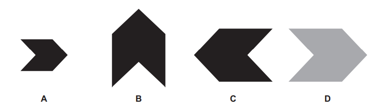
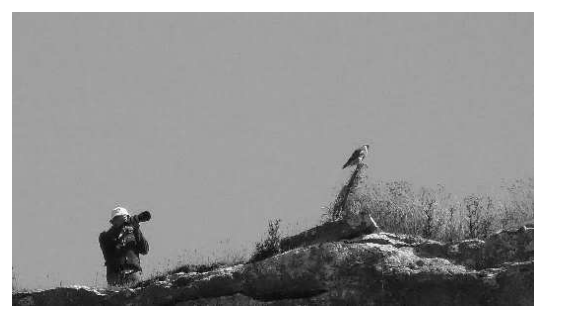
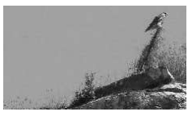
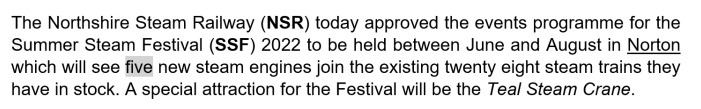
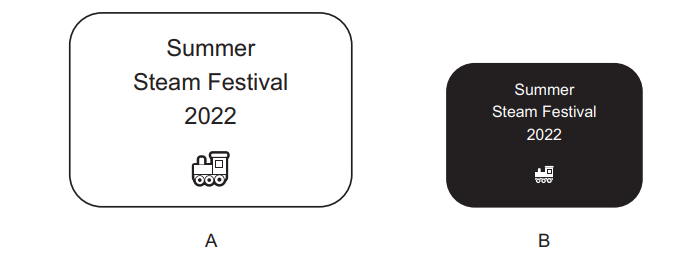

# Exam Questions — Images
**9. Working with Documents** · Cambridge (CIE) IGCSE ict (0417 & 0983)
> Source: [https://www.savemyexams.com/igcse/ict/cie/21/topic-questions/](https://www.savemyexams.com/igcse/ict/cie/21/topic-questions/) · 6 questions across 1 sets

## Exam Questions (6 questions)

### Q1 — medium — 4 marks

**Q1** [4 marks]

An image has been changed in a number of different ways.

Original image

For each of the following images **describe **the software editing technique used in order to produce the edited images shown from the original image.

Edited images

*Source: June 2021 0417/11 Q12*

### Q2 — medium — 5 marks

**Q2** [5 marks]

A student has taken a photograph of him and his friend, using a digital camera. He needs to increase the size of the image to include it on a poster.

He now wishes to edit the image to remove his friend. He edits the image by cropping it and removing part of the image.

**Describe**, step by step, how he would crop the image.

*Source: Nov 2021 0417/13 Q11B*

### Q3 — medium — 4 marks

**Q3** [4 marks]

An image has been taken of a bird watcher and a bird. The original image has been saved as a jpg file type. You have been asked to remove parts of the image to just show the bird and to save it as a png file type to become the new image.

**Original Image**

**New Image**

**Explain **the steps needed to change the original image to the new image

*Source: June 2022 0417/13 Q11A*

### Q4 — medium — 4 marks

**Q4** [4 marks]

Many word processing packages have a number of formatting features

The paragraph below shows some of the formatting features that can be used.

The logo for the Summer Steam Festival is shown and labelled A. The organisers of the event are planning to create a second logo for all their correspondence. This is shown and labelled B.

Describe the steps that have been used to transform logo A into logo B.

*Source: June 2022 0417/12 Q4B*

### Q5 — easy — 1 marks

**Q5** [1 mark]

A student has taken a photograph of him and his friend, using a digital camera. He needs to increase the size of the image to include it on a poster.

**Give **one disadvantage of increasing the size of this image.

*Source: Nov 2021 0417/13 Q11A*

### Q6 — easy — 2 marks

**Q6** [2 marks]

gif and jpg file formats are used to store images

The file size of an image can be reduced by changing the file format of the image

**State **two other ways of reducing the file size of an image.

*Source: June 2023 0417/11 Q13C*

