# Mark Schemes — Inequalities
**Algebra & Sequences** · Cambridge (CIE) IGCSE maths (0580 & 0980)

## Exam Questions (17 questions)

### Q1
Draw a circle at 3

- Fill it in as 3 is included in the inequality

Draw a line to the left

- The inequality includes numbers smaller than or equal to 3

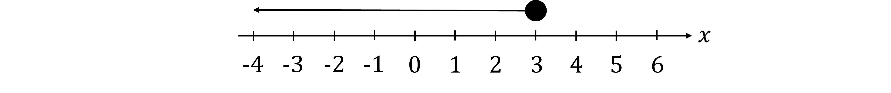

**[B1 B1]**

> **[mark-scheme]**
> **B1:** For a closed circle at 3.
> 
> **B1:** For an arrow pointing to the left.
The inequality represents numbers that are 6.5 and smaller

The largest integer is 6 but it is even

**Final answer:** **The largest odd integer is 5**

**[B1]**

### Q2
> *Add up all the known bars in the cart*

$41+19+25+13=98$

> *Subtract this from the total number of students to get the missing country*

$120-98=22$

**[M1]**

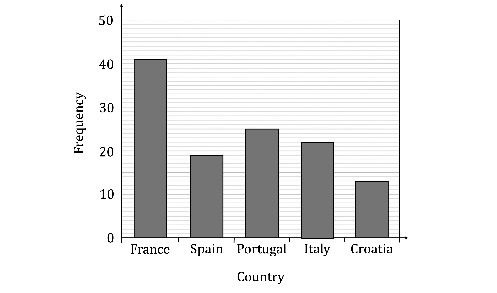

**[A1]**
> *Divide the amount of student who chose Spain by the total number of students*

$\frac{19}{120}$

**[B1]**

### Q3
> *Open circle means "not including", closed circle means "including" *

> *We assume that the missing numbers continue with the same scale, so the closed circle is above "3"*

$-4<x\leq3$

**"**$-4<x$**" or equivalent ****[1]** 
**"**$x\leq3$**" ****or equivalent**** [1]**
> *Add 2 to both sides*

$y>7$  **[1]**

** "=" or an incorrect inequality sign in the final answer will lose the mark**

### Q4
> *Recall that*
* *$3^{2}=9$* and *$( - 3 )^{2} = 9$

> *Consider the first option*
* *$2\frac{7}{8}$* is less than 3, and not negative, so when squared, will not be larger than 9*

> *Consider the second option *
*2.8 is less than 3, and not negative, so when squared, will not be larger than 9*

> *Consider the third option *
*3 squared is exactly 9, but the inequality is a >, not a ≥, so this is incorrect*

> *Consider the fourth option*

> * *$-\frac{7}{2}$* is equivalent to *$-3.5$*, and *$( - 3.5 )^{2}$* will be larger than 9*

> *So option four is correct*

** The correct option is option four, **$-\frac{7}{2}$ **[1]**

### Q5
> *It can help to represent several inequalities on a number line*

> *Draw *$x\leq7$* first*

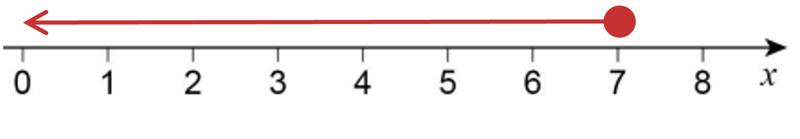

> *Next draw *$2<x\leq8$

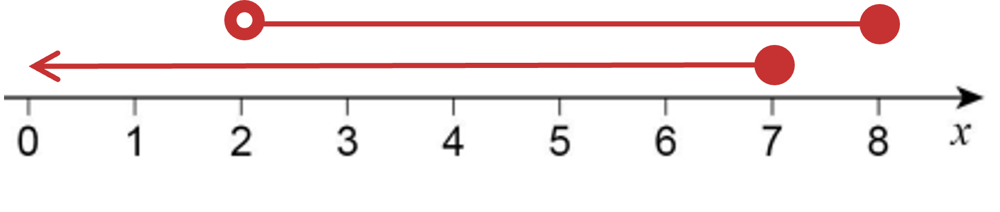

> *Lastly draw *$4\leqx\leq8.5$

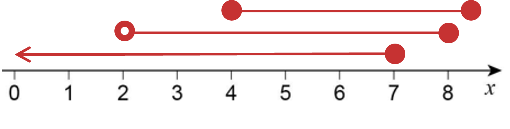

*The integers which satisfy all three inequalities are where all three inequalities overlap* 
*This includes 4 and 7, as these circles are shaded in (as they used "or equal" inequalities)*

**4, 5, 6, 7**** ****[1]**

### Q6
$<$ *and*$>$*are represented by open circles on a number line*
* *$\leq$* and *$\geq$* are represented by open circles on a number line*

> * *

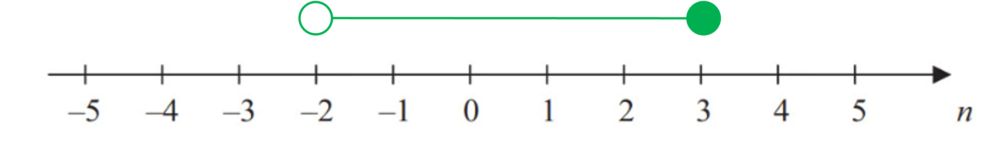

**line joining; shaded circle at 3...**** [1]**
 **...and unshaded circle at −2 ****[1]**

### Q7
> *Open circle means "not including", closed circle means "including"*

$-3<x\leq4$

**"**$-3<x$**" or equivalent ****[1]**
 **"**$x\leq4$**" ****or equivalent**** [1]**

### Q8
$<$ *and*$>$*are represented by open circles on a number line.*
* *$\leq$* and *$\geq$* are represented by open circles on a number line.*

> *There is an open circle at -4 so we are looking for *$-4<x$*. *
*This rules out options 1 and 2.*

> *There is a closed circle at 5 so we are looking for *$x\leq5$*. *
*This rules out option 3.*

**The correct option is option four, **$-4<x\leq5$** [1]**

### Q9
> *"*$n$* is an integer" means *$n$* is a whole number*

> *"*$-2\leqn$*" means  *$n$* includes *$-2$

> *"*$n<3$*" means *$n$* does **not** include  3*

**−2, -1, 0, 1, 2**** ****[2] **

**Any 4 with no repeats or extras ****[1]**** **
**Fully correct ****[1]**
> *To show '≤' on a number line use a solid circle (at 1). *
*To show that all values of y (less than or equal to 1) are valid, draw a line to the appropraite end of the diagram and draw an arrow.*

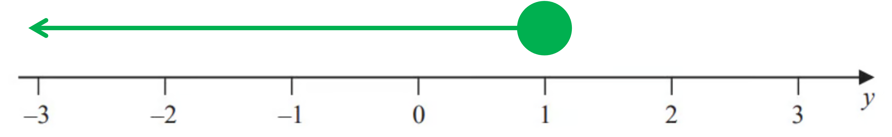

**[1]**

### Q10
> *< and > are represented by open circles on a number line*
* ≤ and ≥  are represented by solid circles on a number line*

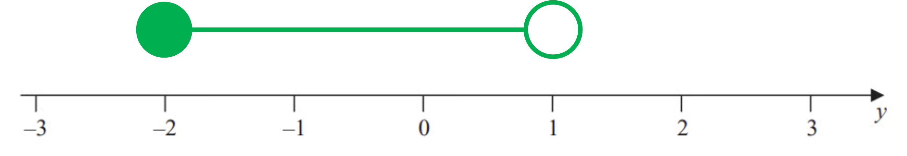

**Shaded circle at -2 or unshaded at 1 ****[1]** 
**Fully correct ****[1]**
*An **integer** is a whole number (positive or negative and including zero).*
 *Looking at the inequality signs, -3.4 is **not** included (and is not an integer anyway), 2 **is** included.* 
*So we need to list **all** the integers from -3 to 2 **inclusive.*

**-3, -2, -1, 0, 1, 2 **
**5 correct values ****[1]****  **
**All correct ****[1]**

### Q11
$<$ *and*$>$*are represented by open circles on a number line*

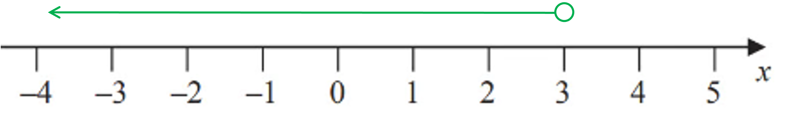

**unshaded circle at 3**** [1]** 
**arrowed line going left from 3 ****[1]**

### Q12
> *It can be helpful to represent the inequalities on a number line*

> *Draw *$x\leq8$* first*

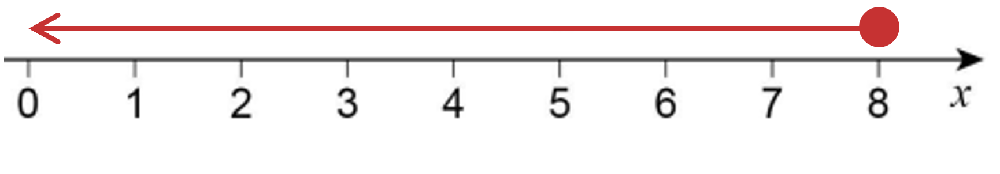

> *Then draw *$x>2$

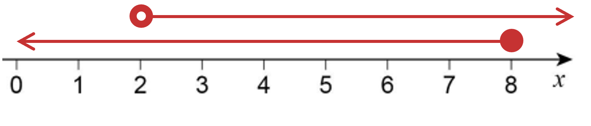

> *Lastly draw *$x>3$

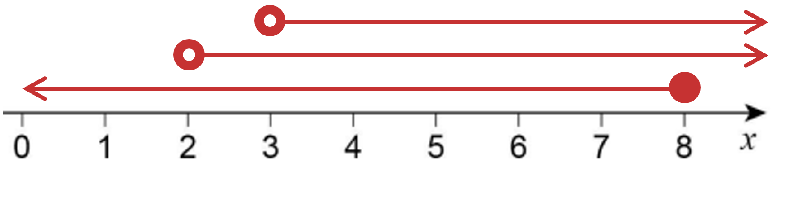

*The integers which satisfy all of these inequalities are the numbers where all three lines overlap* 
*This does not include 3, as it is a > inequality (empty circle)*

**4, 5, 6, 7, 8** **[1]**

### Q13
> *"*$n$* is an integer" means *$n$* is a whole number*

> *"*$-3<n$*" means  *$n$* does **not **include *$-3$

> *"*$n\leq1$*" means *$n$* **does** include 1*

**−2, −1, 0, 1**** ****[2]**

** ****including −3, or missing off one number loses one mark missing more than one number, or including more than one additional number scores no marks**

### Q14
> *"*$m$* is an integer" means *$m$* is a whole number*

> *"*$-2<m$*" means *$m$* does **not** include *$-2$

> *"*$m\leq3$*" means *$n$* includes *$3$

** −1, 0, 1, 2, 3**** ****[2] **

**including −2, or missing off one number, loses a mark missing more than one number, or including more than one additional number scores no marks**

### Q15
> *Open circles represent > and < on a number line. *
*An arrow indicates an open ended (infinite) inequality.*

$x>-3$* ***[1]**

### Q16
> *"*$y$* is an integer" means *$y$* is a whole number*

> *"*$-5<y$*" means  *$y$* does **not** include *$-5$

> *"*$y\leq0$*" means *$y$* includes *$0$

**−4, −3, −2, −1, 0**** ****[2] **

**including −5, or missing off one number, loses a mark missing more than one number, or including more than one additional number scores no marks**

### Q17
> *"*$n$* is an integer" means *$n$* is a whole number*

> *"*$-1\leqn$*" means  *$n$* includes *$-1$

> *"*$n<4$*" means *$n$* does **not** include  *$4$

**−1, 0, 1, 2, 3**** ****[2] **

**including 4, or missing off one number loses one mark missing more than one number, or including more than one additional number scores no marks**
