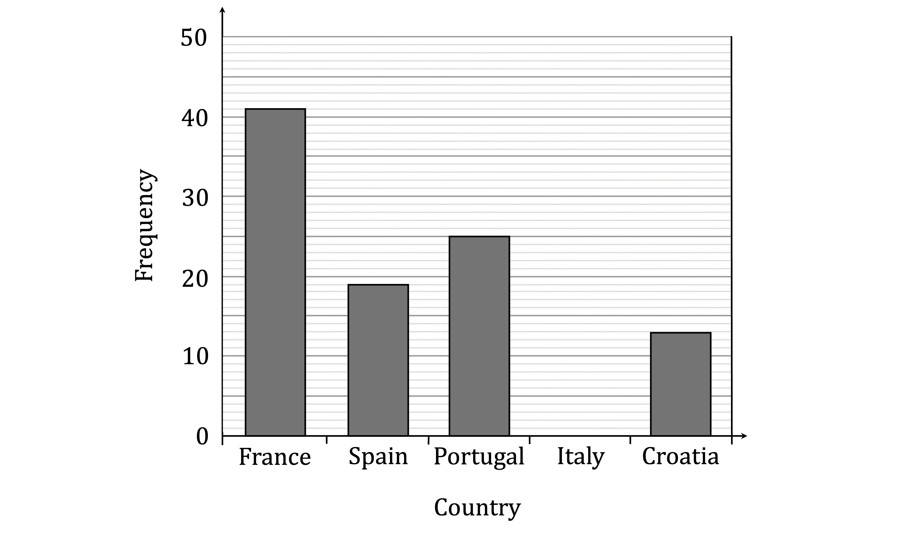
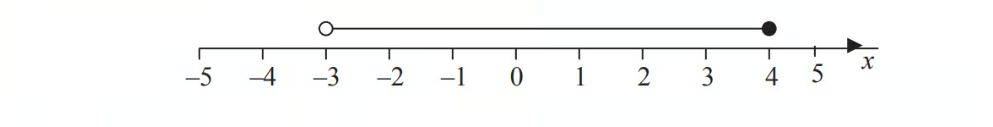
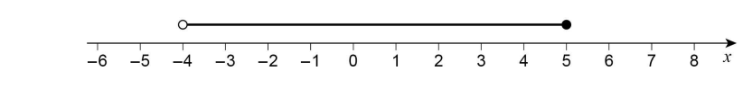
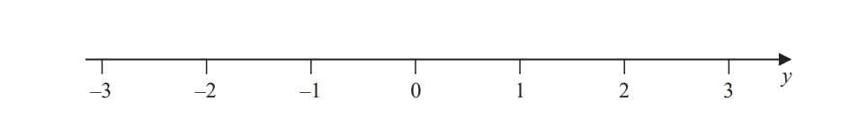
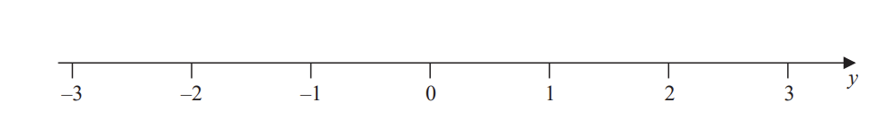

# Exam Questions — Inequalities
**Algebra & Sequences** · Cambridge (CIE) IGCSE maths (0580 & 0980)
> Source: [https://www.savemyexams.com/igcse/maths/cie/25/core/topic-questions/](https://www.savemyexams.com/igcse/maths/cie/25/core/topic-questions/) · 17 questions across 1 sets

## Exam Questions (17 questions)

### Q1 — medium — 3 marks

**Q1** [2 marks]

Represent the inequality $x\leq3$ on the number line.

**Q1** [1 mark]

Write down the largest odd integer that satisfies the inequality $y\leq6.5$.

### Q2 — easy — 3 marks

**Q2** [2 marks]

120 students are asked about their favourite country to visit in Europe, out of France, Spain, Portugal, Italy, and Croatia.

Complete the bar chart above.

**Q2** [1 mark]

A student is selected at random.

Write down the probability that the student chooses Spain as their favourite.

### Q3 — hard — 3 marks

**Q3** [2 marks]

Write down the inequality shown in the diagram.

*Source: November 2012 1MA0/2H Q8B*

**Q3** [1 mark]

Solve        $y-2>5$

*Source: November 2012 1MA0/2H Q8C*

### Q4 — hard — 1 marks

**Q4** [1 mark]

$m^{2}>9$

Circle the possible value of $m$.

| $2\frac{7}{8}$ | 2.8 | 3 | $-\frac{7}{2}$ |
|---|---|---|---|

*Source: Nov 2021 8300/3H Q17*

### Q5 — hard — 1 marks

**Q5** [1 mark]

List all of the integers which satisfy **all three** of the following inequalities.

$x\leq7$

$2<x\leq8$

$4\leqx\leq8.5$

### Q6 — hard — 2 marks

**Q6** [2 marks]

`negative 2 space less than space n space less-than or slanted equal to 3`

Represent this inequality on the number line.

*Source: June 2013 1MA0/1H Q14A*

### Q7 — hard — 2 marks

**Q7** [2 marks]

Here is an inequality, in $x$, shown on a number line.

Write down the inequality.

*Source: November 2014 1MA0/1H Q5B*

### Q8 — medium — 1 marks

**Q8** [1 mark]

Circle the inequality shown by the diagram.

| `– 4 space less-than or slanted equal to space x space less than space 5` | `– 4 space less-than or slanted equal to space x space less-than or slanted equal to space 5` | $--4<x<5$ | `– 4 space less than space x space less-than or slanted equal to space 5` |
|---|---|---|---|

*Source: Nov 2017 8300/3H Q1*

### Q9 — medium — 3 marks

**Q9** [2 marks]

$n$ is an integer. 
Write down all the values of $n$ such that`space – 2 space less-than or slanted equal to space n space less than space 3`

*Source: Jan 2022 4MA1/1HR Q1A*

**Q9** [1 mark]

On the number line, represent the inequality `y space less-than or slanted equal to space 1`

*Source: Jan 2022 4MA1/1HR Q1B*

### Q10 — medium — 4 marks

**Q10** [2 marks]

On the number line, show the inequality `– 2 space less-than or slanted equal to space y space less than space 1`

*Source: Jan 2021 4MA1/1HR Q3A*

**Q10** [2 marks]

$n$ is an integer.

Write down all the values of $n$ that satisfy `– 3.4 space less than space n space less-than or slanted equal to space 2`

*Source: Jan 2021 4MA1/2H Q3B*

### Q11 — medium — 2 marks

**Q11** [2 marks]

Show the inequality $x<3$ on the number line below

*Source: November 2016 1MA0/1H Q10A*

### Q12 — medium — 1 marks

**Q12** [1 mark]

List all of the integers which satisfy **all three** of the following inequalities.

$x\leq8$

$x>2$

$x>3$

### Q13 — easy — 2 marks

**Q13** [2 marks]

`negative 3 space less than space n space less-than or slanted equal to space 1`

$n$ is an integer.

Write down all the possible values of $n$.

*Source: March 2013 1MA0/2H Q12A*

### Q14 — easy — 2 marks

**Q14** [2 marks]

$m$ is an integer such that  `long dash 2 space less than space m space less-than or slanted equal to space 3`

Write down all the possible values of $m$.

*Source: June 2012 1MA0/2H Q10A*

### Q15 — easy — 1 marks

**Q15** [1 mark]

Write down the inequality shown on the number line.

*Source: June 2019 4MA1/2HR Q1A*

### Q16 — easy — 2 marks

**Q16** [2 marks]

`negative 5 space less than space y space less-than or slanted equal to 0`

$y$ is an integer.

Write down all the possible values of $y$.

*Source: June 2014 1MA0/2H Q13A*

### Q17 — easy — 2 marks

**Q17** [2 marks]

$n$ is an integer.

`negative 1 space less-than or slanted equal to n less than 4`

List the possible values of $n$.

*Source: November 2012 1MA0/2H Q8A*

