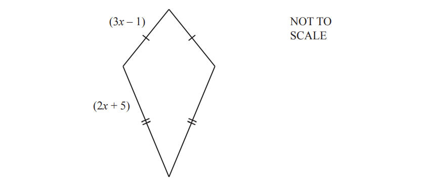
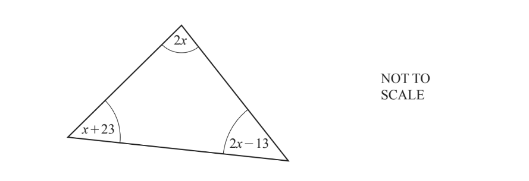
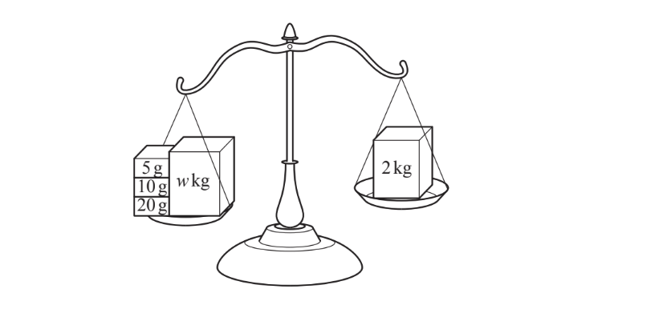
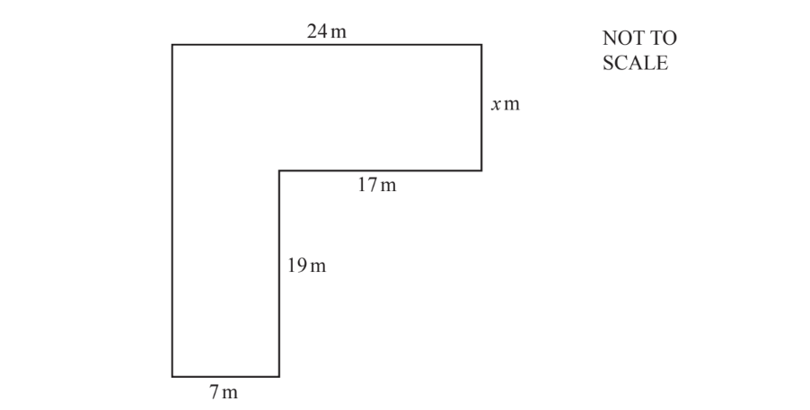

# Exam Questions — Linear Equations
**Algebra & Sequences** · Cambridge (CIE) IGCSE maths (0580 & 0980)
> Source: [https://www.savemyexams.com/igcse/maths/cie/25/core/topic-questions/](https://www.savemyexams.com/igcse/maths/cie/25/core/topic-questions/) · 22 questions across 1 sets

## Exam Questions (22 questions)

### Q1 — hard — 3 marks

**Q1** [3 marks]

Solve

$5 ( x - 1 ) = 3 x + 7$

### Q2 — hard — 2 marks

**Q2** [2 marks]

Solve the following equation.

$8T=12+5T$

### Q3 — hard — 2 marks

**Q3** [2 marks]

Esme buys 8 magazines at \$2.45 each and y cards at \$3.15 each.
Esme spends \$60.55 in total.

How many cards does she buy?

*Source: Nov 2019 0580/12 Q22B*

### Q4 — hard — 4 marks

**Q4** [4 marks]

Rovers, United and City are football teams.

Rovers scored$x$goals. 
United scored 8 goals more than Rovers. 
City scored 3 goals less than twice the number of goals scored by Rovers.

The three teams scored a total of 117 goals.

Write down and solve an equation to find the value of $x$.

$x$ = .................................................

*Source: June 2020 0580/12 Q14*

### Q5 — hard — 5 marks

**Q5** [5 marks]

In this part, all measurements are in centimetres.

The diagram shows a kite with sides $( 2 x + 5 )$ and $( 3 x - 1 )$. The perimeter of the kite is 33 cm.

Work out the length of a shorter side.

............................................ cm

*Source: Nov 2020 0580/33 Q7F*

### Q6 — hard — 5 marks

**Q6** [5 marks]

A club is arranging transport for its members.

Speedy Coaches charge \$625 plus \$15 per member.

The total cost, in dollars, for x members is given by the expression $15x+625.$

i) Sporty Coaches charge \$117 plus \$19 per member.

Write an expression for the total cost, in dollars, for $x$members.

[2]

ii) The total cost is the same for both Speedy Coaches and Sporty Coaches.

Write down an equation and solve it to find $x$.

$x$= .............................................. [3]

*Source: Specimen 2020 0580/03 Q6B*

### Q7 — hard — 4 marks

**Q7** [4 marks]

Cara has $n$ pencils. 
Alice has twice as many pencils as Cara. 
Leon has three more pencils than **Alice**. 
The three children have a total of 58 pencils.

Use this information to write down an equation and solve it to find the value of $n$.

$n$ = ...................................................

*Source: Nov 2019 0580/32 Q9D*

### Q8 — hard — 6 marks

**Q8** [6 marks]

In this part, all angles are in degrees.

i) Use the information in the triangle to write down an equation in terms of $x$.

[1]

ii) Solve this equation to find the value of $x.$

$x$= ................................................. [3]

iii) Work out the size of the smallest angle in the triangle.

[2]

*Source: June 2020 0580/33 Q7D*

### Q9 — hard — 5 marks

**Q9** [5 marks]

i) Navja weighs a parcel with mass $w$kg on her scales. She uses the masses shown to balance the scales.

Work out the value of $w$.

$w$ = ................................................. [3]

ii) Sometimes Navja uses an electronic weighing machine. The machine gives the mass, $p$ kg, of a parcel as 12.4kg, correct to the nearest 100g.

Complete this statement about the value of $p$.

.................. `less-than or slanted equal to p less than` ................... [2]

*Source: March 2020 0580/01 Q1B*

### Q10 — hard — 4 marks

**Q10** [4 marks]

The diagram shows a shape made from rectangles. 
The shape has a total area of 517m2.

Find the value of $x$.

$x=$.....................

*Source: Nov 2020 0580/11 Q6*

### Q11 — hard — 3 marks

**Q11** [3 marks]

Neelum hires a machine to clean carpets. 
It costs \$25 to hire the machine for the first day and \$9 for each extra day after the first day. 
Neelum pays a total of \$88 to hire the machine.

Work out the **total** number of days she hires the machine for.

*Source: Feb/March 2018 0580/12 Q16*

### Q12 — medium — 6 marks

**Q12** [6 marks]

Solve these equations.

i) $\frac{x}{4}=20$

$x$ = .............................................. [1]

ii) $3x-5=16$

$x$ = .............................................. [2]

iii) $5(2x+1)=27$

$x$= .............................................. [3]

*Source: June 2019 0580/31 Q9C*

### Q13 — medium — 2 marks

**Q13** [2 marks]

Solve.

$5 ( 2 x + 4 ) = 85$

$x$ = .................................................

*Source: Nov 2020 0580/32 Q9C*

### Q14 — medium — 6 marks

**Q14** [6 marks]

Solve these equations.

i) $5x=-30$

`x space equals space................................................. space left square bracket 1 right square bracket`

ii) $4x-2=28$

`x space equals space................................................. space left square bracket 2 right square bracket`

iii) $3 ( 2 x + 7 ) = 12$

`x space equals space................................................. space left square bracket 3 right square bracket`

*Source: June 2020 0580/32 Q10A*

### Q15 — medium — 5 marks

**Q15** [5 marks]

Solve these equations.

i) $\frac{x}{3}=18$

$x=$............................[1]

ii) $5x+18=8$

$x=$...............................[2]

iii) $12x-3=4x+21$

$x=$............................[2]

*Source: Nov 2020 0580/31 Q4C*

### Q16 — medium — 2 marks

**Q16** [2 marks]

Solve the equation.

$6-2x=3x$

$x$= ............................................

*Source: Nov 2020 0580/12 Q7*

### Q17 — medium — 6 marks

**Q17** [6 marks]

Solve.

i) $10x=5$

$x$ = ................................................... [1]

ii) $7x-3=2x+11$

$x$= ................................................... [2]

iii) $3 ( 2 x - 1 ) = 27$

$x$ = ................................................... [3]

*Source: Nov 2019 0580/33 Q5C*

### Q18 — easy — 4 marks

**Q18** [4 marks]

Solve these equations.

i) $x+7=15$

$x$ = ..............................................[1]

ii) $5(3x+8)=10$

$x$=.....................................[3]

*Source: Specimen 2020 0580/03 Q6A*

### Q19 — easy — 4 marks

**Q19** [2 marks]

Solve.

$8 ( w + 11 ) = 120$

$w$ = ...................................................

*Source: June 2019 0580/11 Q22A*

**Q19** [2 marks]

$\frac{x-2}{3}=3$

$x$ = ...................................................

*Source: June 2019 0580/11 Q22B*

### Q20 — easy — 2 marks

**Q20** [1 mark]

Complete these statements.

When $w=$.............................. , $10w=70.$

*Source: May/June 2018 0580/12 Q15A*

**Q20** [1 mark]

When $5x=15,12x=$.........................

*Source: May/June 2018 0580/12 Q15B*

### Q21 — easy — 2 marks

**Q21** [2 marks]

Solve.

$7x-5=16$

$x=$ ..................................

*Source: May/June 2019 0580/13 Q16*

### Q22 — easy — 2 marks

**Q22** [2 marks]

Solve the equation  $12x-7=23$

$x=$.....................................

*Source: June 2020 0580/31 Q8B*

