# Mark Schemes — Further Graphs
**Coordinate Geometry & Graphs** · Cambridge (CIE) IGCSE maths (0580 & 0980)

## Exam Questions (15 questions)

### Q1
> *Substitute *$x=-1$*, *$x=0$* and *$x=3$* into the equation *$y=7+2x-x^{2}$*. *

$y = 7 + ( 2 \times - 1 ) - ( - 1 )^{2}
 y = 4

y = 7 + ( 2 \times 0 ) - ( 0 )^{2}
 y = 7

y = 7 + ( 2 \times 3 ) - ( 3 )^{2}
 y = 4$

> *Put the values into the table in the correct places.*

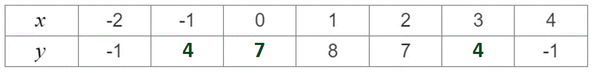

**All values correct**** ****[2] **
**1 mark for 1 or 2 correct values**
> *Plot the coordinates from part (a):*

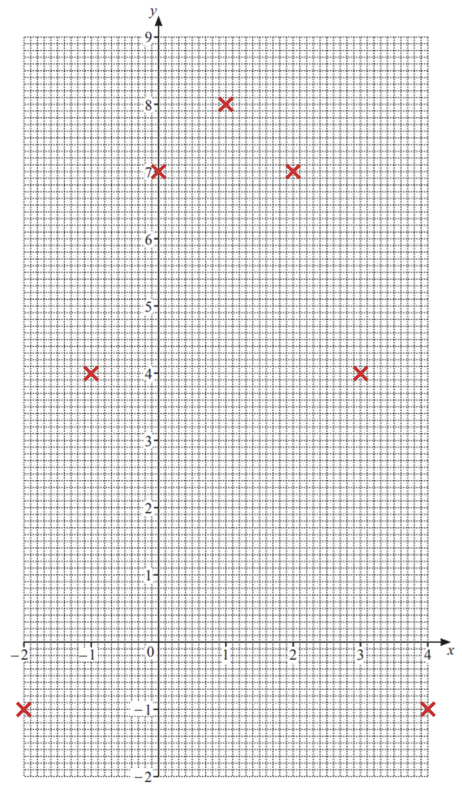

> *Then join with a smooth curve: *

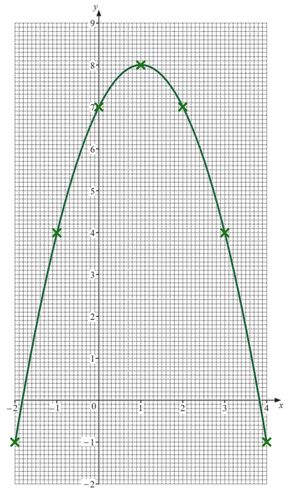

**Fully correct graph**** ****[4]**

**Final answer:** **Or 3 marks for 6 or 7 points correctly plotted **
**Or 2 marks for 4 or 5 points correctly plotted **
**Or 1 mark for 2 or 3 points correctly plotted**
> *The graph has a vertical line of symmetry where *$x=1$*.*

$x=1$* ***[1]**
> $y=0$* has been substituted into the equation of the curve.*

> *Look where the graph crosses *$y=0$* (the *$x$* axis) and read off the values.*

> * *

$x=-1.8$** ****and **$x=3.8$** ****[2] **
**1 mark for each correct value**

**Answers in the range -1.9 to -1.7 and 3.7 to 3.9 accepted**

### Q2
i) *Substitute the required values of *$x$* into the equation and evaluate.*

$x=-3:y=\frac{12}{-3}=-4$

$x=-2:y=\frac{12}{-2}=-6$

$x=-1:y=\frac{12}{-1}=-12$

$x=2:y=\frac{12}{2}=6$

$x=3:y=\frac{12}{3}=4$

$x=4:y=\frac{12}{4}=3$

> *Complete the table with these values.*

**Minimum 2 values correct**** [1]**
**Minimum 4 values correct**** [1]**
**All values correct**** [1]**

ii) *Plot the coordinates from the table onto the axes.  *

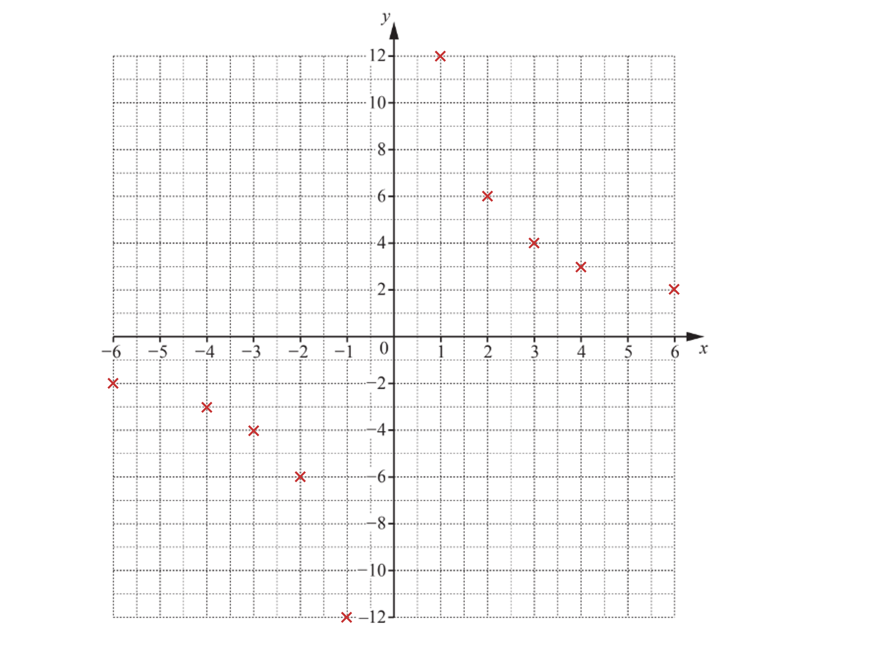

**Minimum 5 points plotted correctly**** [1]**
**Minimum 7 points plotted correctly**** [1]**
**Minimum 9 points plotted correctly**** [1]**

> *This is a reciprocal graph so connect the coordinates using two disconnected smooth curves.  *

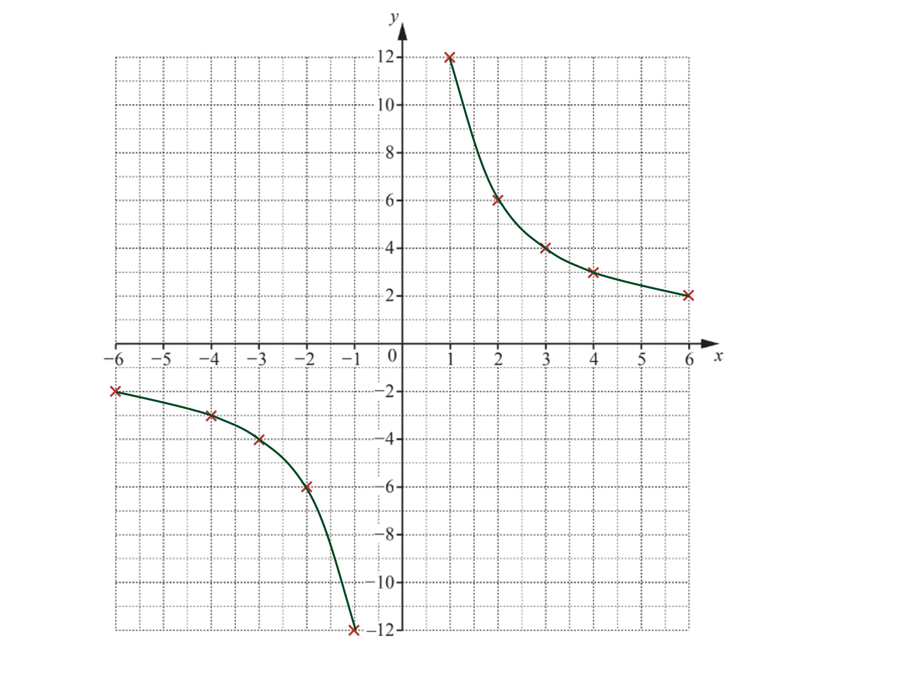

**[1]**

iii) *The line *$y=8$* is a horizontal line that crosses the *$y-$*axis at *$8$*.  *

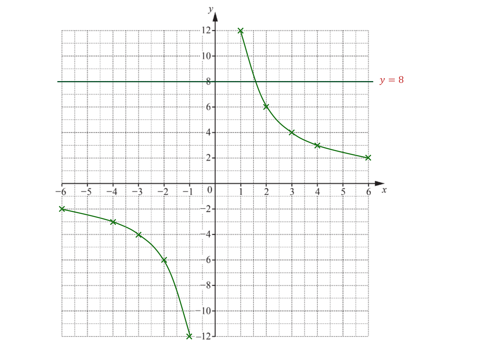

**[1]**

iv) *The solution to the given equation is the *$x-$*coordinate of the point of intersection of the two equations *$y=\frac{12}{x}$* and *$y=8$*.  *

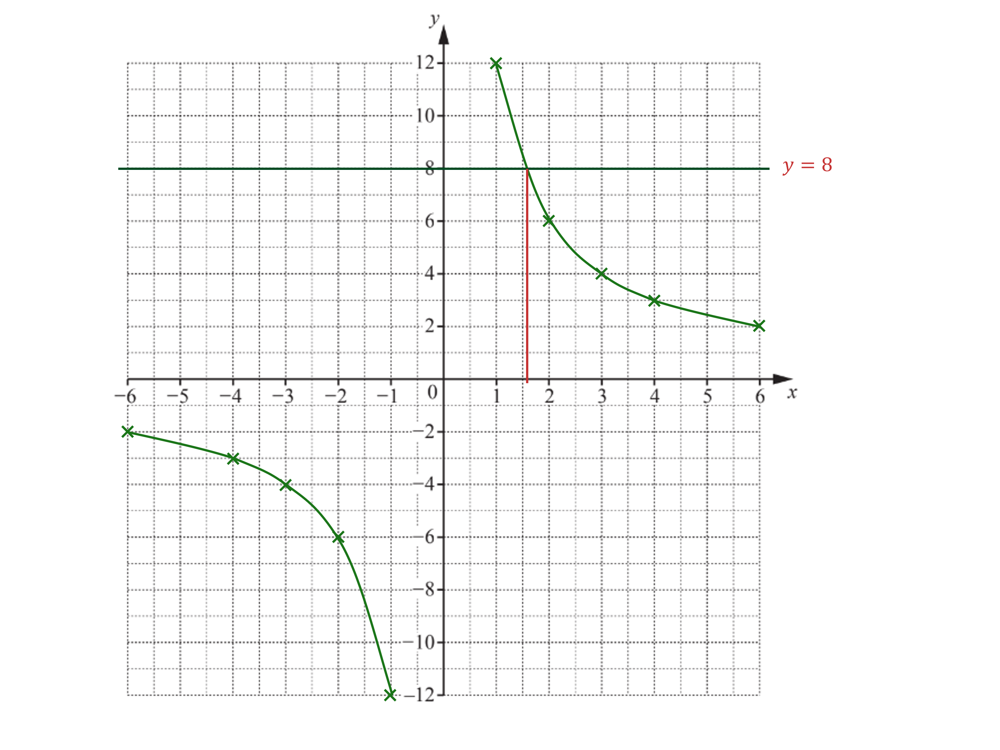

$x=1.6$ **[1]**

### Q3
> *Substituting the values into the equation, we have  *

| $x$ | -5 | -4 | -3 | -2 | -1 |   | 1 | 2 | 3 | 4 | 5 |
|---|---|---|---|---|---|---|---|---|---|---|---|
| $y$ | **Final answer:** **-1.6** | -2 | -2.7 | -4 | -8 |   | 8 | 4 | 2.7 | **Final answer:** **2** | **Final answer:** **1.6** |

**  2 correct answers**** [1] **
**3 correct answers**** [1]**
> *Plot the co-ordinates from the table in part (a) using crosses to show points clearly. *
*Join the 5 points in the first quadrant with a smooth curve. *
*Then join the 5 points in the third quadrant with a smooth curve. *

*The graph should not cross the **y** axis because *$y=\frac{8}{0}$* is undefined.*

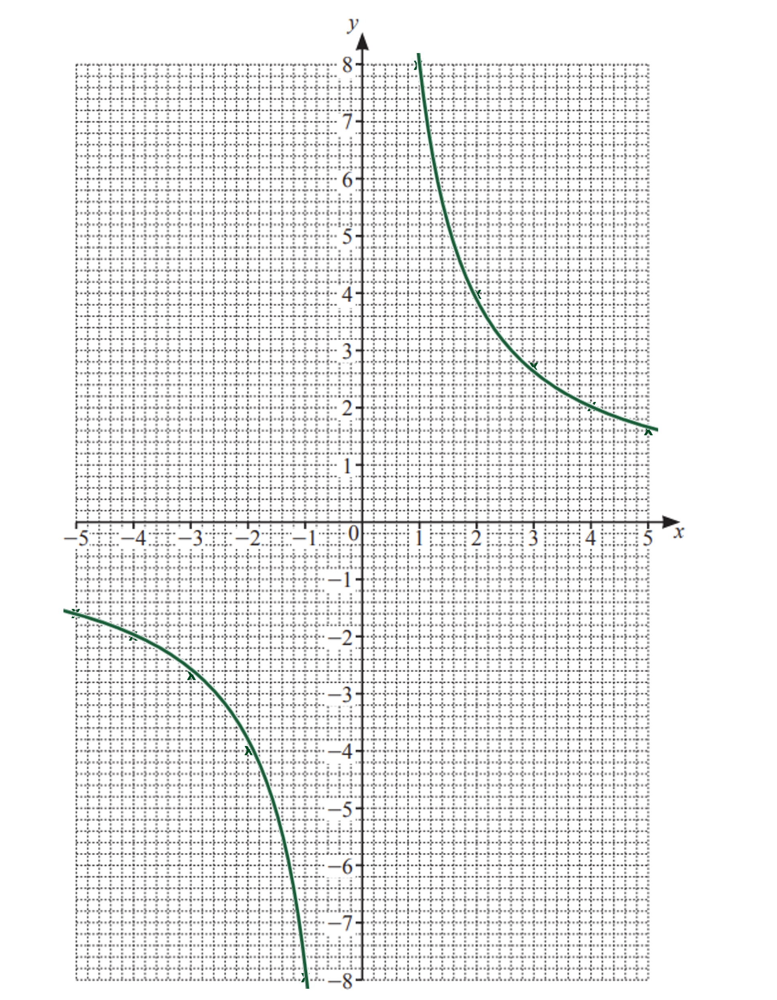

**5 points plotted correctly**** [1] **
**7 points plotted correctly**** [1] **
**9 points plotted correctly**** [1] **
**Curve drawn correctly**** [1]**

### Q4
> *Substitute *$x=-3$*, *$x=0$*, *$x=1$*, *$x=3$* and *$x=4$* into the equation to find the corresponding *$y$* values. *

$y = - ( - 3 )^{2} + ( - 3 ) + 5
 y = - 7

y = - ( 0 )^{2} + ( 0 ) + 5
 y = 5

y = - ( 1 )^{2} + ( 1 ) + 5
 y = 5

y = - ( 3 )^{2} + ( 3 ) + 5
 y = - 1

y = - ( 4 )^{2} + ( 4 ) + 5
 y = - 7$

> * *

> *Write the values into the table in the correct places.*

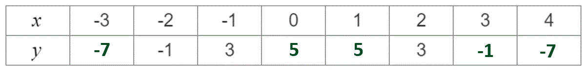

** All correct**** [3]**
> *Plot the coordinates from the table:*

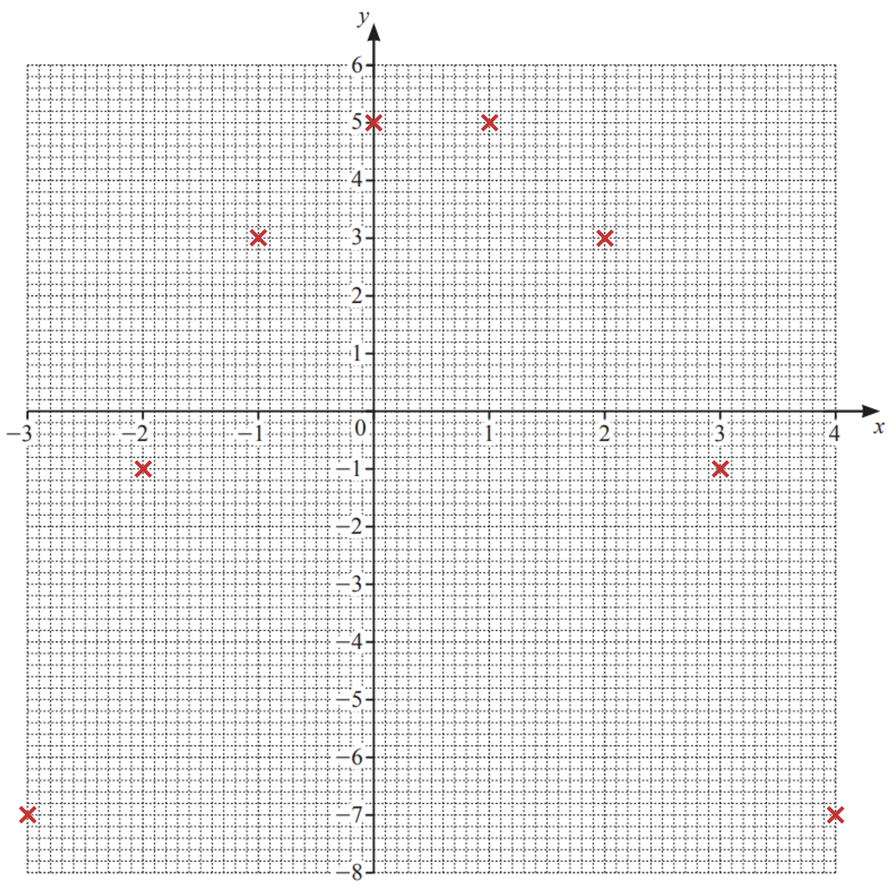

> *Then join them up with a smooth curve:*

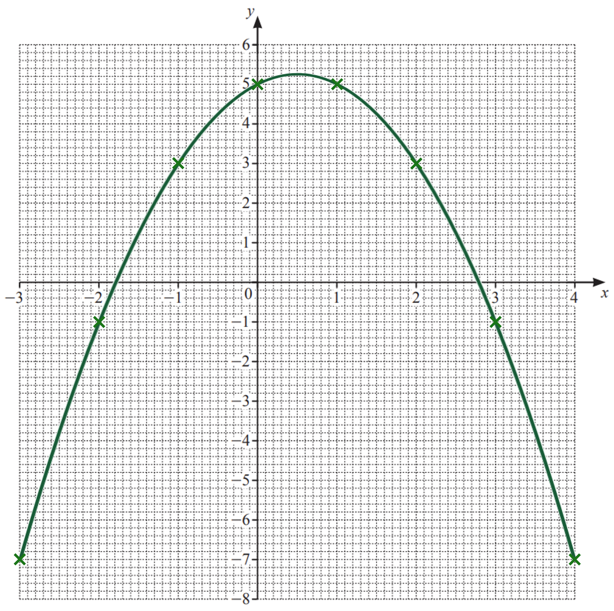

**Fully correct curve**** [4]**

**Final answer:** **Or 3 marks for 7 or 8 points correctly plotted **
**Or 2 marks for 5 or 6 points correctly plotted **
**Or 1 mark for 3 or 4 points correctly plotted**
> *Write the coordinate of the highest point of the graph.*

> * *

$(0.5,5.25)$** [1]**

**Any number between 5 and 6 accepted for y-coordinate**
> *The graph has a line of symmetry in the vertical line *$x=0.5$*.*

> * *

$x=0.5$* ***[1]**
(i) *The line *$y=x$* is a diagonal line that passes through the origin, where each coordinate has the same *$x$* and *$y$* values. *

> *Draw the line on the graph using a ruler.*

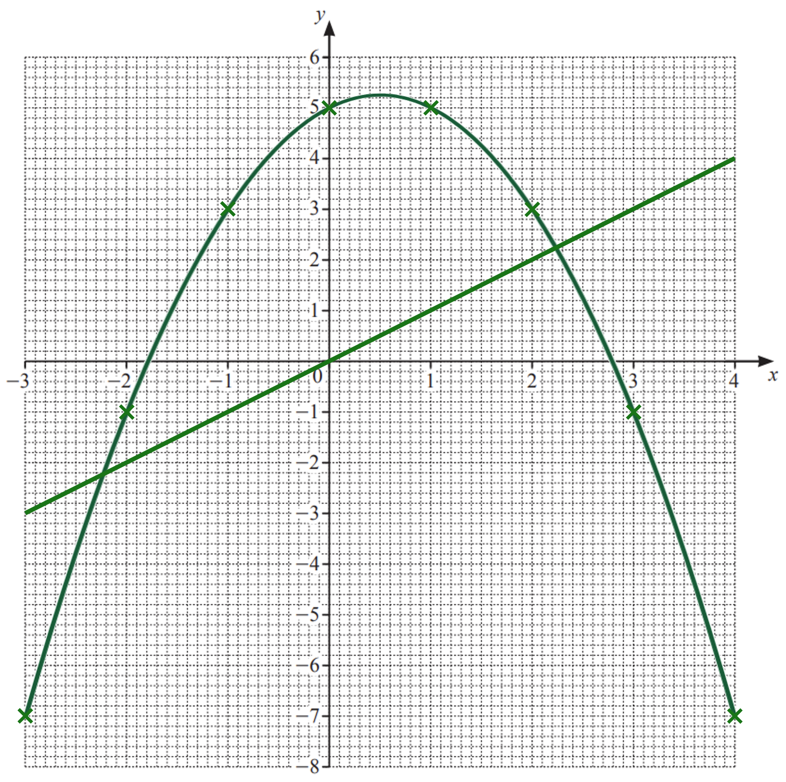

**[1]**

(ii) *Look at the two points where the curve crosses the line, draw vertical lines to the *$x$* axis, and read off the values.*

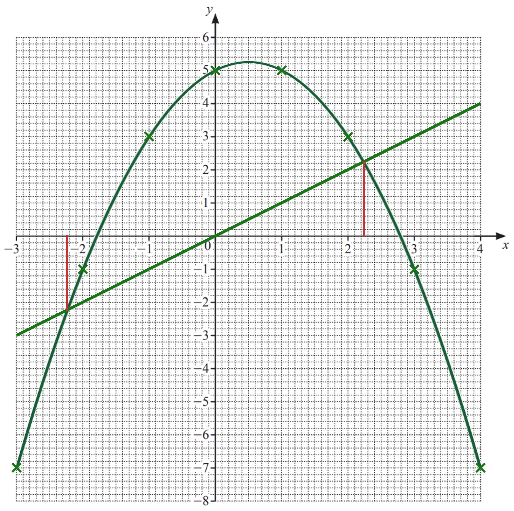

$x=-2.2$** ****and **$x=2.2$* ***[2]**

**Answers in the range -2.4 to -2.1 and 2.1 to 2.4 accepted**

### Q5
> *Substitute each of the numbers from the table into the equation.*

> *When *$x=-5$*,*

$y=\frac{15}{-5}\,y=-3$

> *When *$x=-3$*,*

$y=\frac{15}{-3}\,y=-5$

> *When *$x=-2$*,*

$y=\frac{15}{-2}\,y=-7.5$

> *When *$x=2$*,*

$y=\frac{15}{2}\,y=7.5$

> *When *$x=3$*,*

$y=\frac{15}{3}\,y=5$

> *When *$x=5$*,*

$y=\frac{15}{5}\,y=3$

> *Put the *$y$* values into the table.  *

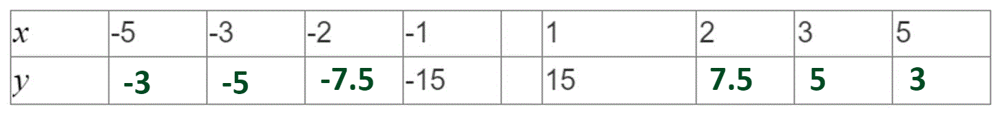

**[3]**

**1 mark for 2 or 3 correct values,**** **
**2 marks for 4 or 5 correct values**
> *Plot the coordinates from part (a). Each pair of *$x$* and *$y$* values make a coordinate.*

> $( - 5 , - 3 )$*  *$( - 3 , - 5 )$*  *$( - 2 , - 7.5 )$*  *$( - 1 , - 15 )$*  *$( 1 , 15 )$*  *$( 2 , 7.5 )$*  *$( 3 , 5 )$* and *$( 5 , 3 )$*. *

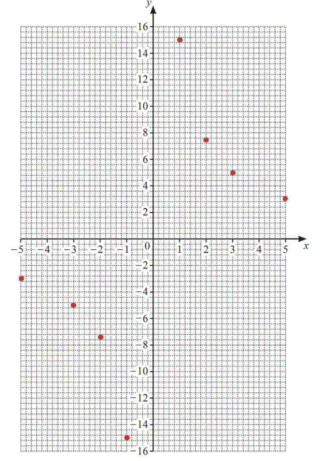

> *Join up the points using two smooth curves.*

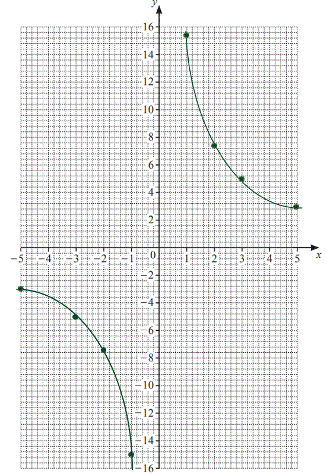

**[4]**

**Final answer:** **1 mark for 3 or 4 points plotted correctly from the table in part (a), **
**2 marks for 5 or 6 points, 3 marks for 7 or 8 points**
> $y=6$* is a horizontal line which passes through 6 on the *$y$* axis.*

> *Draw the line onto the grid with a ruler.*

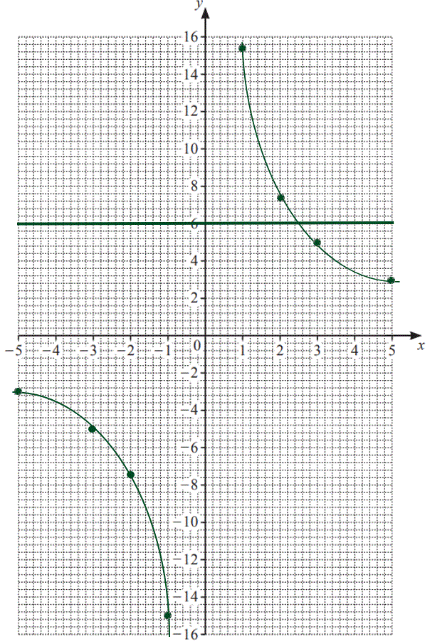

**[1]**
> *Look on the graph for any points where the line and the curve cross.*

> *Draw a line down to the *$x$* axis and read off the value. *

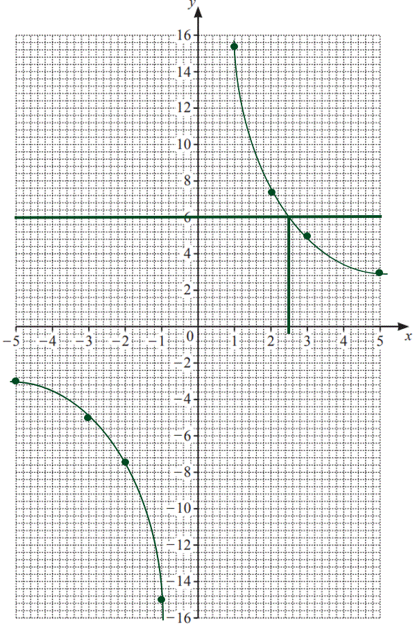

$x=2.5$* ***[1]**

**Answers in the range 2.4 - 2.6 will be accepted**

### Q6
> *The *$y-$*intercept *$c$* is at *$( 0 , 6 )$* as seen on the graph so when *$x=0,y=6$*.*

$y=mx+6$

**[1]**

> *The *$x-$*intercept is at *$( 1.2 , 0 )$* as seen on the graph so when *$x=1.2,y=0$*.*

> *Substitute these two pairs of coordinates into the formula for the gradient of a straight line *$m=$$\frac{\mathrm{rise}}{\mathrm{run}}$*.*

$m=\frac{6-0}{0-1.2}$

**[1]**

$=-\frac{6}{1.2}$

$=-5$

> *Write the equation of the straight line.*

$y=-5x+6$* ***[1]**
i) *Substitute *$x=-1$* and *$x=2$* into the equation and solve for *$y$*.*

$y = ( - 1 )^{2} + 2 \times ( - 1 ) + 4 = 3$

$y=2^{2}+2\times2+4=12$

> * *

| $x$ | -2 | -1 | 0 | 1 | 2 | 3 |
|---|---|---|---|---|---|---|
| $y$ | 4 | **Final answer:** **3** | 4 | 7 | **Final answer:** **12** | 19 |

**3**** ****[1] **
**12**** [1] **

ii) *Plot the coordinates from the table onto the graph.*

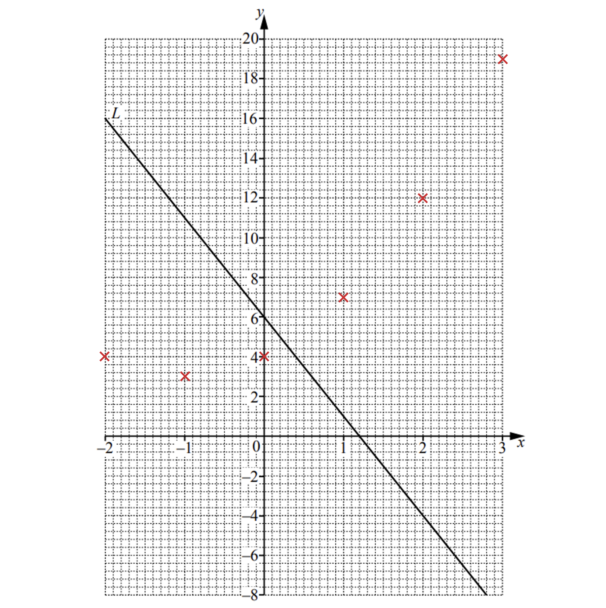

**1 or 2 points plotted correctly**** [1]**
**3 or 4 points plotted correctly**** [1]**
**5 or 6 points plotted correctly**** [1]**

> *Connect these points using a smooth curve*

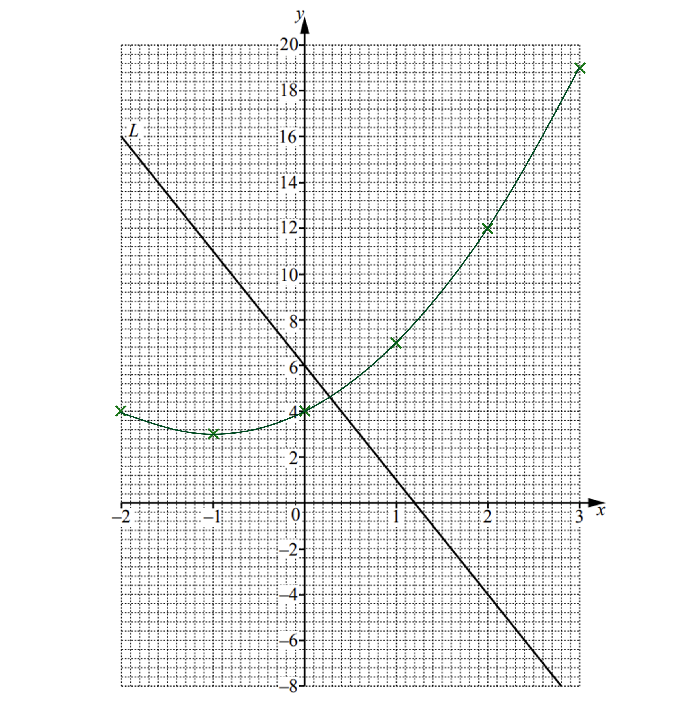

**Correct curve**** ****[1]**
> *Use the graph to determine the horizontal coordinate of the point of intersection.*

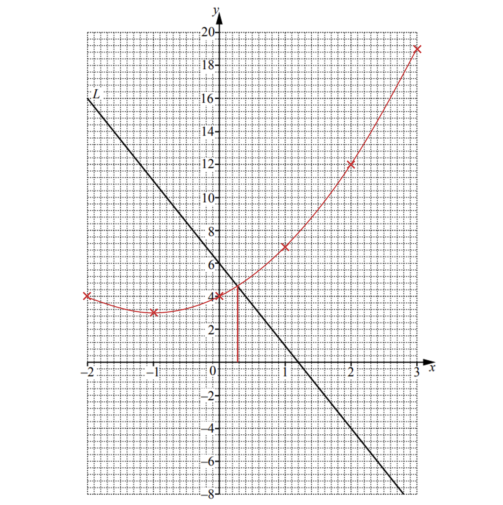

$0.28$ **[1] **
**Any correct value read from the graph in the range **$0.2$** to **$0.35$** is accepted**

### Q7
(i) *Substitute the values of *$x$* into  *$y=x^{2}-x-5$

| $x$ | -3 | -2 | -1 | 0 | 1 | 2 | 3 | 4 |
|---|---|---|---|---|---|---|---|---|
| $y$ | 7 | **1** | -3 | **-5** | -5 | **-3** | **1** | **7** |

**3 correct**** [1]** 
**4 correct**** [1]** 
**All 5 correct**** [1]**

(ii) *Plot each point using the table, and join the points with a smooth curve*

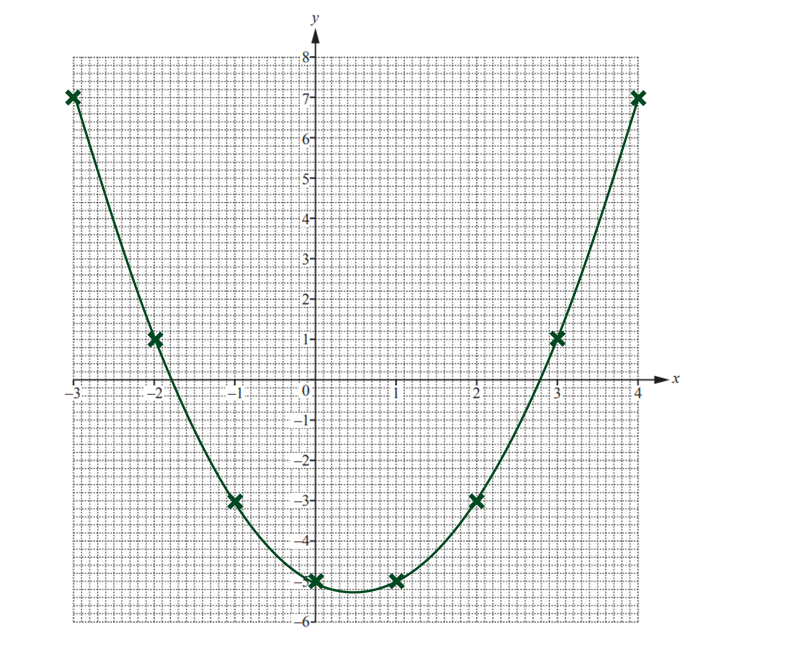

**3 or 4 points correct**** ****[1]** 
**5 or 6 points correct**** ****[1]** 
**7 or 8 points correct**** ****[1]** 
**All points correct with smooth curve ****[1]**

(iii) *The lowest point on the graph is halfway between the two plotted points; (0,-5) and (1,-5), and a little lower down*

**(0.5, -5.25)**** ****[1]** 
**A value for the **$y$**-coordinate of **$-5.5\leqy<-5$** will be accepted**

(iv) (a) *The line of symmetry will be a vertical line, passing through the lowest point on the graph*

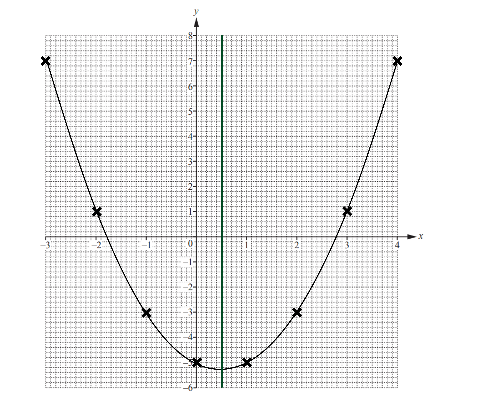

**[1]**

(b) *The *$x$*-coordinate of the lowest point on the graph is 0.5*

$x=0.5$ **[1]**

### Q8
> *Substitute the values of *$x=-2,2,3$* into the equation and evaluate for *$y$*.*

$x = - 2 : 5 + 2 \times ( - 2 ) - ( - 2 )^{2} = - 3$

$x = 2 : 5 + 2 \times ( 2 ) - ( 2 )^{2} = 5$

$x = 3 : 5 + 2 \times ( 3 ) - ( 3 )^{2} = 2$

**[2] **
**1 mark for any 2 correct**
> *Plot each point from the table onto the set of axes.*

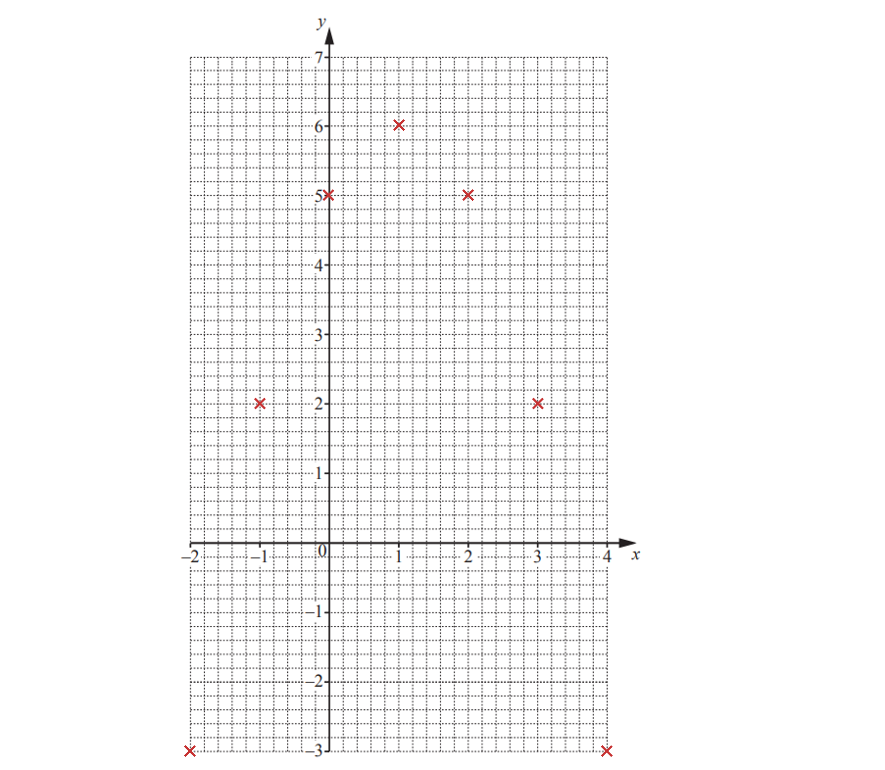

> *Connect each point using a smooth curve.*

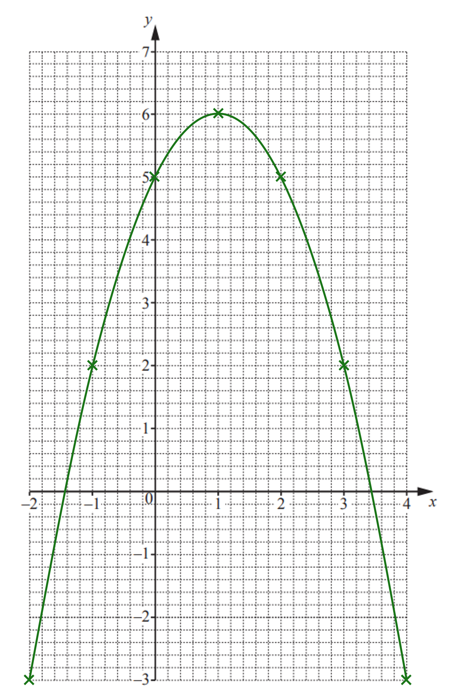

**Minimum 6 correct points ****[1] **
**Minimum 4 correct points**** ****[1] **
**Minimum 2 correct points**** ****[1] **
**Correct graph**** ****[1]**
i) *Rule a vertical line through the graph through the turning point.*

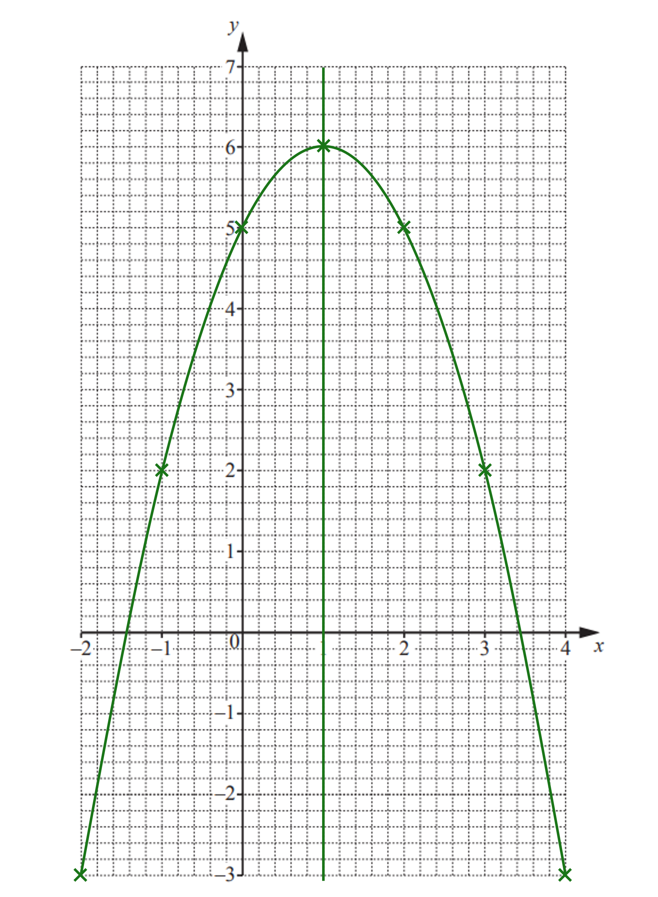

**[1]**

ii) *The vertical line that crosses the *$x-$*axis at *$1$* is*

$x=1$** [1]**
> *Draw a horizontal line at *$y=4$* and state the *$x-$*values of the points of intersection with the quadratic graph.*

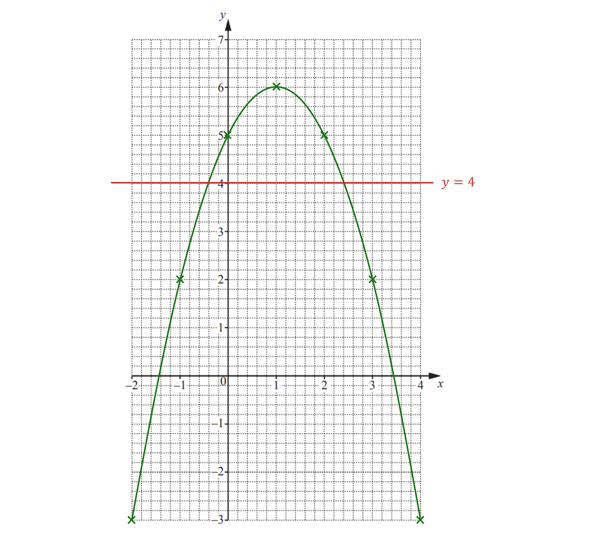

$x=-0.4,x=2.4$ **[2]**
** ****1 mark for each**

**Answers in the range of -0.5 to -0.3 and 2.3 to 2.5**
i) *Indicate these two coordinates on the grid and join them together using a straight line.*

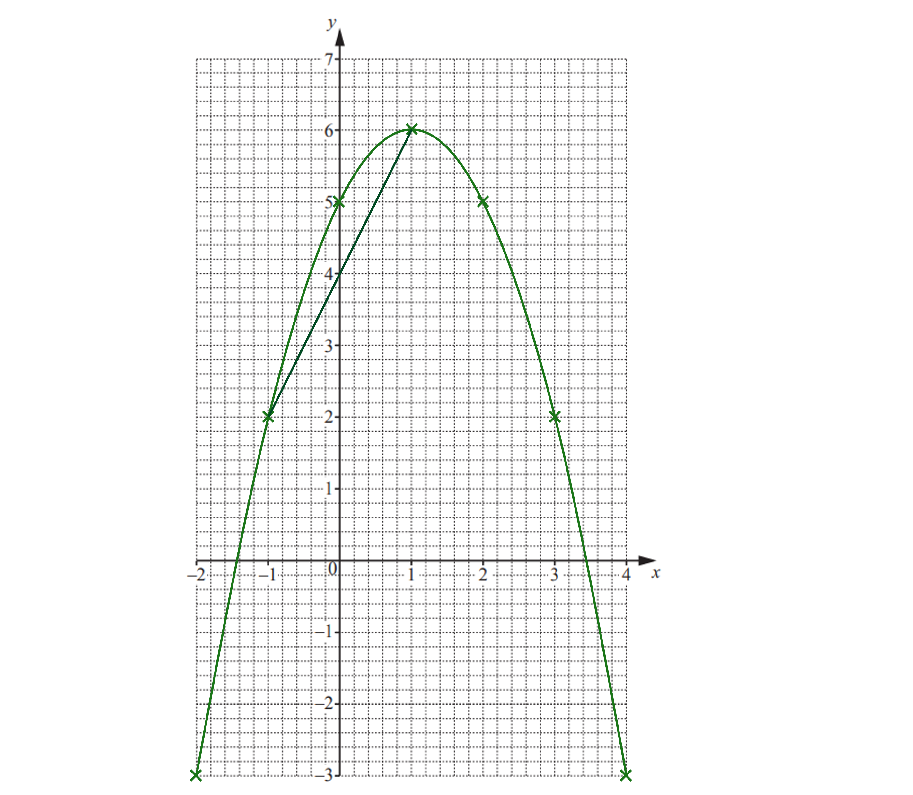

**[1]**

ii) *The gradient is calculated by finding *$m=$$\frac{\mathrm{rise}}{\mathrm{run}}$*.*

$m=\frac{6-2}{1--1}=\frac{4}{2}=2$

**[1]**

> *Substitute a coordinate into the equation to determine the intercept.*

$6=2\times1+c$

$6=2+c$

$c=4$

**[1]**

> *Write the equation.*

$y=2x+4$** [1]**

### Q9
i) *Substitute *$x=-4,x=-1$* and *$x=2$* into the equation and solve for *$y$*.*

$x = - 4 : y = - 4 \times ( 3 - - 4 ) = - 4 \times 7 = - 28$

**[1]**

$x = - 1 : y = - 1 \times ( 3 - - 1 ) = - 1 \times 4 = - 4$

**[1]**

$x = 2 : y = 2 \times ( 3 - 2 ) = 2 \times 1 = 2$

**[1]**

| $x$ | $-4$ | $-2$ | $-1$ | $0$ | $1$ | $2$ | $4$ |
|---|---|---|---|---|---|---|---|
| $y$ | **Final answer:** **-28** | $-10$ | **Final answer:** **-4** | $0$ | $2$ | **Final answer:** **2** | $-4$ |

ii) *Plot each point from the table onto the graph and connect them with a smooth curve.*

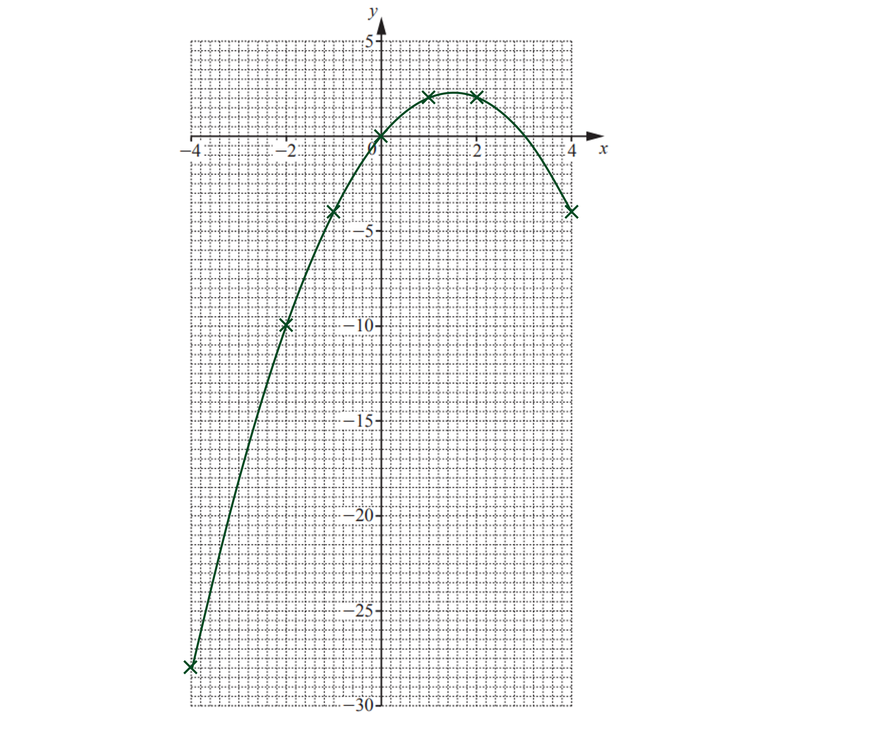

**Minimum 2 points correct ****[1]**
**Minimum 4 points correct**** [1]**
**Minimum 6 points correct**** ****[1]**
**Correct graph**** ****[1]**

iii) *Use the graph to determine the turning point of the curve.*

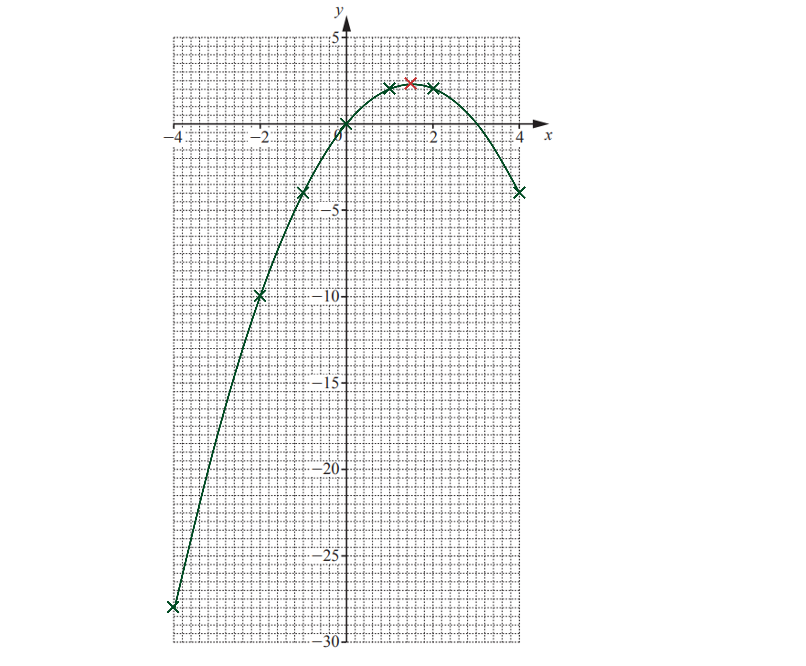

$(1.5,2.25)$ **[1]**
**Answers in the range **$1<x<2,2<y<4$** are accepted**

### Q10
> *Substitute *$x=-1$*, *$x=2$* and *$x=4$* into the equation and evaluate.*

> * *

$y = 1 + ( 5 \times - 1 ) - ( - 1 )^{2}
 y = - 5

y = 1 + ( 5 \times 2 ) - ( 2 )^{2}
 y = 7

y = 1 + ( 5 \times 4 ) - ( 4 )^{2}
 y = 5$

> *Write into the table in the correct places. *

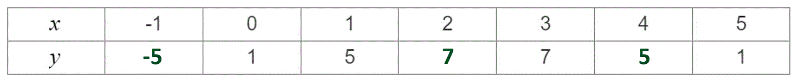

**All values correct**** ****[2] **
**1 mark for 2 correct values**
> *Plot the coordinates from the table:*

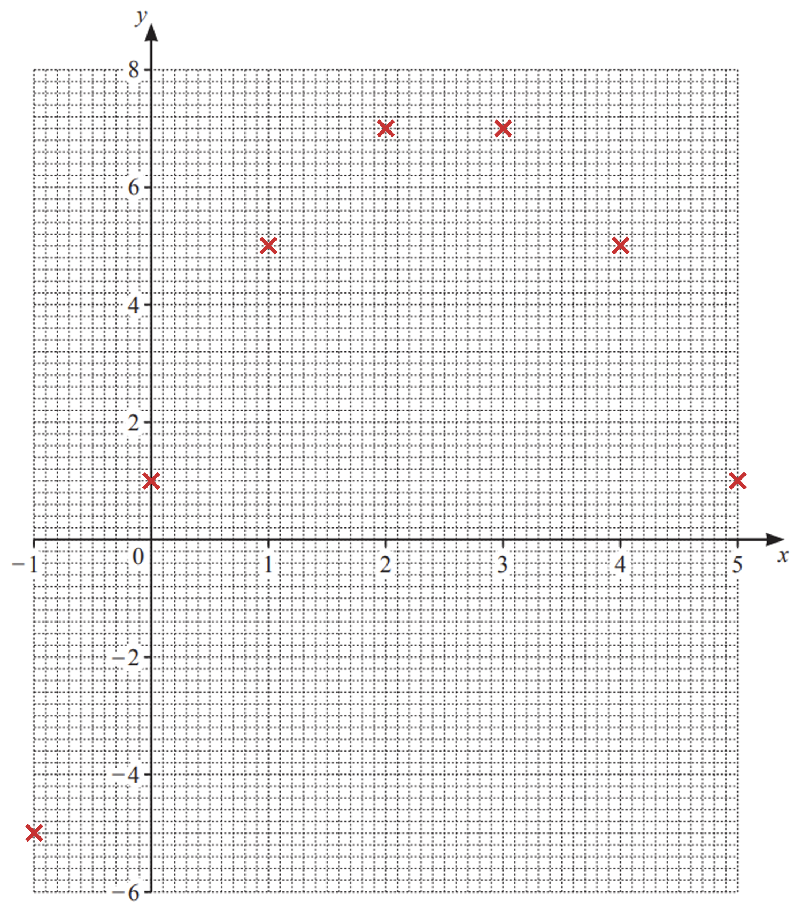

> *Then join the points with a smooth curve:*

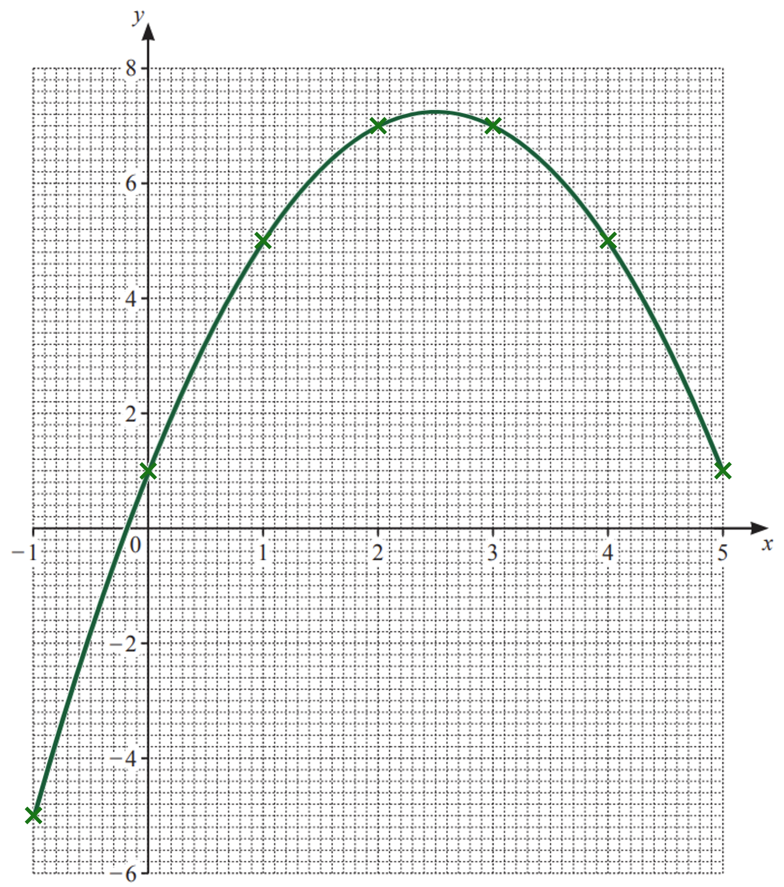

**Fully correct curve**** ****[4]**

**Final answer:** **Or 3 marks for 6 or 7 points correctly plotted **
**Or 2 marks for 4 or 5 points correctly plotted **
**Or 1 mark for 2 or 3 points correctly plotted**
i) *Using a ruler, draw a horizontal line on the grid through *$y=3$*. *

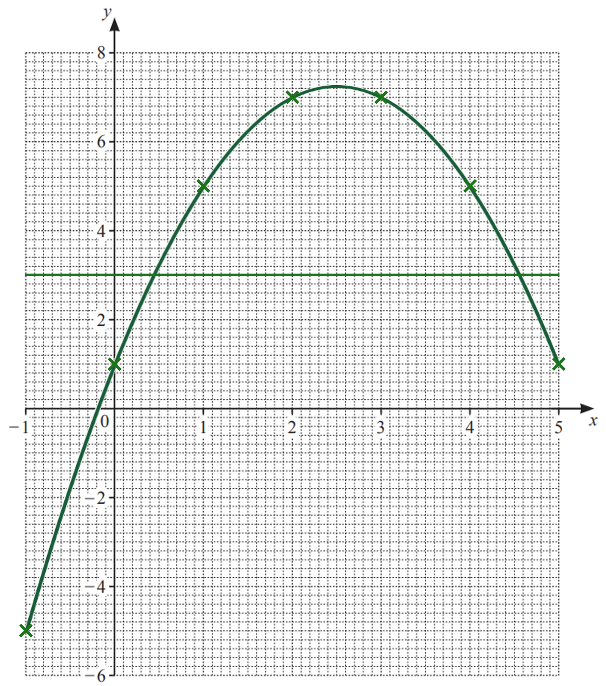

**[1]**

ii) *Look at where the curve intersects the horizontal line *$y=3$*.*
*Draw vertical lines down to the *$x$* axis and read off the values. *

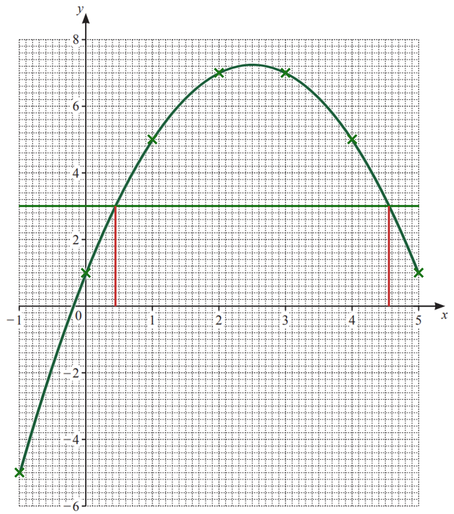

$x=0.4\mathrm{or}x=4.6$** ****[2]**
**1 mark for each** 
**Answers in the range 0.3 - 0.6 and 4.4 - 4.7 accepted**

### Q11
i) *Work out the missing values *

$y = 3^{2} - 2 ( 3 ) = 3$

$y = ( - 1 )^{2} - 2 ( - 1 ) = 3$

| $x$ | -2 | -1 | 0 | 1 | 2 | 3 | 4 |
|---|---|---|---|---|---|---|---|
| $y$ | 8 | **Final answer:** **3** | 0 | -1 | 0 | **Final answer:** **3** | 8 |

**[1]**

ii)

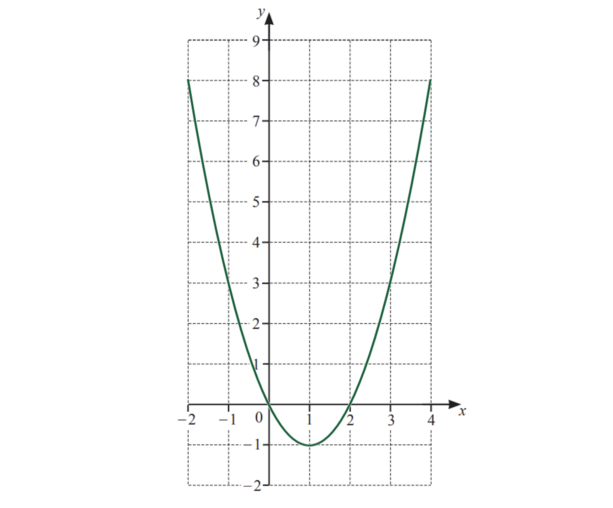

**2 points plotted correctly**** ****[1] **
**4 points plotted correctly**** [1] **
**6 points plotted correctly**** [1] **
**Curve drawn correctly**** ****[1]**

### Q12
i) *Substitute *$x=-3$*, *$x=0$*, and *$x=9$* into the equation and solve for *$y$*. *

$y = ( - 3 )^{2} - 10 \times ( - 3 ) = 9 + 30 = 39$
$y = ( 0 )^{2} - 10 \times ( 0 ) = 0 - 0 = 0$
$y = ( 9 )^{2} - 10 \times ( 9 ) = 81 - 90 = - 9$

> *Complete the table of values.*

| $x$ | $-6$ | $-3$ | $0$ | $3$ | $6$ | $9$ | $12$ | $15$ |
|---|---|---|---|---|---|---|---|---|
| $y$ | $96$ | $39$ | $0$ | $-21$ | $-24$ | $-9$ | $24$ | $75$ |

** ****39**** [1]**
** 0**** [1]**
**-9**** [1]**

** **ii) *Plot the coordinates from the table.*

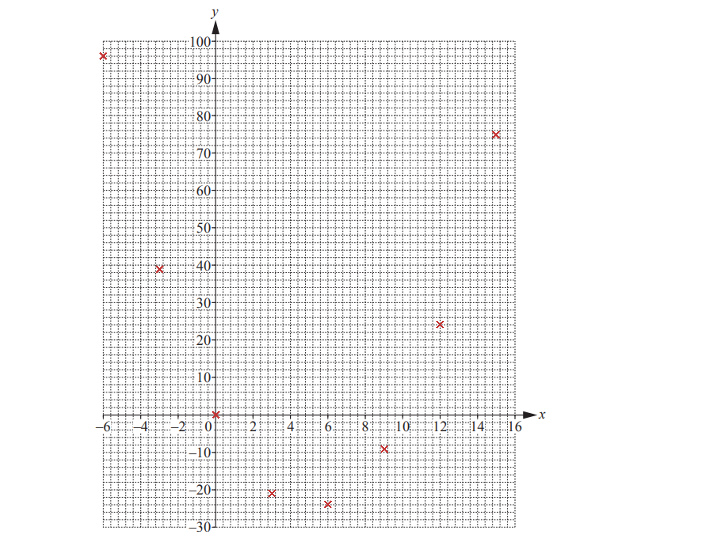

**  ****3 or 4 correctly plotted points**** [1]**
**5 or 6 correctly plotted points**** ****[1]**
**7 or 8 correctly plotted points**** ****[1]**

*Connect each coordinate with a smooth curve*

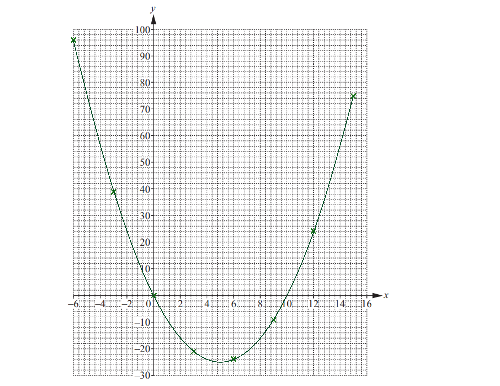

**[1]**

** **iii) *The lowest point on the graph is the point where the gradient changes from being negative (going downhill) to being positive (going uphill).*

$(5,-25)$ **[1]**
**Any coordinate in the range **$4.4<x<6$**, **$-28<y<-24$** is accepted**

### Q13
> *Substitute *$x=-2$* into the equation.  *

> $y = ( - 2 )^{2} - ( 4 \times - 2 ) - 3$*   *

> *Evaluate.  *

> $y=9$*   *

> *Substitute *$x=2$* into the equation.  *

> $y = ( 2 )^{2} - ( 4 \times 2 ) - 3$*   *

> *Evaluate.  *

> $y=-7$*  *

> *Write the numbers into the correct places in the table.  *

| $x$ | -2 | -1 | 0 | 1 | 2 | 3 | 4 | 5 |
|---|---|---|---|---|---|---|---|---|
| $y$ | $9$ | 2 | -3 | -6 | $-7$ | -6 | -3 | 2 |

** 1 mark for each**** ****[2]**
> *Plot the coordinates from part (a) on the graph:*

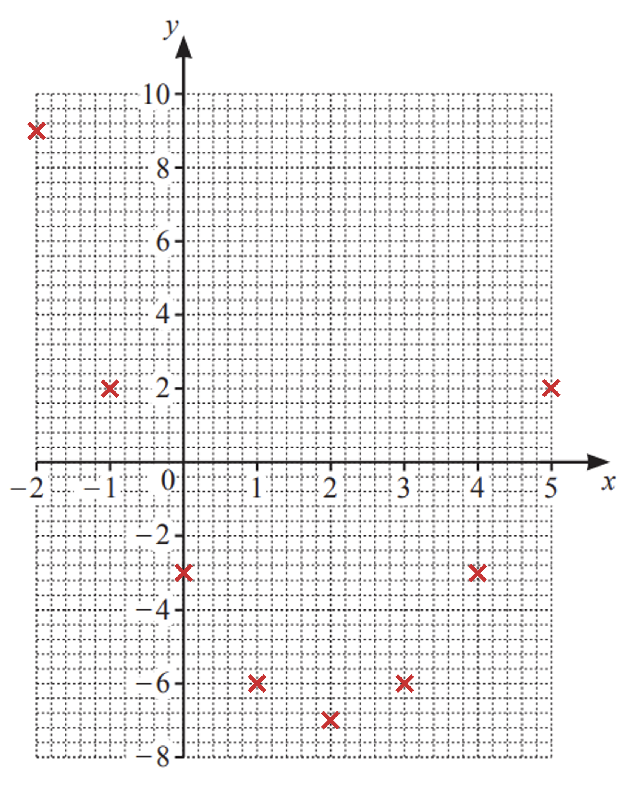

> *Then join up the points with a smooth curve:*

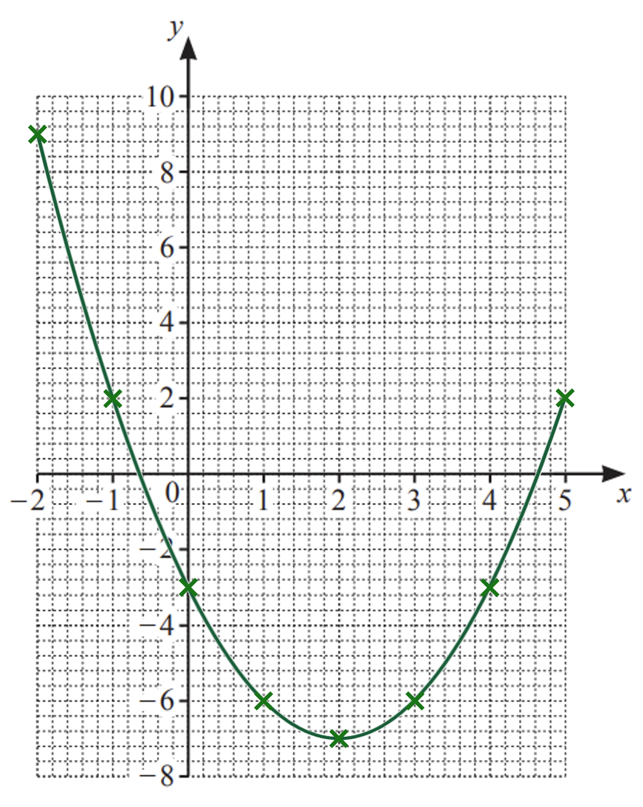

**Fully correct curve**** ****[4]**
**Or 3 marks for 7 or 8 points correctly plotted **
**Or 2 marks for 5 or 6 points correctly plotted **
**Or 1 mark for 3 or 4 points correctly plotted**
> *Look at where the curve crosses the *$x$* axis and read off the values.*

$-0.6\mathrm{and}4.6$* ***[2] **
**1 mark for each**

**Answers in the range -0.8 to -0.5 and 4.5 to 4.8 accepted**

### Q14
> *Substitute the given values into the equation to find the values of **y.  *
*Use brackets to avoid mistakes with negative numbers.  *

$y = ( - 1 )^{2 } - 5 ( - 1 ) + 3 = 9
y = ( 0 )^{2 } - 5 ( 0 ) + 3 = 3
y = ( 6 )^{2 } - 5 ( 6 ) + 3 = 9$*  *

| $x$ | -1 | 0 | 1 | 2 | 3 | 4 | 5 | 6 |
|---|---|---|---|---|---|---|---|---|
| $y$ | **Final answer:** **9** | **Final answer:** **3** | -1 | -3 | -3 | -1 | 3 | **Final answer:** **9** |

**2 correct values ****[1] **
**3 correct values**** ****[1]**
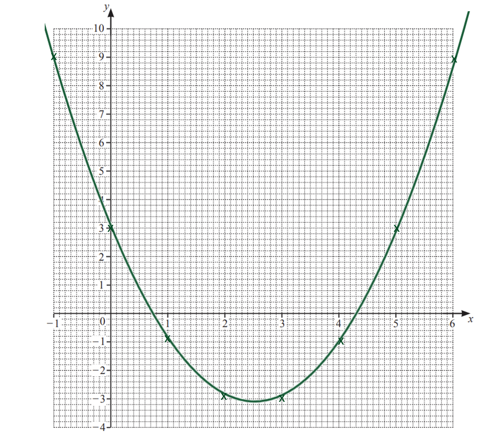

**3 points plotted correctly**** ****[1]** 
**5 points plotted correctly**** ****[1]** 
**7 points plotted correctly**** ****[1]** 
**Curve drawn correctly**** ****[1]**
> *As the quadratic expression equals zero, the solutions are the **x**-coordinates when **y = **0. *
*These are the points where the graph crosses the **x-**axis.   *

**x = ****0.7** **[1] **
**Answers in the range from 0.6 to 0.8 are accepted**

**x =**** 4.3 ****[1] **
**Answers in the range from 4.2 to 4.4 are accepted**

### Q15
> *Substitute *$x=-2,x=0,x=1,x=2,x=3$* and *$x=5$* into *$y=x^{2}-3x-6$* to find the corresponding *$y$* values.*

> * *

$y = ( - 2 )^{2} - ( 3 \times - 2 ) - 6
 y = 4

y = ( 0 )^{2} - ( 3 \times 0 ) - 6
 y = - 6

y = ( 1 )^{2} - ( 3 \times 1 ) - 6
 y = - 8

y = ( 2 )^{2} - ( 3 \times 2 ) - 6
 y = - 8

y = ( 3 )^{2} - ( 3 \times 3 ) - 6
 y = - 6

y = ( 5 )^{2} - ( 3 \times 5 ) - 6
 y = 4$

> * *

> *Write the values into the correct places in the table.*

> * *

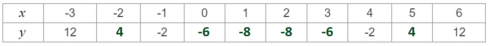

**[3]**
> *Use the *$x$* and *$y$* values from the table to plot the coordinates on the grid.*

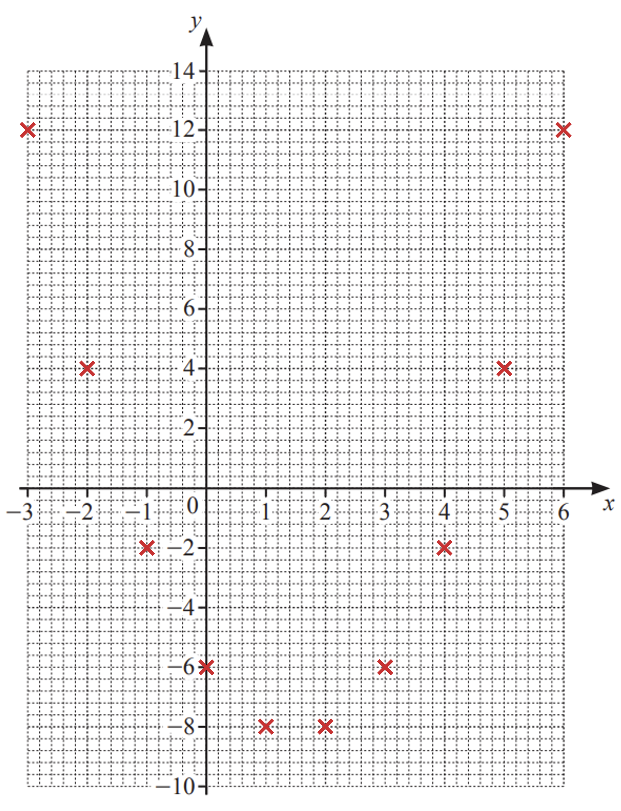

> *Then join them up with a smooth curve.*

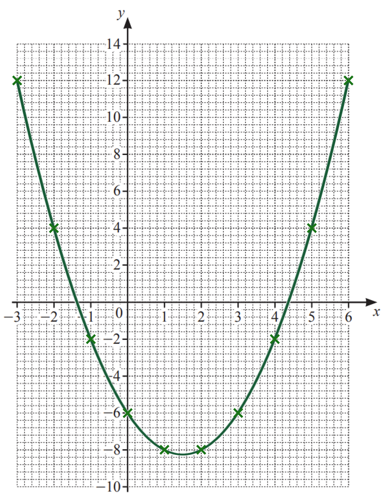

**Final answer:** **Fully correct graph ****[4]**

**Final answer:** **Or 3 marks for 9 or 10 points correctly plotted **
**Or 2 marks for 7 or 8 points correctly plotted **
**Or 1 mark for 5 or 6 points correctly plotted**
> *The line of symmetry of the graph is where *$x=1.5$*.*

> * *

$x=1.5$* ***[1]**
> $y=0$* has been substituted into the equation of the curve. Look where the graph crosses the *$x$* axis (which is the line *$y=0$*). Write down the values.*

> * *

$x=-1.4$* **and *$x=4.4$* ***[2]**
** ****1 mark for each**
