# Exam Questions — Further Graphs
**Coordinate Geometry & Graphs** · Cambridge (CIE) IGCSE maths (0580 & 0980)
> Source: [https://www.savemyexams.com/igcse/maths/cie/25/core/topic-questions/](https://www.savemyexams.com/igcse/maths/cie/25/core/topic-questions/) · 15 questions across 1 sets

## Exam Questions (15 questions)

### Q1 — hard — 9 marks

**Q1** [2 marks]

Complete the table of values for $y=7+2x-x^{2}$

| $x$ | -2 | -1 | 0 | 1 | 2 | 3 | 4 |
|---|---|---|---|---|---|---|---|
| $y$ | -1 |   |   | 8 | 7 |   | -1 |

*Source: June 2020 0580/31 Q4A*

**Q1** [4 marks]

**Extract:**

Complete the table of values for y = 7 + 2 x - x^2

| x | -2 | -1 | 0 | 1 | 2 | 3 | 4 |
| y | -1 |   |   | 8 | 7 |   | -1 |

On the grid, draw the graph of $y=7+2x-x^{2}$ for `negative 2 less-than or slanted equal to x less-than or slanted equal to 4.`

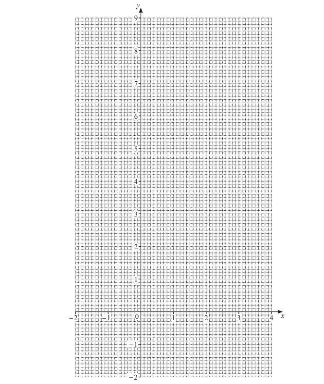

*Source: June 2020 0580/31 Q4B*

**Q1** [1 mark]

**Extract:**

y equals 7 plus 2 x minus x squared

Write down the equation of the line of symmetry of the graph.

*Source: June 2020 0580/31 Q4C*

**Q1** [2 marks]

Use your graph to solve the equation $7+2x-x^{2}=0$

$x$ = .................... or $x$ = ....................

*Source: June 2020 0580/31 Q4D*

### Q2 — hard — 9 marks

**Q2** [9 marks]

i) Complete the table of values for $y=\frac{12}{x},x\neq0.$

| $x$ | -6 | -4 | -3 | -2 | -1 |   | 1 | 2 | 3 | 4 | 6 |
|---|---|---|---|---|---|---|---|---|---|---|---|
| $y$ | -2 | -3 |   |   |   |   | 12 |   |   |   | 2 |

[3]

ii) On the grid, draw the graph of $y=\frac{12}{x}$ for `negative 6 less-than or slanted equal to x less-than or slanted equal to negative 1` and `1 less-than or slanted equal to x less-than or slanted equal to 6`.

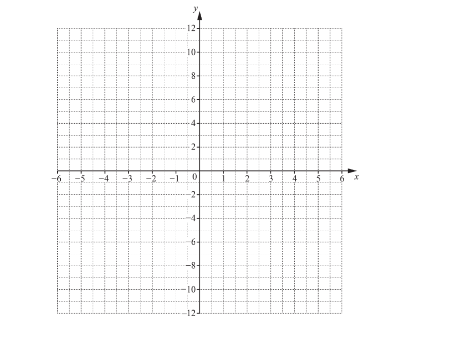

[4]

iii) On the grid, draw the line $y=8$.

[1]

iv) Use your graph to solve $\frac{12}{x}=8$.

$x$ = .............................................. [1]

*Source: June 2019 0580/31 Q5C*

### Q3 — hard — 6 marks

**Q3** [2 marks]

Complete the table of values for $y=\frac{8}{x}$.

| $x$ | -5 | -4 | -3 | -2 | -1 |   | 1 | 2 | 3 | 4 | 5 |
|---|---|---|---|---|---|---|---|---|---|---|---|
| $y$ |   | -2 | -2.7 | -4 | -8 |   | 8 | 4 | 2.7 |   |   |

*Source: June 2019 0580/11 Q24A*

**Q3** [4 marks]

**Extract:**

| x | -5 | -4 | -3 | -2 | -1 |   | 1 | 2 | 3 | 4 | 5 |
| y |   | -2 | -2.7 | -4 | -8 |   | 8 | 4 | 2.7 |   |   |

On the grid, draw the graph of $y=\frac{8}{x}$for `negative 5 less-than or slanted equal to x less-than or slanted equal to negative 1` and `1 less-than or slanted equal to x less-than or slanted equal to 5.`

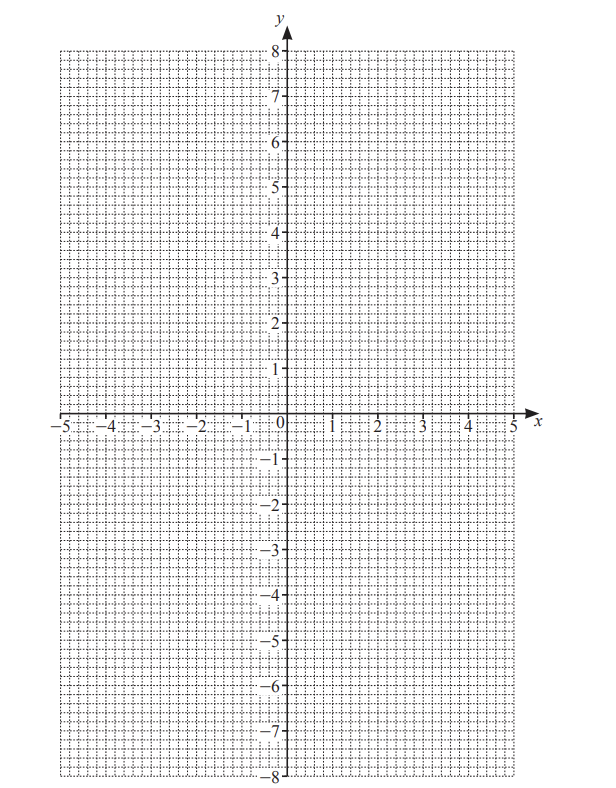

[4]

*Source: June 2019 0580/11 Q24B*

### Q4 — hard — 12 marks

**Q4** [3 marks]

Complete the table of values for $y=-x^{2}+x+5$

| $x$ | -3 | -2 | -1 | 0 | 1 | 2 | 3 | 4 |
|---|---|---|---|---|---|---|---|---|
| $y$ |   | -1 | 3 |   |   | 3 |   |   |

*Source: June 2020 0580/33 Q8A*

**Q4** [4 marks]

**Extract:**

Complete the table of values for y = -x^2 + x + 5

| x | -3 | -2 | -1 | 0 | 1 | 2 | 3 | 4 |
| y |   | -1 | 3 |   |   | 3 |   |   |

On the grid, draw the graph of $y=-x^{2}+x+5$ for `negative 3 less-than or slanted equal to x less-than or slanted equal to 4`.

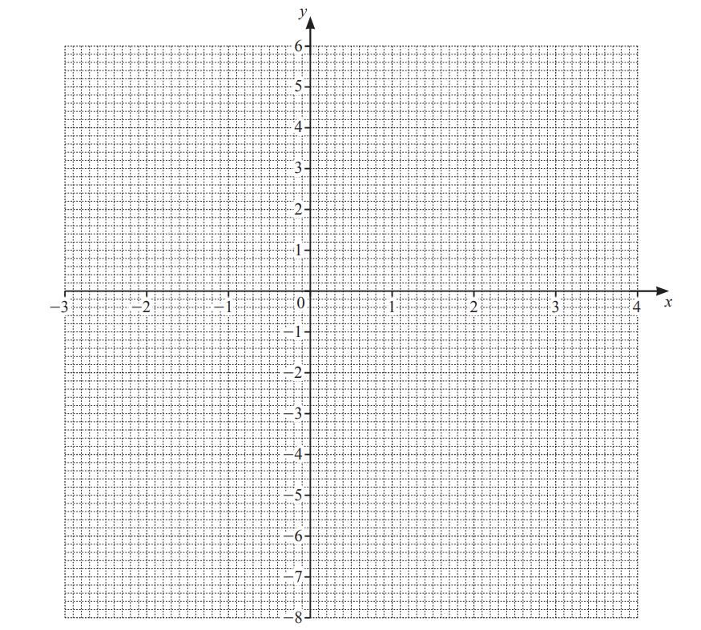

*Source: June 2020 0580/33 Q8B*

**Q4** [1 mark]

**Extract:**

y equals negative x squared plus x plus 5

Write down the coordinates of the highest point of the graph.

*Source: June 2020 0580/33 Q8C*

**Q4** [1 mark]

**Extract:**

y equals negative x squared plus x plus 5

Write down the equation of the line of symmetry of the graph.

*Source: June 2020 0580/33 Q8D*

**Q4** [3 marks]

**Extract:**

Complete the table of values for y equals negative x squared plus x plus 5

i) On the grid, draw the line $y=x$ for `negative 3 less-than or slanted equal to x less-than or slanted equal to 4`

[1]

ii) Write down the values of $x$ where the line $y=x$ crosses the curve $y=-x^{2}+x+5$

$x$ = ...................... and $x$ = ...................... [2]

*Source: June 2020 0580/33 Q8E*

### Q5 — hard — 9 marks

**Q5** [3 marks]

Complete the table of values for $y=\frac{15}{x}$

| $x$ | -5 | -3 | -2 | -1 |   | 1 | 2 | 3 | 5 |
|---|---|---|---|---|---|---|---|---|---|
| $y$ |   |   |   | -15 |   | 15 |   |   |   |

*Source: Nov 2020 0580/31 Q9A*

**Q5** [4 marks]

**Extract:**

| x | -5 | -3 | -2 | -1 |   | 1 | 2 | 3 | 5 |
| y |   |   |   | -15 |   | 15 |   |   |   |

On the grid, draw the graph of $y=\frac{15}{x}$ for `negative 5 less-than or slanted equal to x less-than or slanted equal to negative 1` and `1 less-than or slanted equal to x less-than or slanted equal to 5`.

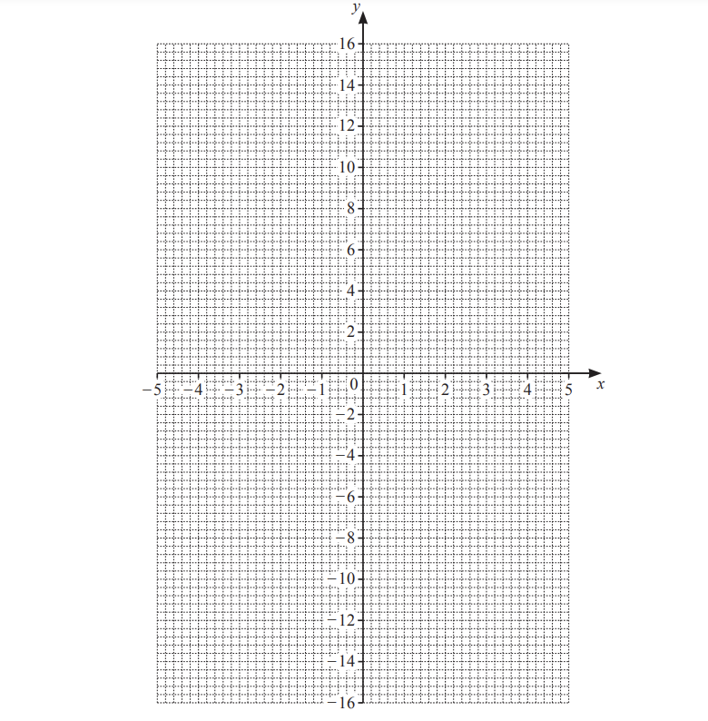

*Source: Nov 2020 0580/31 Q9B*

**Q5** [1 mark]

On the grid, draw the line $y$ = 6.

*Source: Nov 2020 0580/31 Q9C*

**Q5** [1 mark]

**Extract:**

On the grid, draw the graph of y = 15 over x for negative 5 ≤ x ≤ negative 1 and 1 ≤ x ≤ 5.
On the grid, draw the line y = 6.

Use your graph to solve $\frac{15}{x}=6$.

$x=$.............................

*Source: Nov 2020 0580/31 Q9D*

### Q6 — medium — 10 marks

**Q6** [3 marks]

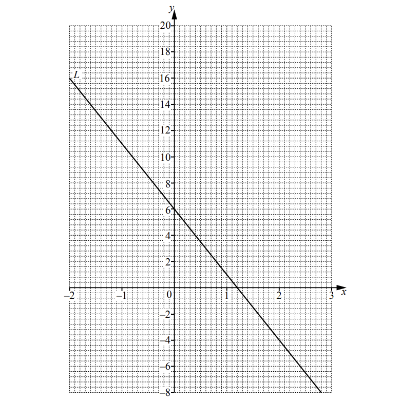

The line $L$ is shown on the grid. 
Find the equation of the line in the form $y=mx+c$.

$y$ = ..............................................

*Source: Specimen 2020 0580/03 Q7A*

**Q6** [6 marks]

i) Complete the table of values for $y=x^{2}+2x+4$.

| $x$ | -2 | -1 | 0 | 1 | 2 | 3 |
|---|---|---|---|---|---|---|
| $y$ | 4 |   | 4 | 7 |   | 19 |

[2]

ii) On the grid opposite, draw the graph of $y=x^{2}+2x+4$ for `– 2 space less-than or slanted equal to space x space less-than or slanted equal to space 3.`

[4]

*Source: Specimen 2020 0580/03 Q7B*

**Q6** [1 mark]

**Extract:**

The line L is shown on the grid. 
Find the equation of the line in the form y = mx + c.

y = ..............................................

y = x^2 + 2x + 4

For `– 2 space less-than or slanted equal to space x space less-than or slanted equal to space 3 comma` write down the $x$-coordinate of the point of intersection of the line $L$ with the curve$y=x^{2}+2x+4.$

$x=$...............................

*Source: Specimen 2020 0580/03 Q7C*

### Q7 — medium — 10 marks

**Q7** [10 marks]

i) Complete the table of values for $y=x^{2}-x-5.$

| $x$ | -3 | -2 | -1 | 0 | 1 | 2 | 3 | 4 |
|---|---|---|---|---|---|---|---|---|
| $y$ | 7 |   | -3 |   | -5 |   |   |   |

[3]

ii) On the grid, draw the graph of `y space equals space x squared space minus space x space minus space 5 space for space minus 3 space less-than or slanted equal to space x italic space italic less-than or slanted equal to italic space 4.`

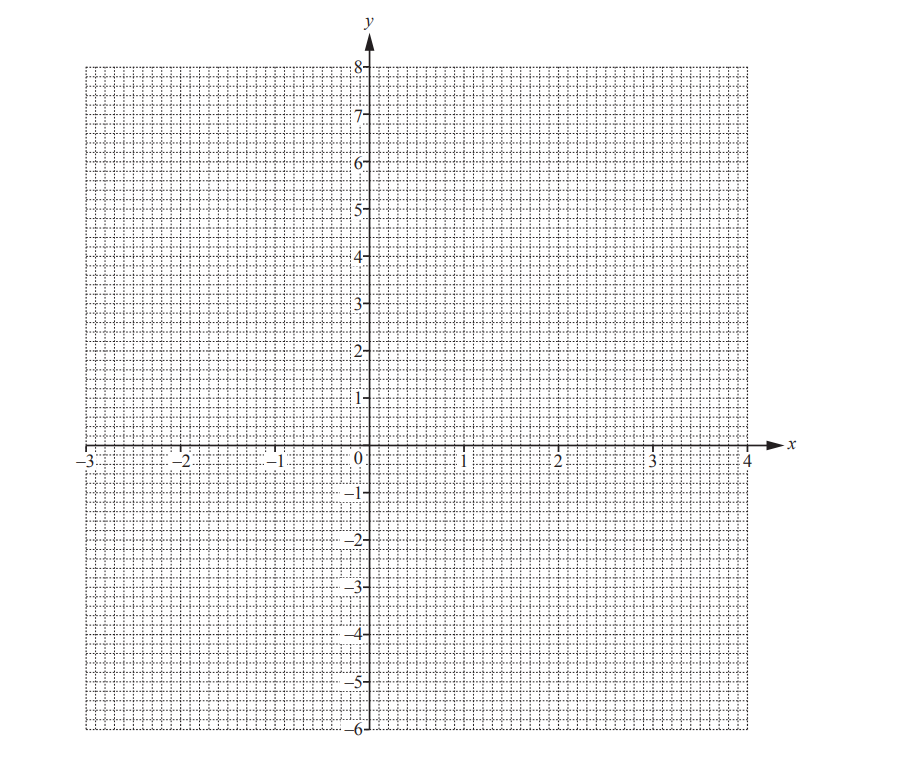

[4]

iii) Write down the co-ordinates of the lowest point on the graph.

[1]

iv) 
a) On the grid, draw the line of symmetry of the graph.

[1]

b) Write down the equation of this line.

[1]

*Source: May/June 2018 0580/31 Q10B*

### Q8 — medium — 14 marks

**Q8** [2 marks]

Complete the table of values for $y=5+2x-x^{2}$.

| $x$ | $-2$ | $-1$ | $0$ | $1$ | $2$ | $3$ | $4$ |
|---|---|---|---|---|---|---|---|
| $y$ |   | $2$ | $5$ | $6$ |   |   | $-3$ |

*Source: May/June 2019 0580/33 Q4A*

**Q8** [4 marks]

**Extract:**

| x | -2 | -1 | 0 | 1 | 2 | 3 | 4 |
| y |   | 2 | 5 | 6 |   |   | -3 |

On the grid, draw the graph of $y=5+2x-x^{2}$ for `negative 2 less-than or slanted equal to x less-than or slanted equal to 4`.

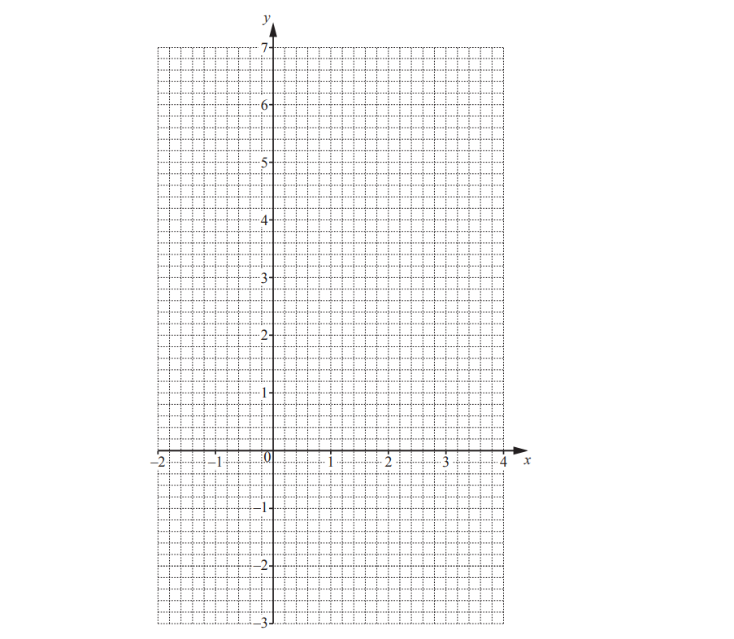

*Source: May/June 2019 0580/33 Q3B*

**Q8** [2 marks]

**Extract:**

y equals 5 plus 2 x minus x squared

i) On the grid, draw the line of symmetry.

[1]

ii) Write down the equation of the line of symmetry.

[1]

*Source: May/June 2019 0580/33 Q4C*

**Q8** [2 marks]

**Extract:**

On the grid, draw the graph of y = 5 + 2x - x^2 for -2 ≤ x ≤ 4.

Use your graph to find the solutions of the equation $5+2x-x^{2}=4.$

$x=$ ....................... or $x=$ .....................

*Source: May/June 2019 0580/33 Q4D*

**Q8** [4 marks]

i) On the grid, draw a line from $(-1,2)\mathrm{to}(1,6).$

[1]

ii) Find the equation of this line in the form $y=mx+c.$

$y=$ ............................ [3]

*Source: May/June 2019 0580/33 Q4E*

### Q9 — medium — 8 marks

**Q9** [8 marks]

i) Complete the table of values for `y equals x open parentheses 3 minus x close parentheses`.

| $x$ | $-4$ | $-2$ | $-1$ | $0$ | $1$ | $2$ | $4$ |
|---|---|---|---|---|---|---|---|
| $y$ |   | $-10$ |   | $0$ | $2$ |   | $-4$ |

[3]

ii) On the grid, draw the graph of `y equals x open parentheses 3 minus x close parentheses` for `negative 4 less-than or slanted equal to x less-than or slanted equal to 4.`

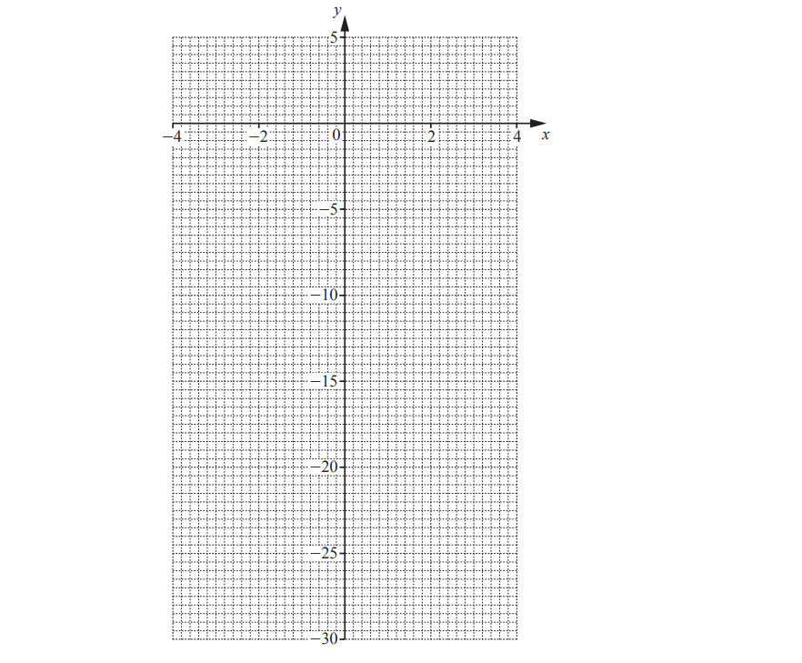

[4]

iii) Write down the co-ordinates of the highest point of the graph for `negative 4 less-than or slanted equal to x less-than or slanted equal to 4.`

[1]

*Source: March 2019 0580/32 Q8C*

### Q10 — medium — 9 marks

**Q10** [2 marks]

Complete the table of values for $y=1+5x-x^{2}$

| $x$ | -1 | 0 | 1 | 2 | 3 | 4 | 5 |
|---|---|---|---|---|---|---|---|
| $y$ |   | 1 | 5 |   | 7 |   | 1 |

*Source: Nov 2020 0580/33 Q3A*

**Q10** [4 marks]

**Extract:**

Complete the table of values for y = 1 + 5x - x^2

| x | -1 | 0 | 1 | 2 | 3 | 4 | 5 |
| y |   | 1 | 5 |   | 7 |   | 1 |

On the grid, draw the graph of $y=1+5x-x^{2}$ for `negative 1 less-than or slanted equal to x less-than or slanted equal to 5`.

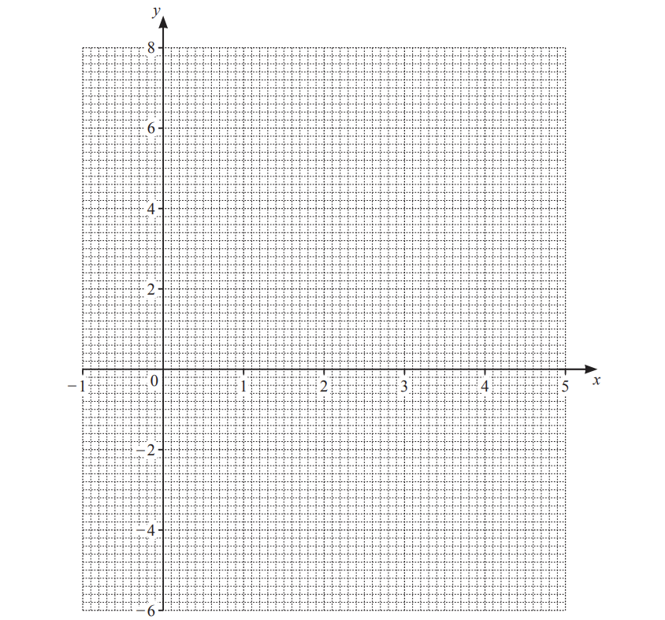

*Source: Nov 2020 0580/33 Q3B*

**Q10** [3 marks]

**Extract:**

y equals 1 plus 5 x minus x squared
On the grid, draw the graph of y equals 1 plus 5 x minus x squared for negative 1 less-than or slanted equal to x less-than or slanted equal to 5.

i) On the grid, draw the line $y$ = 3.

[1]

ii) Use your line to solve the equation $1+5x-x^{2}=3$

$x$= .................... or$x$= .................... [2]

*Source: Nov 2020 0580/32 Q3C*

### Q11 — easy — 5 marks

**Q11** [5 marks]

i) Complete the table of values for $y=x^{2}-2x$

| $x$ | -2 | -1 | 0 | 1 | 2 | 3 | 4 |
|---|---|---|---|---|---|---|---|
| $y$ | 8 |   | 0 | -1 | 0 |   | 8 |

ii) On the grid, draw the graph of $y=x^{2}-2x$ for `negative 2 less-than or slanted equal to x less-than or slanted equal to 4`.

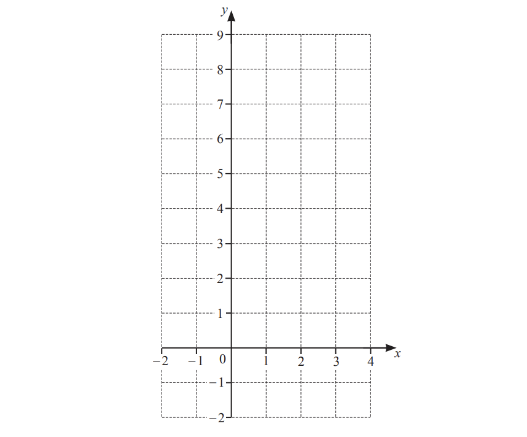

[4]

*Source: Nov 2019 0580/33 Q8A*

### Q12 — easy — 8 marks

**Q12** [8 marks]

i) Complete the table of values for $y=x^{2}-10x.$

| $x$ | $-6$ | $-3$ | $0$ | $3$ | $6$ | $9$ | $12$ | $15$ |
|---|---|---|---|---|---|---|---|---|
| $y$ | $96$ |   |   | $-21$ | $-24$ |   | $24$ | $75$ |

[3]

ii) On the grid, draw the graph of $y=x^{2}-10x\mathrm{for}-6\leqx\leq15.$

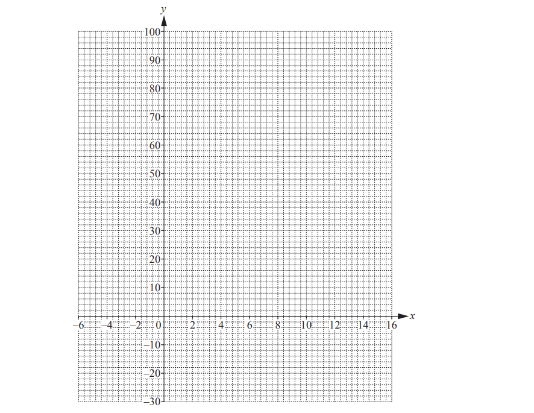

[4]

iii) Write down the co-ordinates of the lowest point of the graph.

[1]

*Source: March 2018 0580/32 Q11B*

### Q13 — easy — 8 marks

**Q13** [2 marks]

Complete the table of values for $y=x^{2}-4x-3$

| $x$ | -2 | -1 | 0 | 1 | 2 | 3 | 4 | 5 |
|---|---|---|---|---|---|---|---|---|
| $y$ |   | 2 | -3 | -6 |   | -6 | -3 | 2 |

*Source: Nov 2020 0580/32 Q10A*

**Q13** [4 marks]

**Extract:**

Complete the table of values for y = x squared minus 4 x minus 3

| x | -2 | -1 | 0 | 1 | 2 | 3 | 4 | 5 |
| y |   | 2 | -3 | -6 |   | -6 | -3 | 2 |

On the grid, draw the graph of $y=x^{2}-4x-3$ for `negative 2 less-than or slanted equal to x less-than or slanted equal to 5`.

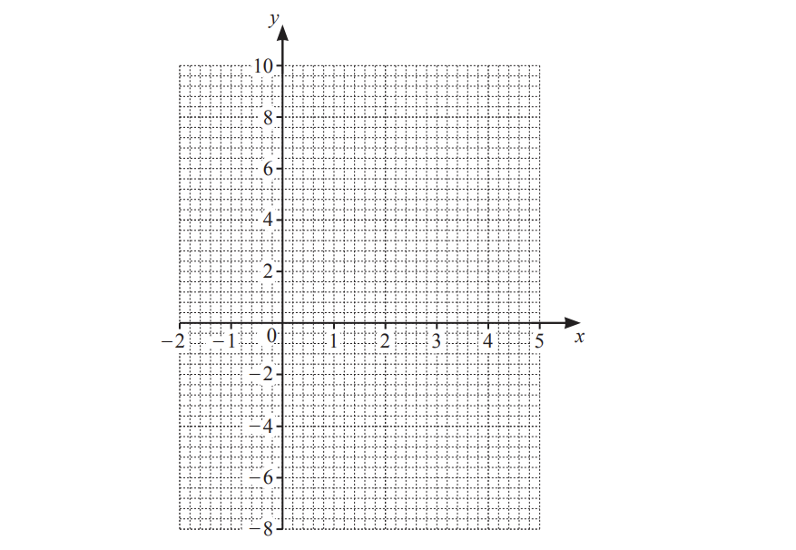

*Source: Nov 2020 0580/32 Q10B*

**Q13** [2 marks]

**Extract:**

On the grid, draw the graph of y = x squared minus 4 x minus 3 for negative 2 less-than or slanted equal to x less-than or slanted equal to 5.

Use your graph to solve the equation $x^{2}-4x-3=0.$

$x$ = .................. or $x$ = ..................

*Source: Nov 2020 0580/32 Q10C*

### Q14 — easy — 8 marks

**Q14** [2 marks]

Complete the table of values for $y=x^{2}-5x+3$.

| $x$ | -1 | 0 | 1 | 2 | 3 | 4 | 5 | 6 |
|---|---|---|---|---|---|---|---|---|
| $y$ |   |   | -1 | -3 | -3 | -1 | 3 |   |

*Source: Nov 2019 0580/32 Q6A*

**Q14** [4 marks]

**Extract:**

| x | -1 | 0 | 1 | 2 | 3 | 4 | 5 | 6 |
| y |   |   | -1 | -3 | -3 | -1 | 3 |   |

On the grid, draw the graph of $y=x^{2}-5x+3$ for `negative 1 less-than or slanted equal to x less-than or slanted equal to 6`.

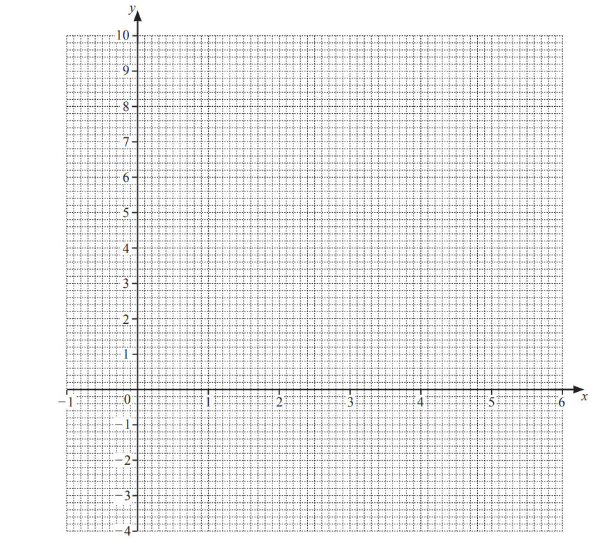

*Source: Nov 2019 0580/32 Q6B*

**Q14** [2 marks]

**Extract:**

On the grid, draw the graph of y equals x squared minus 5 x plus 3 for negative 1 less-than or slanted equal to x less-than or slanted equal to 6.

Use your graph to solve the equation $x^{2}-5x+3=0$

$x$ = .................... or $x$ = ...................

*Source: Nov 2019 0580/32 Q6C*

### Q15 — easy — 10 marks

**Q15** [3 marks]

Complete the table of values for $y=x^{2}-3x-6$

| $x$ | -3 | -2 | -1 | 0 | 1 | 2 | 3 | 4 | 5 | 6 |
|---|---|---|---|---|---|---|---|---|---|---|
| $y$ | 12 |   | -2 |   |   |   |   | -2 |   | 12 |

*Source: June 2020 0580/32 Q9A*

**Q15** [4 marks]

**Extract:**

| x | -3 | -2 | -1 | 0 | 1 | 2 | 3 | 4 | 5 | 6 |
| y | 12 |   | -2 |   |   |   |   | -2 |   | 12 |

On the grid, draw the graph of  $y=x^{2}-3x-6$ for  -`3 less-than or slanted equal to x less-than or slanted equal to 6`.

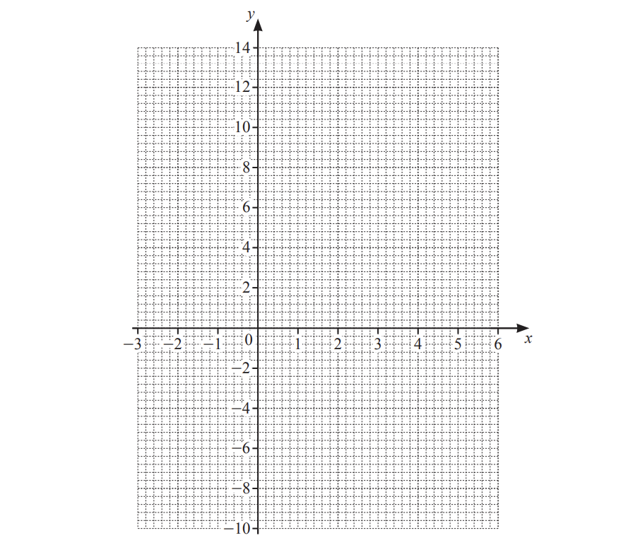

*Source: June 2020 0580/32 Q9B*

**Q15** [1 mark]

**Extract:**

y equals x squared minus 3 x minus 6

Write down the equation of the line of symmetry of the graph.

*Source: June 2020 0580/32 Q9C*

**Q15** [2 marks]

**Extract:**

Complete the table of values for y = x^2 - 3x - 6
On the grid, draw the graph of y = x^2 - 3x - 6 for -3 ≤ x ≤ 6.

Use your graph to solve the equation  $x^{2}-3x-6=0$

$x$ = ............................ 
or $x$ = ............................

*Source: June 2020 0580/32 Q9D*

