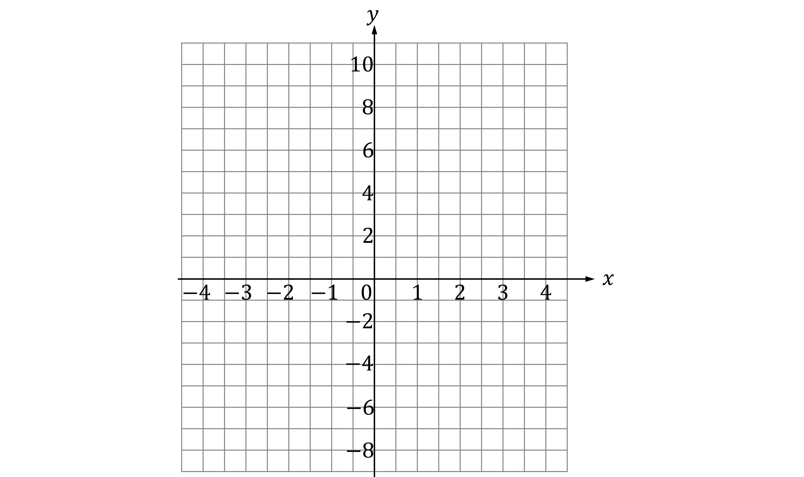
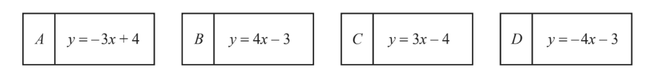
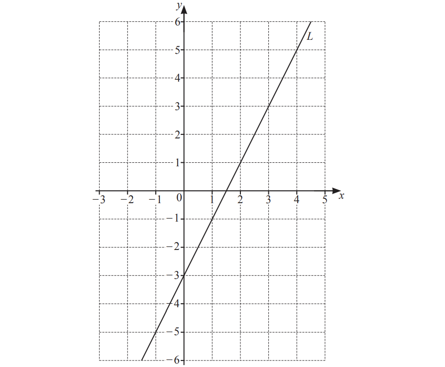
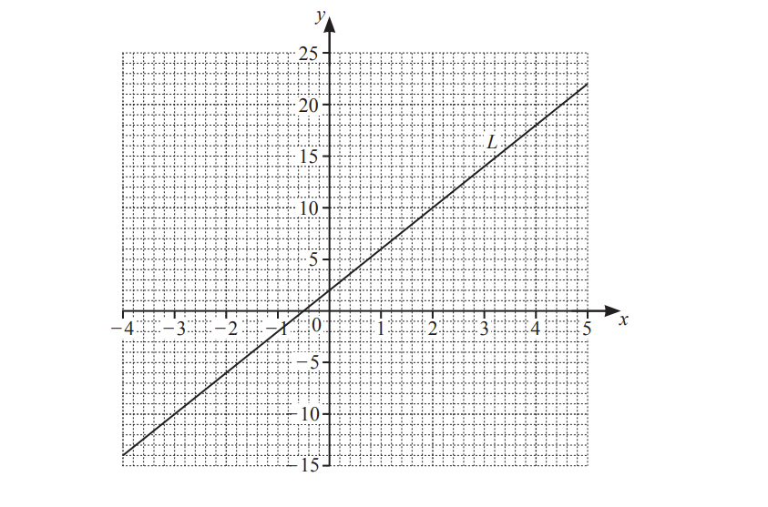
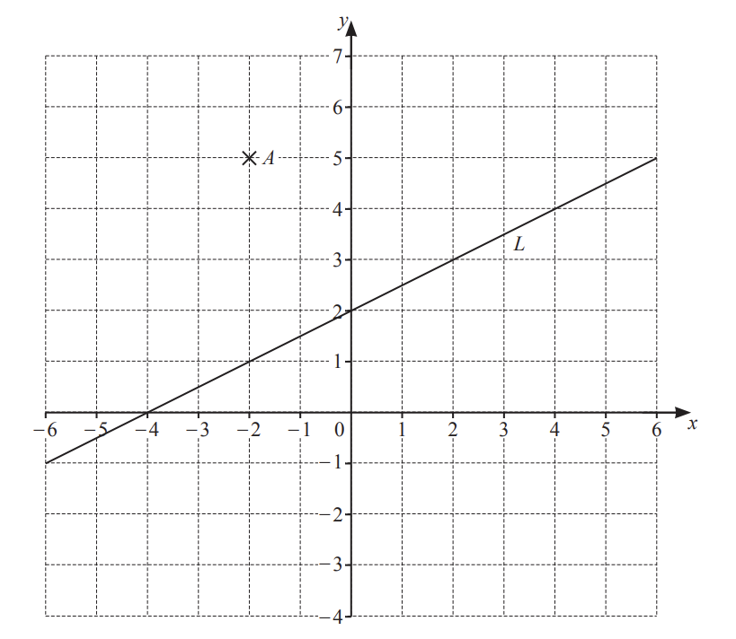
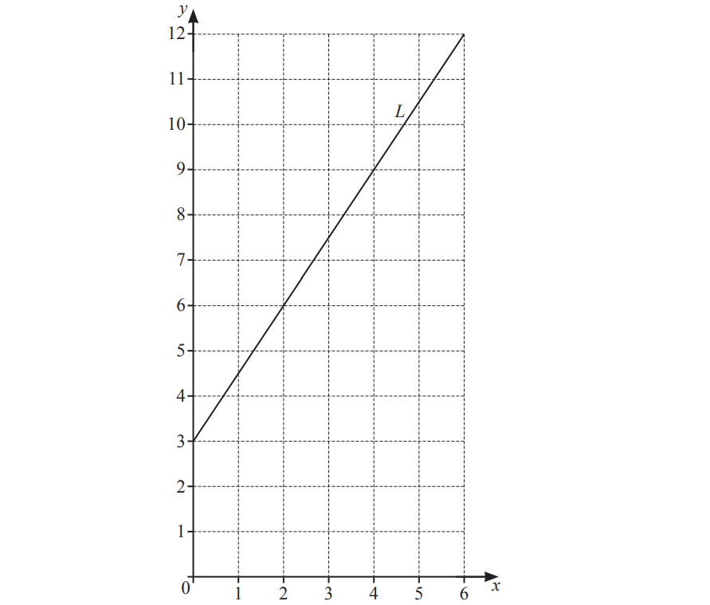
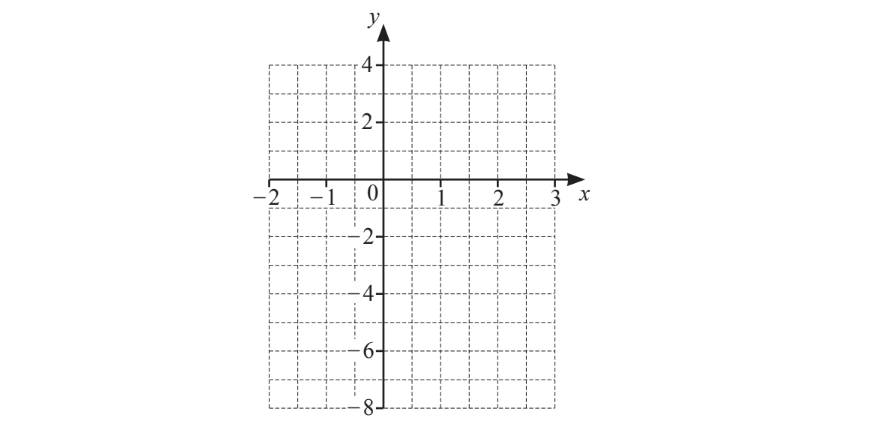
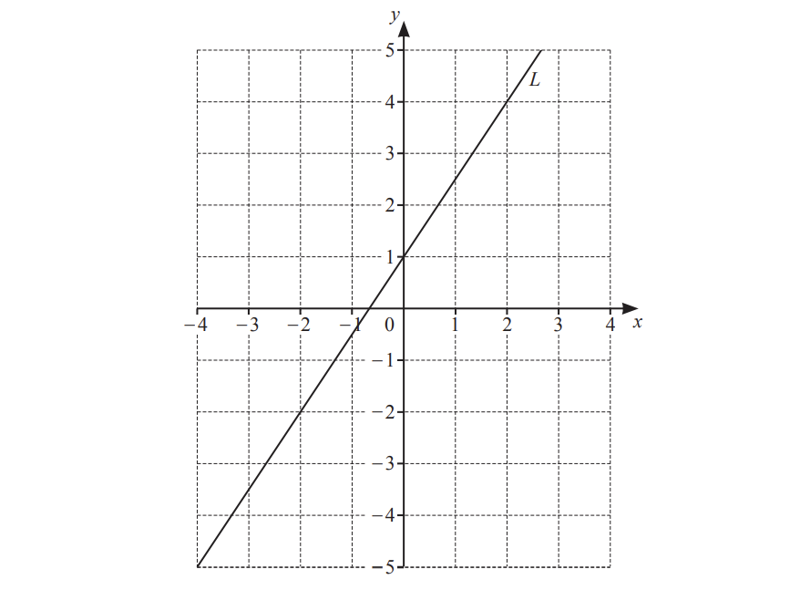
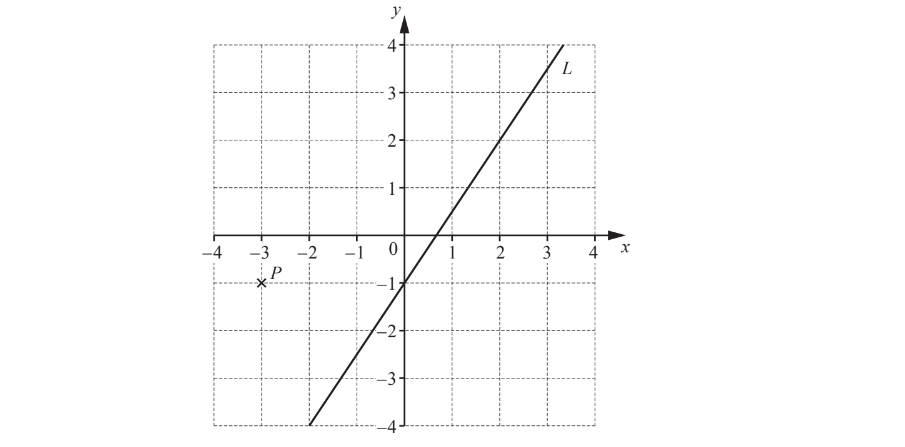

# Exam Questions — Linear Graphs
**Coordinate Geometry & Graphs** · Cambridge (CIE) IGCSE maths (0580 & 0980)
> Source: [https://www.savemyexams.com/igcse/maths/cie/25/core/topic-questions/](https://www.savemyexams.com/igcse/maths/cie/25/core/topic-questions/) · 18 questions across 1 sets

## Exam Questions (18 questions)

### Q1 — hard — 3 marks

**Q1** [3 marks]

Draw on the grid below the line with equation  $y=2x+1$, for $-3\leqx\leq3$.

### Q2 — hard — 5 marks

**Q2** [5 marks]

$A,B,C$ and $D$ are four equations of straight line graphs.

i) Write down the letter of the graph that

a) passes through the point $( 1 , - 1 )$,

[1]

b) has a $y$- intercept of 4,

[1]

c) has a gradient of -4.

[1]

ii) The point $( p , - 26 )$ lies on the line $y=-3x+4$.

Work out the value of $p$.

$p$ = ................................ [2]

*Source: March 2018 0580/32 Q11A*

### Q3 — hard — 1 marks

**Q3** [1 mark]

Write down the equation of the line parallel to $y=5x+6$ that passes through (0, -7).

$y=$..................................

*Source: Nov 2020 0580/12 Q16B*

### Q4 — hard — 3 marks

**Q4** [2 marks]

Find the equation of line $L$ in the form $y=mx+c$

$y$ = ..................................................

*Source: June 2020 0580/11 Q22*

**Q4** [1 mark]

**Extract:**

Find the equation of line L in the form y = m x + c
y = ..................................................

On the grid, draw a line that is perpendicular to line $L$.

*Source: June 2020 0580/11 Q22B*

### Q5 — hard — 3 marks

**Q5** [1 mark]

A straight line, $l$, has equation $y=5x+12$

Write down the gradient of line $l$.

*Source: Nov 2020 0580/13 Q11A*

**Q5** [2 marks]

**Extract:**

A straight line, ![l], has equation ![y equals 5 x plus 12]

Find the coordinates of the point where line $l$ crosses the $x$-axis.

*Source: Nov 2020 0580/13 Q11B*

### Q6 — hard — 4 marks

**Q6** [2 marks]

i) Write down the co-ordinates of the point where the line $y=6x-3$ crosses the $y$-axis.

[1]

ii) Write down the equation of the straight line that

- passes through the origin

and

- is parallel to $y=6x-3$.

[1]

*Source: June 2019 0580/32 Q8A*

**Q6** [2 marks]

i) On the grid, draw the line through the point $( - 3 , - 2 )$ that is perpendicular to the $y$-axis.

[1]

ii) On the grid, draw the line $y=-2x$ .

[1]

*Source: June 2019 0580/32 Q8B*

### Q7 — hard — 8 marks

**Q7** [3 marks]

The line $L$ is shown on the grid.

Find the equation of the line $L$ in the form $y=mx+c.$

y = ...................................................

*Source: Nov 2019 0580/31 Q6A*

**Q7** [2 marks]

The equation of a different line is $y=3x-4$.

i) Write down the gradient of this line.

[1]

ii) Write down the co-ordinates of the point where this line crosses the $y$˗axis.

[1]

*Source: Nov 2019 0580/31 Q6B*

**Q7** [3 marks]

On the grid, draw the graph of $y=-2x+1$ for `negative 4 less-than or slanted equal to x less-than or slanted equal to 5`.

*Source: Nov 2019 0580/31 Q6C*

### Q8 — hard — 7 marks

**Q8** [3 marks]

Line $L$ is drawn on the grid.

Find the equation of line $L.$ 
Give your answer in the form $y=mx+c.$

$y=$ .............................

*Source: March 2019 0580/32 Q8A*

**Q8** [4 marks]

The points (9, $a$) and ($b$, 3) lie on the line $y=\frac{2}{3}x-7.$

Work out the value of

i) $a$,

$a=$.......................... [2]

ii) $b.$

$b=$.......................... [2]

*Source: March 2019 0580/32 Q8B*

### Q9 — medium — 1 marks

**Q9** [1 mark]

Find the co-ordinates of the point where the line $y=3x-8$ crosses the $y$-axis.

*Source: May/June 2019 0580/13 Q4*

### Q10 — medium — 4 marks

**Q10** [4 marks]

i) Write down the coordinates of point $A$.

[1]

ii) On the grid, plot the point (2, -3).

[1]

iii) The line $L$ is shown on the grid.

Find the equation of the line L in the form $y=mx+c$.

$y=$...............................[2]

*Source: Nov 2020 0580/12 Q16A*

### Q11 — medium — 3 marks

**Q11** [3 marks]

Line $L$ is drawn on the grid.

Find the equation of line $L.$ 
Give your answer in the form $y=mx+c.$

$y=$ .............................

*Source: March 2019 0580/32 Q8A*

### Q12 — medium — 2 marks

**Q12** [2 marks]

Find the equation of line $L$in the form $y=mx+c$.

$y=$..........................

*Source: Nov 2020 0580/11 Q20*

### Q13 — medium — 2 marks

**Q13** [2 marks]

A line, $M$, has the equation $y=8x+3$.

Write down the equation of the line parallel to line $M$ that passes through the point (0, 6).

*Source: May/June 2018 0580/13 Q20B*

### Q14 — easy — 2 marks

**Q14** [1 mark]

For the line $y=4x-6$, write down the gradient,

*Source: Oct/Nov 2018 0580/13 Q16A*

**Q14** [1 mark]

**Extract:**

For the line y = 4x - 6

Write down the $y$-intercept.

*Source: Oct/Nov 2018 0580/13 Q16B*

### Q15 — easy — 4 marks

**Q15** [1 mark]

Write down the gradient of the line $y=2x-3$.

*Source: March 2020 0580/12 Q9A*

**Q15** [2 marks]

Complete the table of values for  $y=2x-3$

| $x$ | -2 | 0 | 3 |
|---|---|---|---|
| $y$ |   |   |   |

*Source: March 2020 0580/12 Q9B*

**Q15** [1 mark]

On the grid, draw the graph of  $y=2x-3$  for  `negative 2 less-than or slanted equal to x less-than or slanted equal to 3.`

*Source: March 2020 0580/12 Q9C*

### Q16 — easy — 3 marks

**Q16** [2 marks]

Find the gradient of line$L$.

*Source: June 2020 0580/12 Q23A*

**Q16** [1 mark]

**Extract:**

[The gradient of line L as found in part a]

Write down the equation of line $L$ in the form $y=mx+c$.

$y=$..........................

*Source: June 2020 0580/12 Q23B*

### Q17 — easy — 3 marks

**Q17** [2 marks]

The line $L$ is shown on the grid.

Find the gradient of the line $L$.

*Source: Nov 2019 0580/12 Q20A*

**Q17** [1 mark]

Find the equation of the line $L$ in the form $y=mx+c$.

*Source: Nov 2019 0580/12 Q20B*

### Q18 — easy — 5 marks

**Q18** [1 mark]

The diagram shows a point $P$ and a line $L$.

Write down the co-ordinates of point $P$.

*Source: June 2019 0580/11 Q22A*

**Q18** [2 marks]

Find the gradient of line $L$.

*Source: June 2019 0580/11 Q22B*

**Q18** [2 marks]

**Extract:**

Write down the co-ordinates of point P.
Find the gradient of line L.

Write down the equation of line $L$ in the form $y=mx+c$.

$y$ = ......................................

*Source: June 2019 0580/11 Q22C*

