# Mark Schemes — Real-Life Graphs
**Coordinate Geometry & Graphs** · Cambridge (CIE) IGCSE maths (0580 & 0980)

## Exam Questions (16 questions)

### Q1
> **[exam-tip]**
> To calculate average speed, use
> 
> $\mathrm{speed}=\frac{\mathrm{distance}}{\mathrm{time}}$

Find the distance

- The vertical axis goes up in 1 km increments, so the distance from 'Start' to 'Stop 1' is

*24 km*

Find the time

- The horizontal axis has ten divisions per hour
- That means you can read the time off directly as decimal hours

*1.2 hours*

Calculate the speed

$\mathrm{speed}=\frac{24}{1.2}=20$

**Final answer:** **20 km/h**

**[B1]**
(i)

> **[exam-tip]**
> The formula $\mathrm{speed}=\frac{\mathrm{distance}}{\mathrm{time}}$ can be rearranged to give
> 
> $\mathrm{time}=\frac{\mathrm{distance}}{\mathrm{speed}}$

The distance from 'Stop 2' to 'Finish' is

$60-45=15\mathrm{km}$

Therefore the time taken, in hours, is

$\mathrm{time}=\frac{15}{13}$

**[M1]**

$=1.153846...\mathrm{hours}$

You need to convert 0.153846... hours to minutes

- There are 60 minutes in an hour, so multiply by 60

$60\times0.153846...=9.230769...\mathrm{minutes}$

Round to the nearest minute

- The '2' after the decimal point tells you to leave the '9'unchanged

**Final answer:** **1 hour  9 minutes**

**[A1]**

> **[mark-scheme]**
> **M1**: For $\frac{15}{13}$ or 1.153... .
> 
> **A1**: For 1 [hour] 9 [mins].

(ii)

You can try to mark the correct time point on the 'Finish' line at the top of the graph

- It will be about one and a half small divisions to the right of 1500

However it's easier to use the fact that he is travelling 13 km/h

- If he is at distance 45 km at time 1400

  - then he is going to be at distance 58 km (45+13) at time 1500
- So mark the point time 1500, distance 58 on the graph

  - and draw a straight line through it starting at time 1400, distance 45
  - and carrying on until it hits the 'Finish' line

**[B1]**

> **[mark-scheme]**
> **B1**: For a line from (1400, 45) to 'Finish' passing through (1500, 58).
Andy is stopped when the line on the travel graph is horizontal

Each small division on the horizontal axis is 0.1 hours

- So at 'Stop 1' Andy was stopped for

$6\times0.1=0.6\mathrm{hours}$

- And at 'Stop 2' he was stopped for

$9\times0.1=0.9\mathrm{hours}$

Add those together

$0.6+0.9=1.5\mathrm{hours}$

Convert to minutes

- There are 60 minutes in an hour, so multiply by 60

$60\times1.5=90$

**Final answer:** **90 minutes**

**[B1]**
The total distance is 60 km

Find the total time

- This will be 4 hours (the time from 1000 to 1400)
- plus the time found in part (b)(i)

$4+1.153846...=5.153846...\mathrm{hours}$

**[B1]**

Now you can use $\mathrm{speed}=\frac{\mathrm{distance}}{\mathrm{time}}$

$\mathrm{speed}=\frac{60}{5.153846...}$

**[M1]**

Work that out on your calculator

$=11.641791...$

Round to a suitable degree of accuracy

- In general you should round to 3 significant figures, unless the question specifies otherwise
- The fourth significant figure is a '4'

  - which tells you not to change the third significant figure '6'

**Final answer:** **11.6 km/h (3 s.f.)**

**[A1]**

> **[mark-scheme]**
> **B1**: For 5.153... or 5 hours 9 minutes.
> 
> **M1**: For `fraction numerator 60 over denominator 4 plus your space open parentheses straight b close parentheses open parentheses straight i close parentheses space answer space in space hours end fraction`.
> 
> **A1**: For 11.6 or 11.7 or 11.64 to 11.66.
(i)

Jocasta cycles the whole way at a constant speed

- so her journey will appear as a single straight line
- The line will start at time 1100 and distance 0 at the bottom of the grid
- The line will end at time 1324 (2 hours and 24 minutes after 1100) and distance 60 at the top of the grid

Each hour is divided into 10 small divisions

- and there are 60 minutes in an hour

  - so each small division is $\frac{60}{10}=6$ minutes

- Time 1324 will therefore be four small divisions to the right of 1300

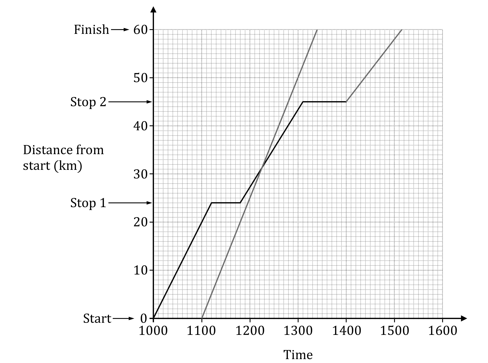

**[B1 B****1]**

> **[mark-scheme]**
> **B1**: For either (1100, 0) or (1324, 60) correctly plotted.
> 
> **B1**: For line from (1100, 0) to (1324, 60).

(ii)

The point where Andy's and Jocasta's travel graphs cross tells you the time, and the distance from start, when Jocasta passes Andy

- The distance at that point is 31

  - and the distance of 'Stop 2' is 45
- So when Jocasta passes Andy, their distance from 'Stop 2' is

*45-31*

**Final answer:** **14 km**

**[B1]**

> **[mark-scheme]**
> **B1**: For answers in the range 13-14. You will also get this mark for a correct distance calculated from an incorrect line drawn in part (e)(i).

### Q2
> *Add 15 minutes to the time that Louise set off*

*09 55 + 15 minutes*

**10 10**** [1]**
i) *Divide the distance in kilometres by the time in hours*

> *15 minutes is a quarter of an hour = 0.25 hours*

*5.6 ÷ 0.25*

**22.4 km/h** **[1]**

ii) *There are 1000 metres in 1 km, so first multiply by 1000*

*22.4 km/h = 22.4 × 1000 m/h = 22400 m/h*

> *There are 60 minutes in an hour, so divide by 60 to change to minutes*

*22400 m/h = 22400 ÷ 60 m/min = 373.333... m/min*

> *There are 60 seconds in a minute, so divide by 60 to change to seconds*

*373.333... m/min = 373.333... ÷ 60 m/s = 6.222... m/s*

**multiplying by 1000 and dividing by 60 twice**** [1]**

> *Round to 1 decimal place*

**6.2 m/s** **[1]**
> *Starting at (09 55, 0) draw a straight line up to (10 10, 5.6)*

> *Draw another straight line from (10 10, 5.6) to (10 33, 5.6)*

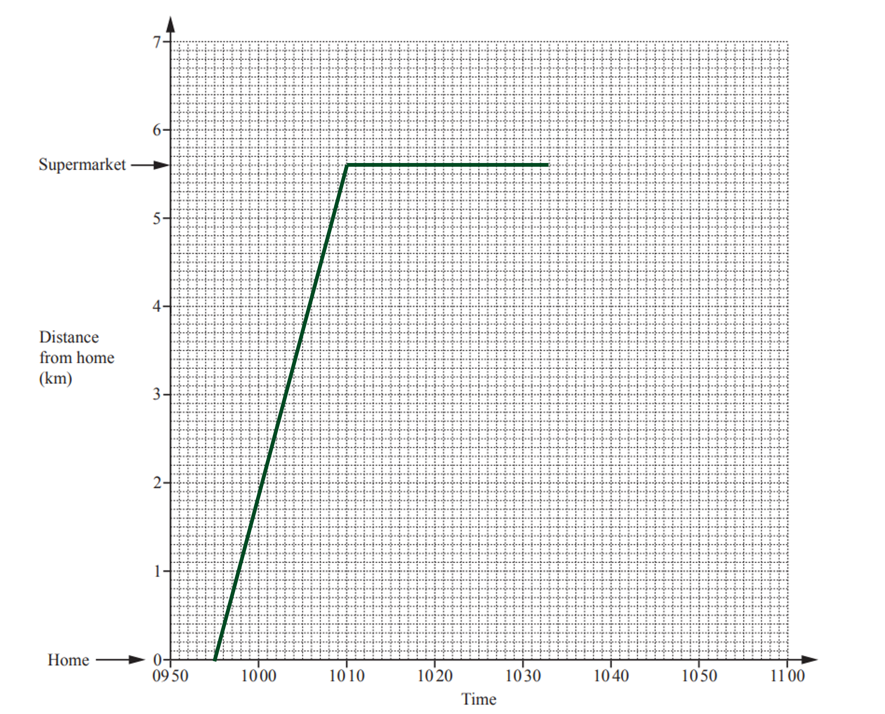

**1 mark for each correct straight line**** [2]**
i) *Divide the speed by 60 to convert from km/h to km/min*

$\frac{28}{60}=0.46666....$

> *Find the time taken for the journey by Louise's mum by dividing the distance by the speed*

$5.6\div0.46666...$

**[1]**

$12\mathrm{min}$ **[1]**

ii) *Starting at (10 07, 0) draw a straight line up to (10 19, 5.6)*

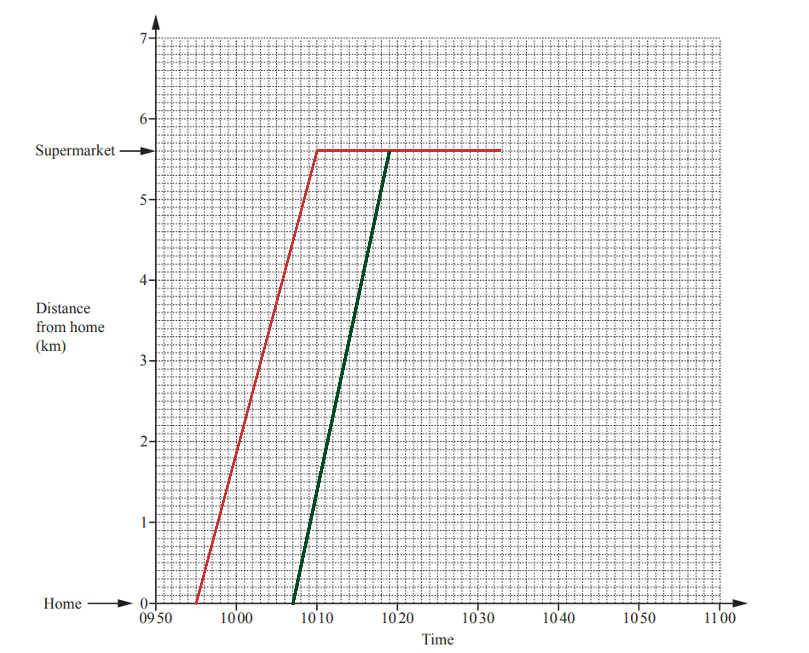

**[1]**
i) *Starting from (10 33, 5.6) draw a straight line that finishes at (10 54, 0)*

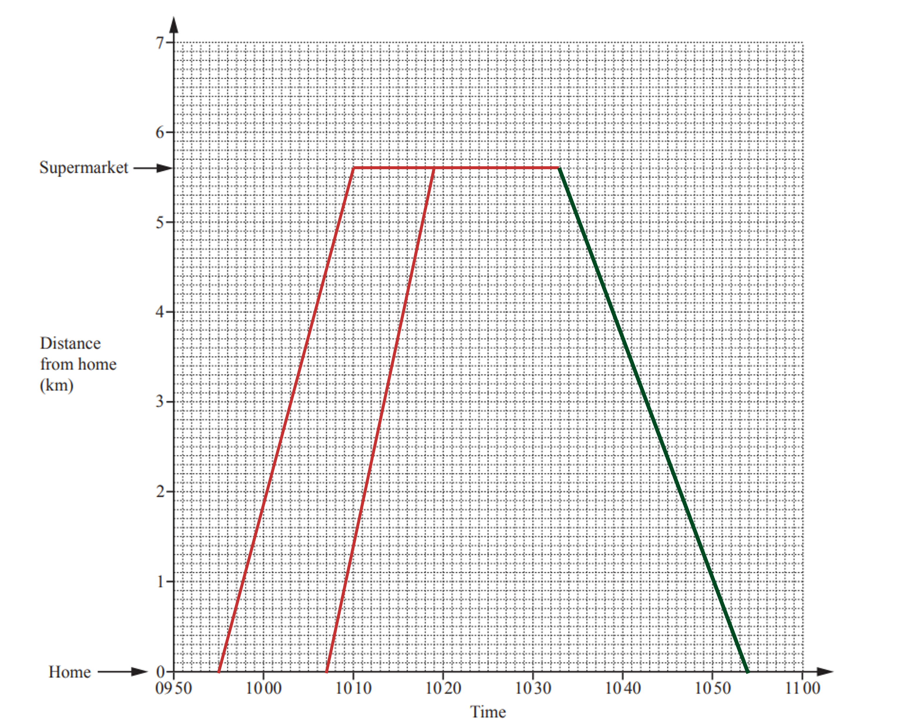

**[1]**

ii) *Find the length of time taken to travel home*

*10 54 - 10 33 = 21 minutes*

> *Convert the time taken to travel home from minutes to hours by dividing by 60*

$\frac{21}{60}=0.35$

> *Calculate the speed by dividing the distance by the time taken*

$5.6\div0.35$

**[1]**

$16\mathrm{km}/h$** [1]**

### Q3
i) *To calculate the speed of an object, use the formula, Speed = *$\frac{\mathrm{Distance}}{\mathrm{Time}}$ .

> *From the graph,*

*at time *$T=12$* minutes, Anand has travelled distance *$D=4$* km *

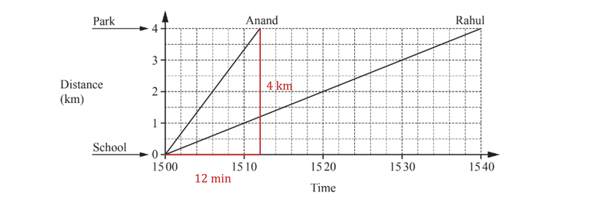

* **The units in the solution are kilometres per hour so convert the time into hours.*

$\frac{12}{60}=0.2$* hours*

> *Substitute the time (in hours), and the distance (in km) into the formula to determine the speed.*

$4\div0.2$

**[1]**

`bold 20 bold space bold km bold ⁄ bold h`* ***[1]**

** **ii) *Using the graph, the arrival times for Anand and Rahul at the park are*

*Anand = 15 12*
*Rahul = 15 40*

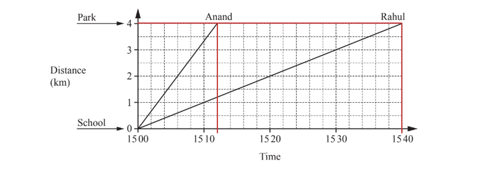

> *Calculate the difference between these times.*

*15 40 - 15 12 *

**28 minutes** **[1]**

** **iii) *Subtract 12 minutes from Rahul's time of arrival at the park (15 40). *

*15 40 - 12 minutes *

** ****15 28**** [1]**
i) *Using the graph, the horizontal change of the two different straight lines represent the time spent cycling and walking.*

*Anand spent 6 minutes cycling*
*Anand spent 20 minutes walking*

**[1]**

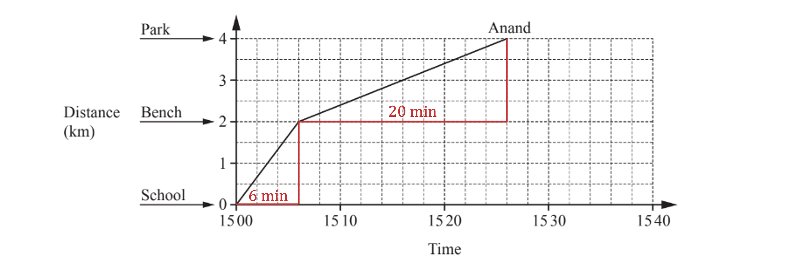

> *Write this as a ratio.*

*6 : 20*

> *Simplify the ratio by dividing both parts of the ratio by their greatest common factor (2).*

**3 : 10 ****[1]**

** **

iia) *Determine the time it takes Rahul to travel 1 km when walking. *

* **6 km/h = 6 km every 60 minutes*

> *Divide both the distance and time by 6 to maintain the same ratio. *

*1 km every 10 minutes*

> *As Rahul walks 2 km, double the time to calculate how long it takes Rahul to walk to the bench. *

*10 *$\times$* 2 = 20 minutes*

> *Next, determine the time it takes Rahul to travel 1 km when cycling. *

*15 km/h = 15 km every 60 minutes*

> *Divide both the distance and time by 15 to maintain the same ratio. *

*1 km every 4 minutes*

> *As Rahul cycles the remaining distance of (4 - 2 =) 2 km, double the time to calculate how long it takes Rahul to cycle to the park.*

* **4 *$\times$* 2 = 8 minutes*

> *Rahul walks 2km in 20 minutes, then cycles 2km in 8 minutes.*

> *As Rahul leaves School at 15 00, he arrives at the bench, 20 minutes later, at 15 20.*
*Draw a straight line from (15 00, 0) to (15 20, 2). *

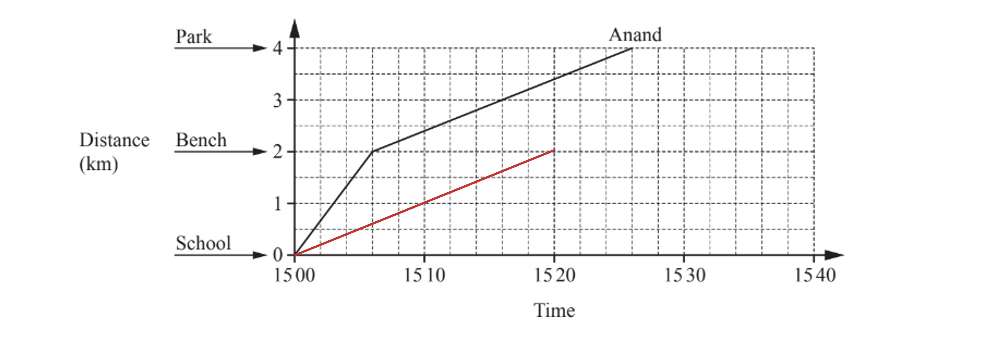

* ***[1]**

> *Rahul leaves the bench at 15 20 and arrives at the park, 8 minutes later, at 15 28.*
*Draw a straight line from (15 20, 2) to (15 28, 4). *

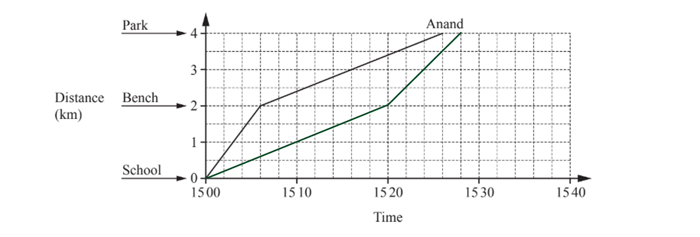

**[1]**

** **iib) *Using the graph, the times each person arrived at the bench are *

*Anand = 15 06*
*Rahul = 15 20*

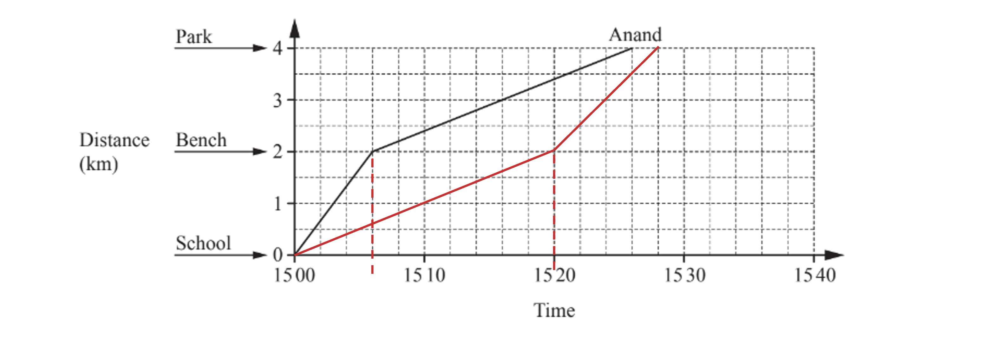

> *Calculate the difference between these times.*

* **15 20 - 15 06*

**14 minutes**** ****[1]**

**  **

iic) *The greatest distance is the furthest vertical distance between the two line graphs for Anand and Rahul.*
*The two lines are parallel between 15 06 and 15 20 and so the vertical distance between the lines during this time is the same .*

> *At the chosen time of 15 20,  *

*Anand is 3.4km from School*
*Rahul is 2km from School*

* **Find the difference in the distances from school at these two times.*

*  3.4 - 2*

** ****1.4 km**** [1]**

**Any value within the range of 1.25 to 1.5 km is accepted**

### Q4
> *Each minor grid line on the horizontal time axis represents *

$30\div6=5\mathrm{mins}$

> *Find the difference in the times from the start and end of Mr Patel's journey.*

$9:55-9:00=55\mathrm{minutes}$

**55 min**** ****[1]**
> *From the graph, use the formula: Speed = *$\frac{\mathrm{Distance}}{\mathrm{Time}}$* where *

*Distance: *$D=18\mathrm{km}$

*Time: *$T=10\mathrm{mins}=\frac{10}{60}\mathrm{hours}$

> *Substitute these values into the formula.*

$18\div\frac{10}{60}$

** [1]**

> *Complete the calculation.*

$18\times\frac{60}{10}=18\times6=108$

**108 km/h**** [1]**
> *Work through each point in order.*

> *"He spends 35 minutes at the library" so draw a horizontal line from (09 55, 31.5) to (10 30, 31.5).  *

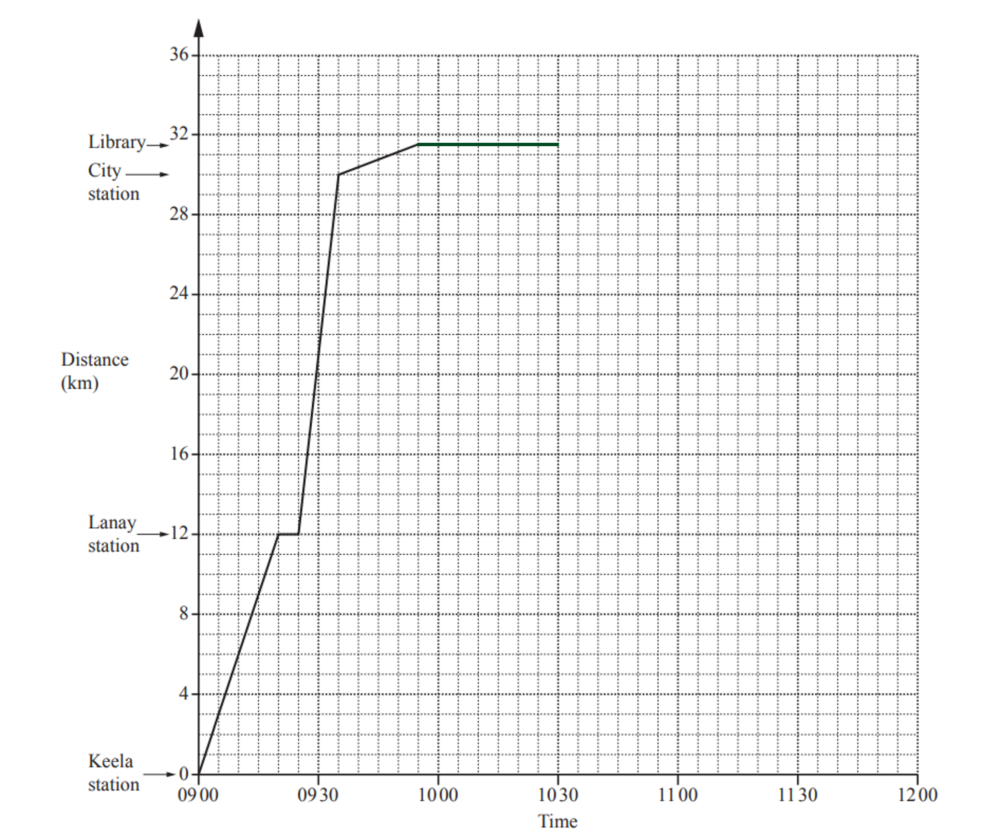

> *"He walks back to City station at the same constant speed he walked to the library" so inspect the graph to determine the time and the distance of the journey Mr Patel took from City station to the Library.*

*Time = 20 minutes*

*Distance = 1.5 km*

> *Draw a straight line down from the current point (10 30, 31.5) to City station over 20 minutes to the point (10 50, 30).  *

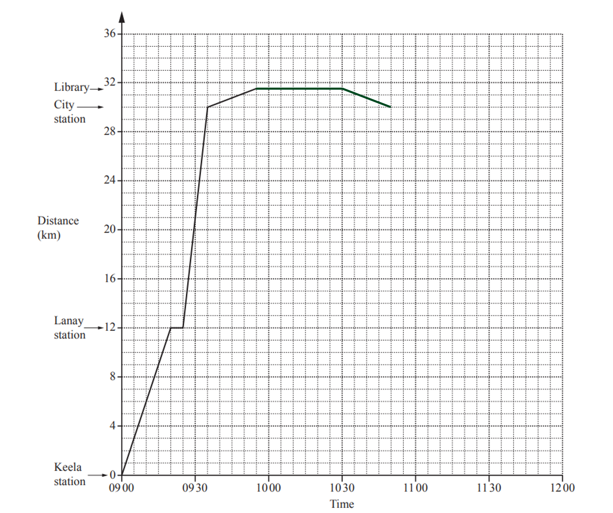

**[1]**

> *"The train takes 20 minutes to travel from City station to Lanay Station" so draw a straight line from (10 50, 30) to (11 10, 12).   *

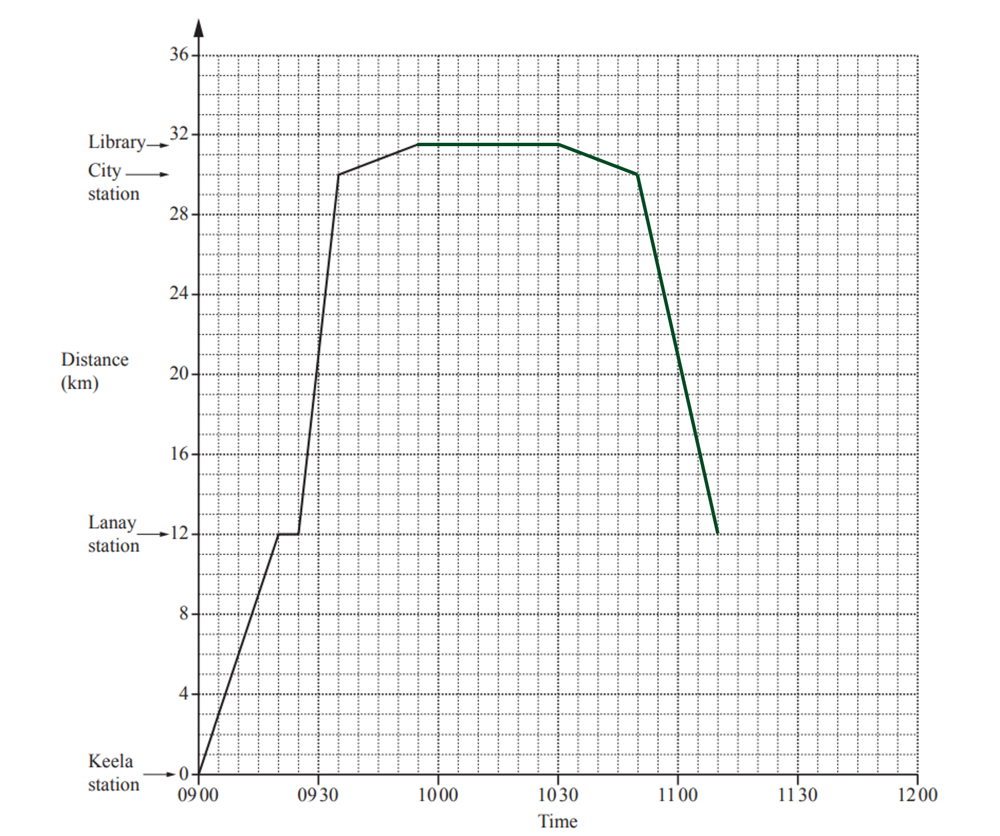

**[1]**

*"The train stops for 10 minutes at Lanay station" so draw a horizontal line from (11 10, 12) to (11 20, 12). *

**[1]**

> *"The train travels at a constant speed of 48 km/h from Lanay station to Keela station" so determine the length of time it takes by using the formula Time = *$\frac{\mathrm{Distance}}{\mathrm{Speed}}$* where *

*Distance: *$D=12\mathrm{km}$

*Speed: *$S=48\mathrm{km}/h$

*Time: *$T=\frac{12}{48}=\frac{1}{4}\mathrm{hours}$

> *Convert the time to minutes by multiplying by *$60$*.*

$\frac{1}{4}\times60=15\mathrm{mins}$

> *The time Mr Patel arrives at Keela station is*

$1120+15\mathrm{mins}=1135$

*Draw a straight line from (11 20, 12) to (11 35, 0). *

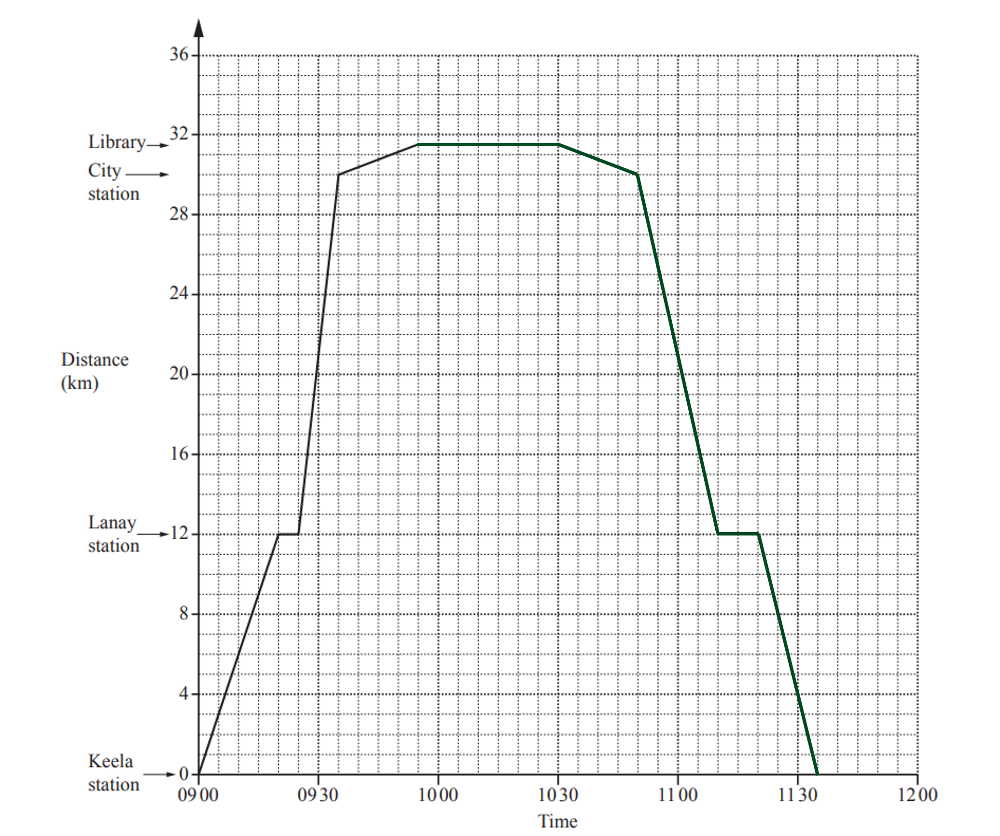

**[1]**

### Q5
> *Caroline starts off later than Rob so is behind him until 08 20 (the point of intersection) when she overtakes him*

**The point of intersection is where Caroline cycles past Rob** **[1]**
> *Find the distance travelled by Rob and the time he has taken to travel it*

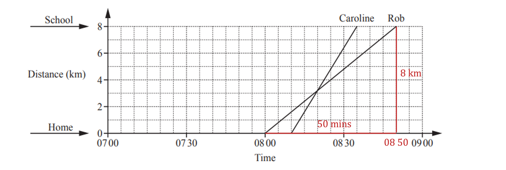

*Rob travels 8 km in 50 minutes*

> *Remember to keep units in hours*

$50\mathrm{mins}=\frac{50}{60}\mathrm{hours}$

> *Rob's speed can be calculated by dividing the distance he has travelled by the time taken*

$\mathrm{Speed}=8\div\frac{50}{60}$

**[1]**

$9.6\mathrm{km}/h$ **[1]**
> *Plot a point at (07 25, 0)*

> *William travels *$6\mathrm{km}/h$*, so plot another point  an hour later at (08 25, 6)*

> *Draw a straight line through both points extending up to (08 45, 8)*

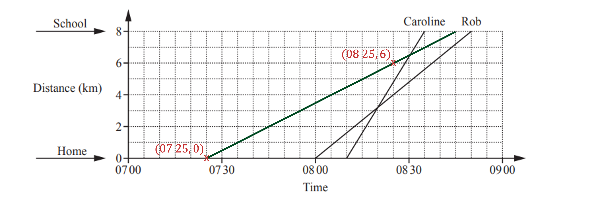

**[1]**
> *Find the greatest vertical distance between the lines representing Rob and Williams' journeys*

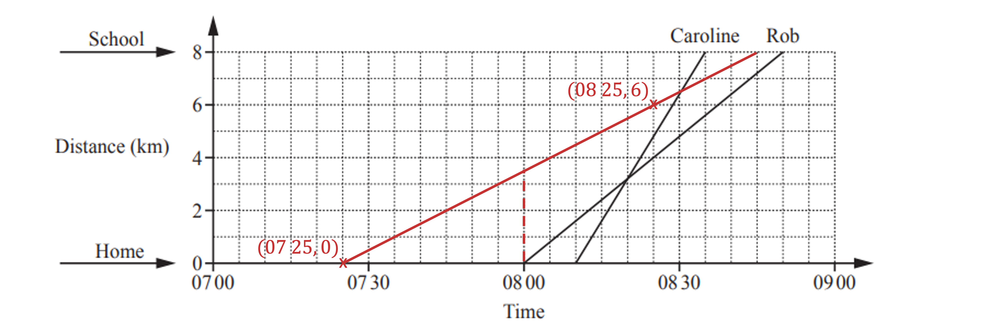

> *Read off the time from the *$x$*-axis*

**08 00** **[1]**
> *The order of arrival at school is the order in which the lines on the graph reach a distance of 8 km*

**First: Caroline     **** ****Second: William     **** ****Third: Rob**** [1]**

### Q6
ia) *Read up from 4km on the horizontal scale to the straight line graph, then across to the vertical scale to get the cost for this distance.*

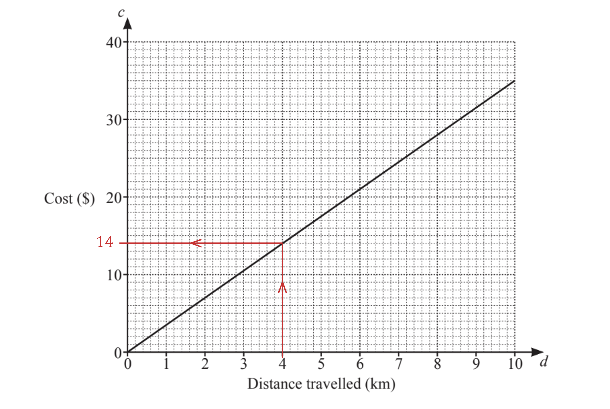

**\$14*** [***1]**

** **

ib) *Divide any known distance by the cost for this distance.*

$14\div4=3.5$

**\$3.50*** ***[1]**

** **

ic) *The distance *$d$* multiplied by the cost per kilometre (*`$ 3.50`*) gives us the total cost *$c$

**c**** = 3.5****d*** ***[1]**

iia) *Multiply the distance (*$d=4km$*) by the cost per kilometre (*`$ 2`*), then add the hire cost (*`$ 5`*).*

$4\times2+5$

** ****13**** [1]**

** **iib)*As the  cost increases at a constant rate, the cost is a linear relationship and so an equation would be of the form*

$c=md+k$

> *where *$m$* is the charge per kilometre, and *$k$* is the hire charge.*

> *As the cost per kilometre *$m=2$*,*

$c=2d+k$

**[1]**

> *As the hire charge *$k=5$*,*

* **c **= 2**d** + 5 ***[1]**

** **iic) *The line intersects the vertical axis at*

`open parentheses 0 comma space 5 close parentheses`

> *For each kilometre, the cost increases by *$2$*.*
*Start at point (0, 5), then find another point on the line by moving 2 units up for every 1 unit across.*
*Connect these points with a straight line.*

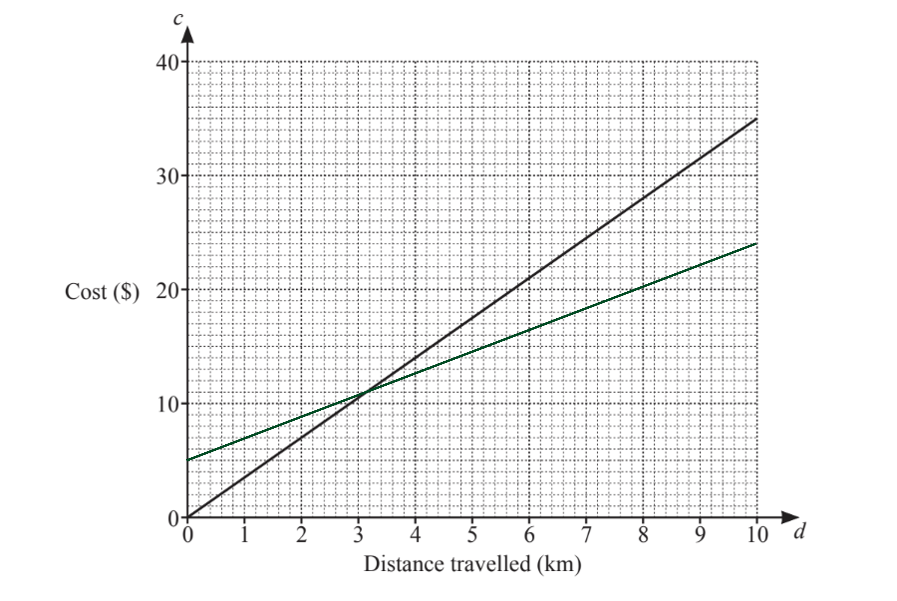

**Correct ruled line**** [2]**

**1 mark for a straight line with a gradient of 2 OR an intercept of (0,5)**

* *iid) *At the point of intersection the cost of both taxis is the same, before this point Saanvi's taxis are cheaper and after this point Krishna's taxis are cheaper*

**No because the graph shows that after the two lines intersect, the cost for ****Krishna's taxis**** is lower than ****Saanvi's taxis*** ***[1]**
i) *The cost is equal to the combination of hours and passengers stated*

**61** **[1]**

** **

ii) *5 hours and 8 passengers can be represented as *

$5h+8p$

**[1]**

> *Use the same linear format for the equation as in part bi)*

**5****h**** + 8****p**** = 80**** ****[1]**

**  **

iii) *The two simultaneous equations to solve are*

$3h+10p=61$

$5h+8p=80$

> *Multiply the first equation by 5 to make the coefficients of *$h$* the same*

`open parentheses 5 cross times 3 h close parentheses plus open parentheses 5 cross times 10 p close parentheses equals open parentheses 5 cross times 61 close parentheses`

$15h+50p=305$

> *Multiply the second equation by 3 to make the coefficients of *$h$* the same*

*  *`open parentheses 3 cross times 5 h close parentheses plus open parentheses 3 cross times 8 p close parentheses equals open parentheses 3 cross times 80 close parentheses`

$15h+24p=240$

**[1]**

> *Equating coefficients of *$h$* or *$p$* is accepted*

*Eliminate the *$h$* term from each equation by subtracting one equation from the other*

**[1]**

> *Correctly eliminating *$h$* or *$p$* is accepted*

> *Solve the 1-step equation by dividing both sides by 26*

$p=65\div26=2.5$

**[1]**

> *Correctly finding *$p=2.5$*or *$h=12$* is accepted*

> *Substitute *$p=2.5$* into either of the two original equations and solve for *$h$

`table row cell 3 h plus open parentheses 10 cross times 2.5 close parentheses end cell equals 61 end table`

$3h+25=61$

$3h=61-25$

$3h=36$

$h=\frac{36}{3}$

$h=12$

* ***h**** = 12, ****p**** = 2.5 ****[1]**

### Q7
i) *The speed of an object is calculated using the formula, Speed = *$\frac{\mathrm{Distance}}{\mathrm{Time}}$*.*

> *From the graph:*

*Distance = *$90\mathrm{km}$
*Time = *$14:30-13:45=45$* minutes*

> *Convert *$45$* minutes into hours by dividing by *$60$*.*

$\frac{45}{60}=\frac{3}{4}$* hours*

> *Calculate the speed by substituting the known values into the formula.*

*Speed = *$90\div\frac{3}{4}=120$

**[1]**

$120\mathrm{km}/h$** [1]**

ii) *The horizontal line shows when the train was at Station *$B$*.*

$10\mathrm{min}$ **[1]**

iii) *Draw a straight line from the end of the horizontal line at Station *$B$* to the point in line with *$1520$* and Station *$C$*.*

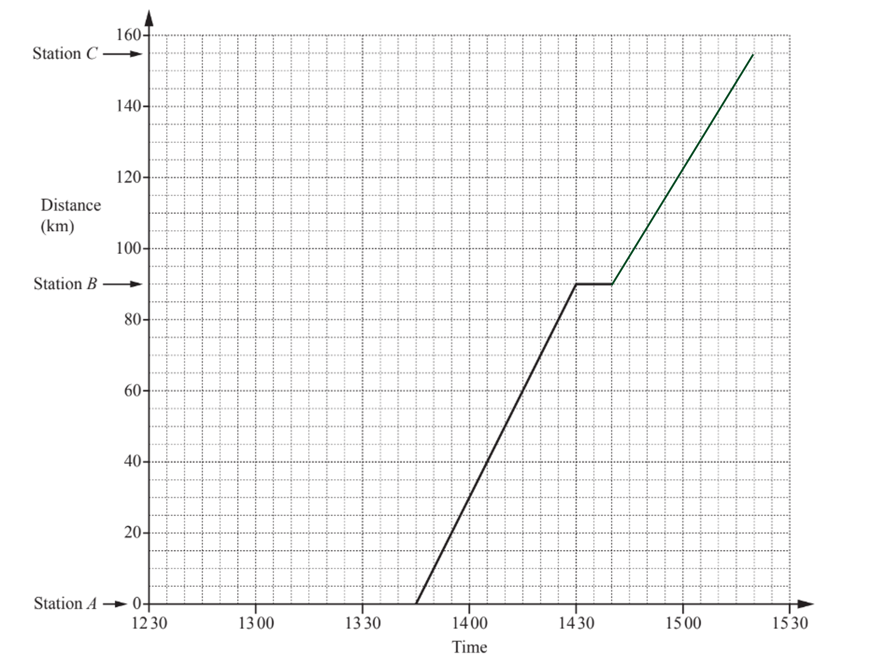

**[1]**

iv) *The gradient of the line is less steep between *$B$* and *$C$* than *$A$* and *$B$*.*

**Between station **$A$** and station **$B$ **[1]**
i) *Calculate the time taken using the formula, Time =* $\frac{\mathrm{Distance}}{\mathrm{Speed}}$*.*

> *From the graph*

*the distance between Station C and Station A is 155 km*

> *The speed of the train is given as *`62 k m ⁄ h`*.*
*Substitute these into the formula to determine the time of the journey.*

*Time = *$\frac{155}{62}=2.5\mathrm{hours}$

**[1]**

> *Convert *$0.5$* hours to minutes by multiplying by *$60$*.*

$0.5\times60=30$* minutes*

**Final answer:** $2$** h **$30$** min**** [1]**

ii) *Add 2 hours and 30 minutes to 12 45*

*12 45 + 2 hours + 30 minutes*
*= 14 45 + 30 minutes*
*= 15 00 + 15 minutes*

**15 15 ****[1]**

iii) *Draw a straight line from Station *$C$* at *$1245$* to Station *$A$* at *$1520$

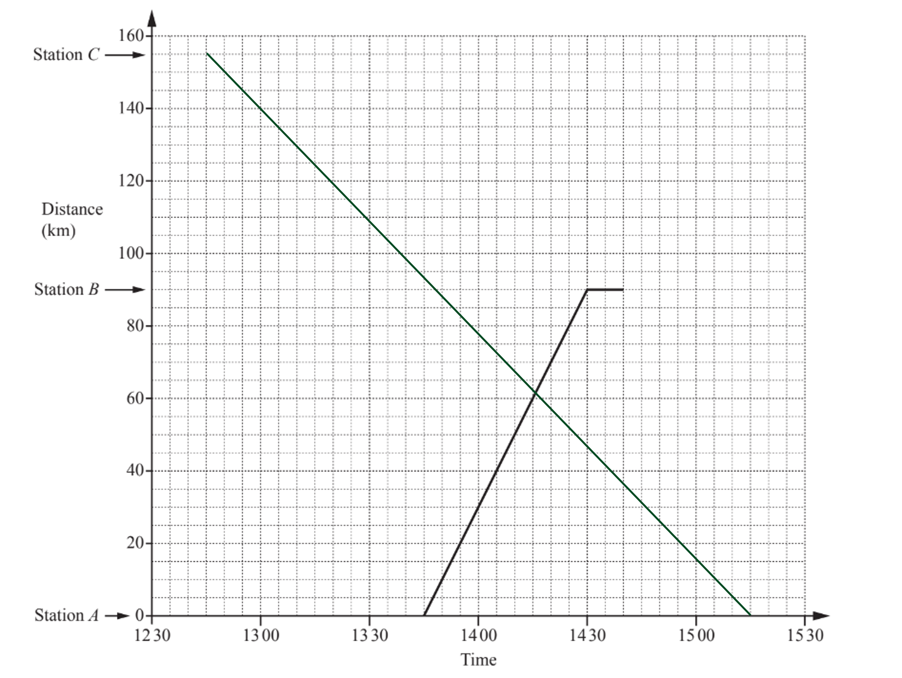

**[1]**

iv) *From the graph, the two trains pass each other at *

$62\mathrm{km}$ **[1]**

**Answers between 58 and 63 are accepted**

### Q8
*Find a point on the line that crosses grid lines* 
*Draw a vertical line down to the **x**-axis and a horizontal line across to the **y**-axis*

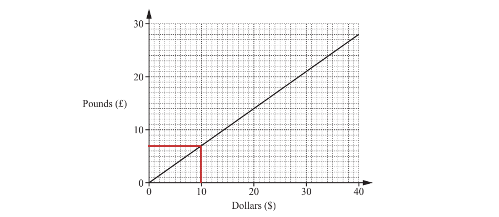

> *Write down the conversion between dollars and pounds*

*10 dollars = 7 pounds*

**[1]**

*Find the equivalent price in pound for 120 dollars*
 *Multiply both values in the conversion by 12*

*10 x 12 dollars = 7 x 12 pounds* *120 dollars = 84 pounds*

> *Compare the two prices*

*84 pounds is less than 90 pounds*

**[1]**

**Final answer:** **The shop price is lower**** [1]**

### Q9
> *Draw a dotted line across from 5000 shillings until you reach the line on the graph. Then draw a dotted line down to the **x** axis.*

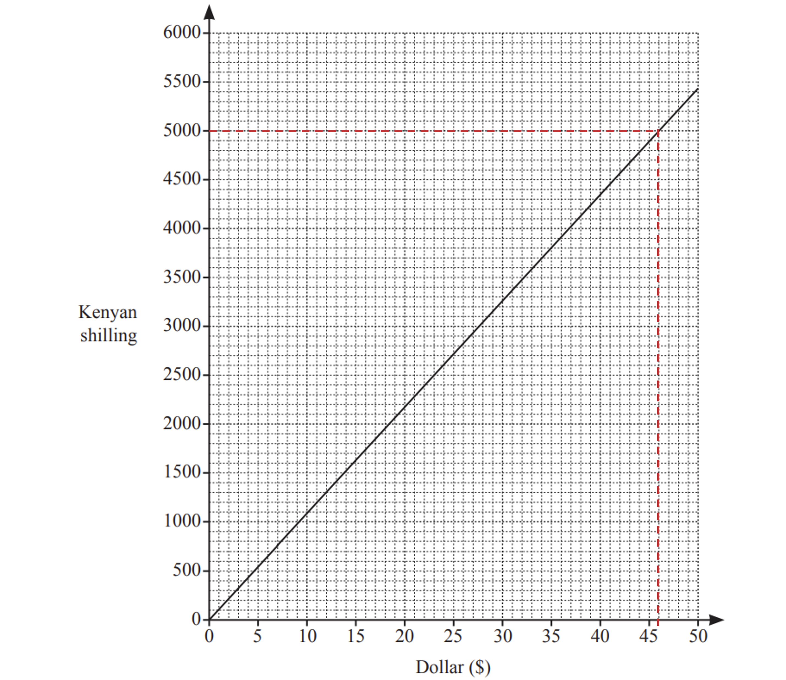

**\$46**** ****[1]**
> *The graph does not go up to \$420 so find a factor of \$420 that is on the graph and scale it up.*

**Work out \$42 and multiply by 10**** ****[1]**

**There are other correct methods such as working out \$10 and multiplying by 42**
> *The new exchange rate is \$1 = 90 shillings. *
*Multiply by 10 to give points to plot.*

*\$10 = 900 shillings*

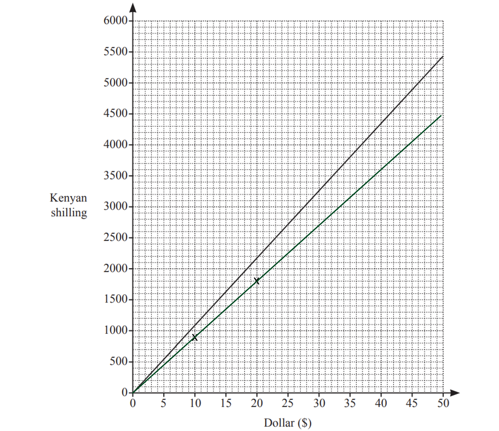

**Correct plotted point other than (0,0)**** ****[1] **
**Correct ruled line**** [1]**

### Q10
> *Begin by checking the scale on the time axis. Every three squares is 30 minutes, which means that each square is worth 10 minutes.*

> *The line starts after one square on the time axis, which means that Hua started her journey at 10 00 + 10 minutes. *

$1010$* ***[1]**
(i) *She stops for a rest when the line is horizontal, since this means time is continuing but the distance is not changing.*
*There is a horizontal line when the distance is 8 km.*

$8\mathrm{km}$* ***[1]**

(ii) *The horizontal line is 2 squares long, and we know that each square is worth 10 minutes.   *

$10\mathrm{minutes}\times2$

$20\mathrm{minutes}$* ***[1]**
> *The stay at the library will be drawn as a horizontal line for one square (because every square is 10 minutes).*

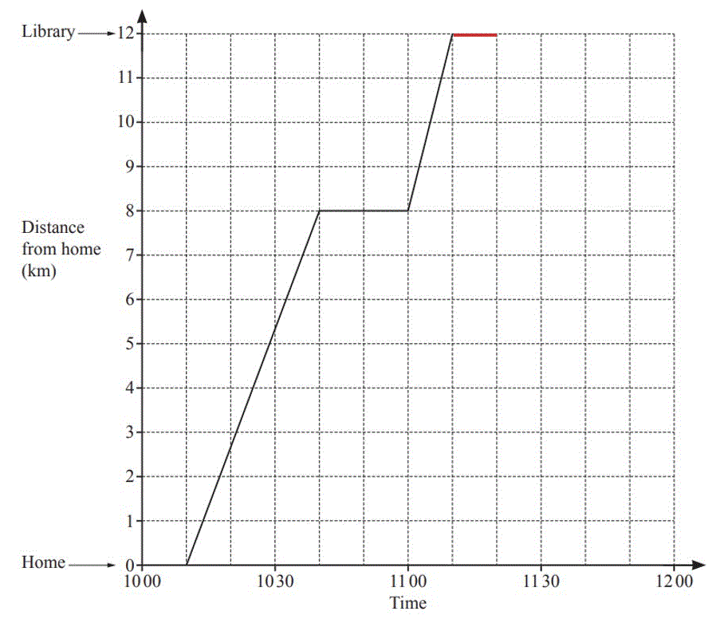

> *Hua travels at a constant speed of 24 km/h to get home, and now has 12 km to travel. Because 12 is half of 24, we know that it will take her half an hour to get home. *

$1120+30\mathrm{minutes}=1150$

> * Draw a line joining the horizontal line to the time axis at 11 50.  *

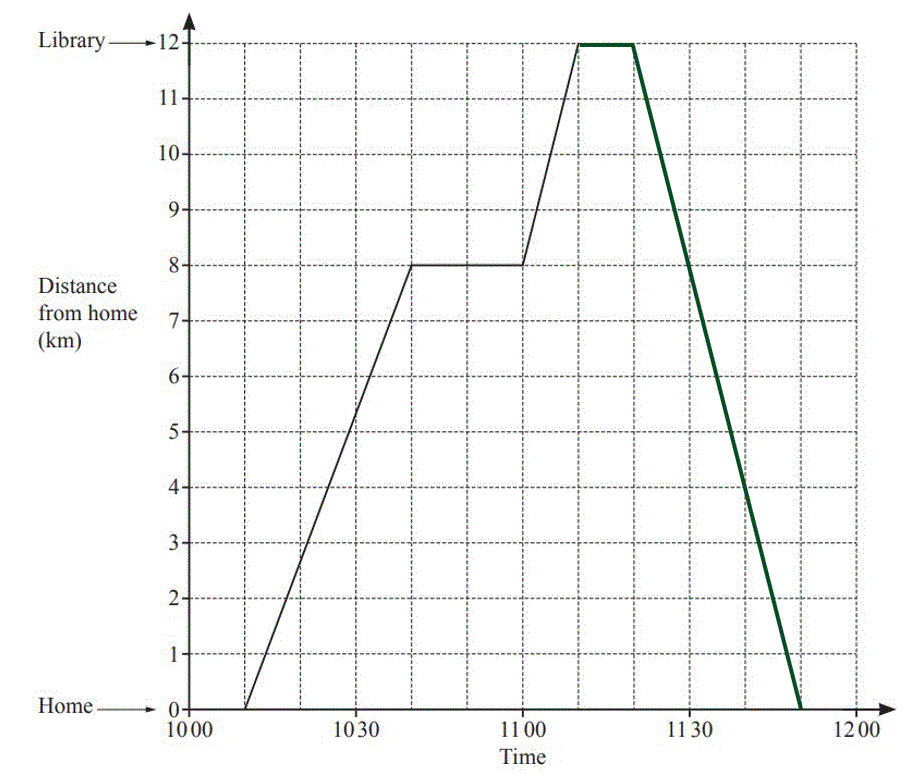

**  Horizontal line drawn correctly**** ****[1] **
**Second line drawn correctly with a rule****r ****[1]**

**If no marks scored, 1 mark can be allowed for finding "30 minutes" or "half an hour"**

### Q11
> *The arrow is showing that the shop is halfway between 12 km and 18 km.*

**15 km ****[1]**
> *On a distance-time graph, a horizontal line means that the object is not moving. *
*In this context,*

**He has arrived at the shop**** ****[1]**
> *The shop is 15km from home. If Juan is travelling at a constant speed of 15km/h, this means it will take him 1 hour to get home so he will arrive home at 16 15.   *

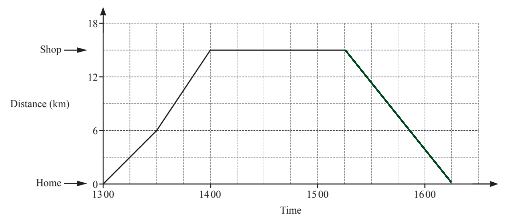

**[1]**

### Q12
> *Draw a line up from £5 on the horizontal axis until it hits the line *
*Then draw a line across and read off the vertical \$ axis*

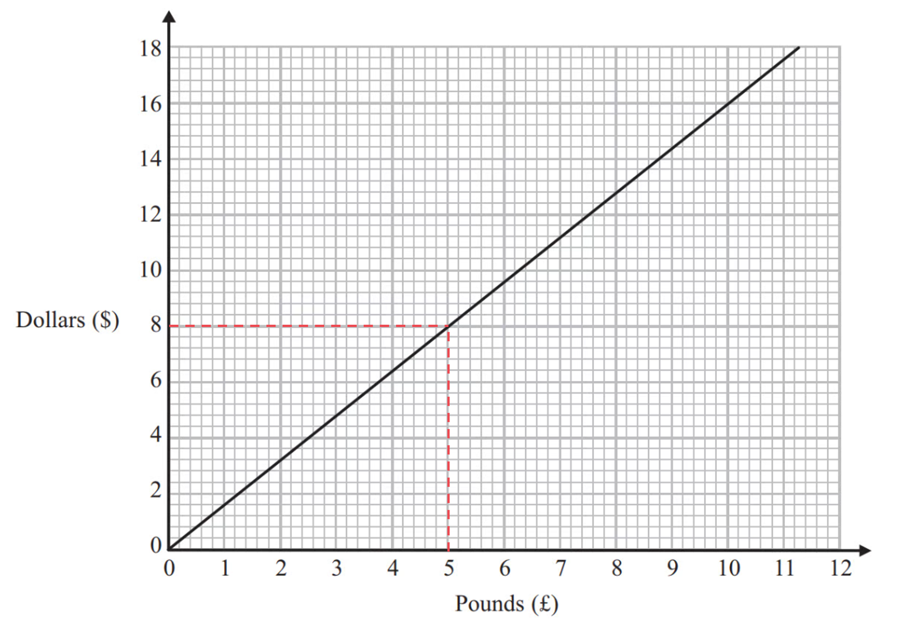

**\$8 ****[1]**

### Q13
> *The horizontal line on the graph shows where Sarah has stopped. *
*Each small square on the **y**-axis represents 0.1 so count up from 0 until you reach the horizontal line.*

**1.2 km**** ****[1]**
> *The horizontal part of the graph at the end shows that Sarah has reached school. Each small square on the **x-**axis represents one minute. The horizontal part of the graph starts halfway between 08 40 and 08 50, which is 08 45. *

> *Finding the difference between this time and the start of the school day at 08 55.*

$0855-0845=10\mathrm{minutes}$

**10 minutes** **[1]**

### Q14
> *On the horizontal scale, three grid squares is equivalent to 30 minutes. *
*Calculate the time for one square.*

*30*$\div$*3 = 10*

> *The horizontal scale increases in 10 minute intervals per grid square. *
*One grid square along from 08:00 is the point where Michael starts his journey. Add 10 minutes onto this time*

**08 10** **[1]**
i) *When Michael is at rest, the distance stays the same whilst the time passes. *
*This is represented by a horizontal line. *
*The value on the vertical scale of the horizontal line is the distance.*

**8 km*** ***[1]**

ii) *From the graph, the time this horizontal line begins is 09 20.*
*The time this horizontal line ends is 09 50.*
*Subtract these times to determine the length of time Michael stopped.*

*09 50 - 09 20*

** 30 minutes** **[1]**
> *A faster speed is represented by a steeper gradient.*

**The gradient of the line before Michael stopped is steeper** **[1]**

### Q15
*"He stops at the post office on the way"* 
*So we are looking for the first flat portion of the graph*

> *Each square on the horizontal axis represents 5 minutes*

**10:25**** ****[1]**
*Staying at the library for 25 minutes will be a horizontal line, as the distance from home is not changing* *Remember each square horizontally represents 5 minutes*

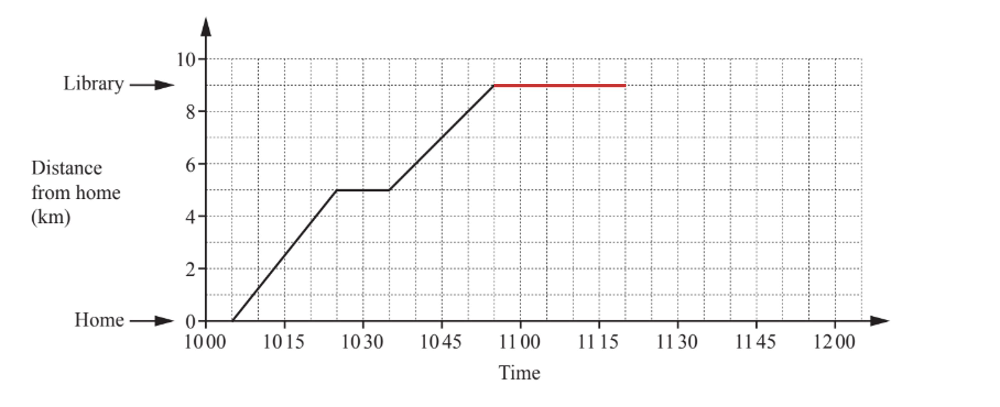

**[1]**

*They are 9 km from home, and travel back at 18 km/hr* *Using *$\mathrm{Speed}=\frac{\mathrm{Distance}}{\mathrm{Time}}$

$18=\frac{9}{t}$

$t=0.5\mathrm{hrs}=30\mathrm{mins}$

> *Draw a line back to a distance of 0 km, which moves 30 mins (6 squares) horizontally*

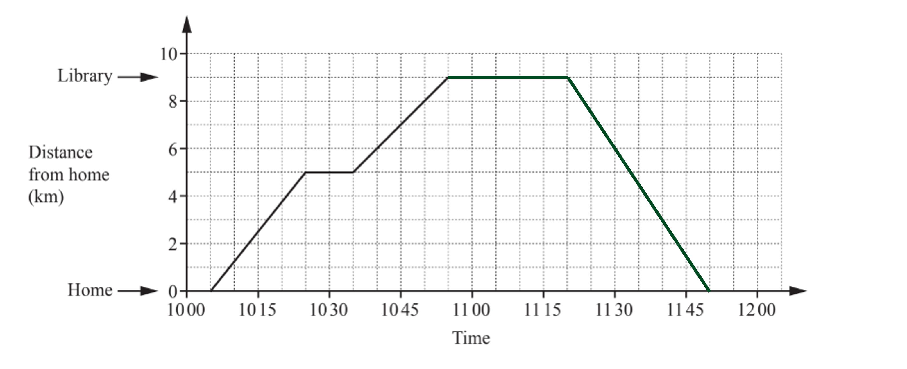

**[1]**

### Q16
*A **horizontal** part of a **distance-time graph** shows when the distance is not changing *
*There is a horizontal part from 3 pm to 3.30 pm, we can infer this is when Simon is resting* 
*Reading off the Time axis tells us this is 0.5 hours or 30 minutes*

**30 minutes ****or**** 0.5 hours**** ****[1]**
> *Reading up from 5 pm on the "Time" axis, and across to the "Distance from home" axis, we see that Simon was 20 km from home*

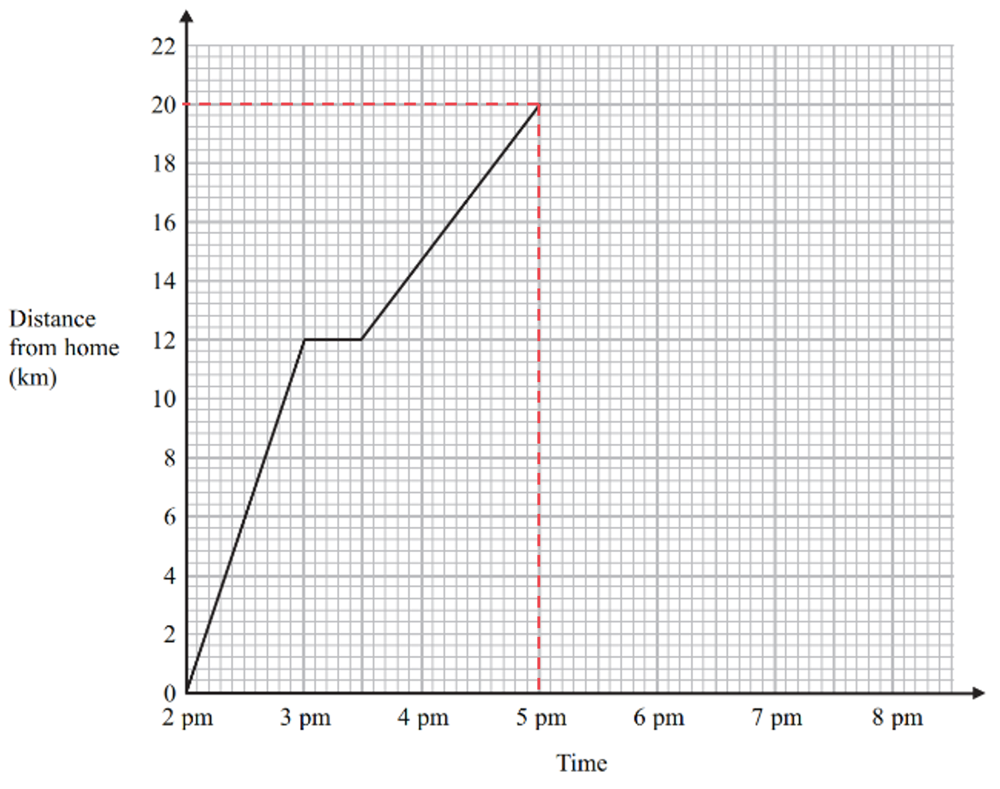

**20 km** **[1]**
