# Exam Questions — Real-Life Graphs
**Coordinate Geometry & Graphs** · Cambridge (CIE) IGCSE maths (0580 & 0980)
> Source: [https://www.savemyexams.com/igcse/maths/cie/25/core/topic-questions/](https://www.savemyexams.com/igcse/maths/cie/25/core/topic-questions/) · 16 questions across 1 sets

## Exam Questions (16 questions)

### Q1 — hard — 11 marks

**Q1** [1 mark]

Andy is doing a 60 kilometre sponsored cycle ride.

He leaves the starting point at 1000, stops briefly at the first stopping point, and then cycles on to the second stopping point.

The travel graph shows Andy's journey.

Find Andy’s average speed, in kilometres per hour, from 'Start' to 'Stop 1'.

....................................... km/h

**Q1** [3 marks]

**Extract:**

Andy is doing a 60 kilometre sponsored cycle ride.

He leaves the starting point at 1000, stops briefly at the first stopping point, and then cycles on to the second stopping point.

The travel graph shows Andy's journey.

Graph showing distance over time, with stops at 24 km and 45 km. Vertical axis (distance) goes from 0 km to 60 km, horizontal axis (time) goes from 1000 to 1600. Part of journey from Start to Stop 2 is shown. 'Finish' is marked at 60 km.

Andy leaves 'Stop 2' at 1400.
He continues to the Finish point at a constant speed of 13 kilometres per hour.

(i) Calculate the time Andy takes to travel from 'Stop 2' to 'Finish'.
`space space space space`Give your answer in hours and minutes, correct to the nearest minute.

....................... h ....................... min [2]

(ii) On the travel graph, complete Andy's journey.

[1]

**Q1** [1 mark]

**Extract:**

Andy is doing a 60 kilometre sponsored cycle ride.

He leaves the starting point at 1000, stops briefly at the first stopping point, and then cycles on to the second stopping point.

The travel graph shows Andy's journey.

Graph showing distance over time, with stops at 24 km and 45 km. Vertical axis (distance) goes from 0 km to 60 km, horizontal axis (time) goes from 1000 to 1600. Part of journey from Start to Stop 2 is shown. 'Finish' is marked at 60 km.

Find the total time, in minutes, that Andy stopped between the starting and finishing points.

........................................ min

**Q1** [3 marks]

**Extract:**

Andy is doing a 60 kilometre sponsored cycle ride.

He leaves the starting point at 1000, stops briefly at the first stopping point, and then cycles on to the second stopping point.

Andy leaves 'Stop 2' at 1400.

He continues to the Finish point at a constant speed of 13 kilometres per hour.

(i) Calculate the time Andy takes to travel from 'Stop 2' to 'Finish'.

The distance from 'Stop 2' to 'Finish' is 60 - 45 = 15 km

Therefore the time taken, in hours, is time = 15/13 = 1.153846... hours

Calculate Andy’s overall average speed, in kilometres per hour, from 'Start' to 'Finish'.

....................................... km/h

**Q1** [3 marks]

**Extract:**

Andy is doing a 60 kilometre sponsored cycle ride.

He leaves the starting point at 1000, stops briefly at the first stopping point, and then cycles on to the second stopping point.

The travel graph shows Andy's journey.

Graph showing distance over time, with stops at 24 km and 45 km. Vertical axis (distance) goes from 0 km to 60 km, horizontal axis (time) goes from 1000 to 1600. Part of journey from Start to Stop 2 is shown. 'Finish' is marked at 60 km.

Andy leaves 'Stop 2' at 1400.

He continues to the Finish point at a constant speed of 13 kilometres per hour.

On the travel graph, complete Andy's journey.

Jocasta sets off from the starting point at 1100, and completes the entire cycle route from 'Start' to 'Finish' in 2 hours and 24 minutes. She cycles at a constant speed on the same route as Andy, without stopping.

(i) Draw a line on the travel graph to show Jocasta’s journey.

[2]

(ii) Find the distance that the two cyclists are from 'Stop 2' when Jocasta passes Andy.

.......................................... km [1]

### Q2 — hard — 12 marks

**Q2** [1 mark]

Louise leaves home at 09 55 and cycles the 5.6 km to the supermarket at a constant speed. 
She takes 15 minutes to complete the journey.

Write down the time she arrives at the supermarket.

[1]

*Source: May/June 2018 0580/32 Q7A*

**Q2** [3 marks]

**Extract:**

Louise leaves home at 09 55 and cycles the 5.6 km to the supermarket at a constant speed. She takes 15 minutes to complete the journey.

Calculate Louise’s average speed from her home to the supermarket

i) in kilometres per hour,

.........................km/h [1]

ii) in metres per second, giving your answer correct to 1 decimal place.

......................... m/s [2]

*Source: May/June 2018 0580/32 Q7B*

**Q2** [2 marks]

**Extract:**

Louise leaves home at 09 55 and cycles the 5.6 km to the supermarket at a constant speed. She takes 15 minutes to complete the journey.

Louise stays at the supermarket for 23 minutes.

On the grid, draw the travel graph of her journey from home and her stay at the supermarket.

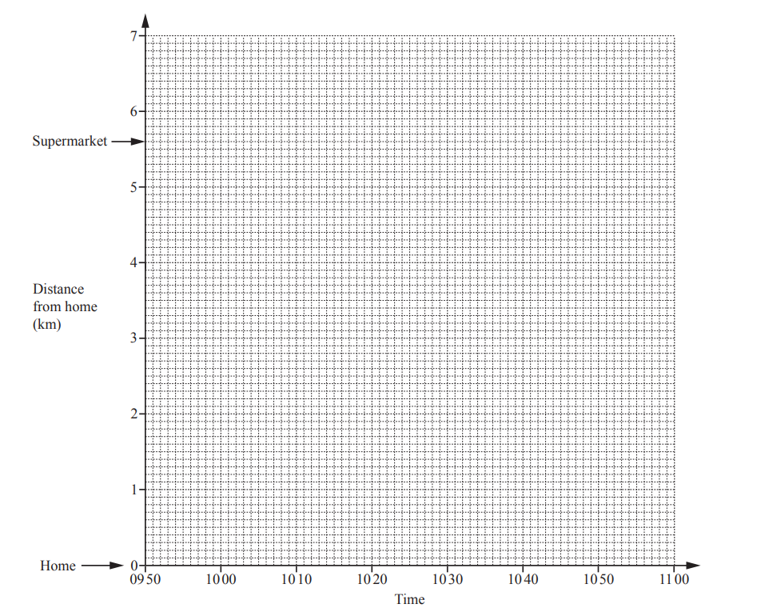

*Source: May/June 2018 0580/32 Q7C*

**Q2** [3 marks]

**Extract:**

Louise leaves home at 09 55 and cycles the 5.6 km to the supermarket at a constant speed.

Louise’s mother leaves home at 10 07 to meet Louise at the supermarket. 
She cycles at a constant speed of 28 km/h.

i) Work out how long she takes for the 5.6 km journey. Give your answer in minutes.

...........................min [2]

ii) On the grid, show her mother’s journey.

[1]

*Source: May/June 2018 0580/32 Q7D*

**Q2** [3 marks]

**Extract:**

Louise leaves home at 09 55 and cycles the 5.6 km to the supermarket at a constant speed. She takes 15 minutes to complete the journey.
Louise stays at the supermarket for 23 minutes.

They cycle home together at a constant speed and arrive at 1054.

i) On the grid, show their journey home.

[1]

ii) Calculate, in km/h, their constant speed on the journey home.

..........................km/h [2]

*Source: May/June 2018 0580/32 Q7E*

### Q3 — hard — 10 marks

**Q3** [4 marks]

Anand, Rahul and Samir go from school to the park each day.

One day, Anand cycles and Rahul walks. The travel graph shows their journeys.

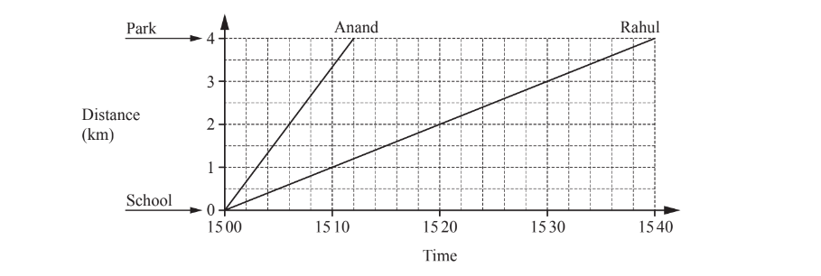

i) Work out the speed that Anand cycles. Give your answer in kilometres per hour.

..............................km/h [2]

ii) Find the number of minutes that Anand arrives at the park before Rahul.

.............................. min [1]

iii) Samir cycles at the same speed as Anand.
He arrives at the park at the same time as Rahul.

Find the time that Samir leaves school.

[1]

*Source: March 2018 0580/32 Q6A*

**Q3** [6 marks]

On another day, Anand cycles 2km to a bench and then walks the rest of the way to the park.

The travel graph shows his journey.

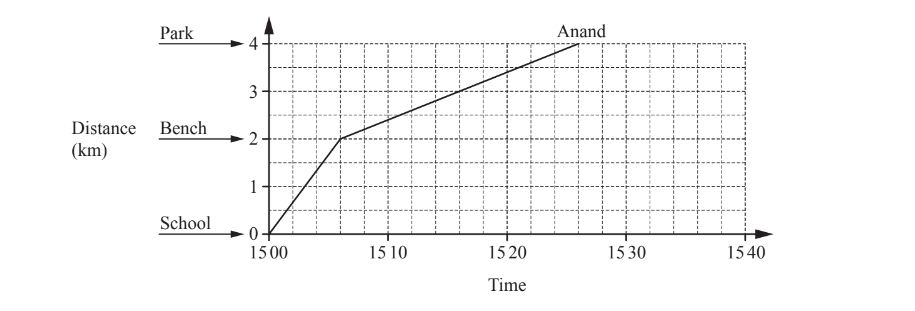

i) Write down the ratio minutes cycling : minutes walking. 
Give your answer in its simplest form.

[2]

ii) Rahul leaves school at the same time as Anand. 
Rahul walks 2 km to the bench at a constant speed of 6km/h. 
He then cycles the rest of the way to the park at a constant speed of 15km/h.

a) Complete the travel graph for Rahul’s journey to the park.

[2]

b) Use your travel graph to find the number of minutes that Anand arrives at the bench before Rahul.

............................... min [1]

c) Find the greatest distance between Anand and Rahul as they travel to the park.

................................ km [1]

*Source: March 2018 0580/32 Q6B*

### Q4 — hard — 7 marks

**Q4** [1 mark]

Mr Patel is travelling by train to the city. He is going to the library.

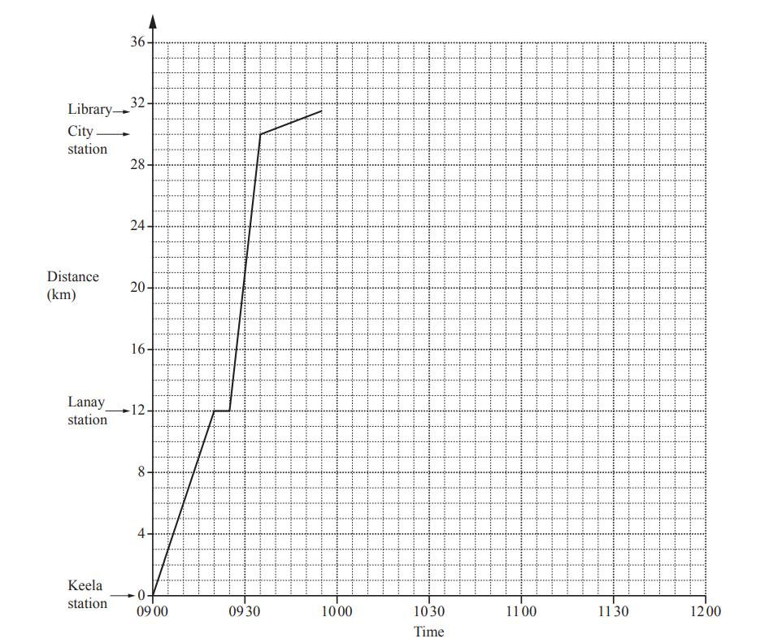

The travel graph shows his journey from Keela station to the library.

Write down the total time it takes Mr Patel to travel from Keela station to the library.

.............................. min

*Source: March 2019 0580/32 Q6A*

**Q4** [2 marks]

Work out the speed of the train between Lanay station and City station in km/h.

....................... km/h

*Source: March 2019 0580/32 Q6B*

**Q4** [4 marks]

Use the following information to complete the travel graph for Mr Patel.

- He spends 35 minutes at the library.
- He walks back to City station at the same constant speed he walked to the library.
- The train takes 20 minutes to travel from City station to Lanay station.
- The train stops for 10 minutes at Lanay station.
- The train travels at a constant speed of 48km/h from Lanay station to Keela station.

*Source: March 2019   0580/32 Q6C*

### Q5 — hard — 6 marks

**Q5** [1 mark]

Three children from the same family travel from their home to the same school. 
Caroline cycles to school. Rob runs to school.
 William walks to school.

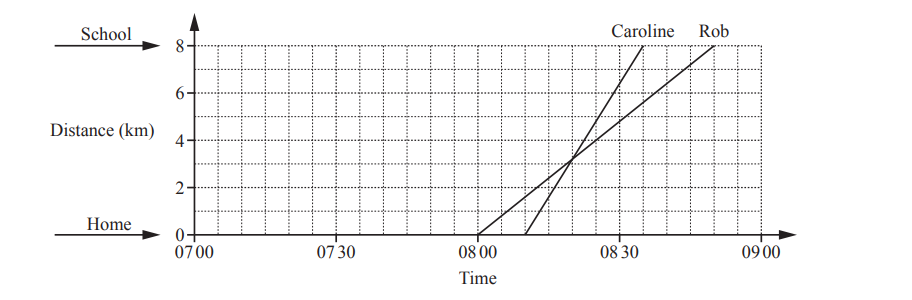

The travel graph shows the journeys to school for Caroline and Rob. 
Rob leaves home before Caroline.

Explain what is happening when the two lines intersect on the travel graph.

[1]

*Source: May/June 2018 0580/31 Q8A*

**Q5** [2 marks]

**Extract:**

The travel graph shows the journeys to school for Caroline and Rob. Rob leaves home before Caroline.

Work out Rob’s speed in km/h.

.............................. km/h [2]

*Source: May/June 2018 0580/31 Q8B*

**Q5** [1 mark]

William leaves home at 07 25. He walks to school at a constant speed of 6km/h.

On the grid, draw William’s journey.

[1]

*Source: May/June 2018 0580/31 Q8C*

**Q5** [1 mark]

**Extract:**

The travel graph shows the journeys to school for Caroline and Rob. William leaves home at 07 25. He walks to school at a constant speed of 6km/h.

At what time is the distance between Rob and William greatest?

[1]

*Source: May/June 2018 0580/31 Q8D*

**Q5** [1 mark]

**Extract:**

Three children from the same family travel from their home to the same school. Caroline cycles to school. Rob runs to school. William walks to school.

Complete this list of names in the order they arrive at school.

First ................................

Second ................................

Third ................................ [1]

*Source: May/June 2018 0580/31 Q8E*

### Q6 — hard — 16 marks

**Q6** [9 marks]

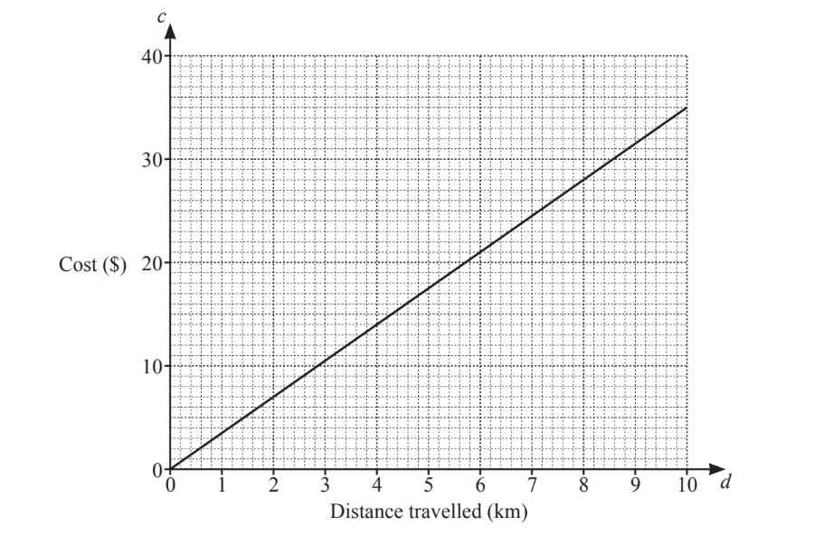

The graph shows the cost, \$*c*, of travelling a distance, $d$ km, with *Saanvi’s Taxis.*

* *

ia)  Write down the cost of a 4km journey.

\$ ................................................. [1]

ib) Complete this statement.

*Saanvi’s Taxis *cost \$ ........................ for each kilometre travelled.

[1]

ic) Find the equation of the line.

*c* = ................................................. [1]

*Krishna’s Taxis *cost \$5 to hire plus \$2 for each kilometre travelled.

iia) Show that the cost of a 4km journey with *Krishna’s Taxis *is \$13.

[1]

iib) Find an equation for the cost, \$c, of travelling d kilometres with *Krishna’s Taxis*.

*c *= ................................................. [2]

iic) On the grid, draw a line to show the cost of travelling with *Krishna’s Taxis*.

[2]

iid) Mrs Singh wants to hire a taxi.

She says that Saanvi’s Taxis are always cheaper than *Krishna’s Taxis.*

Is Mrs Singh correct? 
Give a reason for your answer. Use your graph to help you.

[1]

*Source: March 2020 0580/23 Q5A*

**Q6** [7 marks]

A minibus can be hired from *Dhruv’s Minibuses*. The cost is \$h per hour plus \$p per passenger.

i) When the minibus is hired for 3 hours with 10 passengers the cost is \$61.

Complete the equation.

$3h+10p=$............................

[1]

ii) When the minibus is hired for 5 hours with 8 passengers the cost is \$80.

Write this information as an equation.

[2]

iii) Solve your two simultaneous equations to find $h$ and $p$. You must show all your working.

$h=$................................................

$p=$................................................[4]

*Source: March 2020 0580/32 Q5B*

### Q7 — medium — 10 marks

**Q7** [5 marks]

The travel graph shows part of a train journey between station $A$ and station $C$.

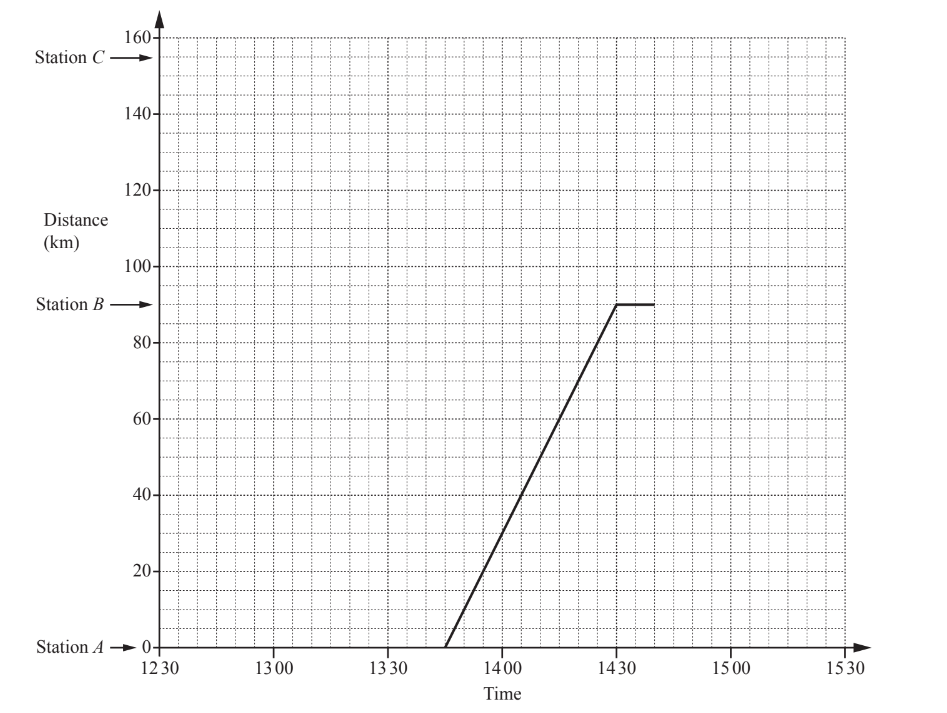

i) Calculate, in km/h, the speed of the train between station $A$ and station $B$.

........................km/h [2]

ii) The train leaves station $B$ at 14 40.

For how many minutes did the train stop at station $B$?

...........................min [1]

iii) The train travels at a constant speed between station $B$ and station $C$, arriving at 15 20. 

Complete the travel graph for the journey between station $B$ and station $C$.

[1]

iv) On which part of the journey was the train travelling faster?

Between station ........... and station ........... [1]

*Source: May/June 2019 0580/33 Q7A*

**Q7** [5 marks]

**Extract:**

The travel graph shows part of a train journey between station A and station C.

[graph image]

i) Calculate, in km/h, the speed of the train between station A and station B.

ii) The train leaves station B at 14 40.

For how many minutes did the train stop at station B?

iii) The train travels at a constant speed between station B and station C, arriving at 15 20. 

Complete the travel graph for the journey between station B and station C.

iv) On which part of the journey was the train travelling faster?

Between station ........... and station ...........

Another train leaves station $C$ at 12 45. It travels to station $A$ at a constant speed of 62km/h without stopping at station $B$.

i) Work out how long, in hours and minutes, this journey takes.

.................... h ...................min [2]

ii) Write down the time this train arrives at station $A$.

[1]

iii) On the grid, show the journey of this train.

[1]

iv) Find the distance from station $A$ when the two trains pass each other.

........................... km [1]

*Source: May/June 2019 0580/33 Q7B*

### Q8 — medium — 3 marks

**Q8** [3 marks]

The diagram shows a conversion graph between pounds (£) and dollars (\$).

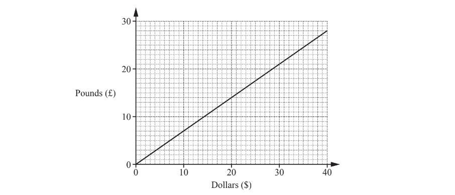

Ana finds the same watch on sale in a shop and on the internet. 
The shop price is \$120. 
The internet price is £90.

Use the conversion graph to find which price is lower. Show your working clearly.

The ........................ price is lower. [3]

*Source: Oct/Nov 2018 0580/12 Q13*

### Q9 — medium — 4 marks

**Q9** [1 mark]

The diagram shows a conversion graph for dollars and Kenyan shillings.

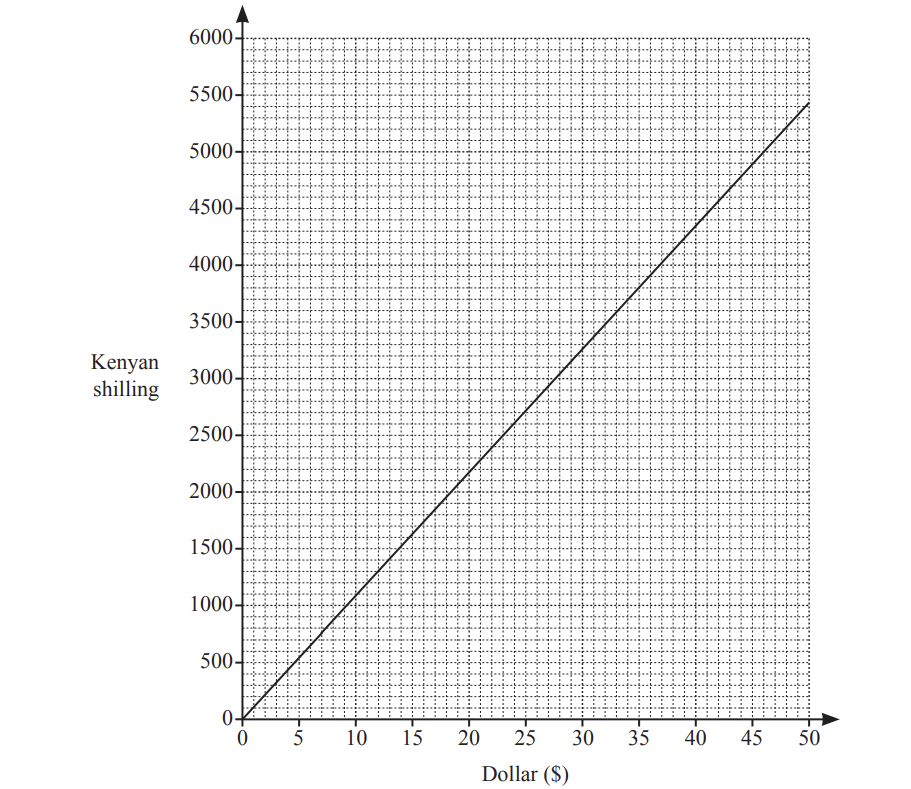

Use the graph to change 5000 shillings to dollars.

\$....................................................

*Source: Nov 2019 0580/13 Q21A*

**Q9** [1 mark]

**Extract:**

The diagram shows a conversion graph for dollars and Kenyan shillings.

Explain how to use this graph to change \$420 to shillings.

*Source: Nov 2019 0580/13 Q21B*

**Q9** [2 marks]

**Extract:**

The diagram shows a conversion graph for dollars and Kenyan shillings.

The exchange rate is now \$1 = 90 shillings.

On the grid, draw another line to show this exchange rate.

*Source: Nov 2019 0580/13 Q21C*

### Q10 — medium — 5 marks

**Q10** [1 mark]

Hua cycles from her home to the library 
The travel graph shows this journey.

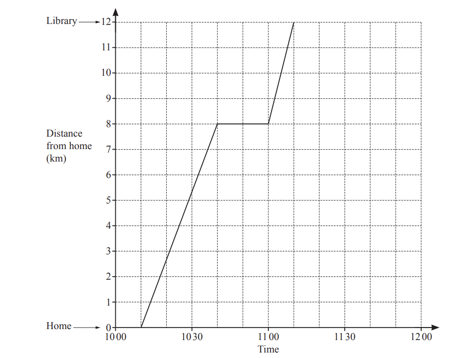

At what time does she start her journey?

*Source: Nov 2020 0580/11 Q7A*

**Q10** [2 marks]

i) Find her distance from home when she stops for a rest.

.......................km[1]

ii) How long does she stop for a rest?

......................min [1]

*Source: Nov 2020 0580/11 Q7B*

**Q10** [2 marks]

**Extract:**

The travel graph shows this journey.

Hua stays at the library for 10 minutes. 
She then cycles home at a constant speed of 24km/h.

Complete the travel graph.

*Source: Nov 2020 0580/11 Q7C*

### Q11 — medium — 3 marks

**Q11** [1 mark]

Juan travels from his home to a shop. 
The travel graph shows his journey.

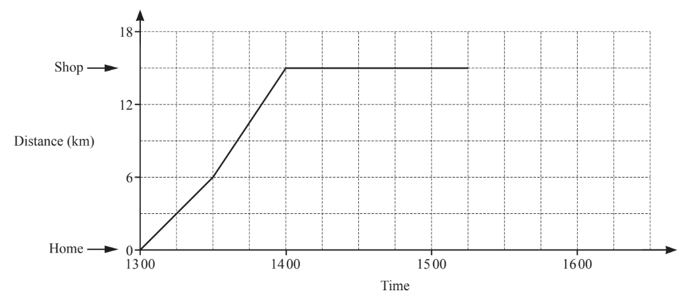

Find the distance Juan travels to the shop.

.............................................. km

*Source: June 2019 0580/11 Q20A*

**Q11** [1 mark]

Write down what happens at 1400.

*Source: June 2019 0580/11 Q20B*

**Q11** [1 mark]

**Extract:**

Juan travels from his home to a shop. The travel graph shows his journey.

Juan travels home at a constant speed of 15km/h. He leaves the shop at 1515.

Complete the travel graph.

*Source: June 2019 0580/11 Q20C*

### Q12 — easy — 1 marks

**Q12** [1 mark]

You can use this conversion graph to change between pounds (£) and dollars (\$).

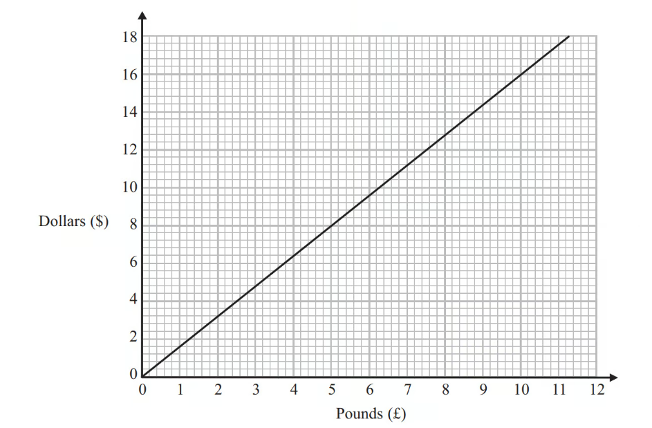

Use the conversion graph to change £5 to dollars.

*Source: 2013	March 1MA0/1H Q6A*

### Q13 — easy — 2 marks

**Q13** [1 mark]

Sara walks from home to school. 
The travel graph shows her journey.

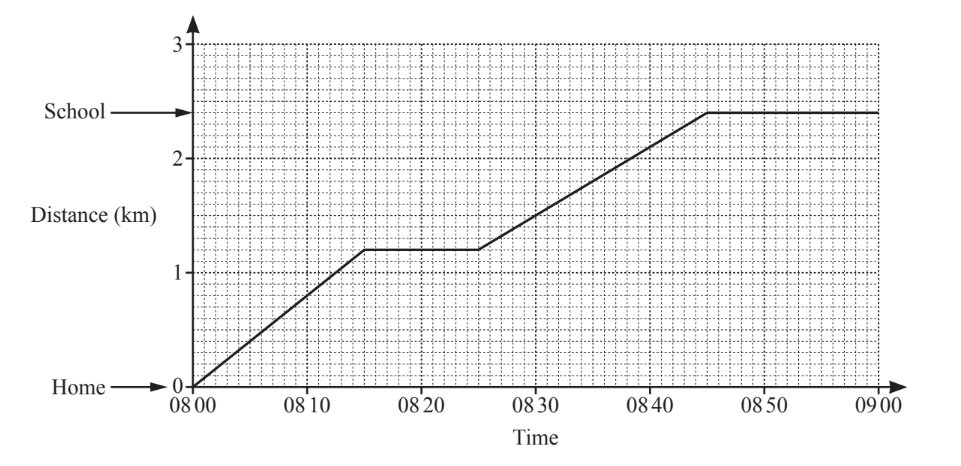

Sara stops at a shop on her way to school.

Find the distance of the shop from her home.

.............................................. km

*Source: Nov 2019 0580/12 Q6A*

**Q13** [1 mark]

**Extract:**

The travel graph shows her journey.

School starts at 0855.

Find the number of minutes between the time Sara arrives at school and the time school starts.

............................................. min

*Source: Nov 2019 0580/12 Q6B*

### Q14 — easy — 4 marks

**Q14** [1 mark]

The travel graph shows Michael’s journey from his home to the beach.

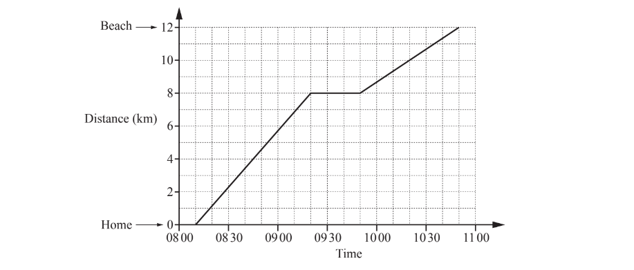

At what time did he start his journey?

*Source: June 2019 0580/11 Q21A*

**Q14** [2 marks]

On the journey he stopped for a rest.

i) Find the distance he was from home when he stopped for a rest.

....................................... km [1]

ii) For how many minutes did he stop?

......................................min [1]

*Source: June 2019 0580/11 Q21B*

**Q14** [1 mark]

**Extract:**

The travel graph shows Michael's journey from his home to the beach.

Explain how the graph shows that Michael travelled faster before he stopped than after he stopped.

*Source: June 2019 0580/11 Q21C*

### Q15 — easy — 3 marks

**Q15** [1 mark]

Shohan cycles from home to the library.
He stops at the post office on the way.
The travel graph shows his journey.

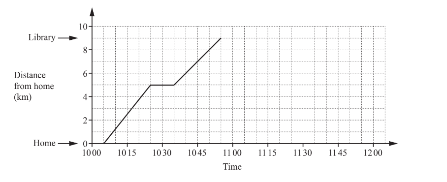

Write down the time Shohan arrives at the post office.

*Source: Oct/Nov 2018 0580/11 Q14A*

**Q15** [2 marks]

**Extract:**

Shohan cycles from home to the library. He stops at the post office on the way. The travel graph shows his journey.

Shohan stays at the library for 25 minutes. 
He then cycles home at a constant speed of 18km/h.

Complete the travel graph.

*Source: Oct/Nov 2018 0580/11 Q14B*

### Q16 — easy — 2 marks

**Q16** [1 mark]

Simon went for a cycle ride. He left home at 2 pm.

The travel graph represents part of Simon's cycle ride.

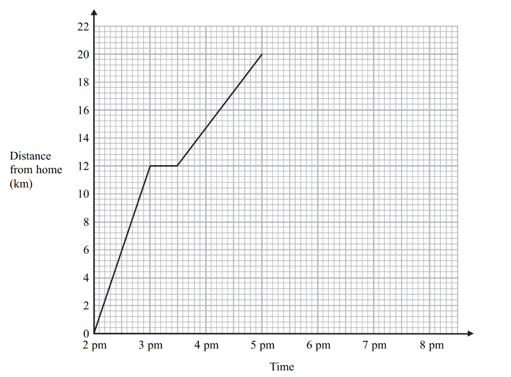

At 3 pm Simon stopped for a rest.

How many minutes did he rest?

*Source: 2013	March 1MA0/2H Q3A*

**Q16** [1 mark]

How far was Simon from home at 5 pm?

*Source: 2013	March 1MA0/2H Q3B*

