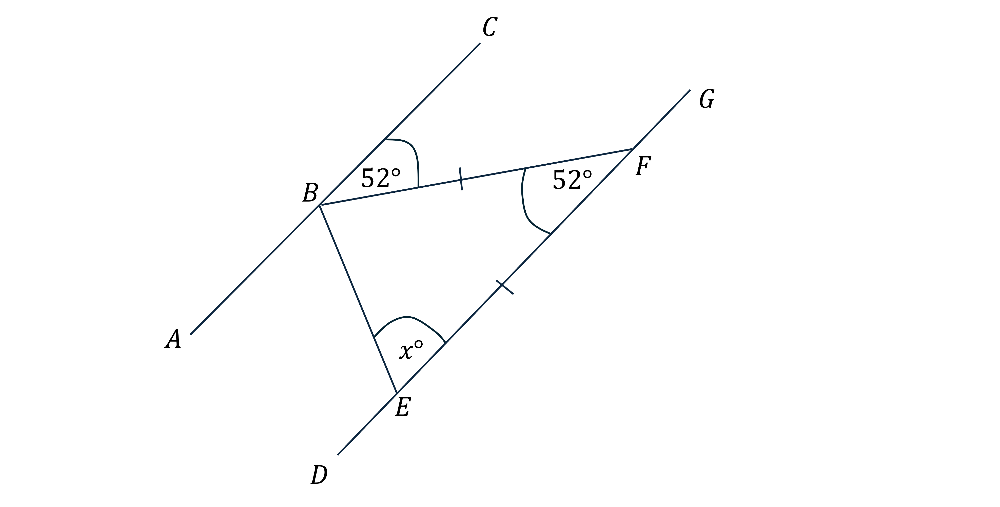
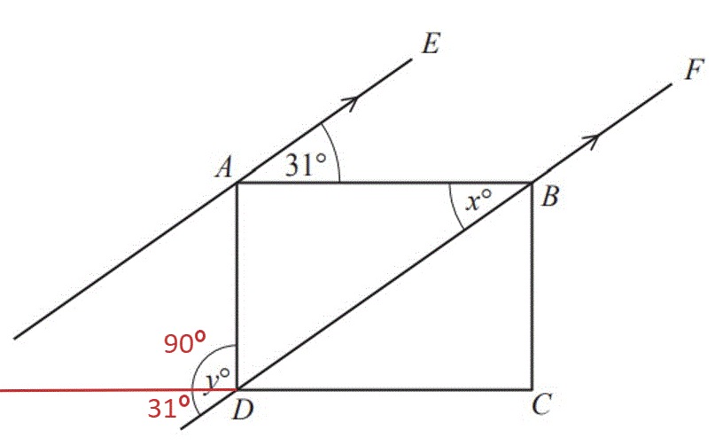
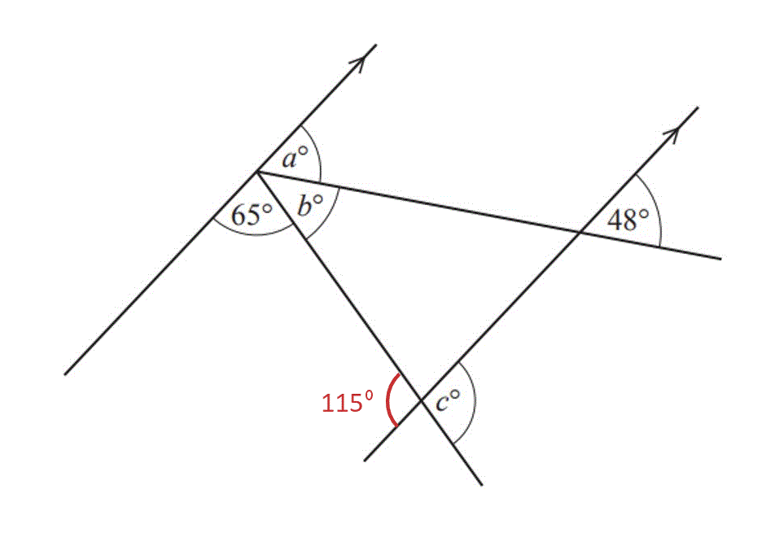

# Mark Schemes — Angles in Polygons & Parallel Lines
**Geometry** · Cambridge (CIE) IGCSE maths (0580 & 0980)

## Exam Questions (28 questions)

### Q1
**Method 1 - interior angles**

Find the sum of the interior angles in a hexagon using `open parentheses n minus 2 close parentheses cross times 180 degree`

`open parentheses 6 minus 2 close parentheses cross times 180 degree equals 720 to the power of ring operator`

Find the interior angle in a regular hexagon by dividing by the number of angles

* *$720^{\circ}\div6=120^{\circ}$

Find the sum of the interior angles in a pentagon using `open parentheses n minus 2 close parentheses cross times 180 degree`

* *`open parentheses 5 minus 2 close parentheses cross times 180 degree equals 540 to the power of ring operator`

Find the interior angle in a regular pentagon by dividing by the number of angles

$540^{\circ}\div5=108^{\circ}$

**[M1]**

Subtract the interior angles from $360^{\circ}$ as they are around the same point

$x=360^{\circ}-120^{\circ}-108^{\circ}$

$x=132^{\circ}$

**[A1]**

**Method 2 - exterior angles**

Find the exterior angle of the hexagon and pentagon using $\frac{360^{\circ}}{n}$

$360^{\circ}\div6=60^{\circ}\,360^{\circ}\div5=72^{\circ}$

**[M1]**

Add them together

$60^{\circ}+72^{\circ}=132^{\circ}$

$x=132^{\circ}$

**[A1]**

> **[mark-scheme]**
> **M1**: For finding the interior or exterior angle in either a pentagon or hexagon.
> 
> **A1**: Correct answer.

### Q2
Angle CBF =Angle BFE because they are alternate angles (Z shape)

*Angle BFD=*$52^{\circ}$* because it is an alternate angle*

**[B1 B1]**

Angles in a triangle add to $180^{\circ}$

$180-52=128^{\circ}$* because interior angles in a triangle add up to 180°*

Angle EBA = Angle BEF because base angles of an isosceles triangle

$128\div2=64^{\circ}$* because base angles in an isosceles triangle are equal*

**[M1]**

$x=64$

**[A1]**

> **[mark-scheme]**
> **B1**: Correct value. You do not need the reason for this mark.
> 
> **B1**: Correct reason.
> 
> **M1**: Correct method to find $x$.
> 
> **A1**: Correct answer. You must have stated the angle fact about isosceles triangles.

### Q3
**Method 1**

> *The sum of interior angles of an *$n$*-sided polygon is*

`180 cross times open parentheses n minus 2 close parentheses`

**[M1]**

> *For a hexagon*

$n=6$

> *Therefore*

`180 cross times open parentheses 6 minus 2 close parentheses
180 cross times 4 equals 720 degree`

**Final answer:** **The sum of interior angles of a hexagon = **$720^{\circ}$

**[A1]**

> **[exam-tip]**
> The formula is from the fact that an $n$- sided polygon has $n-2$ triangles, each with a sum of interior angles of $180^{\circ}$.
> 
> 
> 
> You can also show this using exterior angles.

**Method 2**

> *Find the exterior angle of a **regular **hexagon*

$\frac{360}{6}=60$

> *Find the interior angle of a regular hexagon*

$180-60=120$

**[M1]**

> *Multiply this by 6 to find the sum of the angles in a hexagon*

$120\times6=720$

**Final answer:** **The sum of interior angles of a hexagon = **$720^{\circ}$

**[A1]**

### Q4
> $BDC$* is on a straight line with the *$54^{\circ}$* angle and angles on a straight line sum to *$180^{\circ}$

$BDC+54=180\,BDC=180-54\,BDC=126^{\circ}$

**[B1]**

> *Angle *$DBC$* is alternate to *$FGC$* and so *

$DBC=FGC=31^{\circ}$

**[B1]**

> *Angles in a triangle sum to *$180^{\circ}$

$BCD+126+31=180\,BCD=180-31-126\,BCD=23^{\circ}$

**[B1]**

> $BCD$* and *$DCG$* lie on a straight line and so also sum to *$180^{\circ}$

$DCG+23=180\,DCG=180-23\,DCG=157$

$DCG=157^{\circ}$

**[B1]**

> **[exam-tip]**
> Any alternative method to finding the correct value of $DCG$, for example working with triangle $CFG$ rather than $BCD$, is also valid.

### Q5
> *An equilateral triangle has equal three sides, *$a$*, adding them together gets the perimeter*

$3a=72$

**[M1]**

$a=72\div3\,a=24$

**[M1]**

> *The larger trapezium has *$5a$* making up the perimeter*

$5a=24\times5\,5a=120$

**Final answer:** **Perimeter of the trapezium **$=120\mathrm{cm}$

**[A1]**
**Final answer:** **Hexagon**

**[B1]**
> *The formula to calculate the exterior angle, *$x$*, of an *$n$*-sided polygon is*

$x=\frac{360}{n}$

> *For the 6-sided polygon , *$n=6$

$x=\frac{360}{6}$

**[M1]**

**Final answer:** **The exterior angle is **$x=60^{\circ}$

**[A1]**
> *The exterior angle, *$x$*, and interior angle, *$y$*, sum to 180 so*

$x+y=180\,60+y=180\,y=180-60\,$

$y=120^{\circ}$

**[B1]**

### Q6
> `angle C E D`* is alternate to the angle of *$28^{\circ}$*.*

$28^{\circ}$*, ***alternate angles are equal*** ***[2] **

**1 mark for angle, 1 mark for reason**

### Q7
> *Angle *$a$* and the angle marked as *$32^{\circ}$* are **alternate angles**, and alternate angles are equal. ** *

$a=32$* ***[1]*** *

> *Angle *$b$* and the angle made up of *$32^{\circ}$* and *$50^{\circ}$* are **co-interior angles**, and co-interior angles add up to *$180^{\circ}$*.** **Add *$32^{\circ}$* and *$50^{\circ}$* and subtract from *$180^{\circ}$*. *

`180 minus open parentheses 32 plus 50 close parentheses equals 98`

$b=98$* ***[1]**

> *Angle *$c$* and the angle made up of *$32^{\circ}$* and *$50^{\circ}$* are **alternate angles**, and alternate angles are equal.** **Add together *$32^{\circ}$* and *$50^{\circ}$*. ** *

$32+50=82$

$c=82$* ***[1]**

### Q8
> *The sum of the interior angle and the exterior angle at a vertex is *$180^{\circ}$*.*

> *As the polygon is regular, all interior angles and all exterior angles are the same.*

> *The exterior angle is*

$180-162=18^{\circ}$

**[1]**

> *Divide *$360^{\circ}$* by the exterior angle to determine the number of sides of the polygon.*

$360\div18=20$

**[1]**

$20$ **[1]**

### Q9
> *The interior angle of a regular pentagon is calculated using the formula: *`A equals fraction numerator 180 open parentheses n minus 2 close parentheses over denominator n end fraction`* where *$n$* is the number of sides of the regular polygon.*

> *For a pentagon, *

$n=5$

> *Substitute *$n=5$* into the formula and evaluate.*

`A equals fraction numerator 180 open parentheses 5 minus 2 close parentheses over denominator 5 end fraction equals fraction numerator 180 cross times 3 over denominator 5 end fraction equals 108 degree`

**[1]**

> *The sum of angles around a point is *$360^{\circ}$*.*

> *Subtract the interior angle to get the reflex angle at *$AED$*.*

$360-108=252^{\circ}$

**[1]**

> *The angle *$AEK$* is half the size of the reflex angle *$AED$* so divide this angle by *$2$*.*

$252\div2=126^{\circ}$

**[1]**

$126^{\circ}$ **[1]**

### Q10
> *Angle **EAB** and angle **ABD** are **alternate **angles.*

> *Alternate angles are equal, so*

> * *$x=31^{\circ}$

> *Extend the line **DC **to the left.*

> $y$* is broken into two angles. One is *$90^{\circ}$* angle (since we are told **ABCD** is a rectangle) and the other is a **corresponding **angle to *$x$* (*$31^{\circ}$*).*

> *Corresponding angles are equal, so this angle must also equal *$31^{\circ}$*.*

> * Add together the two angles to find *$y$*.*

$90+31=121^{\circ}$

$x=31^{\circ}$* ***[1]**

$y=121^{\circ}$* ***[1]**

### Q11
(i) *Interior angle + exterior angle = *$180^{\circ}$*.*
*Divide *$180^{\circ}$* by the total parts in the ratio (2+13). *

$180\div15=12$

* ***[1]**

> *Multiply by 2 (Angle **e **= 2 parts). *

$12\times2=24$

**[1]**

** **

$24^{\circ}$** [1]**

(ii) *Divide the total of the exterior angles, *$360^{\circ}$*, by the size of one exterior angle, *$24^{\circ}$*.  *

> $360\div24=15$* *

**15**** ****[1]**

### Q12
ia) $ABD$* is an isosceles triangle as *$AB=BD$

$p=34^{\circ}$** because **$ABD$** is an isosceles triangle**** [2] **

**1 mark for angle, 1 mark for reason**

ib) *Alternate angles are equal, *$q$* is an alternate angle to *$p$*, so *$q=p$*.*

$q=34^{\circ}$** ****because **$DBE$** is an alternate angle to **$ADB$ **[2] **

**1 mark for angle, 1 mark for reason**

ii) *As the sum of angles in a triangle is *$180^{\circ}$*:*

`r equals 180 minus open parentheses 34 plus 34 close parentheses equals 112`

$r=112$** [1]**

`s equals 180 minus open parentheses 90 plus 34 close parentheses equals 56`

$s=56$** [1]**

iii) *Use the angle fact the sum of angles on a straight line is *$180^{\circ}$*.*

`t equals 180 minus open parentheses q plus r close parentheses equals 180 minus open parentheses 34 plus 112 close parentheses equals 180 minus 146 equals 34`

**Final answer:** $t=34$** because angles on a straight line sum to 180°**** [2] **

**1 mark for angle, 1 mark for reason**

### Q13
**The sum of angles in a triangle is**** **$180^{\circ}$**, as there are three triangles within the pentagon, the sum of interior angles in a pentagon is **$3\times180=540^{\circ}$** ****[1]**

### Q14
> *Work out the exterior angle of an octagon.*

$\frac{360^{\circ}}{8}=45^{\circ}$

* ***[1]**

> *The interior angle and the exterior angle of a polygon sum to *$180^{\circ}$*.*

> *Subtract 45 from 180 to find the interior angle of an octagon. *

$180^{\circ}-45^{\circ}=135^{\circ}$

* ***[1]**

> *There are two interior angles from octagons and one interior angle of a square that meet at point P.*

> *The interior angle of a square is *$90^{\circ}$*.  Add together two lots of *$135^{\circ}$* and *$90^{\circ}$*. *

$135^{\circ}+135^{\circ}+90^{\circ}=360^{\circ}$* ***[1]**

### Q15
> *Angle *$x$* and *$120^{\circ}$* are **co-interior**. Subtract *$120^{\circ}$* from *$180^{\circ}$* to find the size of angle *$x$*. *

`table row cell 180 minus 120 end cell equals 60 row blank blank blank row x equals 60 end table`

> * The missing angle to the left of *$y$* and *$140^{\circ}$* are also **co-interior**, so subtract *$140^{\circ}$* from *$180^{\circ}$* to find the missing angle.  *

$180-140=40$

> * *

> *Add together *$40^{\circ}$* and *$60^{\circ}$* and subtract from *$180^{\circ}$* to find angle *$y$* (angles on a straight line add up to *$180^{\circ}$*). *

`table row cell 180 minus open parentheses 40 plus 60 close parentheses end cell equals 80 row blank blank blank row y equals 80 end table`

$x=60$* ***[1]**

$y=80$* ***[2]**

### Q16
> *Exterior angles on a polygon add up to *$360^{\circ}$*.*

> *Divide *$360^{\circ}$* by the size of one exterior angle, *$20^{\circ}$*. *

> $360\div20=18$* *

**18** **[1]**

### Q17
> *The angle *$a$* is corresponding to the angle of *$63^{\circ}$*. *

$a=63^{\circ}$**, ****corresponding angles are equal**** ****[2]**

** ****1 mark for angle, 1 mark for reason**

> *  The angle *$b$* is within a triangle where the other two angles are *$a=63^{\circ}$* and *$58^{\circ}$*.*

> *The sum of angles in a triangle is *$180^{\circ}$*.*

> *Subtract the known angles from *$180^{\circ}$*. *

`180 minus open parentheses 63 plus 58 close parentheses`

$b=59^{\circ}$*,*** the sum of angles in a triangle is **$180^{\circ}$* ***[2] **

**1 mark for angle, 1 mark for reason**

### Q18
i) *Adjacent angles on a straight line sum to 180°.*

$180-128=52^{\circ}$

**v =**** 52°**** ****[1]**

ii) *Alternate angles are equal.*

**w =**** 52°**** ****[1]**

** **

iii) *Angles in a triangle sum to 180°.*

$180-52-63=65^{\circ}$

**y =**** 65°**** ****[1]**

### Q19
(i) *Angle *$a$* is *$48^{\circ}$* because corresponding angles are equal. *

$48^{\circ}$*, ***corresponding*** ***[2]**
**1 mark for angle, 1 mark for reason**

(ii) *Angle *$b$* is on a straight line with angle *$a$* and *$65^{\circ}$*.*
*Add *$48^{\circ}$* (angle *$a$*) and *$65^{\circ}$* and subtract from *$180^{\circ}$* (degrees on a straight line). *

> `180 minus open parentheses 48 plus 65 close parentheses equals 67`* *

$67^{\circ}$*, ***angles on a straight line add up to **$180^{\circ}$* ***[2]**
**1 mark for angle, 1 mark for reason**

(iii) *Subtract *$65^{\circ}$* from *$180^{\circ}$* to find the angle vertically opposite to angle *$c$* (**co-interior angles **add up to** *$180^{\circ}$*). *

$180-65=115$

> * *

**[1]**

** ***Vertically opposite angles** are **equal**, so *$c=115^{\circ}$*. *

$115^{\circ}$* ***[1]**

### Q20
> *Angle *$x$* and the angle which is *$72^{\circ}$* are **corresponding angles.*

> * *

$x=72$** because corresponding angles are equal*** ***[2] **

**1 mark for angle, 1 mark for reason**
> *Angle *$y$* is at a point with three other angles. Add up the given angles and subtract from *$360^{\circ}$* (angles at a point add up to *$360^{\circ}$*).*

> * *`360 minus open parentheses 72 plus 88 plus 135 close parentheses equals 65`

* *$y=65$* ***because angles at a point sum to **$360^{\circ}$* ***[2]**

* ***1 mark for angle, 1 mark for reason**

### Q21
i) *Angles in a triangle sum to *$180^{\circ}$*.*
*Subtract the known angles in the triangle from *$180^{\circ}$*.*

`180 minus open parentheses 74 plus 71 close parentheses`

$35^{\circ}$ **[1]**

** **

ii) *Corresponding angles are equal.*
*The angle *$y$* is corresponding to *$74^{\circ}$*.*

$74^{\circ}$ **[1]**

### Q22
*The sum of exterior angles of an *$n-$*sided polygon is *$360^{\circ}$.

> *Divide the sum of exterior angles by *$n=10$* to determine one exterior angle.*

$360\div10=36^{\circ}$

**[1]**

> *As the sum of an interior angle and an exterior angle at the same vertex is *$180^{\circ}$* (a straight line).*

$180-36=144^{\circ}$

**[1]**

$144^{\circ}$ **[1]**

### Q23
i) *A polygon with 8 sides is an octagon.*

**Octagon**** ****[1]**

** **

ii) *The interior angle sum of an *$n-$*sided polygon is calculated using the formula:*

> *Interior angle sum *`equals 180 open parentheses n minus 2 close parentheses`*.*

> *Substitute *$n=24$* into this formula and evaluate.*

`180 cross times open parentheses 24 minus 2 close parentheses equals 3960`

**[1]**

> *Each angle is the same so divide the angle sum by the number of angles *$n=24$*.*

$3960\div24$

**165**$^{\circ}$* ***[1]**

> * *

### Q24
> *The polygon is regular and so each exterior angle and each interior angle is the same.*

> *The sum of exterior angles is *$360^{\circ}$*.*

> *The exterior angle of a regular 20 sided polygon is therefore*

$\frac{360}{20}=18^{\circ}$

**[1]**

> *The sum of the interior and exterior angle at a vertex is *$180^{\circ}$*.*

> *Subtracting the exterior angle from *$180^{\circ}$* will determine the interior angle.*

$180-18=162^{\circ}$

**[1]**

**162°**** ****[1]**

### Q25
> *Exterior angles for any shape sum to 360°. One exterior angle for a regular octagon can be found by*

$360^{\circ}\div8=45^{\circ}$

**[1]**

> *One interior angle and one exterior angle has a sum of 180**°, t**herefore, *

$180^{\circ}-45^{\circ}=135^{\circ}$

**[1]**

**135°**** ****[1]**

### Q26
> *Method 1*

> *Exterior angles** of a polygon sum to *$360^{\circ}$*.*

> *Divide 360 by 16 to find the size of one **exterior** angle. *

> $360\div16=22.5$* *

> *The **exterior angle **and the **interior angle **of a polygon add up to *$180^{\circ}$*.*

> *Subtract the **exterior** angle from 180 to find the size of the **interior** angle. *

$180-22.5=157.5$

* ***[1]**

$157.5^{\circ}$* ***[1]**

> *Method 2*

> *The sum of interior angles = 180° × **(*$n-2$*) because a polygon can be split into *$n-2$* triangles. *

`table row cell Sum space of space interior space angles end cell equals cell 180 cross times open parentheses 16 minus 2 close parentheses end cell row blank blank blank row blank equals cell 180 cross times 14 end cell row blank blank blank row blank equals 2520 end table`

> *Divide 2520 by 16 to find the size of one **interior **angle. *

$2520\div16=157.5$

* ***[1]**

$157.5^{\circ}$* ***[1]**

### Q27
> *The angle that is alternate to angle *$X$* is*

$b$ **[1]**
> *The angle that is corresponding to the angle *$X$* is*

$d$ **[1]**

### Q28
> *Work out the exterior angle of a nine sided shape by dividing *$360^{\circ}$* by 9 (exterior angles add up to *$360^{\circ}$* for any polygon). *

$360\div9=40$

* ***[1]**

*The interior and exterior angles of a polygon add up to *$180^{\circ}$*. Subtract *$40^{\circ}$* from *$180^{\circ}$*.*

$180-40=140$

$140^{\circ}$ **[1]**
