# Mark Schemes — Bearings, Constructions & Scale Drawings
**Geometry** · Cambridge (CIE) IGCSE maths (0580 & 0980)

## Exam Questions (26 questions)

### Q1
Draw an arc to mark the length of the 7 cm side

- Set your compass to a distance of 7 cm
- Put the sharp point of the compass on one end of the line

  - and draw an arc above the line

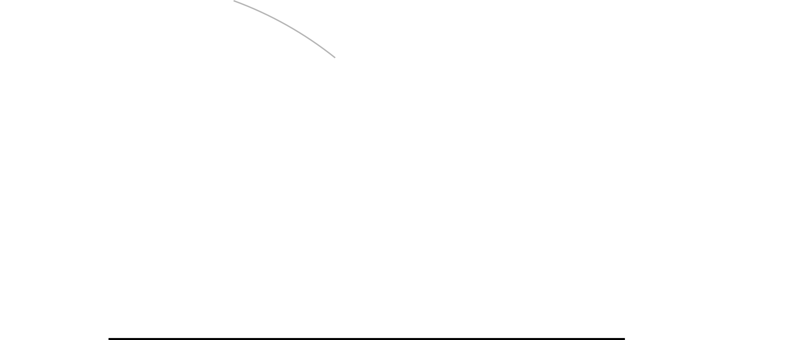

> **[exam-tip]**
> You can draw the 7 cm arc from either end of the given line. Here it has been drawn coming from the left end of the line.

Draw an arc to mark the length of the 9 cm side

- Set your compass to a distance of 9 cm
- Put the sharp point of the compass on the other end of the line

  - and draw an arc above the line (make sure it crosses the first arc!)

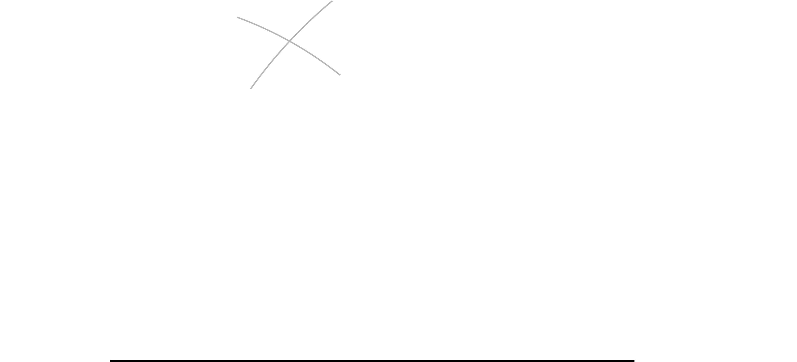

The place where the two arcs intersect is the location where the other two sides of the triangle meet

- Mark the point
- Then use your ruler to draw the other two sides as straight lines

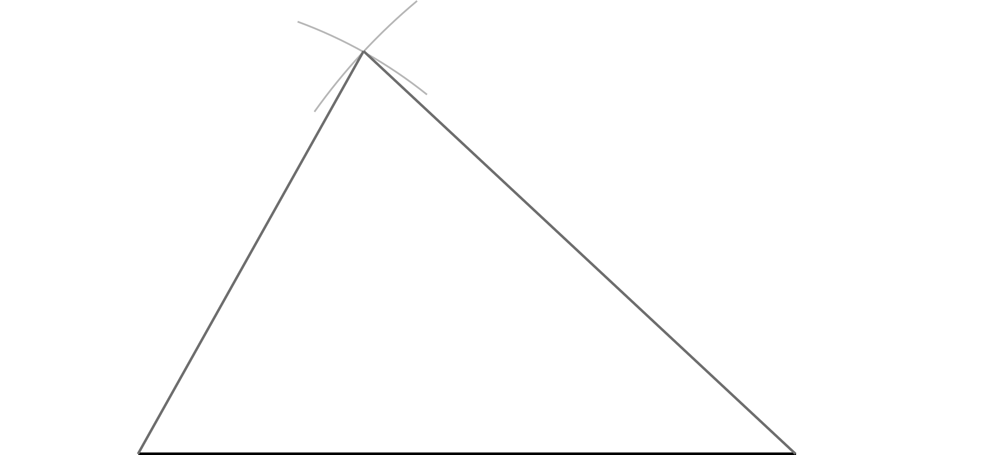

**[B1 B1]**

> **[mark-scheme]**
> **B1**: For correct triangle.
> 
> **B1**: For correct construction arcs seen.

### Q2
Work out the length of the line

$240\div40=6$

Measure an angle of 135° clockwise from the North line

- Make sure the centre of your protractor is on *B*

Measure a 6 cm line from *B* in that direction

- Label the point *L*

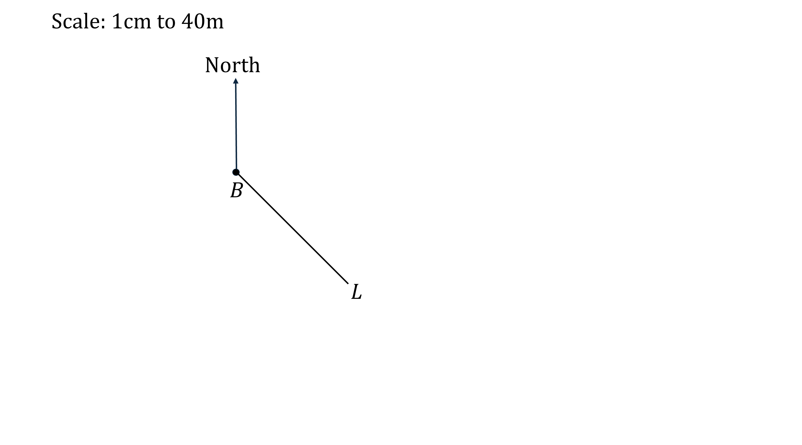

**[B1 B1]**

> **[mark-scheme]**
> **B1**: For stating 6 cm or for a line of length between 5.9 cm and 6.1 cm.
> 
> **B1**: For drawing a line at an angle between 134° and 136°.

### Q3
> *As *$073^{\circ}$* is the bearing of Bartown from Whitestoke, the back bearing is *$180^{\circ}$* greater than this. *

$73+180$

**[1] **

$253^{\circ}$* ***[1] **

> *A sketch of  and the correct bearing marked or a sketch with alternate angles marked is accepted*

### Q4
> *Use the scale to convert 36 km into cm.  *

$36\div4=9$

> *Use a protractor to measure and mark a *$140^{\circ}$* angle clockwise from the north line at **A, **and draw a line**.*

> *Measure 9 cm along the line and label the point **B**.*

> * *

**1 mark for correct angle, 1 mark for correct distance**** ****[2]**
(i) *Convert the lengths of AC, 28 km, and BC, 20 km, using the scale. *

$AC=28\div4=7\mathrm{cm}\,BC=20\div4=5\mathrm{cm}$

> * Place the point of the compasses at point A and draw an arc with radius 7 cm. Draw another with radius 5 cm from point B.*
*Because the bearing of C from A is less than 140 degrees, point C must be to the upper right of line AB, (if all you knew was the two distances, point C could also be on the other side of line AB).*

> * *

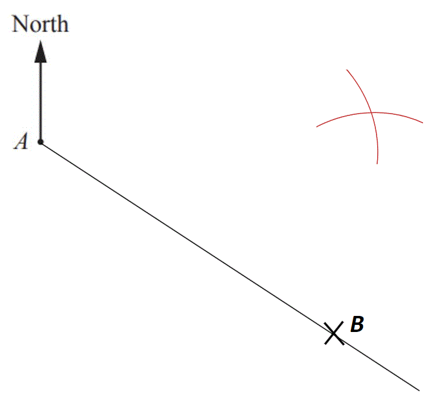

> * *

> * *

> *The third vertex of the triangle is the point at which the two arcs intersect. Draw lines from points A and B to this vertex with a ruler to form the triangle.*

> *Use your ruler to measure each side and check for accuracy.*

> * *

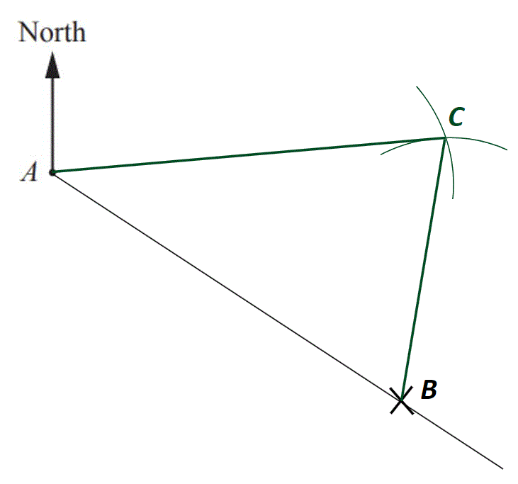

> * *

**1 line with correct length**** ****[1] **
**Fully correct triangle*** ***[2] **

**Do not erase arc lines as this would lose a mark**

(ii) *Use a protractor to measure the angle **ACB**.*

* *$40^{\circ}$* ***[1]**
**38 - 42 accepted**

### Q5
> *Halve the diameter of the circle to find the **radius**.*

> * *$11.4\div2=5.7$

> *Use the scale to convert between km and cm (divide by 1.5).*

> * *$5.7\div1.5=3.8$

**[1]**

> *Use a pair of compasses to draw a circle with a radius of 3.8 cm.*

> * *

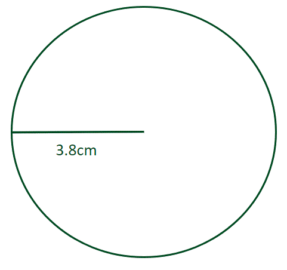

**[1]**
> *Multiply the distance on the map, 9.6 cm, by 50 000 to find the actual distance in cm. *

$9.6\times50000=480000$

> * *

> *Convert in to metres by dividing by 100.*

> * *$480000\div100=4800$

> *Convert into kilometres by dividing by 1000.*

> * *$4800\div1000=4.8$

* ***[1]**

**4.8 km ****[1]**

### Q6
> *Align *$0cm$* of the ruler with *$T$* and measure the length to *$A$*.*

$9.6\mathrm{cm}$

**[1]**

> *Multiply this value by the scale factor.*

$9.6\times2=19.2$

**19.2 km ****[1]**
> *Centre a protractor at *$T$* with *$0^{\circ}$* aligned with the north line at *$T$*. *
*Read the value the line between *$T$* and *$A$* from the correct scale on the protractor and write as a three figure bearing.  *

$045^{\circ}$** [1]**
> *Find the back bearing of the train station from the bus station by subtracting 180 from the bearing.*

$318-180$

** [1]**

**138°**** [1]**

### Q7
i) *Measure the direct distance between East Gate and West Gate using a ruler.  *

$11\mathrm{cm}$

**[1]**

> *Multiply the distance by the scale factor to determine the actual distance.  *

$11\times200=2200m$

> *Convert this distance to kilometres by dividing by *$1000$*.*

> * *$2200\div1000$

* *$2.2\mathrm{km}$** [1]**

** **

ii) *Centre the protractor on North Gate with *$0^{\circ}$* aligned with the North line at North Gate.*

> *Read the angle that crosses the scale in the direction of South Gate.*

$150^{\circ}$ **[1]**

** **

iii) *Determine the distance that the entrance is away from North Gate by dividing the actual distance by the scale factor.*

$500\div200=2.5\mathrm{cm}$

> *Centre a pair of compasses on North gate, and set the radius of the circle at *$2.5\mathrm{cm}$*.*

> *Draw a circle with this radius centred at North Gate.*

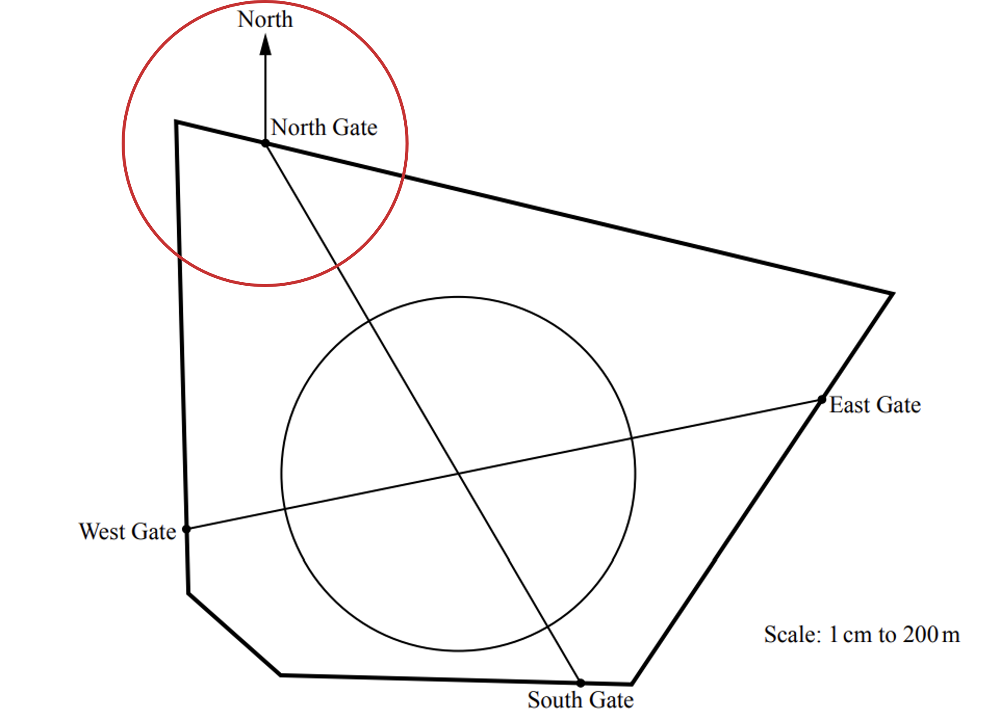

**[1]**

> *Using a protractor, align *$0^{\circ}$* with the North line at North Gate and measure *$195^{\circ}$*.*

> *Mark this angle on the diagram.*

**[1]**

> *Mark the point P where these two construction lines meet.*

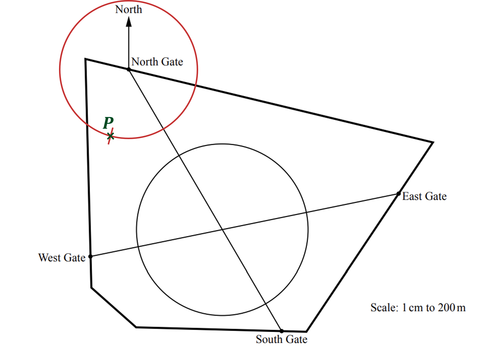

> * *

iv) *Measure the diameter of the circle using a ruler.  *

$6\mathrm{cm}$

**[1]**

> *Multiply the diameter by the scale factor to calculate the diameter of the actual circle.   *

$6\times200=1200m$

**[1]   **

> *The circumference of a circle is calculated using the formula *$C=π\timesd$* where *$d$* is the diameter of the circle.*

> *Substitute *$d=1200$* into the formula.   *

$C=π\times1200=3769.911184$*...*

* *

> *Round.*

** ****3770*** ***[1]**

**Answers between 3769.9 and 3770.4 will be accepted**

### Q8
i) *Use your protractor to measure the bearing, with the 0 on the North line and measuring clockwise.  *

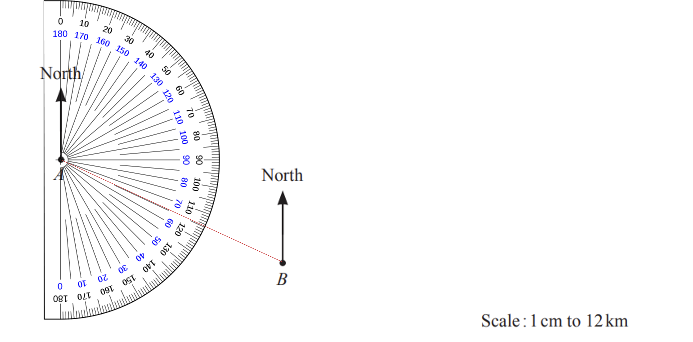

**115**** ****[1]**

ii) *Use your ruler to measure the distance from A to B.  *

> *The distance is 5.3cm.*

**[1]**

> *Each cm represents 12km so multiply by 12.  *

$5.3\times12=63.6\mathrm{cm}$

**63.6 cm**** ****[1]**

iii) *Measure the bearing from A and draw a long line. Measure the bearing from B and draw a long line to meet the first line.   *

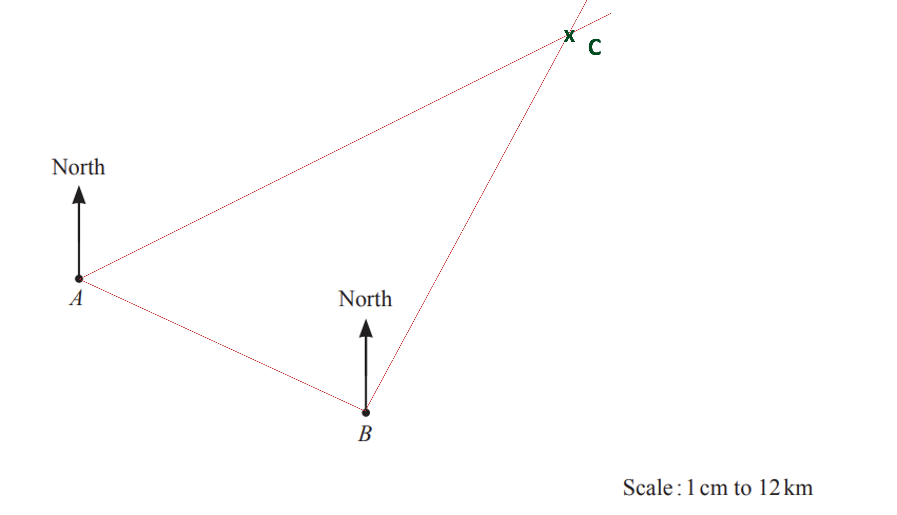

**1 bearing correct**** [1] **
**C is in the correct position**** [1]**
> *Draw a sketch to help you visualise which bearing to calculate.*

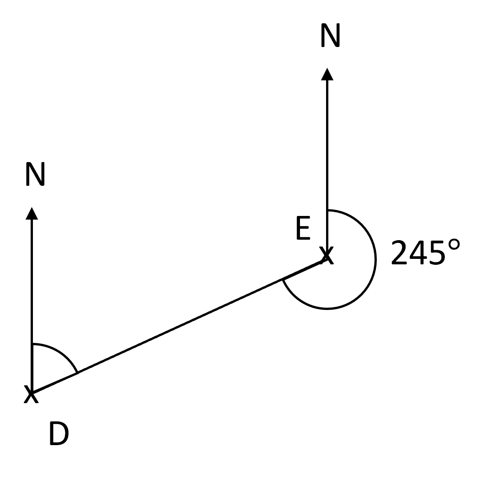

**[1]**

$245-180=065^{\circ}$

** ****065**$^{\circ}$** ****[1]**
i)

**Town P is due west of town Q**** ****[1]**

ii) *A decagon has 10 sides. Work out the exterior angle.  *

$360\div10=36^{\circ}$

**[1]**

> *An interior and an exterior angle sum to 180°.  *

$180-36$

**[1]**

**144°**** ****[1]**

### Q9
i) *Use your ruler to measure the actual distance between A and B. *
*Each 1cm is 20km so write this as a ratio to work out the real-life length represented by 11 cm.*

$\mathrm{cm}:\mathrm{km}\,1:20$

> *Multiply both sides by 11 *

$11:220$

** ****For indicating a length of 11 cm ****[1]**
**220 km**** ****[1]**

ii) *Bearings should be measured from North, clockwise, and use 3 figures. *
*Use a protractor to measure the bearing of B from A.  *

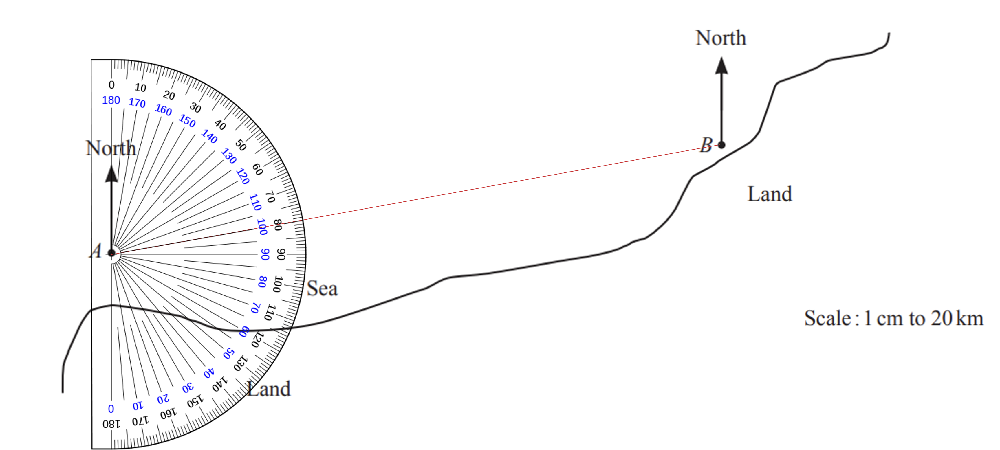

**  080°**** ****[1]**

iii) *Use the ratio to work out how far 120km would be on the scale diagram.*

$\mathrm{cm}:\mathrm{km}\,1:20\,x:120$

> *To work out the value of **x, **multiply by 6.  *

$\mathrm{cm}:\mathrm{km}\,1:20\,6:120$

> *Measure a bearing of 300° by measuring an angle of 60° anti-clockwise from B (because angles around a point sum to 360°, and then draw a line of 6cm.  *

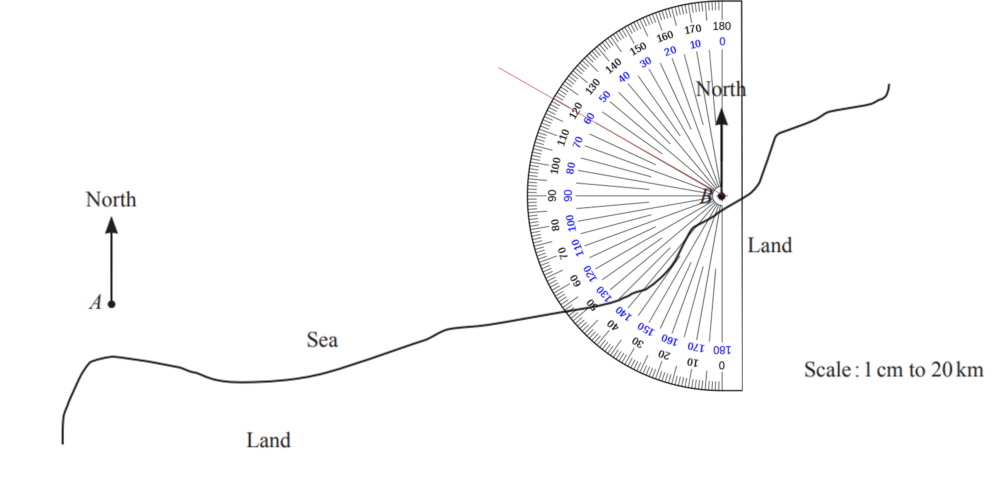

**Correct line of 6 cm or correct bearing**** ****[1]**

> *Then mark the position of C at the end of the 6cm line.  *

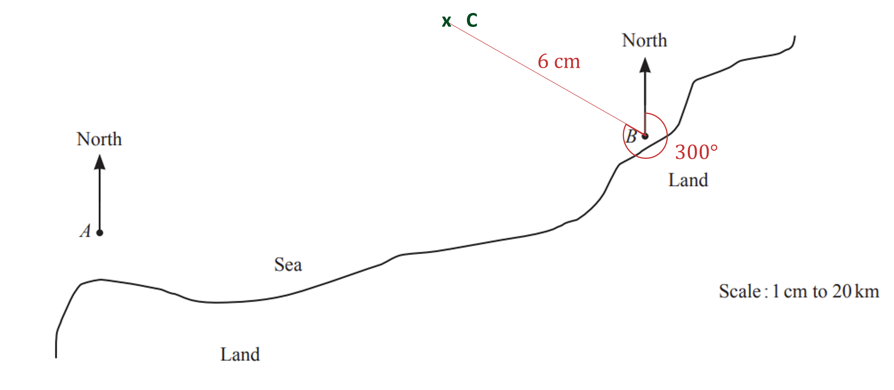

**C in correct position**** ****[1]**

### Q10
> *Centre the protractor on town *$B$* with *$0^{\circ}$* in the same direction as the north line at *$B$*.*

> *Read the angle on the scale clockwise in the direction of *$A$*.*

> *If you only have a semi-circular protractor, find the angle anti-clockwise which is 38, and then subtract from 360.*

$322^{\circ}$ **[1]**
> *Measure the length of the line AB.*

$12\mathrm{cm}$

**[1]**

> *Multiply this by the scale factor.*

$12\times8=96\mathrm{km}$

**96 km**** ****[1]**
> *Convert *$8\mathrm{km}$* to centimetres by multiplying by *$100000$*.*

$8\times100000=800000\mathrm{cm}$

**800 000 cm**** ****[1]**
> *Centre the protractor at town *$C$* and align *$0^{\circ}$* with the north line. Measure the angle of *$246^{\circ}$* clockwise and mark this onto the diagram.*

> *Draw a straight line from town *$C$* to the mark made on the diagram labelling the point *$X$* where the line intersects the line *$AB$*.*

**[1]**
> *Partition 37 minutes into 10 minutes and 27 minutes to increase the time over the next hour*

*10:50 + 10 minutes + 27 minutes*
*= 11:00 + 27 minutes*

**11:27**** ****[1]**

iia) *The time taken for an object to travel a certain distance at a constant speed is calculated using the formula:*
*Time = *$\frac{\mathrm{Distance}}{\mathrm{Speed}}$* where the distance is *$96\mathrm{km}$* and the speed is *`75 space km ⁄ straight h`*.*
*Substitute these values into the formula and evaluate.*
* *

$T=\frac{96}{75}=1.28\mathrm{hours}$

**[1]**

> *Convert this time to minutes by multiplying by *$60$*.*

$1.28\times60=76.8\mathrm{minutes}$

**[1]**

> *Round this to the nearest integer to determine the number of minutes.*

`76.8 ~= 77 minutes ( 0 dp )`

> *As 1 hour is equal to *$60$* minutes, subtract *$60$* minutes from this time to determine the time in hours and minutes.*

> * *$77-60=17$

**1 hour 17 minutes*** ***[1]**

iib) *Subtract 1 hour and 17 minutes from the time that Josie arrives.*

* **11 27 - 1 hour - 17 minutes*
*= 10 27 - 17 minutes*

**10 10** **[1]**

### Q11
> *Measure the line.*

$\mathrm{Line}AB=9\mathrm{cm}$

**[1]**

> *1 cm = 12 km, so multiply by 12. *

$9\times12=108$

> * *

**108**** ****km** **[1]**
> *Convert the lengths of **AC** and **BC** using the scale.*

> *  *$AC=72\div12=6\mathrm{cm}\,BC=96\div12=8\mathrm{cm}$

**Correct conversion using scale for both lengths**** ****[1]***  *

> *Place the point of the compasses at point A and draw an arc with radius 6 cm. *
*Draw another with radius 8 cm from point B.*

> * *

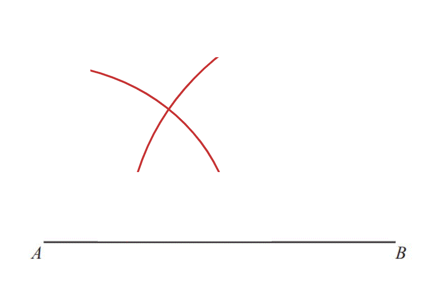

> *The third vertex of the triangle is the point at which they intersect. Draw lines from points A and B to this vertex with a ruler to form the triangle.*

> *Use your ruler to measure each side and check for accuracy.*

> * *

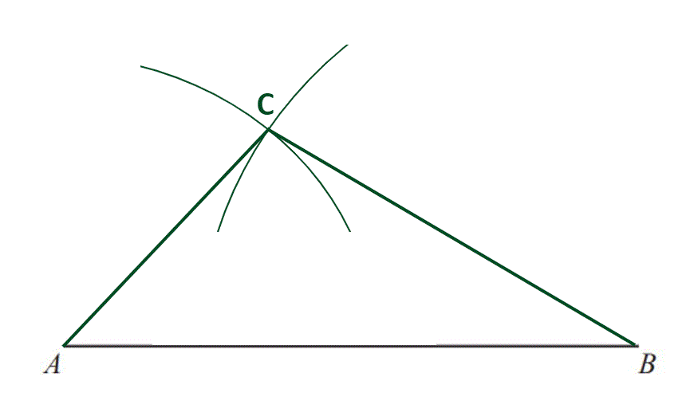

**Correct triangle*** ***[2] **

**Do not erase arc lines as this would lose a mark **
**Also note that point C could alternatively be placed below line AB while still satisfying all the information given in the question**

### Q12
i) *Measure the length between *$R$* and *$S$* using a ruler.*

$9\mathrm{cm}$

**[1]**

> *Multiply the measured length by the scale factor.*

$9\times6$

** ****54 m**** [1]**

** **

ii) *Subtract the bearing from *`180 ˚`* .*

* *$180-164=16$

> *This is an angle in the anticlockwise direction so subtract from *$360^{\circ}$* for a bearing in the clockwise direction. *

$360-16$

**[1]**

** ****344**$^{\circ}$** [1]**

** **

** **

iii) *Place the centre of the protractor on *$R$* and turn the protractor so that *$0^{\circ}$* is aligned with the North line at *$R$*.*

> *Measure an angle in the clockwise direction of *$76^{\circ}$* and mark this angle on the page.*

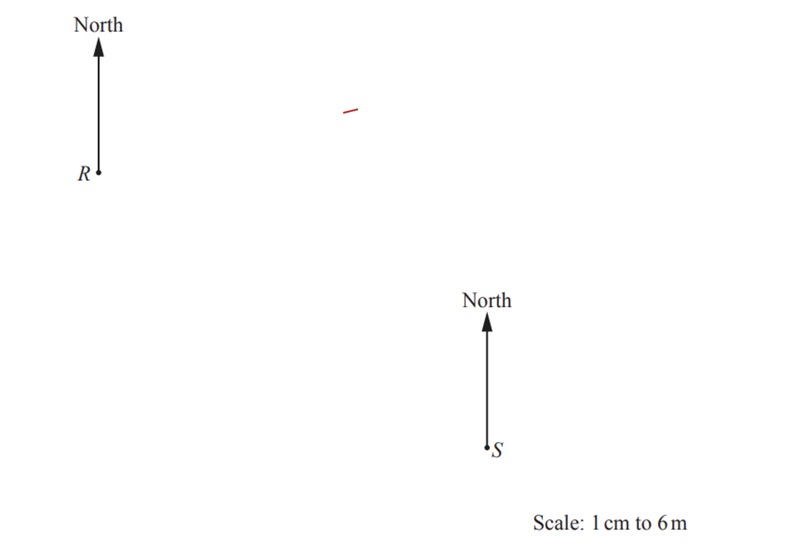

> *Draw a straight line directly from *$R$* through this plotted point.*

**[1]**

** **

> *As the bearing of *$T$* is greater than *$180^{\circ}$* from *$S$*, subtracting *$337^{\circ}$* from *$360^{\circ}$* will find the angle of *$T$* from *$S$* in the anticlockwise direction. *

$360-337=023^{\circ}$

> *Re-centre the protractor in the anticlockwise direction over *$S$* with *$0^{\circ}$* aligned with the North line at *$S$*.*

> *Measure an angle in the anticlockwise direction of *$23^{\circ}$* and mark this angle on the diagram.  *

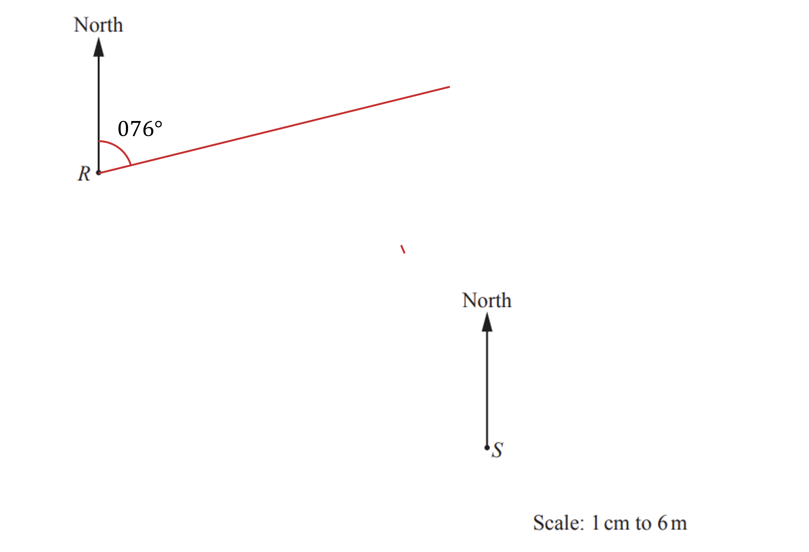

> *Draw a straight line directly from *$S$* through this plotted point, and continue until it crosses the line drawn for the bearing of *$076^{\circ}$* from *$R$*.  *

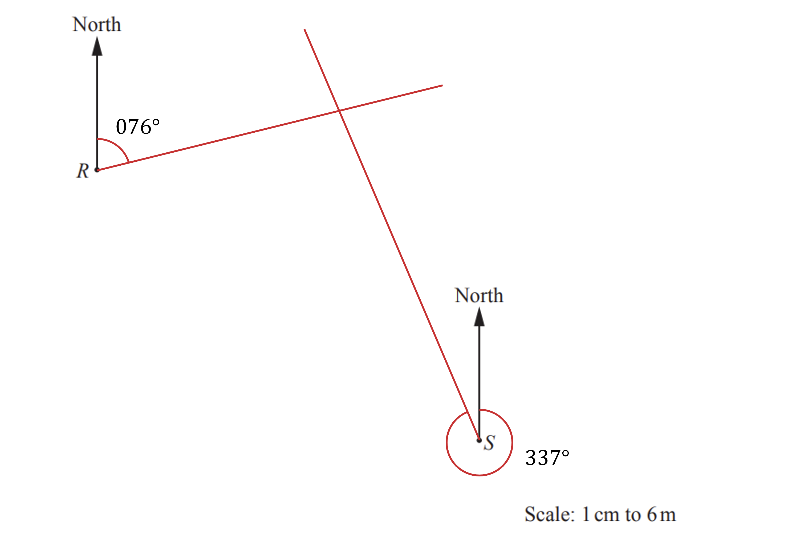

*Label the point of intersection of these two lines with the letter *$T$**   **

**[1]**

### Q13
> *Convert the lengths of AC and BC using the scale.   *

$AC=500\div100=5\mathrm{cm}\,BC=650\div100=6.5\mathrm{cm}$

**  ****Correct conversion using scale ****[1]**

> *Place the point of the compasses at point A and draw an arc with radius 5 cm. Draw another with radius 6.5 cm from point B.*

> * *

> *The third vertex of the triangle is the point at which they intersect. *
*Draw lines from points A and B to this vertex with a ruler to form the triangle.*

> *Use your ruler to measure each side and check for accuracy.*

> * *

**Correct triangle**** ****[2] **
**Do not erase arc lines as this would lose a mark**

### Q14
> *To find a reverse bearing, either add or subtract 180° (whichever will give an answer between 0° and 360°). *

$105+180$

**[1]*** *

$285^{\circ}$** ****[1]**

### Q15
i) *Convert the distance in kilometres to centimetres by multiplying by 100,000. *

$15\times100000=1500000$

**[1]**

** **$1:1500000$ **[1]**

** **

** **ii) *Measure accurately the line between *$Y$* and *$R$* on the diagram.*

> *  *$6.4\mathrm{cm}$

**[1]**

> * Multiply the length by the scale factor in kilometres. *

> * *$6.4\times15$

** ****96 km**** [1]**

iii) *Line the centre of the protractor on *$Y$* and turn the protractor so that *$0^{\circ}$* is aligned with the North line at *$Y$*.*
*Read the angle on the same scale of the line that is in the direction of *$R$*. *

$117^{\circ}$* ***[1]**

** **

iv)*Multiply the distance of 45 km by 100 000 to convert it to cm.*

> * *$45\times100000=4500000$

> * Divide the real-life distance in cm by 1 500 000 to covert it to the corresponding distance on the map.*

> * *$4500000\div1500000=3$

**[1]**

> *Draw a circle with radius *$3\mathrm{cm}$*, centred at *$Y$*.*

> * *

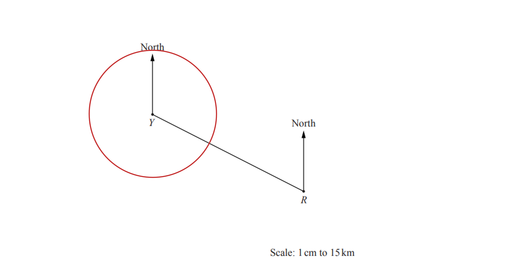

> * *

> *Multiply the distance of 45 km by 100 000 to convert it to cm.*

$60\times100000=6000000$

> * Divide the real-life distance in cm by 1 500 000 to covert it to the corresponding distance on the map.*

$6000000\div1500000=4$

> * Draw a circle with radius *$4\mathrm{cm}$*, centred at *$Y$*.*

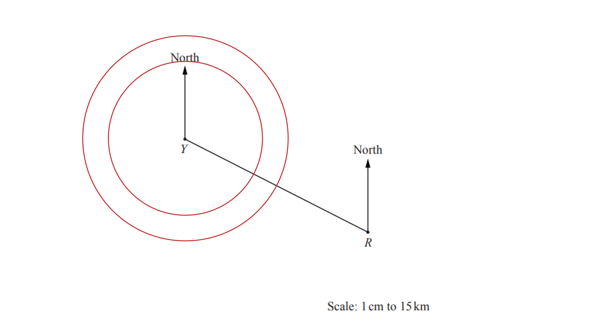

> * *

**Two arcs with radius 3 cm and 4 cm correctly drawn at centre**** ****Y*** ***[1]**

> *Next, centre a protractor on *$Y$* with *$0^{\circ}$* aligned with the North line at *$Y$*.*
*Measure *$250^{\circ}$* (clockwise) and draw this line.*

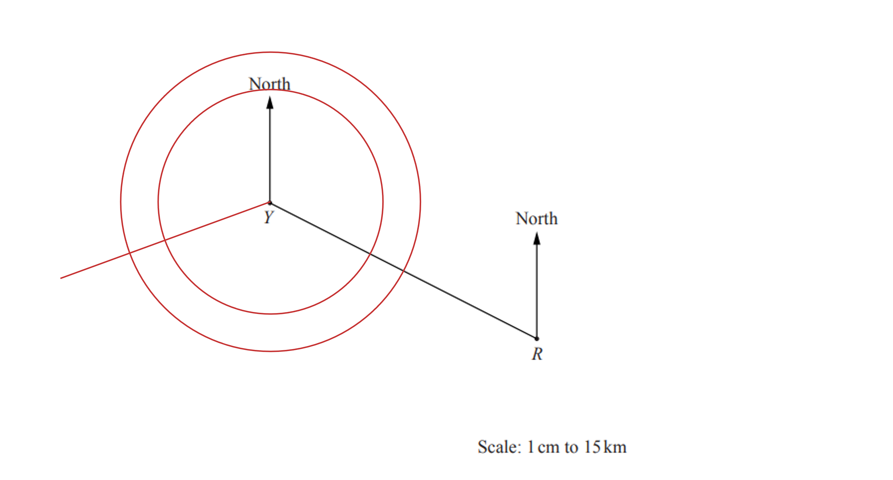

**[1]**

> *  Repeat this process for *$295^{\circ}$* (clockwise).*

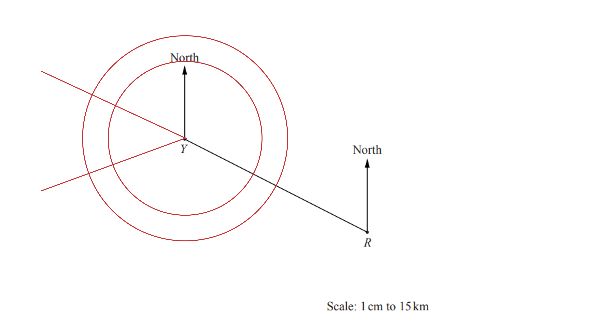

**[1]**

> *Shade the region between the two radial distances and between the two bearings.*

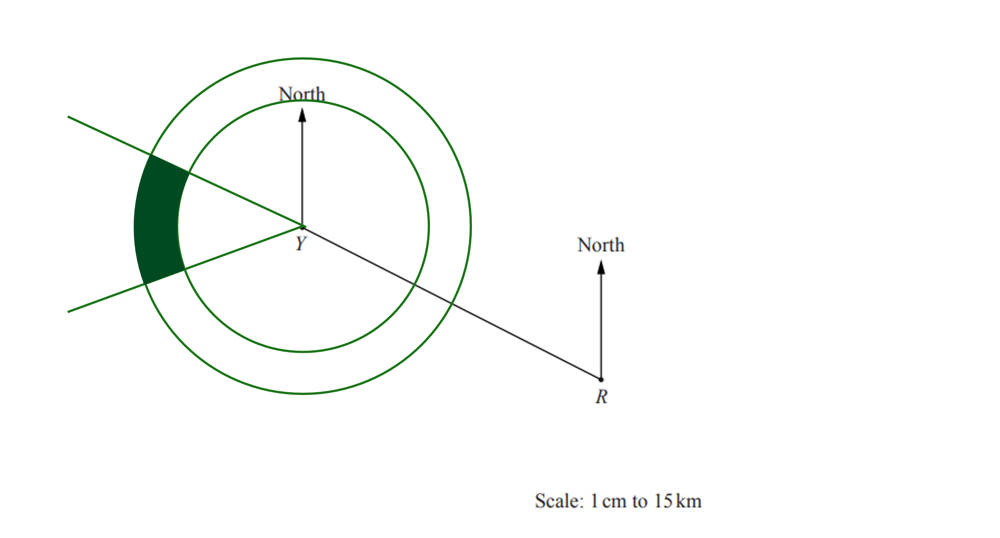

**[1]**

### Q16
(i) *Use a ruler to measure the distance between **A** and **B**. *

$9.5\mathrm{cm}$

**9.3 - 9.7 cm**** ****[1]**

> * Multiply by 10 (because every 1cm represents 10km). *

> $9.5\times10=95$* *

**95 km** **[1]**
**93 - 97 accepted**

(ii) *Divide 85 by 10 (because every 10km is drawn using 1cm). *

$85\div10=8.5\mathrm{cm}$

> * Use a protractor to measure an angle of *$100^{\circ}$* **from the north line **at **A**, and draw a line. ** *

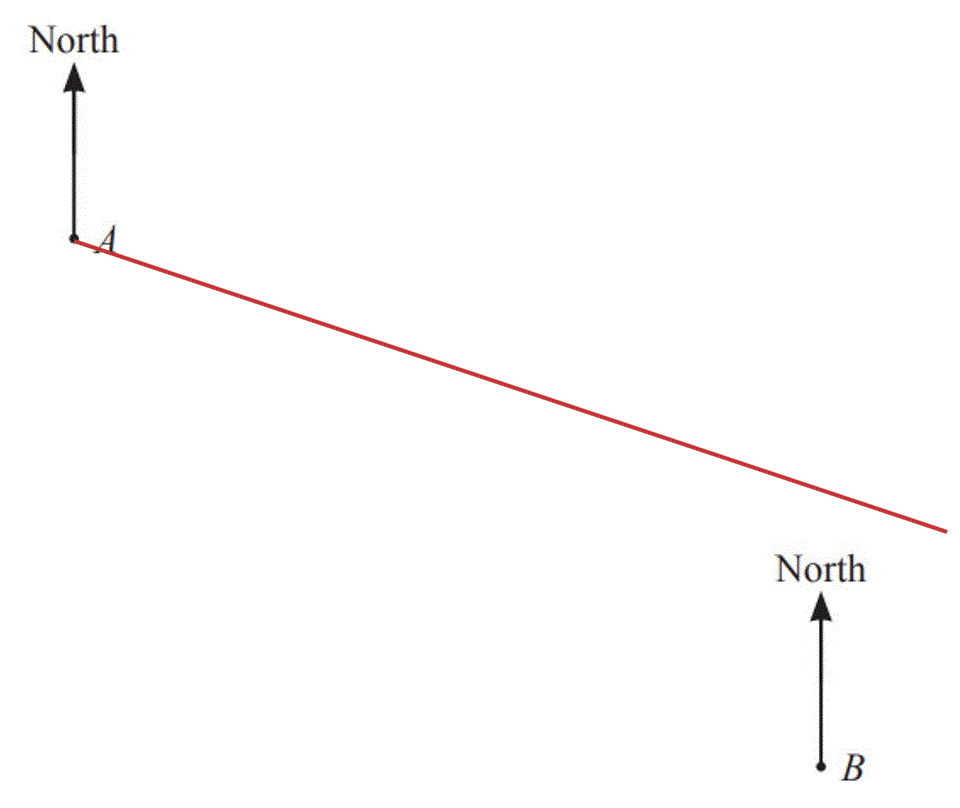

> * *

> *Measure 8.5cm along this line **from **A**,** mark with a cross and label **C**. *

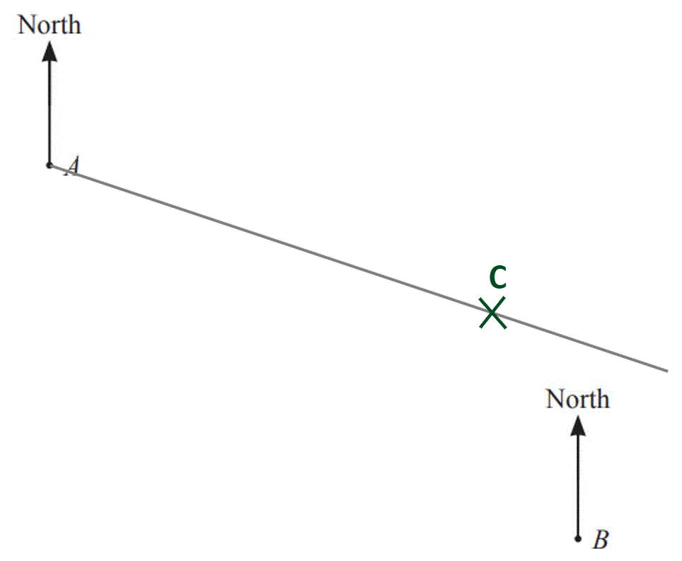

> * *

* ***1 mark for correct bearing,*** *
**1 mark for 8.5cm**** ****[2]**

### Q17
> *Draw a horizontal line using a ruler that is 5 cm in length.*

> * Centre the pair of compasses on the right hand end of the 5cm line with a radius of 10 cm.*

> *Draw an arc above the 5 cm line.*

> * *

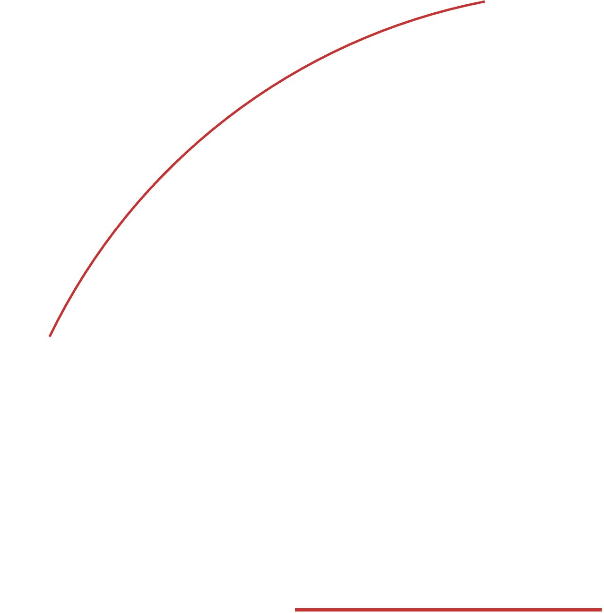

> * *

> *Next, re-centre the pair of compasses over the left hand end of the 5 cm line with a radius of 8 cm.*

> *Draw an arc above the 5 cm line.*

> * *

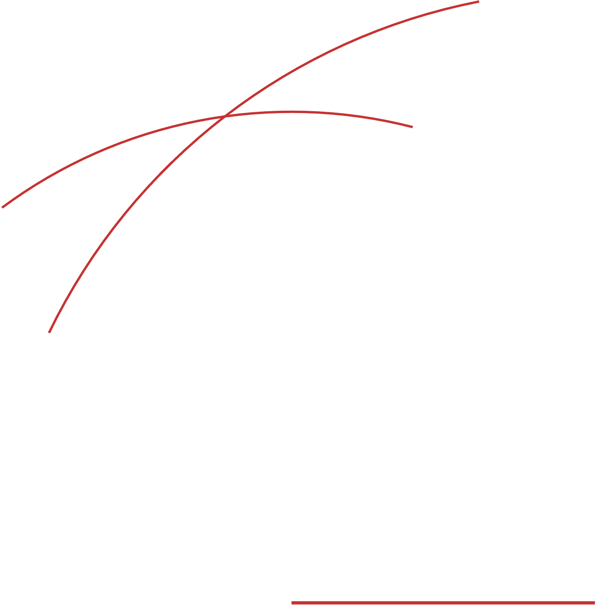

> * *

*The point of intersection of the two arcs is the third vertex of the triangle.* 
*Connect this point to each end of the 5 cm line.*

> *Do **not** erase your construction lines.*

> * *

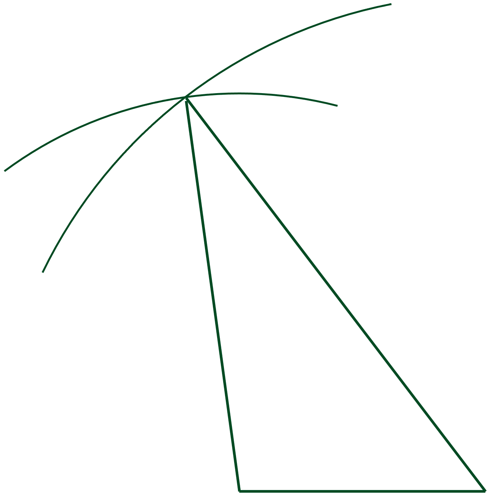

> * *

** ****Any two sides correct when drawn as part of a triangle**** ****[1] **
**All three sides of the triangle fully correct**** [1]**

### Q18
> *Centre the protractor at *$R$* with *$0^{\circ}$* aligned with the north line at *$R$*.*

> *Measure the angle of *$125^{\circ}$* in the clockwise direction and mark this angle on the diagram.*

**[1]**

> *Use the scale to determine the distance that *$L$* is from *$R$*.*

$210\div30=7\mathrm{cm}$

> *Mark the point on the diagram along the bearing drawn that is *$7\mathrm{cm}$* from *$R$*.*

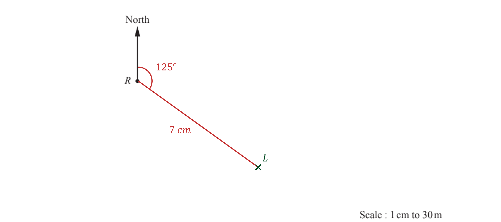

**[1]**

### Q19
> *Use your ruler to measure the length and width of the window. *

$\mathrm{Length}=4\mathrm{cm}$

$\mathrm{Width}=2.5\mathrm{cm}$

> *Use the scale to convert these to their actual lengths by multiplying by 40.*

$4\times40=160\mathrm{cm}$

**160 cm**** ****[1]**

$2.5\times40=100\mathrm{cm}$

**100 cm** **[1]**

### Q20
> *To find the bearing of B from A, start at A and measure clockwise from the North line, making sure that the 0° on your protractor is lying on the North line.*

> * *

> * *

> *The angle is an obtuse angle.*

$113^{\circ}$ **[1]**

### Q21
> *Place the point of the compasses at point A and draw an arc with radius 6.2 cm. *
*Draw another with radius 7.6 cm from point B.*

> * *

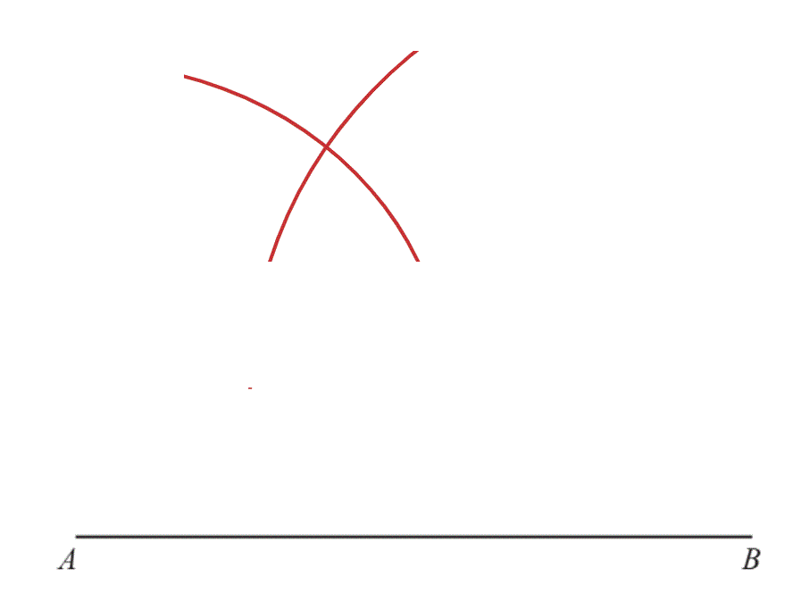

> * *

> *The third vertex of the triangle is the point at which they intersect. *
*Draw lines from points A and B to this vertex with a ruler to form the triangle.*

*Use your ruler to measure each side and check for accuracy.*

> * *

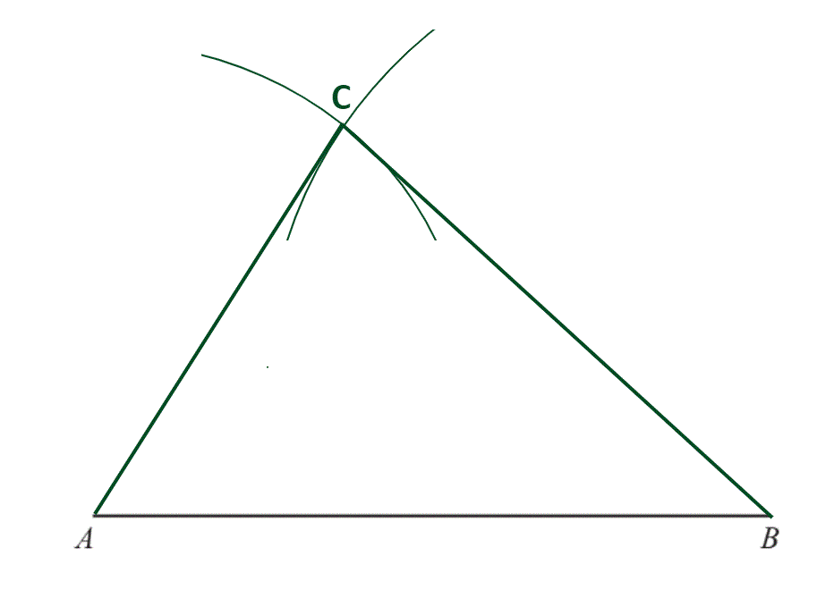

> * *

** ****Correct triangle**** ****[2] **

**Do not erase arc lines as this would lose a mark**

### Q22
> *Place the point of the compasses at point A, open the compasses to the length of the line, and draw an arc. *
*Keeping the compasses at the same distance apart, draw another arc from point B.*

> * *

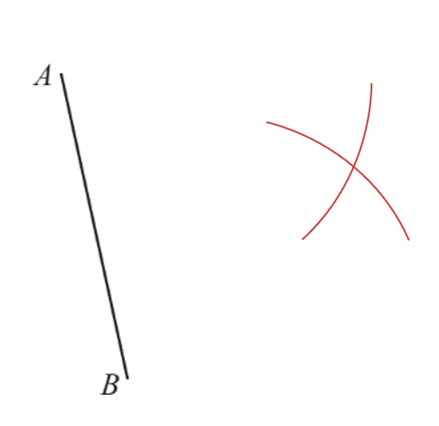

> *The third vertex of the triangle is the point at which they intersect. *
*Draw lines from points A and B to this vertex with a ruler to form the triangle.*

> *Use your ruler to measure each side and check for accuracy.*

> * *

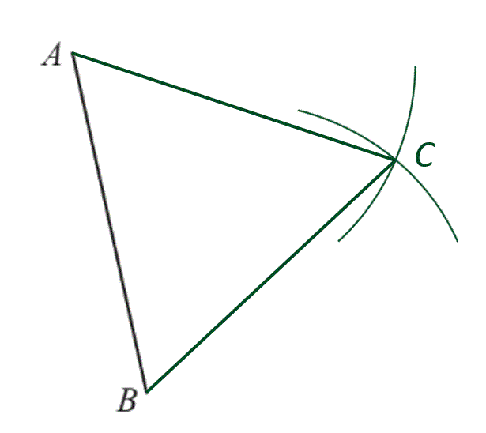

> * *

**Correct triangle**** ****[2] **

**Do not erase arc lines as this would lose a mark**

### Q23
i) *Align *$0\mathrm{cm}$* of a ruler with the point *$S$* and turn the ruler to the direction of *$T$*.*
*Read the value from the scale.*

$7.8\mathrm{cm}$

**[1]**

> *Multiply by the scale factor to determine the actual distance.*

$7.8\times15=117$

**117 km**** ****[1]**

ii) *As the bearing is from *$S$*, centre a protractor at *$S$* and align *$0^{\circ}$* in a clockwise direction with the north line at this point.*

> *Read the angle of *$T$* and write as a three figure bearing.*

$137^{\circ}$ **[1]**

### Q24
> *Centre a pair of compasses on *$A$* set to the radius equal to the distance *$AB$*.*

> *Draw an arc above the line.*

> *Repeat this process with the pair of compasses centred at *$B$* with the same radius.*

**[1]**

> *The intersection of the two arcs is the location of the vertex *$C$*.*

**[1]**

### Q25
i) *Set the pair of compasses to 7 cm and draw an arc with centre at A. *
*Then change to 5 cm and draw an arc with centre at B. The point where the arcs cross is the third corner of the triangle, label this C and join it to the other corners.  *

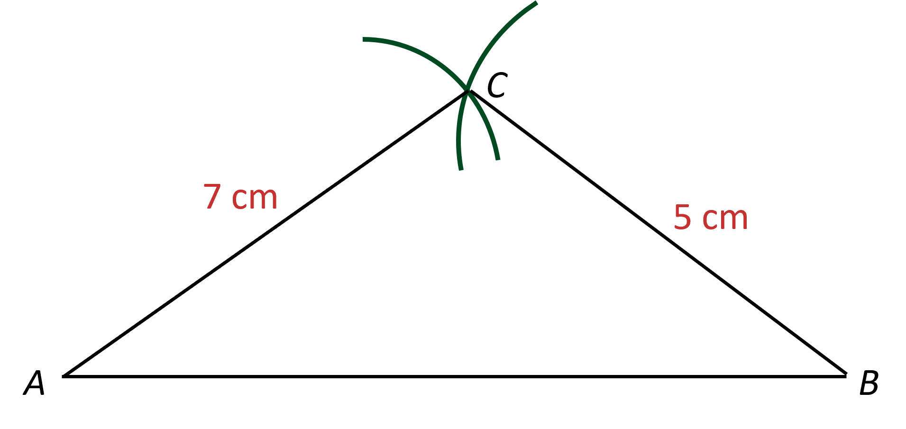

**Correct triangle**** [1]** 
**Correct arcs**** [1]**

ii) *Angle ABC is the angle at B. Use a protractor to measure this angle.  *

**Final answer:** **57°**** [1] **
**Angles between 56 and 59 are accepted**

### Q26
> *Place the point of the compasses at one end of the line and draw an arc with radius 6 cm above the horizontal line. *
*Place the point of the compasses at the other end of the line and draw an arc with radius 4 cm so that it crosses over the first arc.*

> *Use a ruler to join up the sides of the triangle. Use your ruler to measure each side and check for accuracy.*

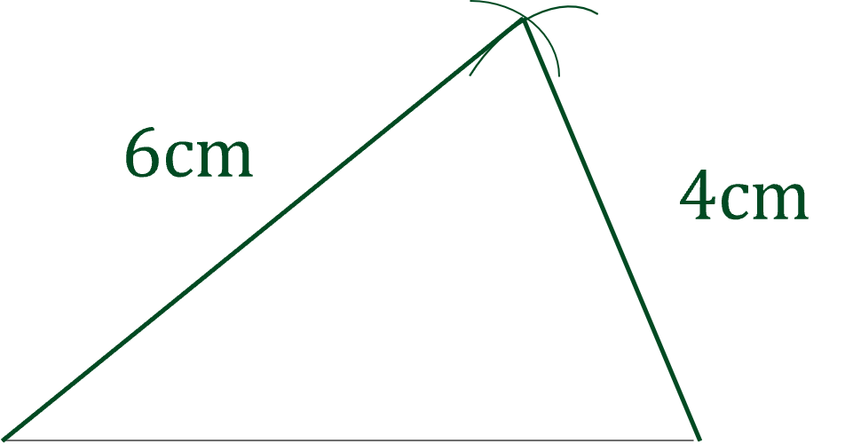

**Both sides correct length**** ****[1]**
** ****Arcs shown and triangle drawn accurately*** ***[1]**
