# Exam Questions — Bearings, Constructions & Scale Drawings
**Geometry** · Cambridge (CIE) IGCSE maths (0580 & 0980)
> Source: [https://www.savemyexams.com/igcse/maths/cie/25/core/topic-questions/](https://www.savemyexams.com/igcse/maths/cie/25/core/topic-questions/) · 26 questions across 1 sets

## Exam Questions (26 questions)

### Q1 — medium — 2 marks

**Q1** [2 marks]

A triangle has sides 5 cm, 7 cm and 9 cm.

**Using a ruler and compasses only**, construct the triangle. 
The 5 cm line has been drawn for you. 
Show all your construction arcs.

### Q2 — medium — 2 marks

**Q2** [2 marks]

The scale drawing shows the position of a boat, $B$.

The scale is 1 centimetre represents $40$  metres.

A lighthouse, $L$ is  $240$ metres from $B$, on a bearing of $135^{\circ}$.

On the scale drawing, mark the position of $L$.

### Q3 — medium — 2 marks

**Q3** [2 marks]

The bearing of Bartown from Whitestoke is 073°.

Work out the bearing of Whitestoke from Bartown.

*Source: March 2018 0580/32 Q8B*

### Q4 — hard — 6 marks

**Q4** [2 marks]

Point $B$ is 36 km from point $A$on a bearing of 140°.

Using a scale of 1 centimetre to represent 4 kilometres, mark the position of $B$.

Scale: 1cm to 4 km

*Source: June 2020 0580/31 Q10A*

**Q4** [4 marks]

**Extract:**

Point B is 36 km from point A on a bearing of 140°.

Using a scale of 1 centimetre to represent 4 kilometres, mark the position of B.

Scale: 1cm to 4 km

i) Point C is 28 km from $A$ and 20km from $B$.
The bearing of $C$ from$A$is less than 140°.
**Using a ruler and compasses only,** construct triangle $ABC$. 
Show all your construction arcs.

[3]

ii) Measure angle $ACB$.

Angle $ACB$ = .................................................. [1]

*Source: June 2020 0580/31 Q10B*

### Q5 — hard — 4 marks

**Q5** [2 marks]

A circular garden has diameter 11.4 m.

Draw the garden accurately, using a scale of 1cm represents 1.5 m.

Scale: 1cm to 1.5m

*Source: June 2020 0580/13 Q10A*

**Q5** [2 marks]

On a map, the distance between two towns is 9.6cm. 
The scale of the map is 1 : 50000.

Work out the actual distance between the two towns in kilometres.

........................................... km

*Source: June 2020 0580/13 Q10B*

### Q6 — hard — 5 marks

**Q6** [2 marks]

The scale drawing shows the positions of an airport ($A$) and a train station ($T$) on a map.

The scale is 1 centimetre represents 2 kilometres.

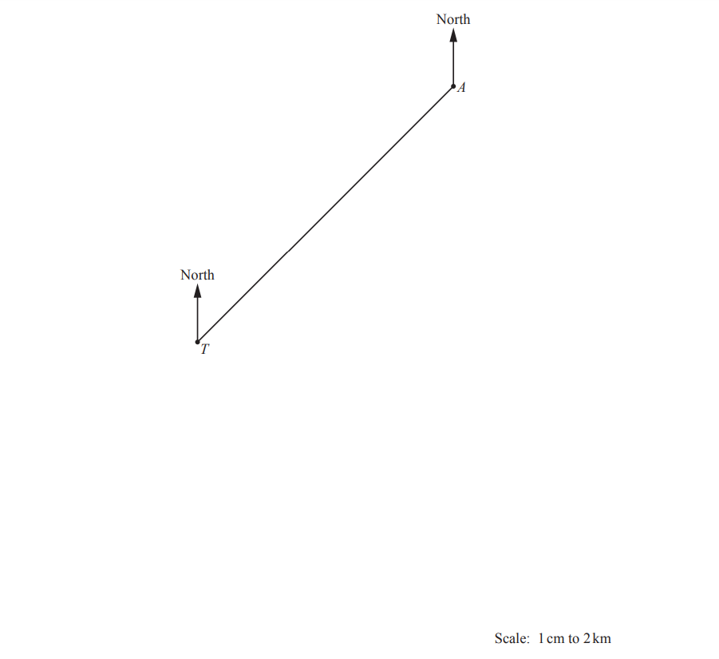

Work out the actual distance, in kilometres, of the train station from the airport.

.............................. km

*Source: March 2019 0580/32 Q7A*

**Q6** [1 mark]

**Extract:**

The scale drawing shows the positions of an airport (![A]) and a train station (![T]) on a map. The scale is 1 centimetre represents 2 kilometres.

Measure the bearing of the airport from the train station.

*Source: March 2019 0580/32 Q7B*

**Q6** [2 marks]

The bus station is not shown on the map. The bearing of the bus station from the train station is 318°.

Work out the bearing of the train station from the bus station.

*Source: March 2019 0580/32 Q7E*

### Q7 — hard — 9 marks

**Q7** [9 marks]

The scale drawing shows a map of Kingswood Park. 
There are two straight paths and one circular path. 
The scale is 1cm represents 200m.

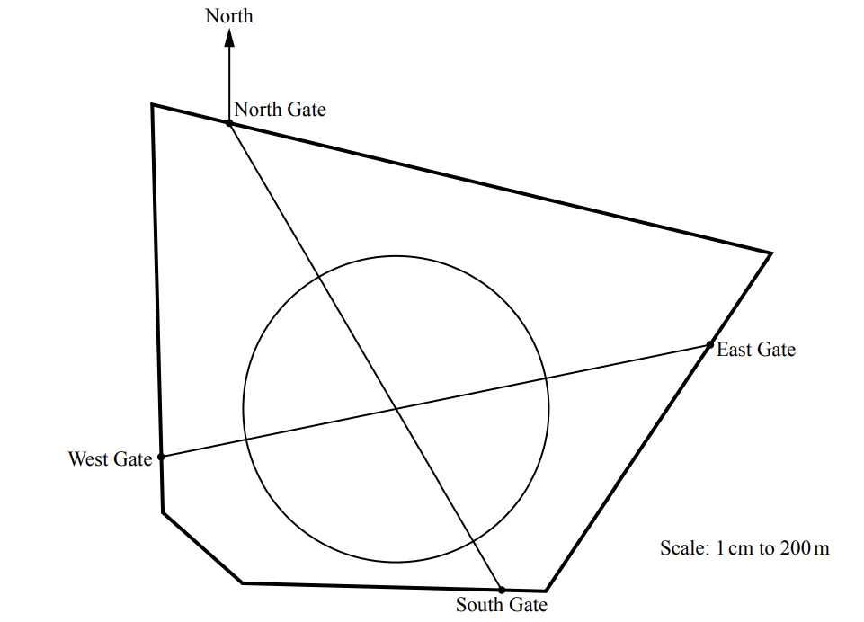

i) Yana walks along the straight path from East Gate to West Gate.

Work out the distance she walks. 
Give your answer in kilometres.

.......................................... km [2]

ii) Measure the bearing of South Gate from North Gate.

[1]

iii) The entrance, P, to a children’s play area is 500 metres from North Gate on a bearing of 195°.
Mark the position of P on the map.

[2]

iv) Ivan runs once around the circular path.

Calculate the distance Ivan runs.

............................................ m [4]

*Source: Specimen 2020 0580/03 Q1C*

### Q8 — hard — 11 marks

**Q8** [5 marks]

The scale drawing shows the positions of town $A$ and town $B$.

The scale is 1 centimetre represents 12 kilometres.

i) Measure the bearing of town $B$ from town $A.$

[1]

ii) Find the actual distance from town $A$ to town $B$.

.............................................. km [2]

iii) Town $C$ is on a bearing of 064° from town $A$ and 028° from town $B$.

On the scale drawing, mark the position of town $C$.

[2]

*Source: Nov 2019 0580/33 Q6A*

**Q8** [2 marks]

The bearing of town $D$ from town $E$ is 245°.

Work out the bearing of town $E$ from town $D$.

*Source: Nov 2019 0580/33 Q6B*

**Q8** [4 marks]

The diagram shows three towns, $P,Q$ and $R$.

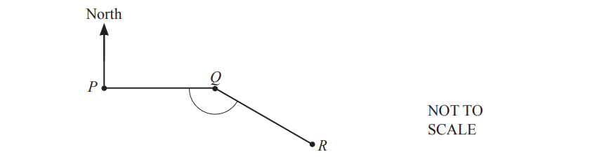

The bearing of town $Q$ from town $P$ is 090°.

i) Complete the statement.

Town ....................................... is due west of town .......................................

[1]

ii) $PQ$ and $QR$ are two sides of a regular decagon.

Work out angle $PQR$.

Angle $PQR$= ................................................... [3]

*Source: Nov 2019 0580/33 Q6C*

### Q9 — hard — 5 marks

**Q9** [5 marks]

The scale drawing shows the positions of two buoys,$A$and $B$, in the sea. 
The scale is 1 centimetre represents 20 kilometres.

i) Work out the actual distance between buoy $A$ and buoy $B$.

.............................................. km [2]

ii) Measure the bearing of buoy$B$ from buoy $A$.

[1]

iii) Buoy $C$ is 120 km from buoy $B$ on a bearing of 300°.

On the scale drawing, mark the position of buoy $C$.

[2]

*Source: Nov 2019 0580/31 Q8A*

### Q10 — hard — 10 marks

**Q10** [1 mark]

The scale drawing shows town $A$, town $B$ and town $C$ on a map. 
There is a straight road between town $A$ and town $B$. 
The scale of the map is 1 centimetre represents 8 kilometres.

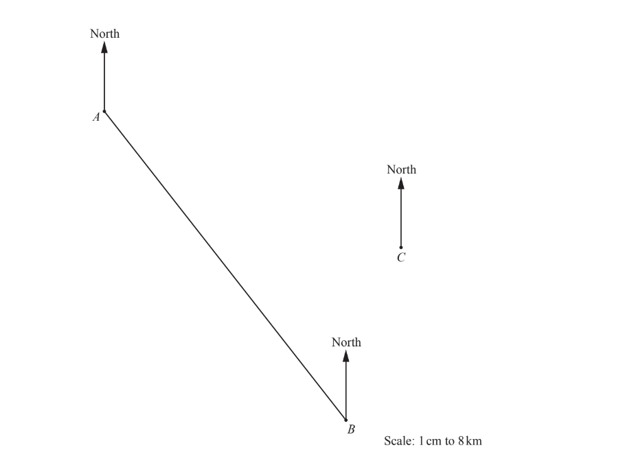

Measure the bearing of town $A$ from town $B$.

*Source: June 2019 0580/32 Q4A*

**Q10** [2 marks]

**Extract:**

The scale of the map is 1 centimetre represents 8 kilometres.

Work out the actual distance, in kilometres, between town $A$ and town $B$.

............................................... km

*Source: 2019 May/June 0580/32 Q4B*

**Q10** [1 mark]

**Extract:**

The scale of the map is 1 centimetre represents 8 kilometres.

Write the scale of the map in the form 1 : $n$.

1 : ...................................................

*Source: June 2019 0580/32 Q4C*

**Q10** [1 mark]

**Extract:**

The scale drawing shows town ![A], town ![B] and town ![C] on a map. 

There is a straight road between town ![A] and town ![B]. 

The scale of the map is 1 centimetre represents 8 kilometres.

A straight road from town $C$ is on a bearing of 246°. 
It meets the road from town $A$ to town$B$at point $X$.

On the map, draw the road from town $C$ to point $X$. 
Label the position of $X$.

*Source: June 2019 0580/32 Q4D*

**Q10** [5 marks]

**Extract:**

Work out the actual distance, in kilometres, between town ![A] and town ![B].

i) Josie is at point $X$ at 10 50
She arrives at town $B$ 37 minutes later.

Work out the time that she arrives at town $B$.

[1]

Sammy leaves town $A$ and travels to town $B$ at a constant speed of 75 km/h.

iia) Work out the time for this journey.
Give your answer in hours and minutes, correct to the nearest minute.

.................... h ................. min [3]

iib) Sammy wants to arrive at town $B$ at the same time as Josie.
Work out the time that Sammy must leave town $A$.

[1]

*Source: June 2019 0580/32 Q4E*

### Q11 — hard — 5 marks

**Q11** [2 marks]

The scale drawing shows the positions of town $A$and town $B$. 
The scale is 1 cm represents 12 kilometres.

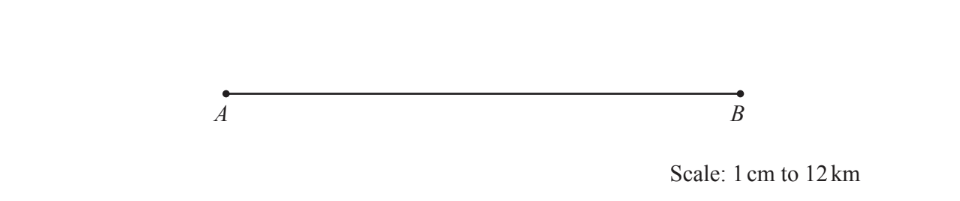

Find the actual distance between town $A$ and town $B$.

........................................... km

*Source: June 2020 0580/12 Q8A*

**Q11** [3 marks]

**Extract:**

The scale drawing shows the positions of town A and town B. The scale is 1 cm represents 12 kilometres. Town C is 72 km from town A and 96km from town B.

Town $C$ is 72 km from town $A$ and 96km from town $B$. 
On the scale drawing, construct the position of town $C$.

*Source: June 2020 0580/12 Q8B*

### Q12 — hard — 6 marks

**Q12** [6 marks]

The scale drawing shows the positions of a rock, $R$, and a statue, $S$, on a map. 
The scale is 1 centimetre represents 6 metres.

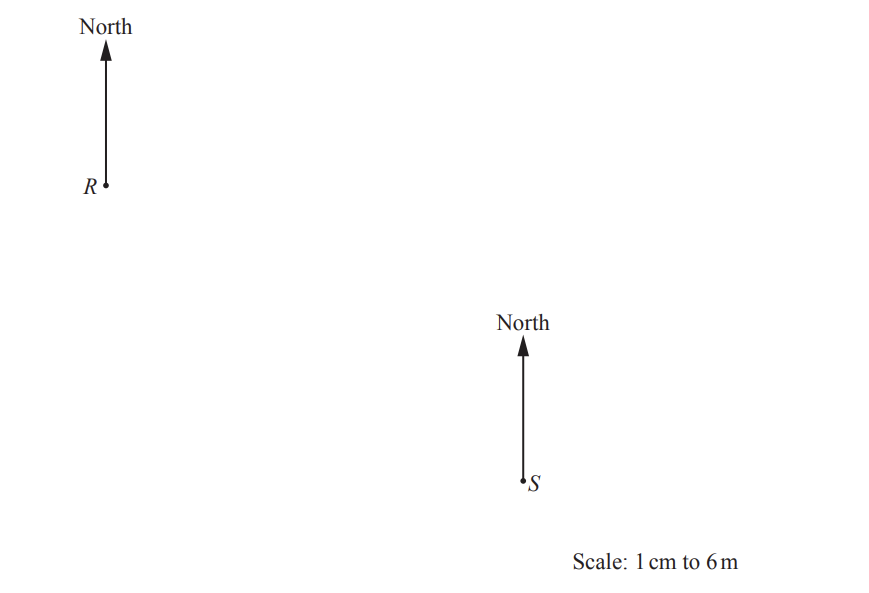

i) Work out the actual distance between$R$ and $S$.

............................................. m [2]

ii) A flagpole, $F$, is on a bearing of 164° from $S$.

Work out the bearing of $S$ from $F$.

[2]

iii) Ishaan uses the map to find some treasure, $T$.
$T$ is on a bearing of 076° from $R$ and on a bearing of 337° from $S$.

Mark the position of $T$ on the map.

[2]

*Source: March 2020 0580/32 Q7A*

### Q13 — medium — 3 marks

**Q13** [3 marks]

A field, ABC, is in the shape of a triangle.
 *AC* = 500m and *BC* = 650m.

**Using a ruler and compasses only,** complete the scale drawing of the field ABC. 
Leave in your construction arcs. 
Use a scale of 1 cm to represent 100m. 
The side AB has been drawn for you.

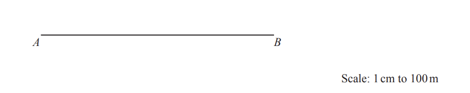

*Source: Nov 2020 0580/11 Q8*

### Q14 — medium — 2 marks

**Q14** [2 marks]

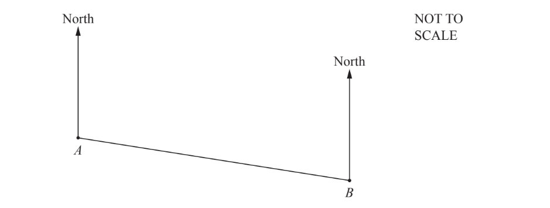

The bearing of $B$ from $A$ is 105°. 
Find the bearing of $A$ from $B$.

*Source: June 2020 0580/12 Q10*

### Q15 — medium — 10 marks

**Q15** [10 marks]

The scale drawing shows the positions of two towns, Yatterford ($Y$) and Rexley ($R$), on a map. 
The scale is 1 centimetre represents 15 kilometres.

i) Write the scale of the map in the form 1: $n$.

1 : ..................................... [2]

ii) Work out the actual distance of Rexley from Yatterford.

............................. km [2]

iii) Measure the bearing of Rexley from Yatterford.

[1]

iv) A hospital is to be built on an area of land between 45km and 60km from Yatterford. 
The bearing of the hospital from Yatterford is between 250° and 295°.

On the map, construct and shade the region in which the hospital is to be built.

[5]

*Source: March 2018 0580/32 Q8A*

### Q16 — medium — 4 marks

**Q16** [4 marks]

The scale drawing shows the positions of two towns, $A$ and $B$. 
The scale is 1 centimetre represents 10 kilometres.

i) Work out the actual distance between town $A$ and town $B$.

............................................ km [2]

ii) Town C is 85 km from town A on a bearing of 100°.

On the scale drawing, mark the position of town C.

[2]

*Source: Nov 2020 0580/32 Q4B*

### Q17 — medium — 2 marks

**Q17** [2 marks]

**Using a ruler and pair of compasses only**, construct a triangle with sides 5cm, 8cm and 10 cm. 
Leave in your construction arcs.

*Source: Specimen 2020 0580/01 Q10*

### Q18 — medium — 2 marks

**Q18** [2 marks]

The scale drawing shows a rock, $R$.

The scale is 1 centimetre represents 30 metres.

A lighthouse, $L$, is 210m from $R$, on a bearing of 125°.

On the diagram, mark the position of $L$.

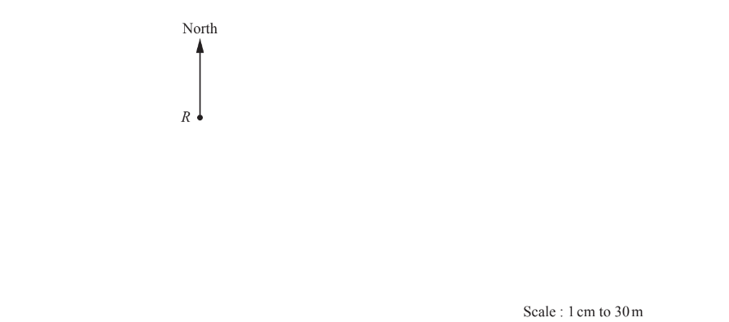

*Source: May/June 2019 0580/13 Q13*

### Q19 — easy — 2 marks

**Q19** [2 marks]

This scale drawing shows the window in the room. 
The scale is 1 centimetre represents 40 centimetres.

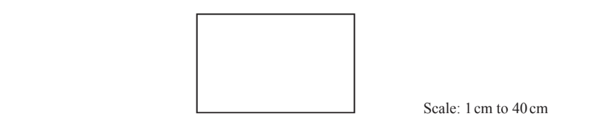

Work out the actual length and height of the window.

Length = ........................................................ cm 
Height = .................................................... cm

*Source: Nov 2019 0580/32 Q2C*

### Q20 — easy — 1 marks

**Q20** [1 mark]

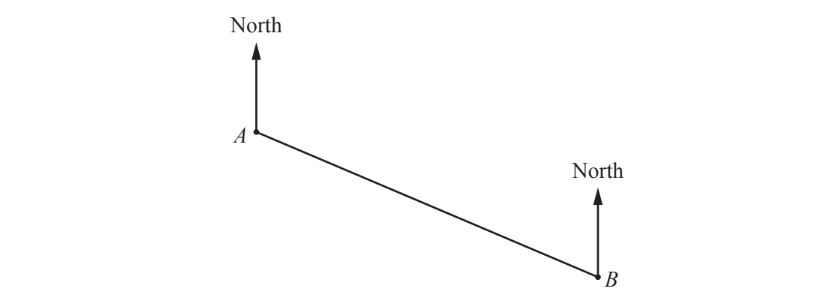

Measure the bearing of $B$ from $A$.

*Source: Nov 2019 0580/12 Q3*

### Q21 — easy — 2 marks

**Q21** [2 marks]

In triangle $ABC$, $BC$ = 7.6cm and $AC$ = 6.2 cm.

**Using a ruler and compasses only,** construct triangle $ABC$. 
Leave in your construction arcs. 
The side $AB$ has been drawn for you.

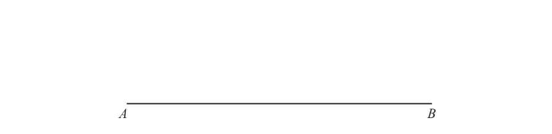

*Source: Nov 2020 0580/13 Q6*

### Q22 — easy — 2 marks

**Q22** [2 marks]

**Using a straight edge and compasses only,** construct the equilateral triangle $ABC$. 
Side $AB$ has been drawn for you.

*Source: June 2020 0580/33 Q7C*

### Q23 — easy — 3 marks

**Q23** [3 marks]

The scale drawing shows the positions of town $S$ and town $T$. 
The scale is 1 centimetre represents 15 kilometres.

i) Find the actual distance between these two towns.

....................................... km  [2]

ii) Measure the bearing of town $T$ from town $S$.

[1]

*Source: June 2019 0580/11 Q20B*

### Q24 — easy — 2 marks

**Q24** [2 marks]

**Using a straight edge and compasses only**, construct the equilateral triangle $ABC$. 
The base $AB$ has been drawn for you.

*Source: March 2019 0580/32 Q10A*

### Q25 — easy — 2 marks

**Q25** [2 marks]

In triangle $ABC,AC$ = 7cm and $BC$ = 5 cm.

i) **Using a ruler and compasses only,** construct triangle $ABC$.
$AB$ has been drawn for you.

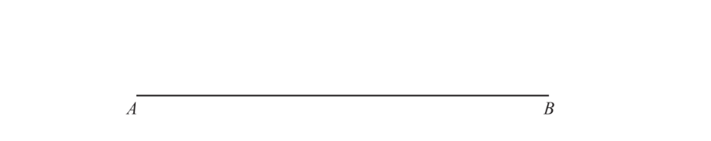

[2]

ii) Measure angle $ABC$.

[1]

*Source: Nov 2019 0580/32 Q5A*

### Q26 — easy — 2 marks

**Q26** [2 marks]

`top enclose space space space space space space space space space space space space space space space space space space space space space space space space space space space space space space space space space space space space space space space space space space space space space space space space space space space space space space end enclose`

The diagram shows the base of a triangle. 
The lengths of the other two sides are 6cm and 4cm.

**Using a ruler and compasses only,** construct the other two sides of the triangle. 
Show all your construction arcs.

*Source: June 2019 0580/11 Q8*

