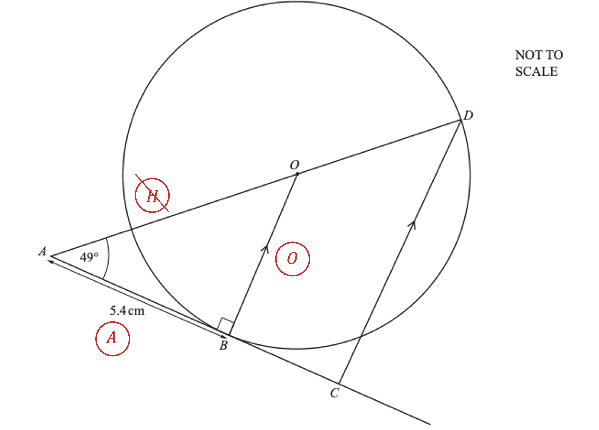
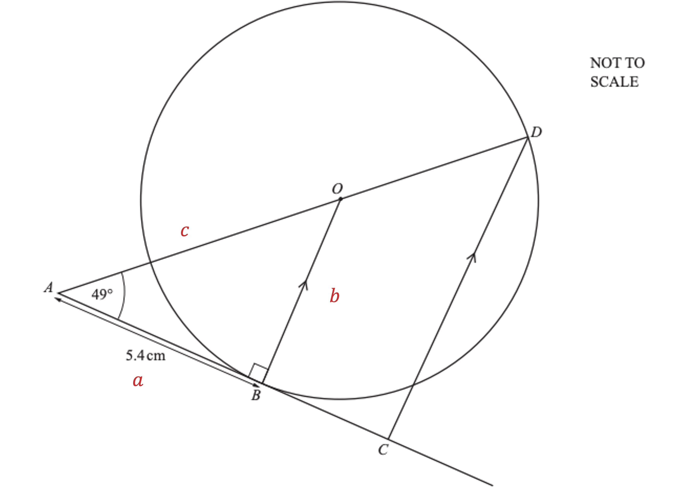
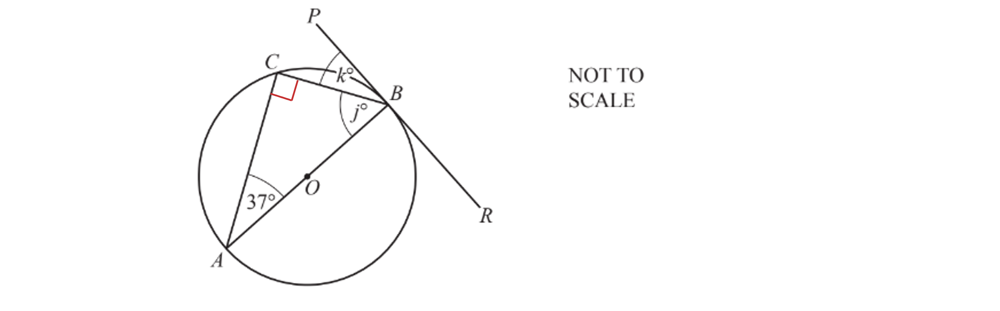
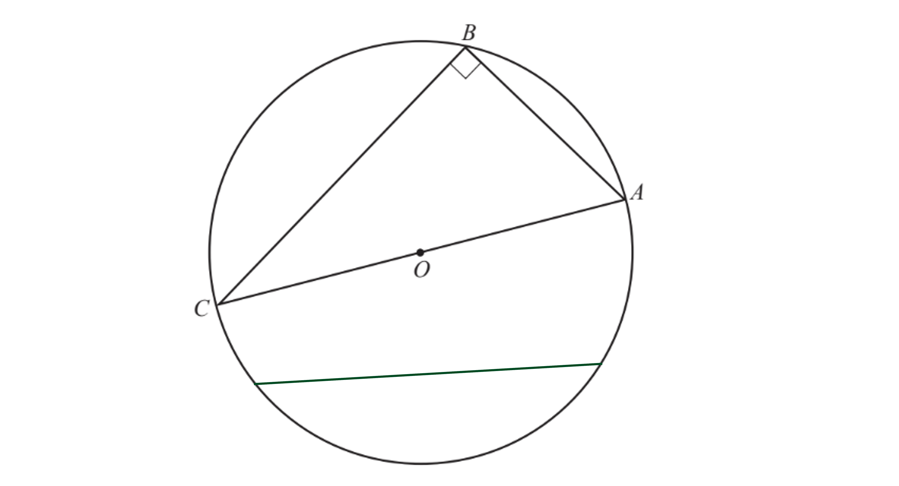

# Mark Schemes — Circle Theorems
**Geometry** · Cambridge (CIE) IGCSE maths (0580 & 0980)

## Exam Questions (17 questions)

### Q1
Because $PQ$ is a diameter of the circle, angle $PRQ$ is an 'angle in a semicircle'

- By one of the circle theorems you should know, angles in a semicircle are always equal to 90°

**Final answer:** **An angle in a semicircle is 90°**

**[B1]**
From part (a) you know that angle $PRQ$ is 90°

- That means triangle $PQR$ is a right-angled triangle

  - so you can use SOHCAHTOA to find $x$

The question tells you that $PR=5.2\mathrm{cm}$, and that $PR=\frac{1}{3}PQ$

- That means that the hypotenuse $PQ$ is equal to three times $PR$

$PQ=3\times5.2=15.6\mathrm{cm}$

**[B1]**

Consider the triangle $PQR$

- and label the sides H (hypotenuse), A (adjacent) and O (opposite) relative to angle $x$ (the angle at $Q$)

Here you know O and H, and you want to find the angle $x$

- so use SOH, $\mathrm{sin}=\frac{O}{H}$

  - with $O=5.2$ and $H=15.6$

$\mathrm{sin}x=\frac{5.2}{15.6}$

**[M1]**

Your calculator can work out the right-hand side

$\mathrm{sin}x=\frac{1}{3}$

- then use $\mathrm{sin}^{-1}$ on your calculator to find the value of $x$

$x = \sin ^{- 1} ( 1 \frac{1}{3} ) = 19.471220...$

Round to a suitable degree of accuracy

- For angles in degrees you should round to 1 decimal place (unless the question says otherwise)
- The '7' in the second decimal place says you should round the first decimal place '4' up to a 5

$x = 19.5 ( 1 \mathrm{d} . \mathrm{p} . )$

**[A1]**

> **[mark-scheme]**
> **M1**: For $PQ=15.6$ or equivalent.
> 
> **M1**: For $\mathrm{sin}x=\frac{5.2}{15.6}$, $\mathrm{sin}x=\frac{1}{3}$ or equivalent. Earning this mark automatically earns the previous 'M' mark.
> 
> **A1**: For 19.5 or 19.47... .

### Q2
> $OB$* is a right angle with the tangent and therefore *$x$* is*

$x+33=90\,x=90-33\,x=57$

$x=57^{\circ}$

**[B1]**

> *Triangle *$BCD$* is a right-angled triangle because each of its points are on the circumference, with one side being the diameter*

> *Remember also that angles in a triangle sum to *$180^{\circ}$

$57+90+y=180\,y=180-90-57\,y=33$

$y=33^{\circ}$

**[B1]**
> *Using the correct trigonometric equation*

$\sin ( y ) = \frac{opposite}{hypotenuse} 
\sin ( 33 ) = \frac{4}{B E}$

**[M1]**

> *Rearrange to find *$BE$

$B E \times \sin ( 33 ) = 4
B E = \frac{4}{\sin ( 33 )} 
B E = 7.3443...$

**[M1]**

> *Radius is half of the diameter*

$7.3443...\div2=3.6721...$

> *Round to 3 significant figures*

**Final answer:** **Radius = **$3.67\mathrm{cm}$

**[A1]**

> **[exam-tip]**
> Another valid method is to use another trigonometric ratio to arrive at the correct answer.
> *Using the formula for area of a circle*

$\mathrm{Area}=πr^{2}\,\mathrm{Area}=π\times3.6721...^{2}$

**[M1]**

$\mathrm{Area}=42.3635...$

$\mathrm{Area}=42.4\mathrm{cm}^{2}$

**[A1]**

> **[mark-scheme]**
> **M1**: For correctly using your value for the radius in the correct formula.
> 
> **A1:** Correct answer.

### Q3
i) $OA=OB$* (radii of the circle), therefore *$OAB$* **is an isosceles triangle.*

> *The size of *`angle O B A`* is the same as *`angle O A B`* and so*

> * *`angle O B A equals angle O A B equals 24 degree`

**[1]**

> *Using the rule that angles in a triangle sum to *$180^{\circ}$*, the missing angle *$x$* is equal to*

> * *$180 - ( 24 + 24 )$

* *

**x**** = 132**$^{\circ}$** ****because triangle **$OAB$** is an isosceles triangle*** ***[2] **

**1 mark for angle, 1 mark for reason**

** **

ii) *Use the circle theorem: the angle in a semicircle is *$90^{\circ}$*.*

> * *`angle C D E equals 90 degree`

> *Angles in a triangle sum to *$180^{\circ}$* so subtract the two known angles to find *$y$*. *

$180 - ( 90 + 73 )$

** **** ****y**** =**** ****17**$^{\circ}$** ****because the angle in a semicircle is 90**$^{\circ}$** [2] **

**1 mark for angle, 1 mark for reason**

** **

iii) *A tangent is a line that is perpendicular to the radius of a circle at point *$A$*.*

**[1]**

### Q4
i) *The line *$OB$* is a straight line going from the centre of the circle to a point on the circumference*

**The line **$OB$** is a radius**** ****[1]**

ii) *The angle between a tangent and a radius is always *$90^{\circ}$

**The angle **$ABO$** is **$90^{\circ}$** because the angle between a radius (**$OB$**) ****and a tangent (**$AB$**)**** is always**** **$90^{\circ}$ **[1]**

iii) *Angles in a triangle add up to *$180^{\circ}$

$\mathrm{Angle}AOB=180-90-49$

$\mathrm{Angle}AOB=41^{\circ}$ **[1]**

iv) *Lines *$OB$* and *$DC$* are parallel*

**Angle**** **$ADC$** = angle **$AOB$** as the****y are corresponding angles ****[1]**

v) *Triangle *$ADC$* is an enlargement of triangle *$AOB$

**Triangle **$AOB$** is similar to triangle **$ADC$ **[1]**

via) *Triangle *$AOB$* is a right-angled triangle, use SOHCAHTOA to find length *$OB$

> *Label the sides of the triangle: hypotenuse, adjacent and opposite  *

> *You know the adjacent side and want to calculate the opposite side, so use the tangent ratio, *$\mathrm{tan}θ=\frac{O}{A}$

> *Substitute in the values that you know*

$\mathrm{tan}49=\frac{OB}{5.4}$

**[1]**

> *Multiply both sides by 5.4 to find length *$OB$

$5.4\times\mathrm{tan}49=OB$

$OB=6.21198...$

> *Round*

$OB=6.21\mathrm{cm}$ **[1]**

**Final answer:** **Answers between 6.211 and 6.212 will be accepted**

> * *

vib) *Use Pythagoras' theorem, *$a^{2}+b^{2}=c^{2}$* to calculate the length *$OA$ 
*It may help you to label the triangle first*

> *Substitute in the lengths that you know, use the unrounded value for *$OB$

$5.4^{2}+6.21198...^{2}=OA^{2}$

**[1]**

> *Take the square root of both sides*

$\sqrt{5.4^{2}+6.21198...^{2}}=OA$

> *Evaluate*

$OA=8.23096...$

> *Round*

$OA=8.23\mathrm{cm}$ **[1]**

**Final answer:** **Answers between 8.229 and 8.231 will be accepted**

> * *

vic) *Use the formula for the area of a triangle, *$A=\frac{1}{2}\times\mathrm{base}\times\mathrm{height}$ 
*Use the unrounded value of *$OB$

$A=\frac{1}{2}\times5.4\times6.21198...$

**[1]**

$A=16.77237...$

> *Round*

$16.8\mathrm{cm}^{2}$ **[1]**

**Final answer:** **Answers between 16.76 and 16.77 will be accepted**

### Q5
(i) *PQ **is a **chord**.*

** **** Chord**** ****[1]**

(ii) *AB** is a tangent and **OP** is a radius. **OPB **is *$90^{\circ}$* because the **angle** between a **tangent** and a **radius** is *$90^{\circ}$*. *

**The angle between a tangent and a radius is **$90^{\circ}$** ****[1]**

(iii) *Triangle **QOP **is isosceles, because two of its sides are radii of the circle. *
*Work out one of the base angles by subtracting *$53^{\circ}$* from *$90^{\circ}$* (radius and a tangent meet at *$90^{\circ}$*). ** *

$\mathrm{angle}OPQ=90-53=37$

* ***[1]**

> *Add together the base angles and subtract from 180 (total degrees in a triangle). *

$180 - ( 37 + 37 ) = 106$

**[1]**

** **$106^{\circ}$** [1]**

### Q6
i) *The angle in a semi-circle is a right angle, so angle FDE is 90°.*

**[1]**

> *Angles in a triangle sum to 180 so subtract what we know from 180.  *

$180-90-63=27$

**27°** **[1]**

ii) *EF** is the hypotenuse and **DF** is the side adjacent to the given angle. Use trigonometry to work out side **DF.  *

$\cos ( 63 ) = \frac{ D F}{12}$

**[1]**

> *Multiply both sides by 12 and type this into your calculator.  *

$12 \times \cos ( 63 ) = D F 
D F = 5.447...$

> *Round to three significant figures.  *

**5.45 cm**** ****[1]**

### Q7
> *The circle theorem states that if the corners of a triangle lie on the circle and one of its sides is the diameter then the triangle is right-angled*

*Angle ***KLM ***= 90°*

**[1]**

> *Interior angles in a triangle add up to 180°*

*Angle ***MKL*** + Angle ***KML ***+ 90° = 180°*

*Angle ***MKL*** + Angle ***KML ***= 90°*

> *Triangle **KLM **is isosceles so the other two angles (**MKL **and **KML**) are equal Therefore they are each half of 90°*

*Angle ***MKL ***= Angle ***KML ***= 90° ÷ 2 = 45°*

> *The circle theorem states that the angle between a radius (or diameter) and a tangent is 90° Therefore angle MKS is 90° which means angles MKL and LKS add up to 90°*

$\begin{gathered} 45 + z & = 90 \\ z = 90 - 45 \end{gathered}$

$z=45$ **[1]**

### Q8
> *The** angle** in a **semicircle** is *$90^{\circ}$*.*

**[1]**

> *Angles** in a **triangle** add up to *$180^{\circ}$*.*

> *Subtract *$90^{\circ}$* and *$53^{\circ}$* from *$180^{\circ}$*.*

$180-90-53=37$

$37^{\circ}$* ***[1]**

### Q9
> *The tangent *$HJ$* is perpendicular to the radius *$OG$*.*

$x=90-58=32^{\circ}$

$x=32$** [1]**

> *The angle *$y$* is in the alternate segment to the angle *$FGH$* and so they are equal.*

$y=58$ **[1]**

### Q10
*The angle between a radius and a tangent is always *$90^{\circ}$ 
*To find angle *$BAC$*, subtract *$42$* from the right-angle*

$BAC=90-42$

$\mathrm{Angle}BAC=48^{\circ}$** [1]**
> *A triangle in a semicircle is a right-angled triangle, so angle *$ACB=90^{\circ}$

> *Angles in a triangle sum to *$180^{\circ}$* so subtract angles *$ACB$* and *$BAC$* from *$180^{\circ}$*to find angle *$ABC$

$\mathrm{Angle}ABC=180-90-48$

**[1]**

$\mathrm{Angle}ABC=42^{\circ}$ **[1]**

### Q11
> *Use the circle theorem the angle in a semicircle is *$90^{\circ}$*.*

> *As the sum of angles in a triangle is *$180^{\circ}$*.  *

$180 - ( 90 + 61 ) = 29^{\circ}$

**  **$b=29^{\circ}$** ****because the angle in a semicircle is**** **$90^{\circ}$** [2] **

**1 mark for angle, 1 mark for reason**

### Q12
> *Triangle *$ABC$* is a triangle in a semicircle, therefore angle *$ACB$* is *$90^{\circ}$

**[1]**

*Angles in a triangle add up to *$180^{\circ}$ 
*Subtract angles *$CAB$* and *$ACB$* from *$180^{\circ}$* to find *$j$

$\begin{gathered} 180 - 37 - 90 & = j \\ j = 53 \end{gathered}$

> *The angle between a radius *$( O A )$* and a tangent *$( R P )$* is always *$90^{\circ}$* so angle *$OBP=90^{\circ}$

$\begin{array}{rcl} j + k & = 90 \\ 53 + k & = 90 \\ k = 37 \end{array}$

$j=53$** [1]**
 $k=37$ **[1]**

### Q13
i) *A chord is a straight line that joins any two points on the circumference of a circle.  *

**Any line that joins two points on the circumference**** ****[1]**

ii) *Angle ABC is a right angle because of the circle theorem.  *

**The angle in a semi-circle is 90°** **[1]**

### Q14
(i) *The perimeter of a circle is called the **circumference**.*

> *Points **X, Y **and **Z **are on the **circumference **of the circle.  *

**Circumference** **[1]**

(ii) *The **angle **in a **semicircle** is **90°** *

> *The words **angle**, **semicircle **and **90°** are key words which must be used.  *

**The angle in a semicircle is 90°*** ***[1]*** *

### Q15
> *The tangent and the radius are perpendicular at the point where they meet.  *

**Angle**** **$ABD=90^{\circ}$** because the tangent meets the radius at a right-angle**** ****[2] **

**1 mark for angle, 1 mark for reason**

### Q16
i) $AC$ *is a straight line that meets the circumference of the circle at two different points and passes through the centre of the circle*

$AC$* ***is a diameter*** ***[1]**

ii) $AB$ *is a straight line that meets the circumference of the circle at two different points but does **not** pass through the centre of the circle*

$AB$** ****is chord**** [1]**
> *Triangle *$ABC$* is a triangle in a circle where one of the edges lie along the diameter of the circle so it is a right-angled triangle*

**The angle in a semicircle is**** **$90^{\circ}$ **[1]**

### Q17
> *A straight line that touches a single point on the circumference of a circle is called a tangent*

**Line **$DE$** is a tangent**** [1]**
> *A radius is a straight line between the centre of a circle and a point on its circumference*

> *Draw any radius on the diagram*

**[1]**
i) *Angle *$ABD$* is a point on the circumference of the circle at which a radius and a tangent meet*

**Final answer:** **Angle **$ABD=90^{\circ}$** ****because the angle between a radius and a tangent is always **$90^{\circ}$** **

**1 mark for the angle, 1 mark for correct reason ****[2]**

ii) *Triangle *$ABC$* is a triangle inside a circle where one length lies along the diameter*
*Angle *$ACB$* is the angle opposite the length that lies along the diameter (the longest side)*

**Final answer:** **Angle **$ACB=90^{\circ}$** ****because the angle of a triangle in a semicircle is always **$90^{\circ}$** **

**1 mark for the angle, 1 mark for correct reason ****[2]**
