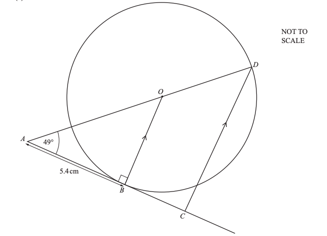
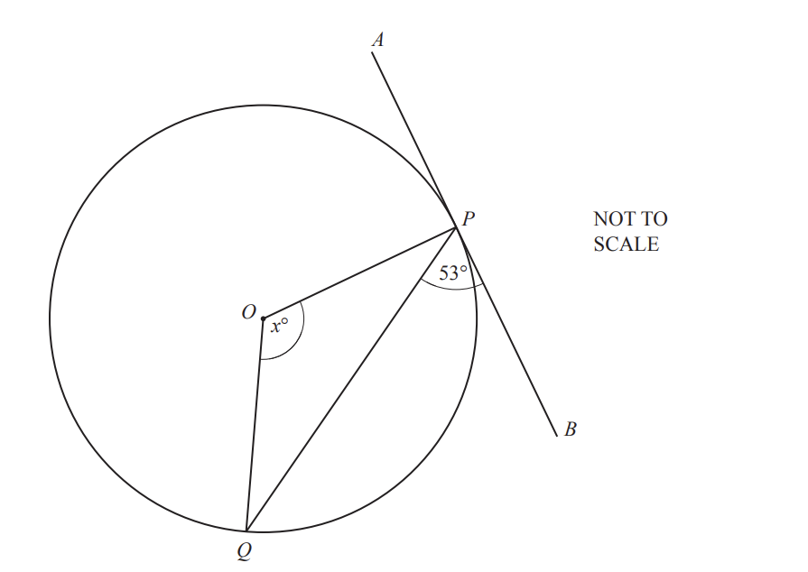
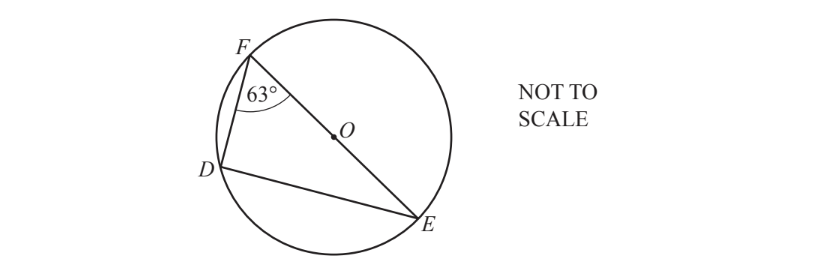
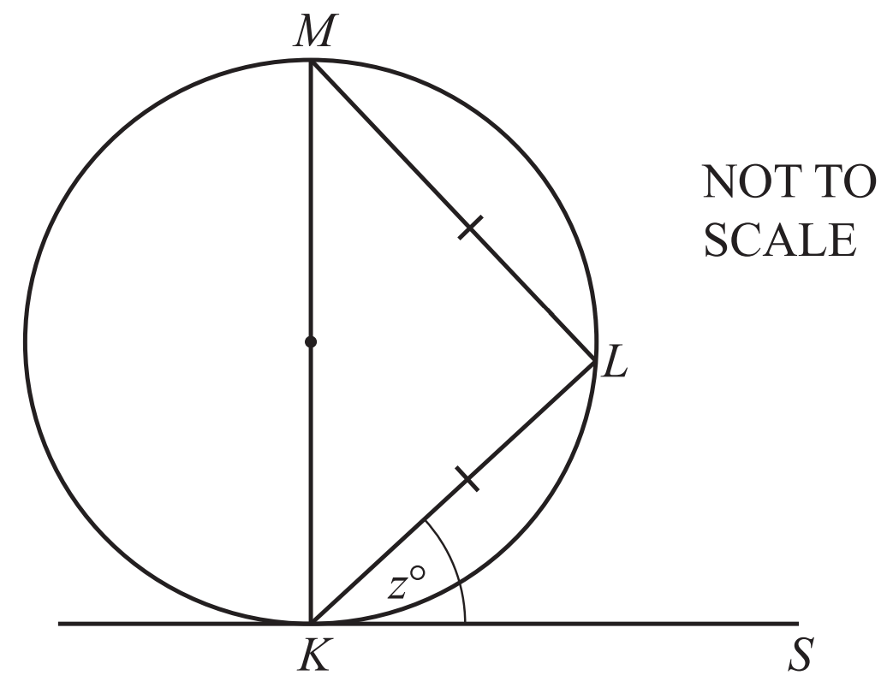
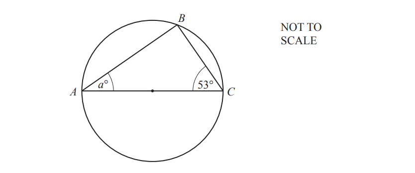
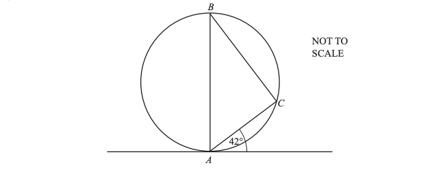
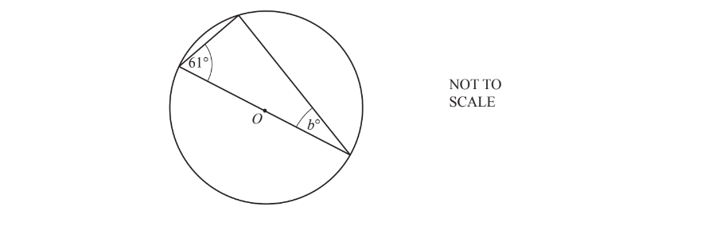
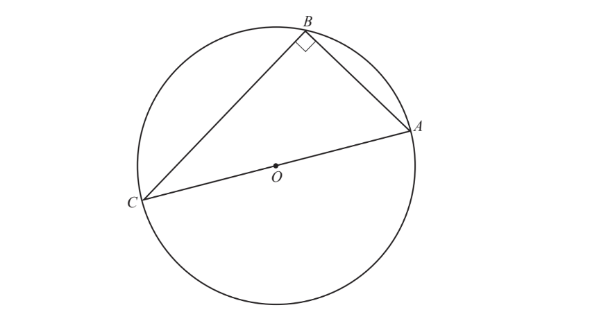
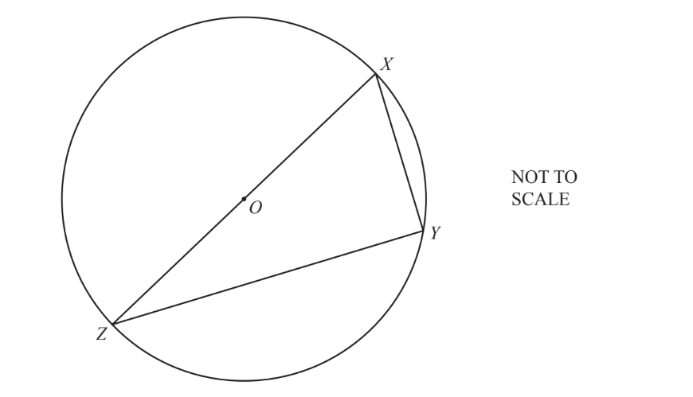
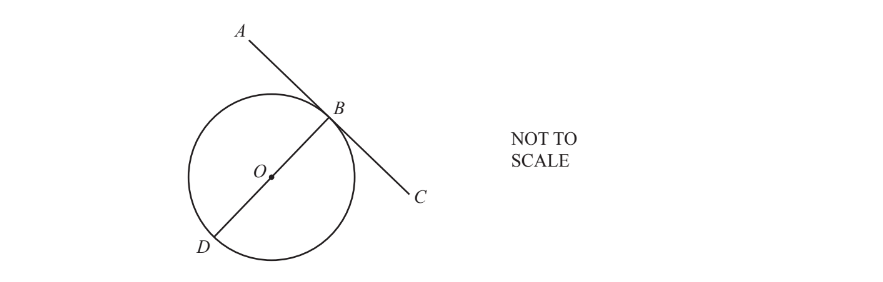

# Exam Questions — Circle Theorems
**Geometry** · Cambridge (CIE) IGCSE maths (0580 & 0980)
> Source: [https://www.savemyexams.com/igcse/maths/cie/25/core/topic-questions/](https://www.savemyexams.com/igcse/maths/cie/25/core/topic-questions/) · 17 questions across 1 sets

## Exam Questions (17 questions)

### Q1 — medium — 4 marks

**Q1** [1 mark]

The diagram shows a circle, centre $O$, with diameter $PQ$. 
$R$ is a point on the circumference.

$PR=5.2\mathrm{cm}$, and $PR=\frac{1}{3}PQ$.
Angle $PQR=x^{\circ}$.

Give a geometrical reason why angle $PRQ$ is 90°.

**Q1** [3 marks]

**Extract:**

The diagram shows a circle, centre O, with diameter PQ. 

R is a point on the circumference.

PR = 5.2 cm, and PR = 1/3 PQ.

Angle PQR = x°.

Angle PRQ is 90°.

Find the value of $x$.

$x=$ ..........................................

### Q2 — hard — 7 marks

**Q2** [2 marks]

The points $B$, $C$, and $D$ lie on the circumference of the circle, centre $O$.

The line $AB$ is a tangent to the circle at $B$.

Find the value of $x$ and the value of $y$.

**Q2** [3 marks]

$BC$ is $4$cm.

Hence, find the radius of the circle.

Round your answer to 3 significant figures.

**Q2** [2 marks]

Calculate the area of the circle.

Round your answer to 3 significant figures.

### Q3 — hard — 6 marks

**Q3** [6 marks]

The diagram shows a circle, centre $O$, with diameter $CE$. 
$A,B,C,D$ and $E$ lie on the circumference of the circle.

i) Find the value of $x$. 
Give a reason for your answer.

$x$ = ..................... because ...........................

[3]

ii) Find the value of $y$. 
Give a reason for your answer.

$y$ = ..................... because ....................................

[2]

iii)Draw a tangent to the circle at $A$.

[1]

*Source: March 2020 0580/32 Q3C*

### Q4 — hard — 5 marks

**Q4** [5 marks]

The diagram shows a circle, centre $O$, with points $B$ and $D$ on the circumference. 
The line $AC$ touches the circle at $B$. $OB$ is parallel to $DC$ and angle $OAB=49^{\circ}$.

i) Write down the mathematical name of the line $OB$.

................................................. [1]

ii) Write down the reason why angle $ABO$ is $90^{\circ}$.

......................................................................................................................................................

...................................................................................................................................................... [1]

iii)  Find angle$AOB$.

$\mathrm{Angle}AOB=$ ................................................ [1]

iv) Write down the reason why angle $ADC$ = angle $AOB$.

...................................................................................................................................................... [1]

v) Complete the statement using a mathematical word.

Triangle $AOB$ is ................................................................. to triangle $ADC$. [1]

$AB=5.4\mathrm{cm}$.

Calculate

via) $OB$,

$OB=$ ......................................... cm [2]

vib) $OA$,

$OA=$ ......................................... cm [2]

via) the area of triangle $OAB$.

.........................................cm2 [2]

*Source: May/June 2017 0580/31 Q41*

### Q5 — hard — 5 marks

**Q5** [5 marks]

$P$ and $Q$ are points on the circle, centre $O$. $APB$ is a tangent to the circle at $P$.

i) Write down the mathematical name for the line $PQ$.

[1]

ii) Explain why angle $OPB$ is 90°.

[1]

iii) Find the value of $x$.

$x$ = ................................................. [3]

*Source: n 0580/33 Q8A*

### Q6 — hard — 4 marks

**Q6** [4 marks]

The diagram shows a circle, centre $O,$ with diameter $EF$. 
Angle $DFE$ = 63°.

i) Find angle $DEF$.

Angle $DEF$ = ................................................... [2]

ii) $EF$ = 12 cm

Calculate $DF$.

$DF$ = ............................................. cm [2]

*Source: Nov 2019 0580/32 Q5C*

### Q7 — hard — 6 marks

**Q7** [6 marks]

*K*, *L* and *M* are points on the circle. 
*KS* is a tangent to the circle at *K*. 
*KM* is a diameter and triangle *KLM* is isosceles.

Find the value of $z$.

$z=$................................................ [2]

*Source: 2020 May/June 0580/43 Q8B*

### Q8 — medium — 2 marks

**Q8** [2 marks]

$A,B$ and $C$ are points on a circle. 
$AC$ is a diameter of the circle.

Find the value of $a$.

$a=$.............................

*Source: Nov 2020 0580/31 Q7C*

### Q9 — medium — 2 marks

**Q9** [2 marks]

The points $E,F$ and $G$ lie on the circumference of a circle, centre$O$.
$JGH$ is a tangent to the circle.

Find the value of $x$ and the value of $y$.

$x=..............................................\,y=..............................................$

*Source: June 2019 0580/31 Q4C*

### Q10 — medium — 3 marks

**Q10** [1 mark]

$A$, $B$  and $C$  are points on the circumference of a circle with diameter $AB$.

A tangent is drawn at $A$.

Find angle $BAC$.

$\mathrm{Angle}BAC=$ ................................ [1]

*Source: May/June 2017 0580/12 Q20A*

**Q10** [2 marks]

**Extract:**

A, B and C are points on the circumference of a circle with diameter AB. A tangent is drawn at A.

Find angle $ABC$.

$\mathrm{Angle}ABC=$................................ [2]

*Source: May/June 2017 0580/12 Q20B*

### Q11 — medium — 2 marks

**Q11** [2 marks]

The diagram shows the vertices of a triangle lying on the circumference of a circle with centre $O$.

Find the value of $b$. 
Give a reason for your answer.

$b$ = .................... because..............................

*Source: June 2019 0580/32 Q7E*

### Q12 — medium — 3 marks

**Q12** [3 marks]

The points $A,B$ and $C$ lie on the circumference of a circle, centre $O$. 
$PBR$ is a tangent to the circle and angle $BAC=37^{\circ}$.

Find the value of $j$ and the value of $k$.

$j=$ .................................

$k=$................................ [3]

*Source: May/June 2018 0580/33 Q2D*

### Q13 — easy — 2 marks

**Q13** [2 marks]

In the diagram,$A,B$ and $C$ are points on the circle, centre $O$.

i) On the diagram, draw a chord.

[1]

ii) Explain why angle $ABC$ is 90°.

[1]

*Source: Nov 2019 0580/31 Q2A*

### Q14 — easy — 2 marks

**Q14** [2 marks]

i) Complete this statement.

$X,Y$and $Z$ are points on the .................................................. of the circle, centre $O$.

[1]

ii) Give a reason why angle $XYZ$ is 90°.

[1]

*Source: Nov 2020 0580/32 Q2E*

### Q15 — easy — 2 marks

**Q15** [2 marks]

In the diagram, $B$ and $D$ are points on the circumference of a circle, centre $O$. 
$AC$ is a straight line touching the circle at $B$ only and $BD$ is a straight line through $O$.

Complete the statement.

Angle $ABD$ = ................ because ...........................

.

*Source: May/June 2019 0580/33 Q6B*

### Q16 — easy — 3 marks

**Q16** [2 marks]

$A,B$ and $C$ are points on the circumference of a circle, centre $O$.

Write down the mathematical name for

i) the straight line $AC$,

[1]

ii) the straight line $AB$.

[1]

*Source: May/June 2018 0580/31 Q9A*

**Q16** [1 mark]

**Extract:**

A, B and C are points on the circumference of a circle, centre O.

Give a geometrical reason why angle $ABC=90^{\circ}$.

[1]

*Source: May/June 2018 0580/31 Q9B*

### Q17 — easy — 6 marks

**Q17** [1 mark]

$A,B$ and $C$ are points on the circumference of the circle, centre $O$.
The straight line $DE$ touches the circle at $B$.

Write down the mathematical name for the line $DE$.

[1]

*Source: Oct/Nov 2018 0580/33 Q9A*

**Q17** [1 mark]

**Extract:**

A, B and C are points on the circumference of the circle, centre O.

On the circle, draw a radius.

[1]

*Source: Oct/Nov 2018 0580/33 Q9B*

**Q17** [4 marks]

**Extract:**

A, B and C are points on the circumference of the circle, centre O. The straight line DE touches the circle at B.

Complete the following statements.

i) Angle $ABD$ = ............... because

[2]

ii) Angle $ACB$ = ............... because

[2]

*Source: Oct/Nov 2018 0580/33 Q9C*

