# Mark Schemes — Symmetry & Shapes
**Geometry** · Cambridge (CIE) IGCSE maths (0580 & 0980)

## Exam Questions (47 questions)

### Q1
(i)

> **[exam-tip]**
> The volume, $V$, of a cuboid is
> 
> $V=\mathrm{length}\times\mathrm{height}\times\mathrm{width}$
> 
> This is **not** included on the list of formulas given in the exam paper.

Multiply the three given dimensions together

- It doesn't matter which ones you call 'length', 'breadth' or 'width'

$7\times3\times4$

**[M1]**

Use your calculator to work that out

**Final answer:** **84 cm****3**

**[A1]**

> **[mark-scheme]**
> **M1**: For $7\times3\times4$ or equivalent.
> 
> **A1**: For 84. Earning this mark automatically earns the preceding 'M' mark as well.

(ii)

> **[exam-tip]**
> The area, $A$, of a rectangle is
> 
> $A=\mathrm{length}\times\mathrm{width}$
> 
> This is **not** included on the list of formulas given in the exam paper.

You can fill in a few more of the side lengths to help you see the sizes of the different faces

A 7 by 3 rectangle has area

$7\times3=21$

**[M1]**

- A 7 by 4 rectangle has area

$7\times4=28$

- A 4 by 3 rectangle has area

$4\times3=12$

The cuboid has two of each type of face

- so the total area is

$\begin{gathered} 2 \times 21 + 2 \times 28 + 2 \times 12 & = 42 + 56 + 24 \\ = 122 \end{gathered}$

**Final answer:** **122 cm****2**

**[A1]**

> **[mark-scheme]**
> **M1**: For $7\times3$, $7\times4$ or $4\times3$ or equivalent, seen or implied.
> 
> **A1**: For $2 \times ( 7 \times 3 + 7 \times 4 + 4 \times 3 )$ or equivalent, leading to 122.

(iii)

> **[exam-tip]**
> Do **not** just add up the lengths of all the lines in the diagram!
> 
> - When the net is assembled into a cuboid, some of those lines meet and become the same edge

A cuboid has 12 edges

- 4 corresponding to each dimension of the cuboid

So the total length of the edges is

$4\times7+4\times3+4\times4$

**[M1]**

$=28+12+16\,=56$

**Final answer:** **56 cm**

**[A1]**

> **[mark-scheme]**
> **M1**: For $4\times7+4\times3+4\times4$ or equivalent.
> 
> **A1**: For 56. Earning this mark automatically earns the preceding 'M' mark as well.
This is different from finding the total length of the edges in part (a) (iii)

- Here you need to add up the lengths of all the lines around the outside of the net
- Don't include the lines that are inside the net

It will help to label all the sides around the perimeter

First add up all the sides that are in terms of $x$

$x + x + x + x + ( x - 3 ) + ( x - 3 )$

- Collect terms and simplify

$=x+x+x+x+x-3+x-3\,=x+x+x+x+x+x-3-3\,=6x-6$

Then add up all the sides that are in terms of $y$

$y+y+y+y+y+y+y+y$

- Collect terms and simplify

$=8y$

Add the $x$ and $y$ parts together to get the total perimeter

$6x-6+8y$

**[B1 B1 B1]**

> **[mark-scheme]**
> **B1**: For any one of $6x$, $-6$ or $8y$ in final answer.
> 
> **B1**: For any two of $6x$, $-6$ or $8y$ in final answer.
> 
> **B1**: For $6x+8y-6$ or equivalent as final answer.

### Q2
A line joining two points on the circumference of a circle is called a chord

- So $AB$ is a chord

A region between a chord and the circumference of a circle is called a segment

**Final answer:** **segment**

**[B1]**
A line that touches a circle at a single point is called a tangent

**Final answer:** **tangent**

**[B1]**

### Q3
**Final answer:** **Cylinder**

**[B1]**
Count the number of faces, edges and vertices:

- Faces are the flat surfaces
- Edges are lines formed when two faces meet
- Vertices are points formed when three or more edges meet

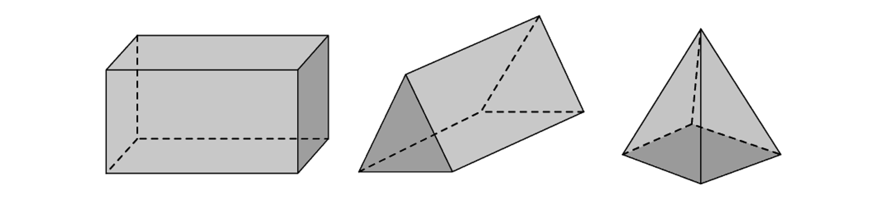

| Name of 3D shape | Number of faces | Number of edges | Number of vertices |
|---|---|---|---|
| Cuboid | 6 | **Final answer:** **12** | **Final answer:** **8** |
| Triangular prism | **Final answer:** **5** | 9 | **Final answer:** **6** |
| Square-based | **Final answer:** **5** | **Final answer:** **8** | 5 |

**[B1 B1]**

> **[mark-scheme]**
> **B1**: For at least 4 correct values.
> 
> **B1**: All correct.

### Q4
**Final answer:** **5**

**[B1]**

> **[exam-tip]**
> You can use tracing paper to help you. Place it over the shape and trace it.  Place your pencil in the middle and spin the tracing paper around in a full circle.  Count how many times the shape on the tracing paper lies on the original shape.

### Q5
> *A straight line connecting the circumference and centre of a circle is the *

**Final answer:** **Radius**

**[B1]**
> *A ruled line going through point *$P$* and perpendicular to *$OP$

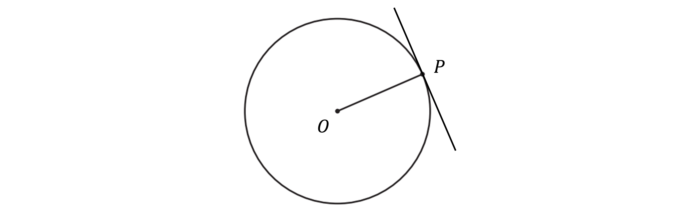

**[B1]**

### Q6
> *The shape currently has no lines of symmetry. *
*We would need to shade more than two squares for there to be a horizontal or vertical line of symmetry, so the line of symmetry must be diagonal. *
*A line of symmetry acts as a mirror line so the shape must be identical on either side of the line. *
*Drawing in the line of symmetry will help.*

> *Or*

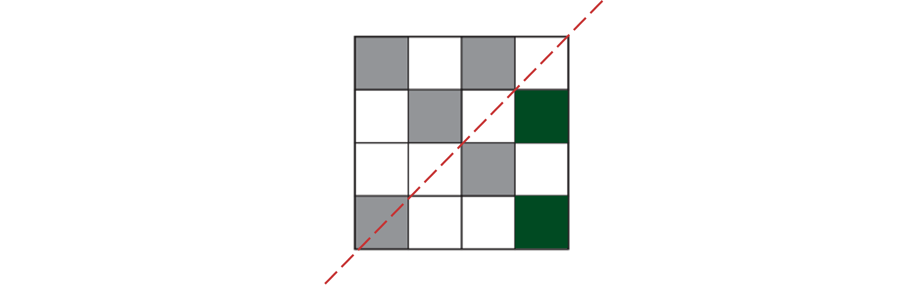

**Either pattern ****[1]**

### Q7
> *As the shape has a rotational symmetry of order 4, the shape must be identical to the original after every rotation of*

$\frac{360}{4}=90^{\circ}$

> *Shade the appropriate two squares*

**[1]**

### Q8
> *For the shape to have rotational symmetry of order 2, it must look the same 2 times if rotated through *$360^{\circ}$*.*

** [1]**

### Q9
> *Draw two 5cm x 3cm rectangles off the 5cm sides.*

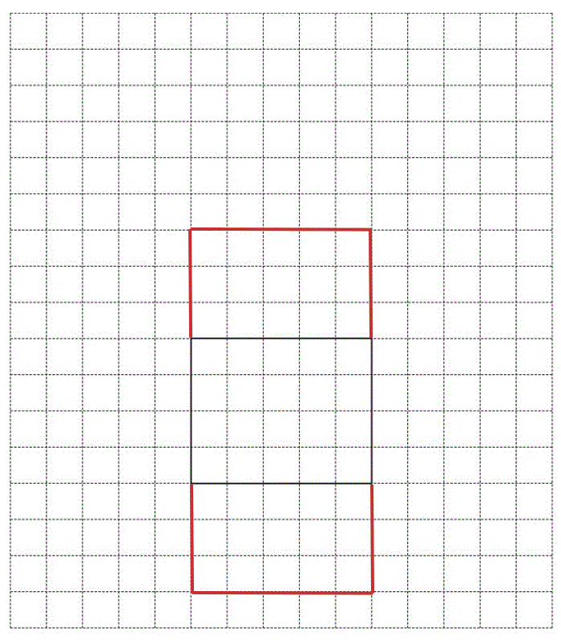

> *Draw two 3cm x 4cm rectangles off the 4cm side.*

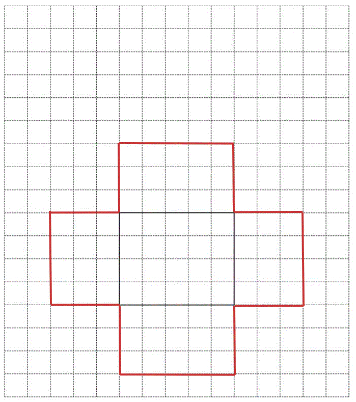

> *Draw a 5cm x 4cm rectangle. *

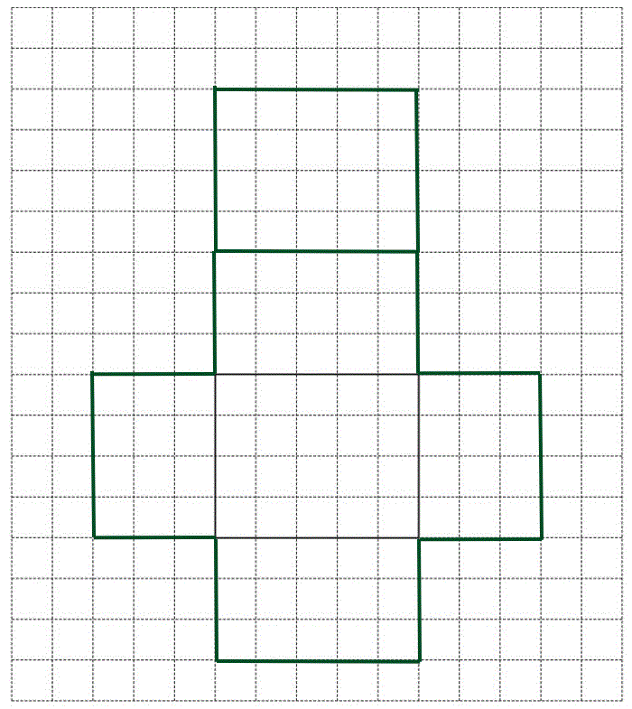

** ****correct net**** [3]**
> *Volume of a cuboid = length x width x height*

> *Multiply the lengths together. *

> $5\times4\times3=60$* *

$60\mathrm{cm}^{3}$ **[1]**

### Q10
> *Co-ordinates should be in the form (**x , y**)*

**(7 , 3)**** ****[1]**
> *Draw the mirror line and plot the point the same distance away from the mirror line as B.*

**[1]**
> *The shape has 4 equal sides but no right-angles.*

**Rhombus** **[1]**
> *The order of rotational symmetry refers to the number of times the shape will look the same when rotated about the centre. *
*The shape will look identical after 180° and 360°. After 90°, the shape will look different because the length AC is smaller than the length BD.*

**2**** ****[1]**

### Q11
(i) *The net will form a **cuboid**. *

**Cuboid** **[1]**

(ii) *When the net is folded up, it will form a cuboid that is 5 cm long, 2 cm wide, and 1 cm high.*
*Multiply the length, width and height together. *

*5 x 2 x 1 = 10*

**[1]**

**10 cm****3** **[1]**

### Q12
> *A cuboid has 6 faces, with 3 pairs of faces with the dimensions:*

$l\timesw$ 
$w\timesh$ 
$h\timesl$

> *The dimensions of the three pairs of faces are therefore:*

* 3 cm *$\times$* 2 cm *
*2 cm  *$\times$* 1 cm *
*1 cm *$\times$* 3 cm*

> *Pairs of faces are on opposing sides of the cuboid so each pair of faces must alternate with the face that shares the same side length*

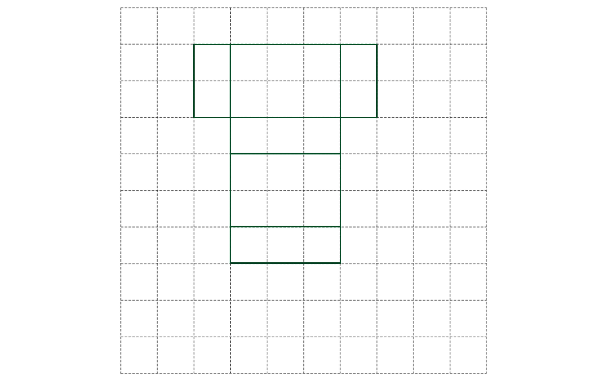

**Correct net with all 6 faces correctly drawn**** ****[3] **
**OR ****4 faces drawn correctly**** ****[2] **
**OR ****2 faces drawn correctly**** ****[1]**

### Q13
(i) *A 6cm x 3cm x 1cm cuboid will have 6 faces:*
*Two rectangles = 6cm x 3cm (one of these has already been drawn)*
*Two rectangles = 6cm x 1cm*
*Two rectangles = 1cm x 3cm. *

> *Given that one of the 6cm x 3cm rectangles has already been drawn, draw one of the 1cm x 6cm rectangles off the 6cm side. *
*Draw the other 6cm x 3cm and 1cm x 6cm rectangles off the 6cm sides. *

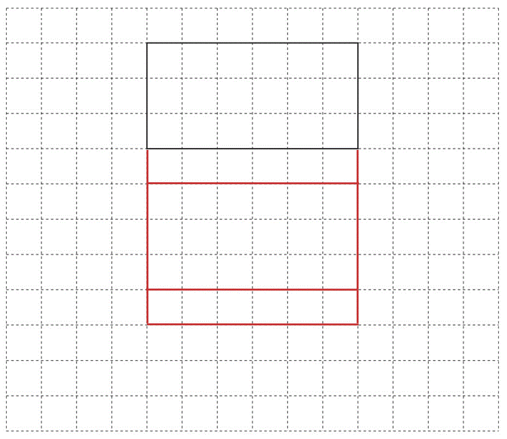

> * Draw the final two rectangles (1cm x 3cm) off the 1cm sides of either of the 6cm x 1cm rectangles. *

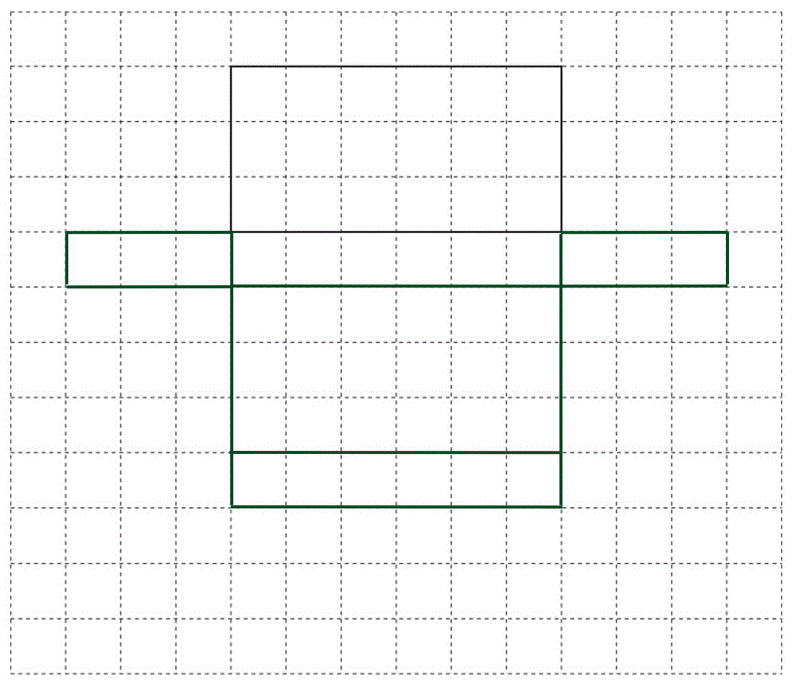

> *  *

** A****ll correct**** ****[3]**

**One mark for 2 or 3 correct**
**Two marks for 4 or 5 correct**

(ii) *Work out the areas of the rectangles in the net and add them together. *

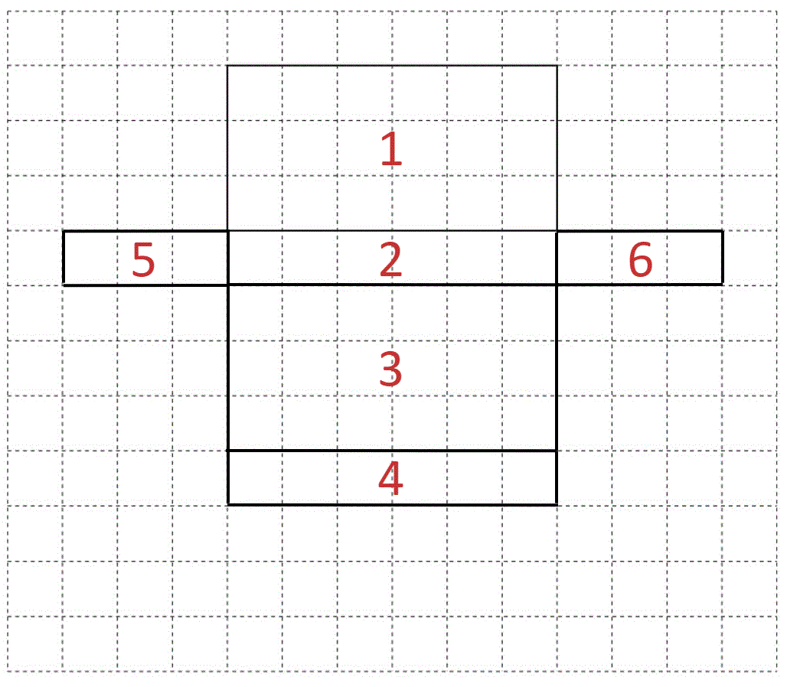

> * *

> *Rectangles 1 and 3 are the same size, so find the area of one and double it. *

> $2 \times ( 3 \times 6 ) = 36$* *

> *Rectangles 2 and 4 are also the same size. *

> $2 \times ( 1 \times 6 ) = 12$* *

> *Rectangles 5 and 6 are the same size. *

> $2 \times ( 1 \times 3 ) = 6$* *

> *Add the areas together. *

$36+12+6=54$

* ***[1]**

**54 cm****2**** ****[1]**

### Q14
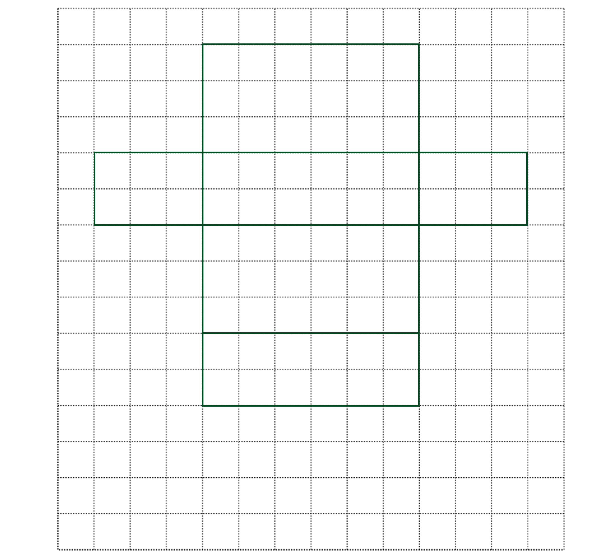

**2 correct faces drawn edge to edge**** [1]**
**4 correct faces drawn edge to edge*** ***[1]**
**Correct net drawn*** ***[1]**

### Q15
i) *When the net is folded, the top is the only face that is not in contact with the base*

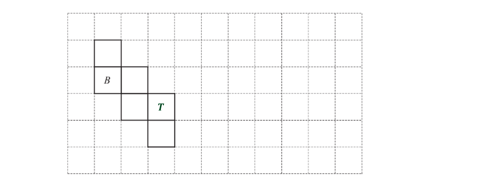

**[1]**

ii) *A net of a cube must have six connected square faces that do not overlap when it is folded*

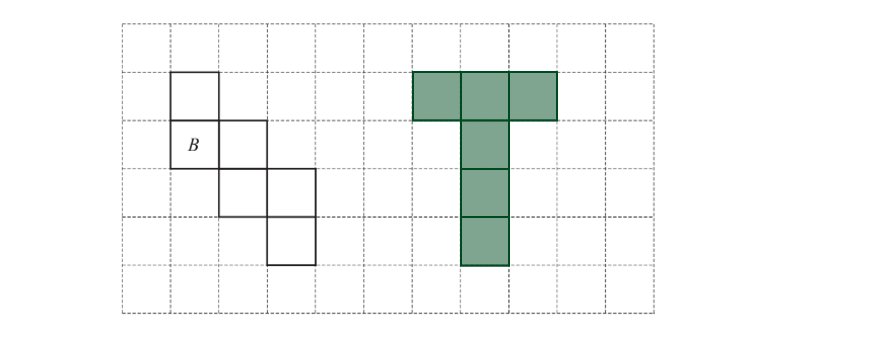

**[1]**

**Final answer:** **Any different correct net drawn is accepted**

### Q16
> *The quadrilateral has two pairs of equal side lengths, and the diagonals meet at *$90^{\circ}$

**Kite** **[1]**

### Q17
> *Opposing faces are the same and connecting side lengths must be equal*

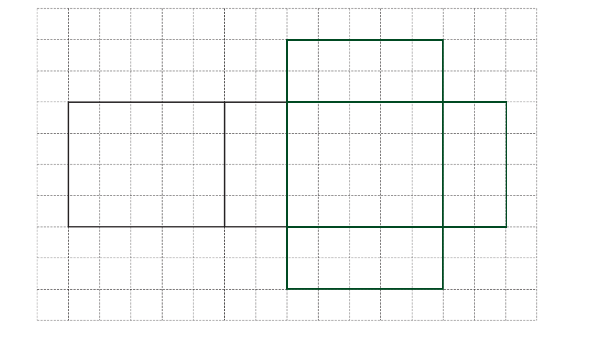

** Fully correct net**** ****[2] **

**1 mark for 2 correct rectangles in the correct place**

### Q18
> *The net of the cuboid will be made up of:*

> *Two **6 cm x 2 cm rectangles,*

> *Two** 6 cm x 3 cm rectangles (one has already been drawn),*

> *Two** 2 cm x 3 cm rectangles.*

> * *

> *Draw one of the 6cm x 2cm rectangles off the 6 cm side of the rectangle already drawn (this 6 cm x 2 cm rectangle will be the base of the cuboid).*

> *Draw the other 6 cm x 3 cm rectangle off the 6 cm side of this base.*

> * *

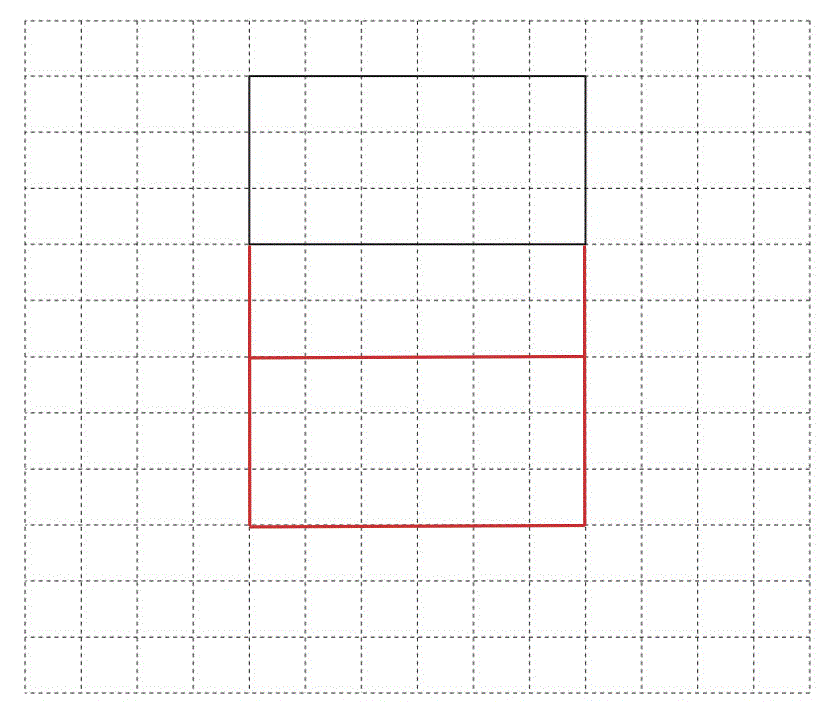

**[1]**

> *Draw the second 6 cm x 2cm rectangle off the 6 cm side of the 6 cm x 3 cm rectangle.*

> * *

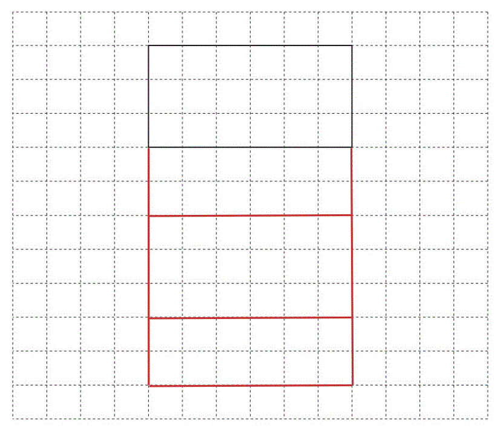

**[1]**

> *Draw the two 2 cm x 3 cm rectangles off the 2 cm sides of either of the 6 cm by 2 cm rectangles.*

> * *

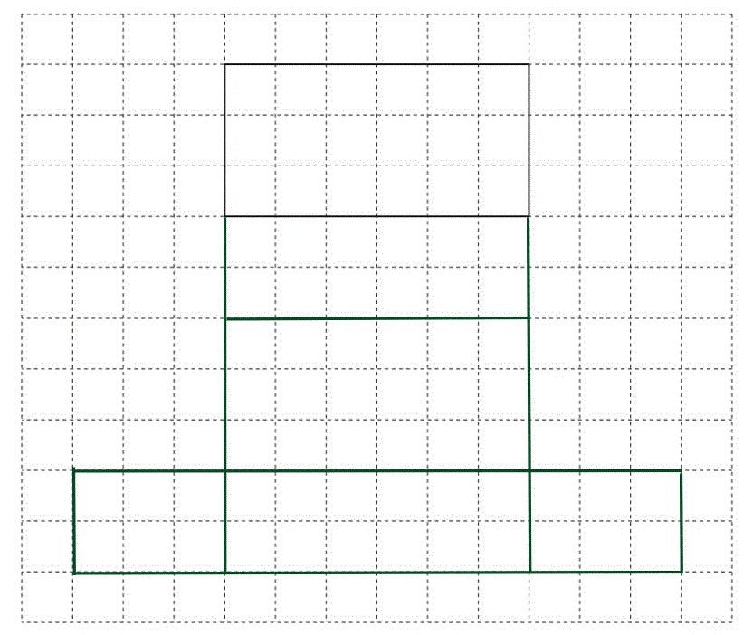

**[1]**

**Other correct versions of the net will also get full marks*** *
**In particular, there are several correct places that the 2x3 'side rectangles' could go**

### Q19
> *A quadrilateral with only one pair of parallel sides is a trapezium. A rectangle has two pairs of parallel sides.*

**Trapezium** **[1]**
> *An angle that is greater than *$90^{\circ}$* and smaller than *$180^{\circ}$* is called obtuse*

**Obtuse** **[1]**

### Q20
> *An angle less than *$90^{\circ}$* is called an **acute **angle.*

> * *

**Acute** **[1]**
(i) *Line **AB **is a **chord**.*** **

**Chord** **[1]**

(ii) *OA **is the **radius **of the circle. Double the **radius **to find the **diameter**. *

> $8\times2=16$* *

**16 cm** **[1]**

### Q21
> *The order of rotational symmetry is the number of times the shape is identical to the original after a rotation about its centre through one full turn*

**3**** ****[1]**
> *Draw in a mirror line through each pair of opposite vertices*

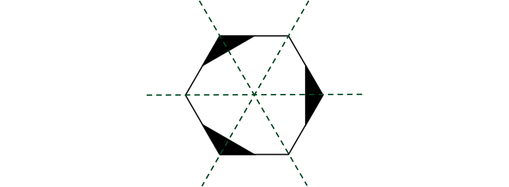

**[1]**

### Q22
> *Line up 0 on the ruler at the point A and turn the ruler so that point B lies further up the scale and read off the measurement in millimetres*

**Final answer:** **94 mm**** [1]**
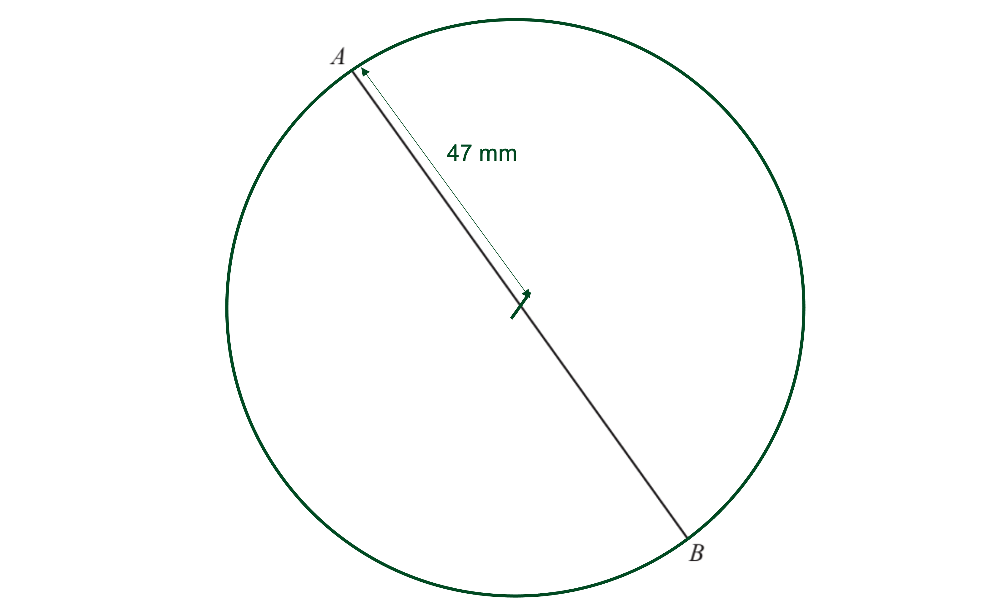

**Centre of **$AB$** ****marked**** [1]**
**Correct circle drawn**** [1]**

### Q23
> *Use a ruler to measure the line. Give your answer in mm.*

$48\mathrm{mm}$* ***[1]**

**46 - 50 accepted**
(i) *Use a protractor to measure the angle.*

$223^{\circ}$* ***[1]**

**221 - 225 accepted**

(ii) *A **reflex **angle is greater than *$180^{\circ}$* and less than *$360^{\circ}$*.*

**Reflex** **[1]**

### Q24
> *A line of symmetry means that the shape is identical either side of it, like a mirror line. This shape has a vertical line of symmetry and a horizontal line of symmetry. It can help to draw the lines of symmetry on the shape and check that it is identical either side.*

**2 lines of symmetry**** ****[1]**

> *Rotational symmetry refers to how many times a shape looks identical when it has been rotated. Take care to consider which triangles have been shaded for this shape. If we rotated the shape by 90°, it would not look the same because the shaded triangles would be in a different place, so we would need to rotate it by 180°, and then 180° again. It would only look the same twice.*

**order of rotational symmetry 2** **[1]**

### Q25
> *Angles less than *$90^{\circ}$* are called **acute **angles.*

**Acute**** ****[1]**
> *A **polygon **is a shape with straight sides.*

> *A polygon** **with 5 sides is called a **pentagon**.*

**Pentagon**** ****[1]**
> *A **quadrilateral **is a 4 sided shape.*

> *Note that **rectangles**, **squares**, and **parallelograms **all have 2 pairs of parallel sides.*

> *A 4 sided shape with exactly one pair of parallel sides is called a **trapezium**.*

**Trapezium**** ****[1]**

### Q26
> *There are only two shapes which have rotational symmetry of order 1 and only one line of symmetry, a **kite **and an **isosceles trapezium**.*

> * *

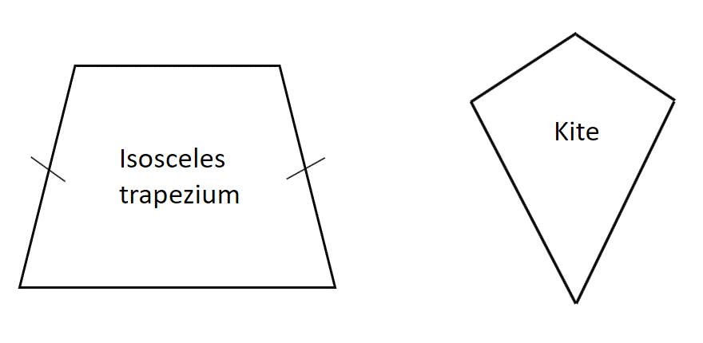

> * *

**Isosceles trapezium**** or ****kite ****[1]**

### Q27
> *Use a ruler to measure the sides of the triangle. (Don't just answer based on 'what it looks like'!)*

> *All the sides are equal, so the triangle is **equilateral**.*

> * *

**Equilateral** **[1]**

### Q28
i) *Any line of symmetry must split the shape into two equal halves that are opposite to each other*

**[1]**

ii) *Any line of symmetry must split the shape into two equal halves that are opposite to each other*

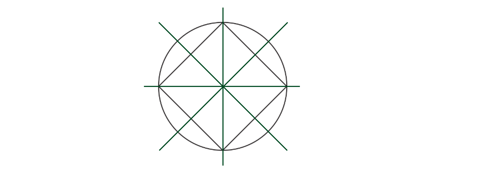

**Minimum 2 correct lines of symmetry**** ****[1]**
**All 4 correct lines of symmetry**** [1]**
> *Rotational symmetry describes the number of times the image of a shape is identical to the original as it is rotated through one full turn about its centre.*

> *The quadrilaterals that have a rotational symmetry of 2 are:*

*Rectangle*

*Parallelogram*

*Rhombus*

> *Of these, the rectangle and the rhombus have 2 lines of symmetry*

**Rectangle*** ***[1]**

**Rhombus is accepted**

### Q29
> *If the first shape was rotated, it would look the same **4 times** as it passed through a full *$360^{\circ}$* turn.*

> *The second shape would look the same **2 times.*

> * *

**4      2** **[2]**

**one mark for each**

### Q30
> *The net has 3 rectangular faces with a triangular cross section*

**Triangular Prism**** ****[1]**

### Q31
> *A quadrilateral** **with no parallel sides, two pairs of equal sides, and one line of symmetry is called a **kite**.*

> * *

**Kite** **[1]**

### Q32
> *The angle is smaller than a right angle.*

**Acute**** ****[1]**

### Q33
i) *An obtuse angle has a size within the range* $90^{\circ}<x<180^{\circ}$*.*

**Obtuse** **[1]**

** **

ii) *Place the centre of the protractor at the vertex of the angle and turn so that *$0^{\circ}$* is aligned with one of the straight lines.*

> *Read the angle off the correct scale on the protractor where the other line crosses the same scale.*

**134**$^{\circ}$ **[1]**

### Q34
> *Rotational symmetry refers to the number of times a shape looks the same as it is rotated *$360^{\circ}$* about its centre. If we put a pencil in the centre of the pentagon and turn it, it will look the same 5 times.*

**5**** ****[1]**

### Q35
i) *Line up the protractor so that the 0 is on one of the lines and the centre is at the point where the two lines meet.*

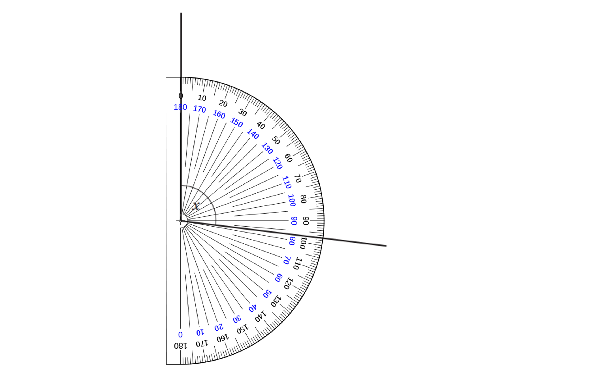

> *Start from the 0 that is on the line, count up until you reach the second line.*

$97^{\circ}$** [1]**

ii) *The angle is greater than 90° but less than 180°.*

**Obtuse**** ****[1]**

### Q36
> *Any regular polygon has the same number of lines of symmetry as the number of sides.*

**5** **[1]**
> *The rotational symmetry of a polygon is the number of times the shape is identical to the original whilst rotating through a full turn about its centre*

> *The diamond only looks identical to the original position when it has turned *$360^{\circ}$

** ****1** **[1]**

### Q37
(i) *A quadrilateral with one pair of parallel sides is called a **trapezium**.*

> * *

**Trapezium** **[1]**

(ii) *A 3D shape with a circular or oval cross section is called a **cylinder**.*

> * *

**Cylinder** **[1]**

### Q38
> *A reflex angle is greater than *$180^{\circ}$*.*

**Angle **$C$** is a reflex angle** **[1]**

### Q39
> *Connect the two straight edges of the first net.*

**Cone** **[1]**

> *Connect each of the straight edges of the triangles of the second net together to create a pyramid with a square base.*

**Square-based pyramid** **[1]**

### Q40
> *On a rhombus, the only places we can draw lines of symmetry are on the diagonals.*

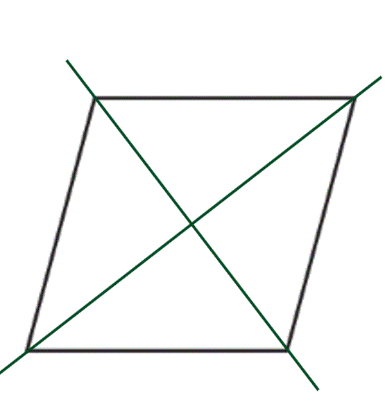

**one mark for each line*** ***[2]**

### Q41
> *A rhombus has 4 sides of equal size but no right-angles. It looks like a slanted square.*

**Shape C ****[1]**
> *Quadrilateral A has one pair of parallel sides.*

**Trapezium**** ****[1]**

### Q42
> *An **equilateral **triangle has three lines of symmetry, one through each vertex.*

> *The second shape only has one line of symmetry.*

> *Draw the lines onto the shapes with a ruler.*

> * *

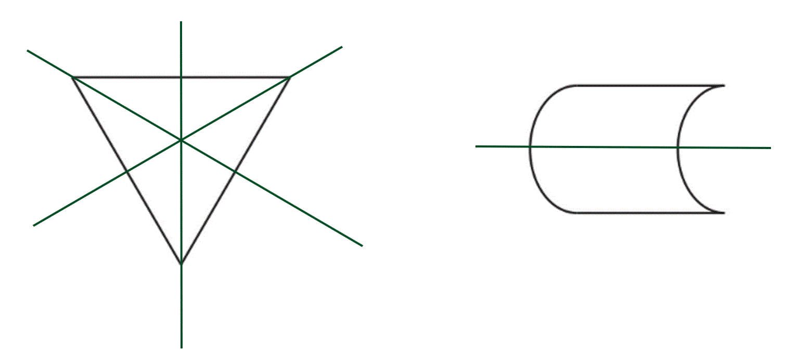

**All correct with no extras ****[3]**
> *The shape will look the same **2 **times as it is rotated though *$360^{\circ}$*.*

** ****2** **[1]**

### Q43
(i) *A shape with 6 sides is called a **hexagon**. *

**Hexagon** **[1]**

(ii) *The shape will look the same 6 times as its turned through *$360^{\circ}$*. *

**6** **[1]**

### Q44
> *A **regular octagon **will look the same 8 times as it is rotated through *$360^{\circ}$*.*

> * *

**8**** ****[1]**

### Q45
> *The shape will look the same **two **times as it is rotated *$360^{\circ}$*about its centre.*

> * *

**2**** [1]**

### Q46
> *The diameter of a circle is twice the length of the radius.*

> *Divide the diameter by 2 to get the radius of the circle.*

$7\div2=3.5$

> *Set a pair of compasses to a radius *$3.5\mathrm{cm}$* and draw a full circle.*

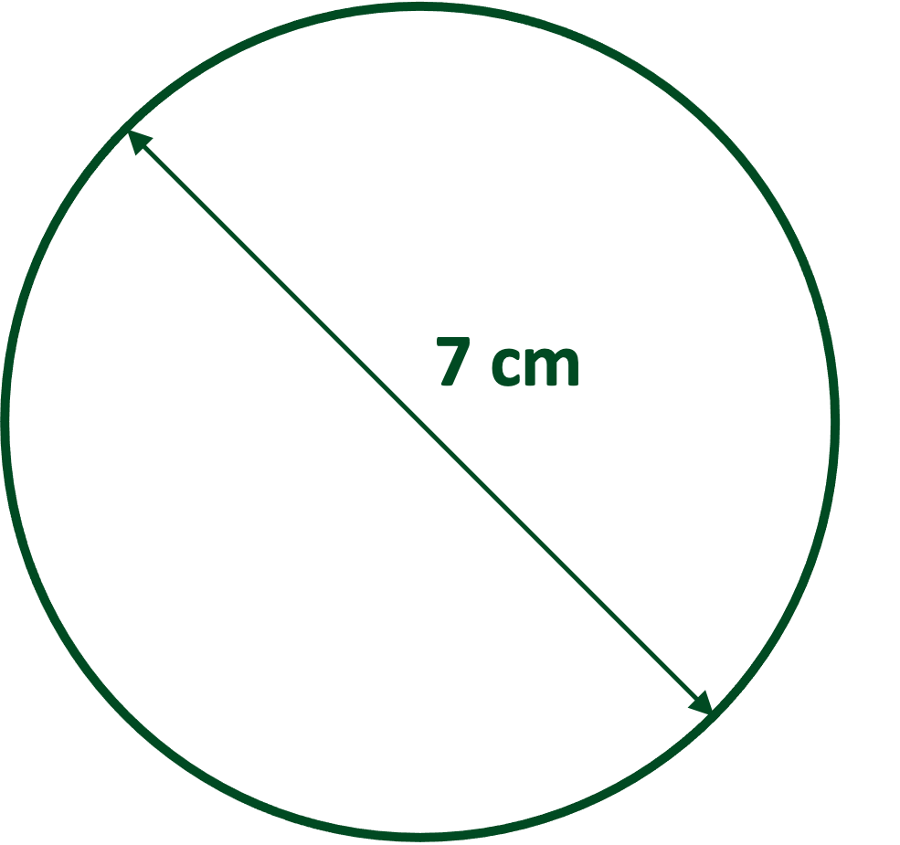

**[1]**
> *A chord is any straight line within a circle, that starts and ends at the circumference.*

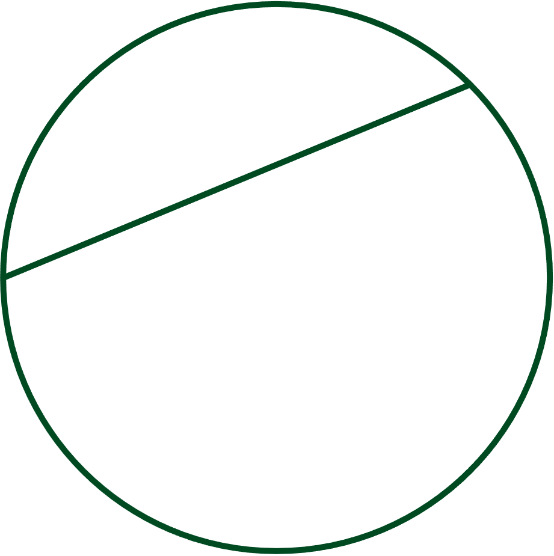

**[1]**

### Q47
> *A quadrilateral with one pair of parallel sides is a trapezium.*

**Trapezium**** [1]**
