# Exam Questions — Symmetry & Shapes
**Geometry** · Cambridge (CIE) IGCSE maths (0580 & 0980)
> Source: [https://www.savemyexams.com/igcse/maths/cie/25/core/topic-questions/](https://www.savemyexams.com/igcse/maths/cie/25/core/topic-questions/) · 47 questions across 1 sets

## Exam Questions (47 questions)

### Q1 — medium — 9 marks

**Q1** [6 marks]

The diagram shows the net of a cuboid.

(i) Find the volume of the cuboid.

......................................... cm3 [2]

(ii) Show that the total surface area of the cuboid is 122 cm2.

[2]

(iii) Calculate the total length of the edges of the cuboid.

.......................................... cm [2]

**Q1** [3 marks]

In this part, all measurements are in centimetres.

This is the net of a cuboid with edges of length $x,y$ and `open parentheses x minus 3 close parentheses`.

Find an expression, in terms of $x$ and $y$, for the perimeter of the net.
Give your answer in its simplest form.

### Q2 — medium — 2 marks

**Q2** [1 mark]

Points $A$ and $B$ lie on the circle.
A region has been shaded between line $AB$ and the circumference of the circle.

Write down the mathematical name for the shaded region.

**Q2** [1 mark]

**Extract:**

Circle with three points on its circumference labelled A, B and Q. A line segment inside the circle joins points A and B. Another line segment, with endpoints V and W, touches the circle at Q. The part of the circle on one side of line AB is shaded in.

The line $VW$ touches the circle at the point $Q$.

Write down the mathematical name for the line $VW$.

### Q3 — easy — 3 marks

**Q3** [1 mark]

Name the 3D shape.

**Q3** [2 marks]

Complete the table below

| Name of 3D shape | Number of faces | Number of edges | Number of vertices |
|---|---|---|---|
| Cuboid | 6 |   |   |
| Triangular prism |   | 9 |   |
| Square-based |   |   | 5 |

### Q4 — easy — 1 marks

**Q4** [1 mark]

Write down the order of rotational symmetry of a regular pentagon.

### Q5 — medium — 2 marks

**Q5** [1 mark]

The diagram above shows a circle, centre $O$.

$P$ lies on the circumference.

Write down the mathematical name for the line $OP$.

**Q5** [1 mark]

Draw a tangent to the circle at $P$.

### Q6 — hard — 1 marks

**Q6** [1 mark]

Shade two more small squares to give a pattern with exactly one line of symmetry.

*Source: Nov 2019 0580/12 Q14A*

### Q7 — hard — 1 marks

**Q7** [1 mark]

Shade two more squares so that this grid has rotational symmetry of order 4.

*Source: June 2019 0580/12 Q7B*

### Q8 — hard — 1 marks

**Q8** [1 mark]

Shade two squares so that the diagram has rotational symmetry of order 2.

*Source: Nov 2020 0580/11 Q5B*

### Q9 — hard — 5 marks

**Q9** [3 marks]

A cuboid has length 5 cm, width 4 cm and height 3 cm.

On the 1 cm2 grid, complete the net of the cuboid. One face has been drawn for you.

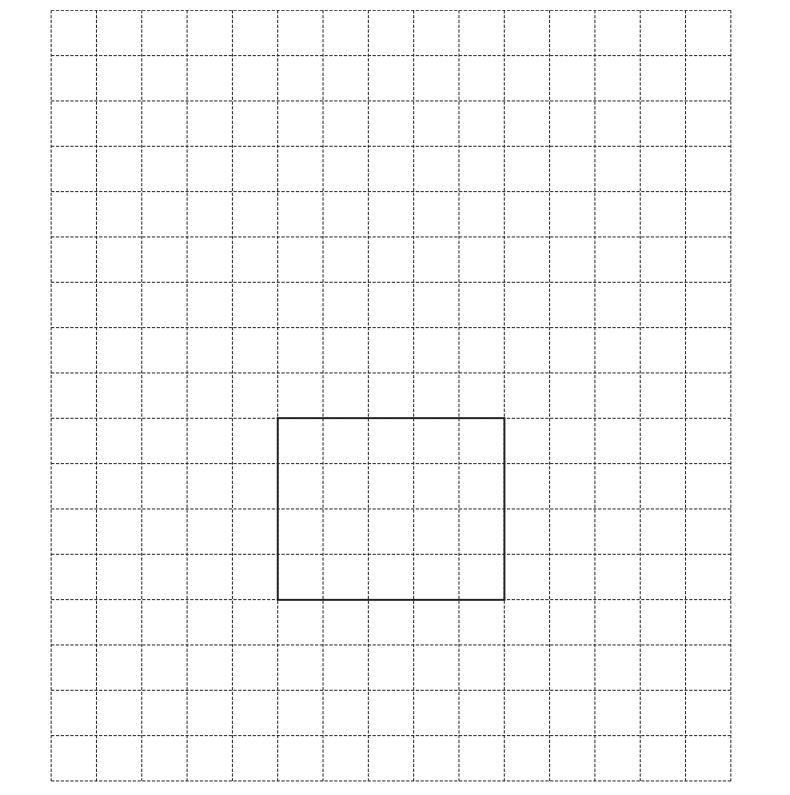

*Source: Nov 2020 0580/13 Q12A*

**Q9** [2 marks]

**Extract:**

A cuboid has length 5 cm, width 4 cm and height 3 cm.

Find the volume of the cuboid.

.......................................... cm3

*Source: Nov 2020 0580/13 Q12B*

### Q10 — hard — 4 marks

**Q10** [1 mark]

Write down the co-ordinates of point $B$.

*Source: Nov 2019 0580/13 Q20A*

**Q10** [1 mark]

The quadrilateral $ABCD$ has$x=4$  as a line of symmetry.

On the grid, plot point $D$.

*Source: Nov 2019 0580/13 Q20B*

**Q10** [1 mark]

**Extract:**

The quadrilateral ABCD has x = 4 as a line of symmetry.

Write down the mathematical name of quadrilateral $ABCD$.

*Source: Nov 2019 0580/13 Q20C*

**Q10** [1 mark]

**Extract:**

Write down the mathematical name of quadrilateral ![A B C D].

Write down the order of rotational symmetry of quadrilateral $ABCD$.

*Source: Nov 2019 0580/13 Q20D*

### Q11 — hard — 3 marks

**Q11** [3 marks]

The diagram shows the net of a solid on a 1cm2 grid.

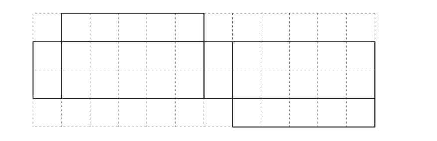

i) Write down the mathematical name for the solid.

[1]

ii) Work out the volume of the solid.

.......................................... cm3 [2]

*Source: June 2020 0580/33 Q3B*

### Q12 — hard — 3 marks

**Q12** [3 marks]

A cuboid has length 3 cm, width 2 cm and height 1cm.

On the 1 cm2 grid, draw a net of the cuboid.

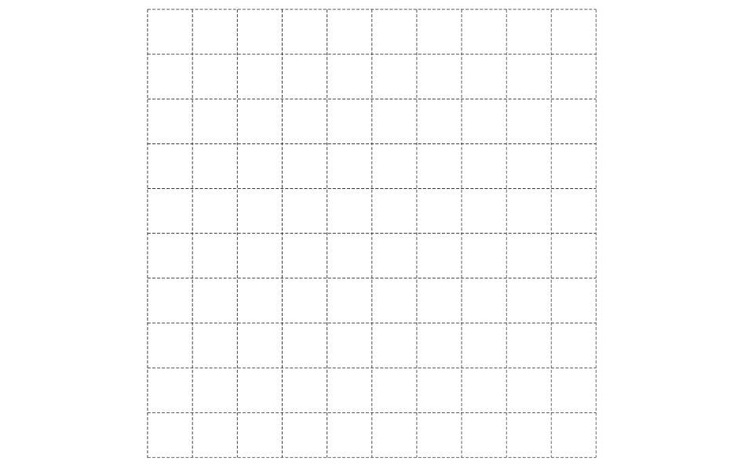

*Source: March 2020 0580/12 Q7*

### Q13 — hard — 3 marks

**Q13** [3 marks]

A cuboid measures 6 cm by 3 cm by 1 cm.

i) On the 1 cm2 grid, draw an accurate net of this cuboid.
One face has been drawn for you.

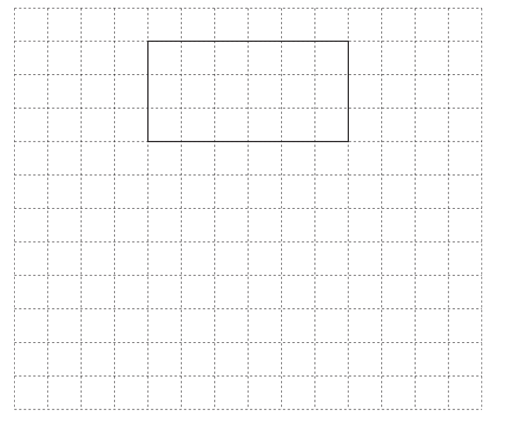

[3]

ii) Calculate the surface area of the cuboid.

.......................................... cm2 [2]

*Source: Nov 2020 0580/32 Q3D*

### Q14 — hard — 3 marks

**Q14** [3 marks]

A cuboid measures 6cm by 3cm by 2 cm. 
On this 1cm2 grid, draw a net of the cuboid.

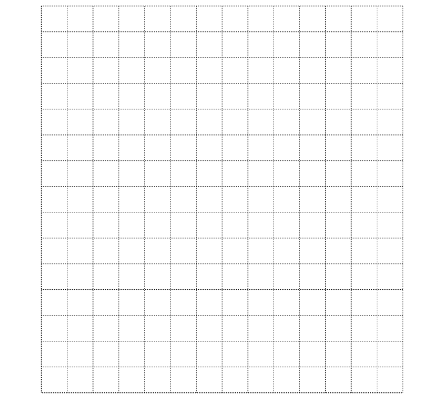

*Source: Specimen 2020 0580/01 Q5*

### Q15 — hard — 2 marks

**Q15** [2 marks]

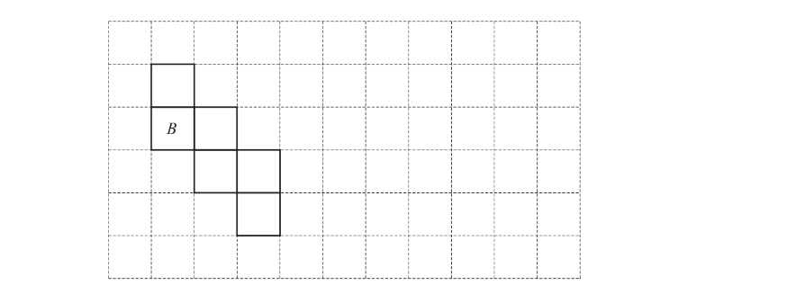

The diagram shows a net of a cube.

i) The square labelled $B$ is the base.

Write the letter $T$ in the square that is the top of the cube.

[1]

ii) On the grid, draw a **different** net of this cube.

[1]

*Source: March 2018 0580/32 Q1B*

### Q16 — medium — 1 marks

**Q16** [1 mark]

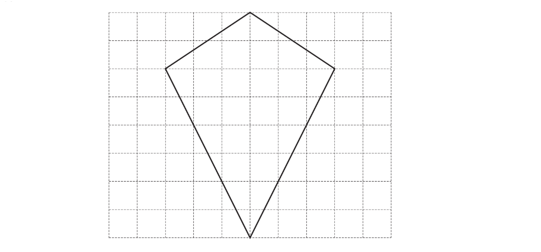

The diagram shows a quadrilateral on a 1 cm2 grid.

Write down the mathematical name of this quadrilateral.

*Source: March 2019 0580/12 Q23A*

### Q17 — medium — 2 marks

**Q17** [2 marks]

On the 1cm2 grid, complete the net of this box.

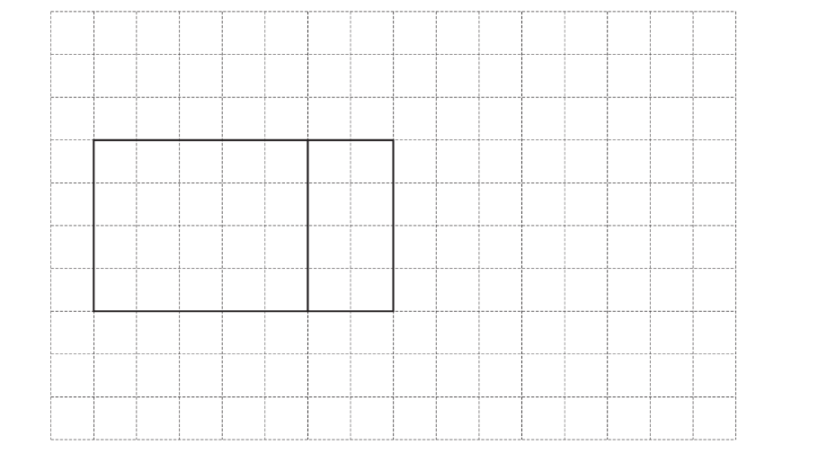

*Source: May/June 2019 0580/13 Q22B*

### Q18 — medium — 3 marks

**Q18** [3 marks]

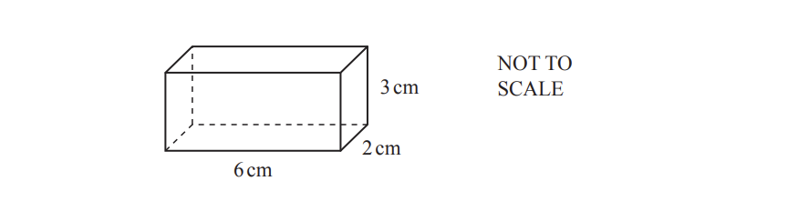

The diagram shows a cuboid.

On the 1 cm2 grid, complete the net of the cuboid. 
One face has been drawn for you.

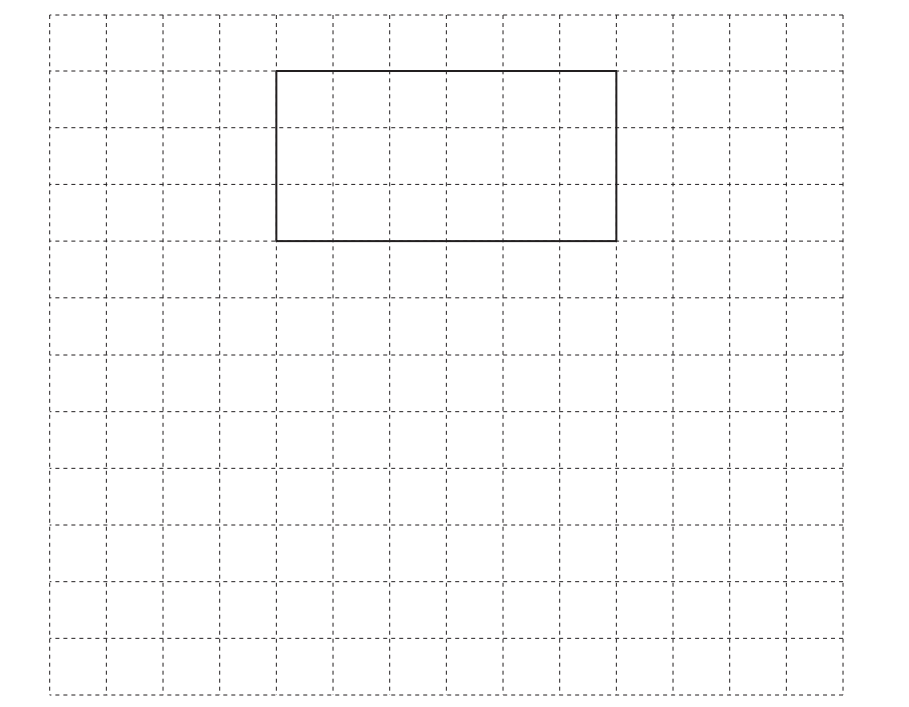

*Source: June 2020 0580/32 Q6A*

### Q19 — medium — 2 marks

**Q19** [1 mark]

Complete each statement.

A quadrilateral with only one pair of parallel sides is called a ...............................................

*Source: June 2019 0580/12 Q6A*

**Q19** [1 mark]

An angle greater than 90° but less than 180° is called ...............................................

*Source: June 2019 0580/12 Q6B*

### Q20 — medium — 3 marks

**Q20** [1 mark]

Write down the mathematical name for this type of angle.

*Source: June 2020 0580/12 Q2A*

**Q20** [2 marks]

$A$and $B$ lie on a circle, centre $O$.

i) .Write down the mathematical name for line $AB$.

[1]

ii) $OA=8\mathrm{cm}$

Write down the length of the diameter of this circle.

............................................ cm [1]

*Source: June 2020 0580/12 Q2B*

### Q21 — medium — 2 marks

**Q21** [1 mark]

Write down the order of rotational symmetry of the shape.

*Source: Specimen 2020 0580/01 Q6A*

**Q21** [1 mark]

Draw all the lines of symmetry on the shape.

*Source: Specimen 2020 0580/01 Q6B*

### Q22 — medium — 3 marks

**Q22** [1 mark]

Measure the length of the line $AB$ in millimetres.

.......................................... mm

*Source: March 2020 0580/12 Q2A*

**Q22** [2 marks]

**Extract:**

Measure the length of the line ![A B] in millimetres.

.......................................... mm

$AB$ is the diameter of a circle.

Draw this circle.

*Source: March 2020 0580/12 Q2B*

### Q23 — medium — 3 marks

**Q23** [1 mark]

Measure the length of this line in millimetres.

........................................... mm

*Source: Nov 2020 0580/32 Q2A*

**Q23** [2 marks]

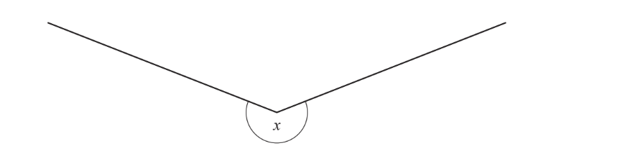

i) Measure the size of angle $x$.

[1]

ii) Write down the mathematical name of this type of angle.

[1]

*Source: Nov 2020 0580/32 Q2B*

### Q24 — medium — 2 marks

**Q24** [2 marks]

Complete the description of this pattern.

The pattern has ................ lines of symmetry

and order of rotational symmetry ................

*Source: Nov 2019 0580/12 Q14B*

### Q25 — medium — 3 marks

**Q25** [1 mark]

Write down the mathematical name for an angle which is less than 90°.

*Source: Nov 2020 0580/11 Q1A*

**Q25** [1 mark]

Write down the mathematical name for a polygon with 5 sides.

*Source: Nov 2020 0580/11 Q1B*

**Q25** [1 mark]

Write down the mathematical name for a quadrilateral with exactly one pair of parallel sides.

*Source: Nov 2020 0580/11 Q1C*

### Q26 — medium — 1 marks

**Q26** [1 mark]

Write down the mathematical name of a quadrilateral that has

- rotational symmetry of order 1

and

- only one line of symmetry.

*Source: June 2020 0580/13 Q7A*

### Q27 — medium — 1 marks

**Q27** [1 mark]

The diagram shows the net of a triangular prism on a 1cm2 grid.

Write down the mathematical name for the type of triangle shown on the grid.

*Source: June 2020 0580/31 Q3A*

### Q28 — medium — 4 marks

**Q28** [3 marks]

On each shape, draw all the lines of symmetry.

i)

[1]

ii)

[2]

*Source: June 2019 0580/11 Q19A*

**Q28** [1 mark]

Write down the name of a quadrilateral that has

- rotational symmetry of order 2

and

- exactly two lines of symmetry.

*Source: June 2019 0580/11 Q19B*

### Q29 — medium — 2 marks

**Q29** [2 marks]

Write down the order of rotational symmetry of each shape.

*Source: Nov 2020 0580/13 Q4*

### Q30 — medium — 1 marks

**Q30** [1 mark]

The diagram shows a net of a solid.

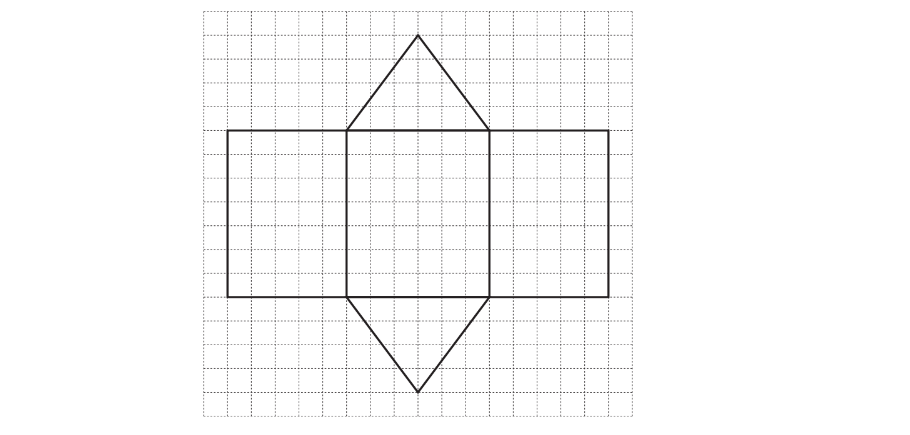

Write down the mathematical name of the solid.

*Source: March 2019 0580/12 Q7*

### Q31 — medium — 1 marks

**Q31** [1 mark]

The grid shows a point $E$ and four quadrilaterals, $A,B,C$ and $D$.

Write down the mathematical name of shape $A$.

*Source: June 2020 0580/31 Q2A*

### Q32 — easy — 1 marks

**Q32** [1 mark]

Write down the mathematical name of this type of angle.

*Source: Nov 2019 0580/13 Q1*

### Q33 — easy — 2 marks

**Q33** [2 marks]

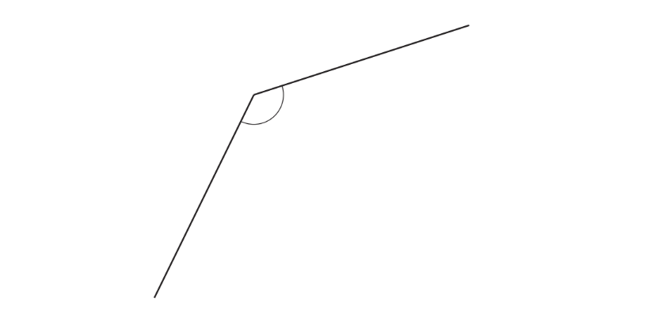

i) Write down the mathematical name for this type of angle.

[1]

ii) Measure this angle.

[1]

*Source: March 2020 0580/32 Q3A*

### Q34 — easy — 1 marks

**Q34** [1 mark]

Write down the order of rotational symmetry of this regular pentagon.

*Source: June 2019 0580/11 Q2*

### Q35 — easy — 2 marks

**Q35** [2 marks]

i) Measure the size of angle $x$.

[1]

ii) Write down the mathematical name of this type of angle.

[1]

*Source: Nov 2019 0580/31 Q3A*

### Q36 — easy — 2 marks

**Q36** [1 mark]

The diagram shows a regular pentagon and a kite.

Complete the following statements.

The regular pentagon has ................................... lines of symmetry.

*Source: Feb/March 2018 0580/12 Q7A*

**Q36** [1 mark]

The kite has rotational symmetry of order ................................... .

*Source: Feb/March 2018 0580/12 Q7B*

### Q37 — easy — 2 marks

**Q37** [2 marks]

Write down the mathematical name for this

i)   quadrilateral,

[1]

ii) solid.

[1]

*Source: Nov 2020 0580/32 Q3A*

### Q38 — easy — 1 marks

**Q38** [1 mark]

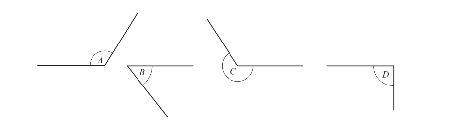

Complete the statement.

Angle ...................... is a reflex angle.

*Source: March 2019 0580/12 Q3*

### Q39 — easy — 2 marks

**Q39** [2 marks]

The diagram shows the nets of two solids.

Write down, under each net, the mathematical name for the solid.

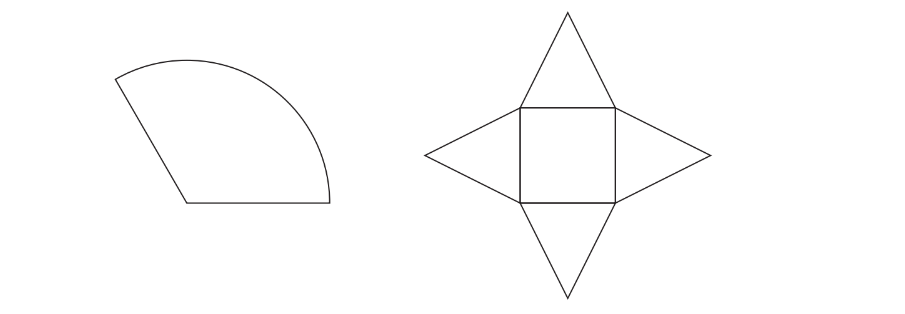

*Source: June 2019 0580/12 Q14B*

### Q40 — easy — 2 marks

**Q40** [2 marks]

The diagram shows a rhombus

On the diagram, draw all the lines of symmetry

*Source: Nov 2020 0580/11 Q5A*

### Q41 — easy — 2 marks

**Q41** [1 mark]

The diagram shows some quadrilaterals.

Complete the statements.

Quadrilateral ................. is a rhombus.

*Source: Nov 2019 0580/12 Q21A*

**Q41** [1 mark]

Quadrilateral $A$ is a ..........................................

*Source: Nov 2019 0580/12 Q21B*

### Q42 — easy — 4 marks

**Q42** [3 marks]

On each shape draw all the lines of symmetry.

*Source: June 2020 0580/11 Q4A*

**Q42** [1 mark]

Write down the order of rotational symmetry of this shape.

*Source: June 2020 0580/11 Q4B*

### Q43 — easy — 2 marks

**Q43** [2 marks]

The diagram shows a regular polygon.

i) Write down the mathematical name for this shape.

[1]

ii) Write down the order of rotational symmetry of this shape.

[1]

*Source: June 2020 0580/33 Q7A*

### Q44 — easy — 1 marks

**Q44** [1 mark]

Write down the order of rotational symmetry of this regular octagon.

*Source: Nov 2020 0580/12 Q3*

### Q45 — easy — 1 marks

**Q45** [1 mark]

Write down the order of rotational symmetry of the diagram.

*Source: June 2020 0580/12 Q9*

### Q46 — easy — 2 marks

**Q46** [1 mark]

In the space below, draw a circle with diameter 7cm.

*Source: Feb/March 2018 0580/12 Q21A*

**Q46** [1 mark]

**Extract:**

In the space below, draw a circle with diameter 7cm.

On your diagram, draw a chord.

*Source: Feb/March 2018 0580/12 Q21B*

### Q47 — easy — 1 marks

**Q47** [1 mark]

Three quadrilaterals are shown on a 1 cm2 grid.

Write down the mathematical name of the shaded quadrilateral.

*Source: May/June 2019 0580/33 Q2A*

