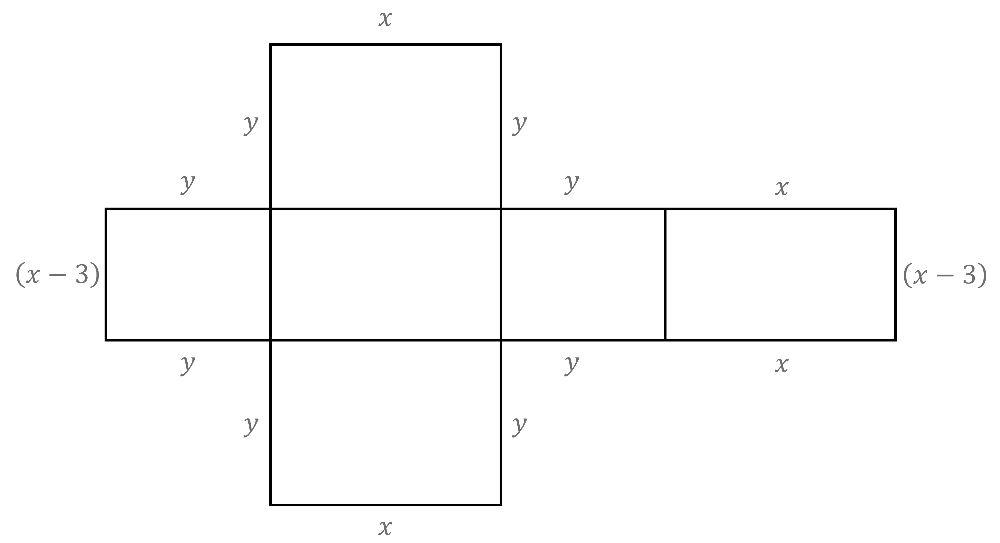
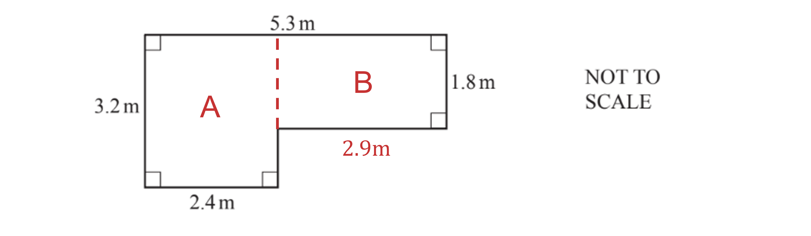
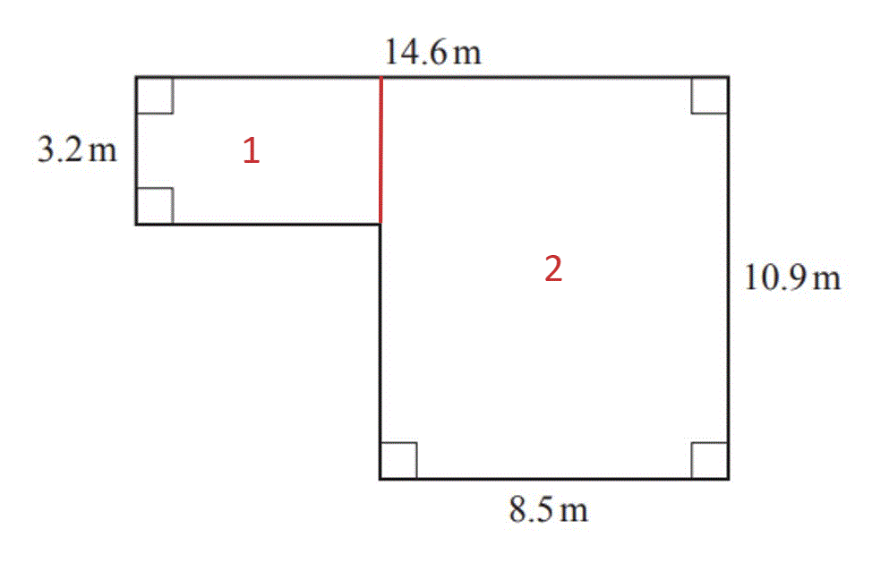
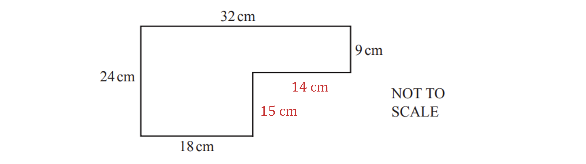
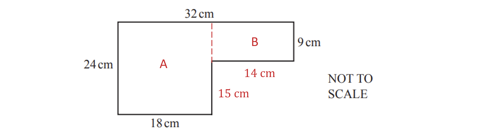
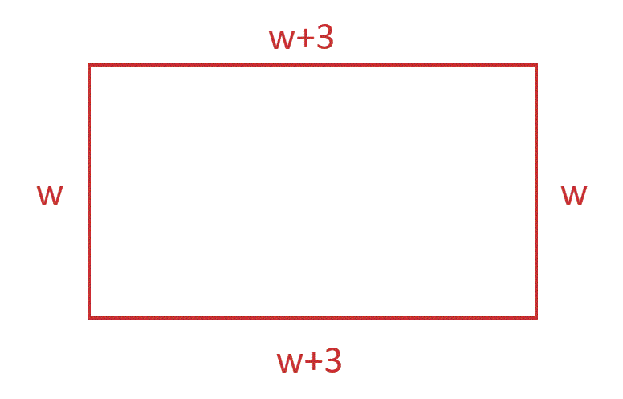

# Mark Schemes — Area & Perimeter
**Lengths, Areas & Volumes** · Cambridge (CIE) IGCSE maths (0580 & 0980)

## Exam Questions (29 questions)

### Q1
This is different from finding the total length of the edges in part (a) (iii)

- Here you need to add up the lengths of all the lines around the outside of the net
- Don't include the lines that are inside the net

It will help to label all the sides around the perimeter

First add up all the sides that are in terms of $x$

`x plus x plus x plus x plus open parentheses x minus 3 close parentheses plus open parentheses x minus 3 close parentheses`

- Collect terms and simplify

$=x+x+x+x+x-3+x-3\,=x+x+x+x+x+x-3-3\,=6x-6$

Then add up all the sides that are in terms of $y$

$y+y+y+y+y+y+y+y$

- Collect terms and simplify

$=8y$

Add the $x$ and $y$ parts together to get the total perimeter

$6x-6+8y$

**[B1 B1 B1]**

> **[mark-scheme]**
> **B1**: For any one of $6x$, $-6$ or $8y$ in final answer.
> 
> **B1**: For any two of $6x$, $-6$ or $8y$ in final answer.
> 
> **B1**: For $6x+8y-6$ or equivalent as final answer.

### Q2
**Method 1**

Split the shape into two rectangles

- Find the missing height of the top rectangle

$14-9=5$

**[M1]**

Find the area of the rectangle at the bottom

$20\times9=180$

**[M1]**

Find out the area of the top rectangle

$235-180=55$

**[M1]**

Find out the length of the top rectangle

$55\div5=11$

Subtract the length from the bottom length to find the value of *y*

$20-11=9$

**[M1]**

$y=9$

**[A1]**

**Method 2**

Draw a rectangle around the whole shape

- Find the missing height of the top rectangle

$14-9=5$

**[M1]**

Find the area of the large rectangle

$20\times14=280$

**[M1]**

Subtract the area of the shape from the area of the large rectangle to find the area of the extra rectangle

$280-235=45$

**[M1]**

Divide the area by the height of the rectangle to find the value of *y*

$45\div5=9$

**[M1]**

$y=9$

**[A1]**

> **[mark-scheme]**
> **M1**: For finding the height of the top rectangle.
> 
> **M1**: For finding the area of one rectangle.
> 
> **M1**: For finding the area of a second rectangle by subtracting areas.
> 
> **M1**: For a complete method to find the value of $y$.
> 
> **A1**: Correct value.

### Q3
> *Split the compound shape shape and add the parts*

`4.6 cross times open parentheses 10 minus x close parentheses plus open parentheses x y close parentheses equals 36`

**[M1]**

> *Expand the brackets*

$46-4.6x+xy=36$

**[A1]**

> *Collect the like terms and factorise*

$xy-4.6x=36-46\,xy-4.6x=-10$

$4.6x-xy=10$

**[A1]**
> *Substituting *$1.5$* into the equation from part (a)*

$1.5x-4.6x=-10$

**[M1]**

$-3.1x=-10\,x=\frac{10}{3.1}=3.23...$

$x=3.2$

**[A1]**

### Q4
i) *Method 1*

> *Split the diagram into a rectangle and a triangle by drawing in a horizontal line at the top of the walls *

> *The formula for the area of a rectangle is: *$A=b\timesh$

> *Substitute *$b=9$* and *$h=5$* into the area formula to determine the area of the rectangle*

$A=9\times5=45$

**[1]**

> *The formula for the area of a triangle is: *$A=0.5\timesb\timesh$

> *Substitute *$b=9$* and *$h=2.4$* into the area formulae to determine the area of the triangle*

$A=0.5\times9\times2.4=10.8$

> *Add the two areas together to get the total area*

> * *$45+10.8$

**[1]**

* *

**55.8 m****2**** ****[1]**

> * *

> *Method 2*

> *Split the diagram into two equal trapezia *

> *The area of a trapezium is calculated using the formula: *`A equals 1 half open parentheses a plus b close parentheses cross times h`* where *$a$* and *$b$* are the two parallel sides and *$h$* is the perpendicular height*

> *Substitute the known values into the formula and evaluate*

`A equals 1 half cross times open parentheses 7.4 plus 5 close parentheses cross times 4.5 equals 27.9`

**[1]**

> *Double this area as both trapezia are equivalent*

$2\times27.9$

**[1]**

**55.8 m****2**** [1]**

** **

ii) *The area of the door (a rectangle) is*

$b\timesh$

$=2.1\times0.9$

$=1.89$

> *The area of the 4 windows (4 rectangles) is*

`open parentheses b cross times h close parentheses cross times 4`

`equals open parentheses 1.5 cross times 1.2 close parentheses cross times 4`

$=7.2$

**[1]**

> $2.1\times0.9$* or *$1.5\times1.2\times4$* or *$1.5\times1.2$* is accepted*

> *The total area of the door and the 4 windows is*

$1.89+7.2=9.09$

**[1]**

**9.09 m****2**** [1]**

** **

iii) *Subtract the area of the door and the windows from the total area of the front of the house*

$55.8-9.09$

** ****46.71 m****2**** ****[1]**

**46.7 is also accepted**

### Q5
> *Work out the area of the parallelogram by using **area = base x height** *

$12\times6=72$

* ***[1]**

> *Work out the area of the trapezium using **area = *$\frac{1}{2}(a+b)h$

*** ***`table row Area equals cell 1 half cross times open parentheses 11 plus 7 close parentheses cross times x end cell row blank blank blank row blank equals cell 1 half cross times 18 cross times x end cell row blank blank blank row blank equals cell 9 x end cell row blank blank blank end table`

> * *

> *Set the areas equal to each other. *

$9x=72$

* ***[1]**

> *Divide both sides by 9.*

$x=72\div9$

> * *

$x=8$* ***[1]**

### Q6
> *Determine the length of the missing side of the right-angled triangle using Pythagoras' Theorem*

$c^{2}=a^{2}+b^{2}$

$c^{2}=8.5^{2}+10.8^{2}$

**[1]**

$c=\sqrt{8.5^{2}+10.8^{2}}$

$c=13.743...$

> *Add all three sides of the triangle to calculate its perimeter*

$8.5+10.8+13.743...$

**[1]**

$33.04...$* ***[1]**

`33 stretchy left square bracket.0 stretchy right square bracket`** is accepted**

### Q7
> *The area of a triangle is calculated using the formula: *$A=\frac{b\timesh}{2}$*. *

> *Substitute *$A=363,b=6h$* and *$h=h$* and solve for *$h$

$363=\frac{6h\timesh}{2}$

**[1]**

$363=3\timesh^{2}$

$363\div3=h^{2}$

**[1]**

$h^{2}=121$

$h=\sqrt{121}=11$

$h=11$** [1]**

### Q8
> *The area of a triangle *$=\frac{1}{2}\times$* base *$\times$* height*

> *(*$h$* is the height here even though it's outside the triangle!)*

> *Substitute area = 27 and base = 6 into the formula.*

$27=\frac{1}{2}\times6\timesh$

**[1]**

> *Work out *$\frac{1}{2}\times6$

$27=3\timesh$

> *Divide both sides of the equation by 3.*

> $27\div3=h$* *

$h=9$* ***[1]**

### Q9
> *Divide the perimeter, *$12x$*, by 4 to find the length of one side (all sides of a square are equal). *

$12x\div4=3x$

**[1]**

> *Square the length of the square to find the area (area of square = length**2**). *

`open parentheses 3 x close parentheses squared equals 9 x squared`

**[1]**

$9x^{2}$** [1]**
> *Divide the diameter of the circle, 10, by 2 to find the radius, which is the height of the triangle. *

$10\div2=5$

* ***[1]**

> *Substitute base = 10, and height = 5 into area = *$\frac{1}{2}$* x base x height*

> * *$\frac{1}{2}\times10\times5=25$

**[1]**

** **

**25 cm****2** **[1]**

### Q10
> *Find the perimeter of the rectangle and multiply it by 5 (the number of congruent rectangles in the shape). *

`table row cell 3 plus 8 plus 3 plus 8 end cell equals 22 row blank blank blank row cell 22 cross times 5 end cell equals 110 end table`

> * *

> *Each of the 4 dotted lengths has been counted twice, but they are not parts of the perimeter of the joined-up shape. So subtract 8 lots of 3cm from 110. *

`110 minus open parentheses 8 cross times 3 close parentheses equals 86`

* ***[1]**

**86 cm** **[1]**

### Q11
> *The area of a trapezium can be calculated using the formula: *`A equals 1 half open parentheses a plus b close parentheses cross times h`* where *$a$* and *$b$* are the parallel sides and *$h$* is the perpendicular height.*

> *Substitute *$a=16,b=24$* and *$h=14$* into the formula and evaluate*

`A equals 1 half open parentheses 16 plus 24 close parentheses cross times 14`

**[1]**

$=\frac{1}{2}\times40\times14$

$=20\times14=280$

**280 m****2**** [1]**

### Q12
(i) *Add together the two given sides and double the result (because the other two sides not labelled will be the same).*

> * *`2 cross times open parentheses 8 plus 6 close parentheses equals 28`

> * *

**28 m****2**** ****[1]**

(ii) *Divide the length of the patio, 8, by the length of the floor tile, 0.5, to work out how many tiles will fit across the length of the patio.*

$8\div0.5=16$

> * Divide the width of the patio, 6, by the width of the floor tile, 0.5, to work out how many tiles will fit across the width of the patio.*

$6\div0.5=12$

> * Multiply how many tiles will fit across the length, 16, by the number of tiles that will fit across the width, 12.*

> * *$16\times12=192$

**[1]**

** **

**192** **[1]**

### Q13
> *i) To work out the area of a compound shape, split it into shapes that are easier to work with. Label the shapes so it's easier to set out your working. The missing length can be found by *

$5.3-2.4=2.9m$

$\mathrm{Area}A:3.2\times2.4=7.68m^{2}$

$\mathrm{Area}B:2.9\times1.8=5.22m^{2}$

$\mathrm{Total} \mathrm{area}:5.22+7.68=12.9m^{2}$

** **** ****[1]**

**Final answer:** **12.9 m****2**** ****[1]**

> *ii) Work out how many lots of 500 ml we need. *

$12.9\div8=1.6125$

$1.6125\times500=806.25\mathrm{ml}$

**[1]**

**806.25 ml** **[1]**
> *The shape of the wall is a trapezium. The formula for the area of a trapezium is *`1 half open parentheses a space plus space b close parentheses space cross times space h`*.*

> *Substitute in the values *

`1 half open parentheses 1.9 space plus space 2.6 close parentheses space cross times space 1.8 space equals space 4.05`

**[1]**

**4.05m****2**** ****[1]**

### Q14
> *The number of whole squares in the shape is*

*20*

> *Pair any further part squares together to approximate the remaining number of squares within the shape*

*8*

> *The total number of squares is*

*20 + 8 = 28*

**28**

**Value given is between 25 and 30**** [1] **

**Value given is also between 26 and 29**** [1]**

### Q15
> *Draw a line to split the shape into two rectangles.*

> * *

> * *

> *Subtract 8.5 from 14.6 to find the length of rectangle 1.*

> * *

$14.6-8.5=6.1$

* ***[1]**

> *Work out the area of rectangle 1 by multiplying the length by the width.*

> * *

$6.1\times3.2=19.52$

> * *

> *Work out the area of rectangle 2.*

> * *

$10.9\times8.5=92.65$

> * *

> *Add the areas together.*

> * *

$19.52+92.65=112.17$

* ***[1]**

$112.17m^{2}$* ***[1]**

### Q16
> *Measure the length of *$h$* using a ruler*

$3.8\mathrm{cm}$

**Final answer:** **3.6 to 4 accepted**** ****[1]**

> *Multiply this distance by the scale factor*

$3.8\times3=11.4$

**11.4 cm**** ****[1]**

> $10.8$* to *$12\mathrm{cm}$* accepted*
> *Measure the length of *$CE$* and multiply it by the scale factor*

$12\times3=36m$

**11.8 to 12.2, or 35.4 to 36.6 are accepted**** ****[1]**

> *Use the formula for the area of a triangle: *$A=\frac{b\timesh}{2}$* where *$b$* is the base and *$h$* is the perpendicular height*

$\frac{36\times10.8}{2}=194.4$

**[1]**

**194.4 m****2**** [1]**

> *Any area in the range *$191$* to *$220m^{2}$* is accepted*

### Q17
i) *Work out the missing sides.*

**[1]**

> *Add the sides together*

$32+24+18+15+14+9=112\mathrm{cm}$

**112 cm** **[1]**

ii) *Split the shape into rectangles and work out the area of each rectangle*

$A=24\times18=432\mathrm{cm}^{2}$

$B=9\times14=126\mathrm{cm}^{2}$

$\mathrm{Total} \mathrm{area}=432+126=558\mathrm{cm}^{2}$

**correct calculation ****[1]**

**558 cm****2**** ****[1]**

### Q18
> *Substitute **a**=7**, **b**=11** and **h**=5** into **area of a trapezium*`equals 1 half open parentheses a plus b close parentheses h`*.*

*area*`equals 1 half cross times open parentheses 7 plus 11 close parentheses cross times 5`

**[1]**

> *Type into a calculator.*

$45\mathrm{cm}^{2}$ **[1]**

### Q19
> *Add together all the lengths of the triangle. *

$3a+b+a+2b+4a-5b$

**[1]**

> *Reorder the expression so that the *$a$* terms are together and the *$b$* terms are together. *

$3a+a+4a+b+2b-5b$

> * *

> *Combine like terms.*

* *$8a-2b$ **[2]**

**one mark for each**

### Q20
> *The length, *$l$*, is 3 more than the width, *$w$*.*

> *Write this using algebra. *

$l=w+3$

> * *

> * *

> *Add the sides together to find the perimeter and set equal to 26.*

> * *

`w plus open parentheses w plus 3 close parentheses plus w plus open parentheses w plus 3 close parentheses equals 26`

* ***[1]**

> *Collect like terms.*

> * *

$4w+6=26$

> * *

> *Subtract 6 from both sides.*

> * *

$4w=26-6\,4w=20$

* ***[1]**

> *Divide both sides by 4 to solve for *$w$*.*

> * *

$w=20\div4\,w=5$

> * *

* Substitute *$w=5$* into  *$l=w+3$ *to find *$l$*.*

> * *

$l=5+3\,l=8$

> * *

$l=8\mathrm{cm},w=5\mathrm{cm}$* ***[1]**

### Q21
> *Multiply the length of the two diagonals and divide by *$2$

$\frac{8\times6}{2}=24$

**[1]**

**Final answer:** **24 cm****2**** [2] **

> *1 mark for *$24$* or *$\mathrm{cm}^{2}$

### Q22
i) *The perimeter is the distance around the outside of the shape*

**16 c****m ****[1]**

ii) *The area of a shape on a centimetre square grid can be calculated by counting the number of shaded squares within the shape*

**12 cm****2** **[1]**

### Q23
i) *The perimeter is the distance around the outside of the rectangle*

$7a+2a+7a+2a=18a$

**[1]**

$18a$** [1]**

ii) *The area of the rectangle is determined by multiplying the      height by the width of the rectangle*

$7a\times2a=14a^{2}$

**[1]**

$14a^{2}$** [1]**

### Q24
> *Count the whole squares and half squares (triangles) to determine the area of shape *$B$

$4$  **[1]**

### Q25
> *i) A line of symmetry means that each side is a mirror image*

** ****One line correct ****[1]**

**Second line correct ****[1]**

> *ii) The area of a rectangle is given by the length multiplied by the width *

$1.2\times1.8=2.16$

**Correct calculation**** [1]**

**2.16** **[1]**

### Q26
> *The area is the length of one side squared.  So take the square root of the area to find the length of one side. *

$\sqrt{64}=8$

** ****8 cm** **[1]**

### Q27
> *Substitute the appropriate values into the formula for the area of a triangle *$A=0.5\timesb\timesh$

$0.5\times10.8\times8.5$

**[1]**

$45.9$ **[1]**

### Q28
> *The area of a triangle is calculated using the formula *$A=\frac{1}{2}\timesb\timesh$* where *$b$* is the base and *$h$* is the perpendicular height.*

> *Substitute known values into the formula and evaluate*

$\frac{1}{2}\times8.4\times3.5=14.7$

**[1]**

**14.7**** ****cm****2** **[1]**

### Q29
i) *As the grid consists of squares of width 1cm, the perimeter can be measured using a ruler*

$2+4+5+5=16$

**16 cm ****[1]**

ii) *Use the formula for the area of a trapezium: *

> `fraction numerator open parentheses a plus b close parentheses over denominator 2 end fraction cross times h`* where *$a$* and *$b$* are the two parallel sides and *$h$* is the perpendicular height*

`fraction numerator open parentheses 2 plus 5 close parentheses over denominator 2 end fraction cross times 4 equals 14`

**14 cm****2**** ****[1]**
