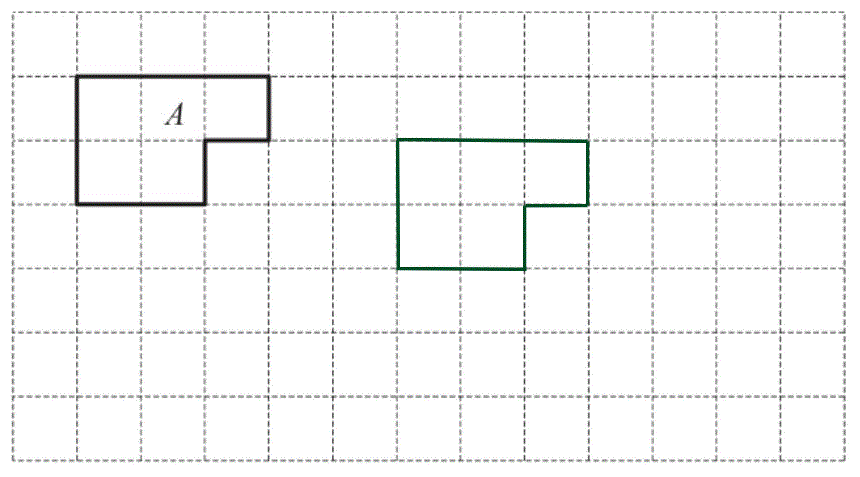

# Mark Schemes — Congruence & Similarity
**Lengths, Areas & Volumes** · Cambridge (CIE) IGCSE maths (0580 & 0980)

## Exam Questions (15 questions)

### Q1
> *TV** and **XZ** are **corresponding **known lengths.*

> *Work out the scale factor from the smaller triangle (**TUV**) to the bigger triangle (**XYZ**) by dividing **XZ **by **TV**.  *

$\frac{54}{12}=4.5$

> *UT** and **YX** are **corresponding **lengths.*

> *Divide **63 by the scale factor to work out the length **UT **(because we are going from the bigger length to a smaller one).  *

$63\div4.5=14$

* ***[1]**

$UT=14\mathrm{cm}$* ***[1]**

### Q2
> *Work out the angle **ACB **by adding together *$37^{\circ}$* and *$78^{\circ}$* and subtracting from *$180^{\circ}$* (angles in a triangle add up to *$180^{\circ}$*). *

$180 - ( 37 + 78 ) = 65 \text{Angle} A C B = 65^{\circ}$

**[1]**

> *The triangles have two pairs of equal angles (Angle **ABC **= Angle **RQP **and Angle **ACB **= Angle **QRP) **so they are similar.** *

**They have two pairs of equal angles** **[1]**

### Q3
> *Form an equation where the ratio of the corresponding sides are equal to each other*

$\frac{5.2}{PQ}=\frac{12.4}{21.7}$

**[1]**

> *Rearrange and solve for *$PQ$

$\frac{5.2\times21.7}{PQ}=12.4$

$\frac{112.84}{PQ}=12.4$

$112.84=12.4\timesPQ$

$\frac{112.84}{12.4}=PQ$

$PQ=9.1\mathrm{cm}$ **[1]**

### Q4
> *Determine the scale factor by dividing two corresponding sides *$PQ$* and *$AB$

$7.7\div5.5=1.4$

**[1]**

> *Divide the length *$PR$* by the scale factor to determine the length of *$AD$

$9.8\div1.4=7\mathrm{cm}$

$a=7$** [1]**

### Q5
> *Divide the **diameter of the larger pot** by the **diameter of the smaller pot** to find the scale factor.*

> *Multiply this by the height of the smaller pot, 21.6, to find the height of the larger pot. *

$\frac{33}{27}\times21.6=26.4$

* ***[1]**

**26.4 cm** **[1]**

> * *

### Q6
> *If two shapes are mathematically similar, it means that their sides have been multiplied by the same scale factor.*

> *To find the scale factor, divide the length of one side by the length of the same side on the other shape.*

$\frac{2.4}{1.8}=\frac{4}{3}$

**[1]**

> *To find the missing side, multiply the side we know by the scale factor*

$1.2\times\frac{4}{3}=1.6$

**1.6cm** **[1]**

### Q7
> *Two shapes are similar if each corresponding pair of angles are equal*

`angle A equals angle P`

`angle B equals angle Q`

`angle C equals angle R`

**All three pairs of corresponding angles are equal** **[1]**
> *Determine the scale factor of enlargement by dividing two corresponding sides *

$AB\divPQ=6\div18=\frac{1}{3}$

**[1]**

> *Multiply the length of *$PR$* by this scale factor to determine the shorter length of *$AC$

$27\times\frac{1}{3}=27\div3$

$9\mathrm{cm}$* ***[1]**

### Q8
i) *Both edges of the first rectangle have increased in size by the same scale factor *

**One rectangle is an enlargement of the other*** ***[1]**

** **ii) *Divide any two corresponding sides to find the length scale factor *

$4.5\div1.5=3$

**[1]**

> *Square this value for the area scale factor*

$3^{2}$

** ****9**** ****[1]**

### Q9
> *Work out the scale factor*

$48\div6=8$

**[1]**

> *Multiply **AC** by 8*

$8.5\times8=68$

**68 cm ****[1]**

### Q10
> *Work out the scale factor by dividing the length *$DF$* on the second triangle by its corresponding length *$AC$* on the first triangle*

$27\div18=1.5$

**[1]**

> *Multiply *$AB$* by the scale factor 1.5*

$16\times1.5$

$DE=24\mathrm{cm}$** ****[1]**

### Q11
> *Shapes are **congruent **if they are **identical **in shape and size.*

> *Draw an exact copy of shape A somewhere on the grid. *

** ****Any congruent shape ****[1]**

### Q12
i) *Two shapes are congruent when they are identical to each other*

**J*** ***[1]**

** **

ii) *Two shapes are similar when one is an enlargement of the other*

**F** **[1]**

**H**** ****[1]**

### Q13
> *A **hexagon **is a 6 sided shape.*

> *Regular** means a shape has equal sides and equal angles.*

> *Perpendicular** means two lines meet at a right angle (*$90^{\circ}$*).*

> *Congruent** means that shapes are the same shape and size.*

> *An **isosceles **triangle has two equal sides and two equal angles.*

**Congruent ****[1]**

### Q14
> *Congruent means the shapes are the exact same shape and size. They may have been rotated or reflected.*

**B and G ****[1]**
> *Two shapes are similar** **if they have the same shape** **and their** **corresponding sides are in proportion. Shape D is 1.5 times the size of shape F and that all of the angles are the same.*

**D and F ****[1]**

> *B and G are also similar shapes so will be accepted*

### Q15
> *Two shapes are congruent if they are identical*

> * *

**No shapes are congruent to **$D$** as they are not the same size**** ****[1]**
