# Exam Questions — Congruence & Similarity
**Lengths, Areas & Volumes** · Cambridge (CIE) IGCSE maths (0580 & 0980)
> Source: [https://www.savemyexams.com/igcse/maths/cie/25/core/topic-questions/](https://www.savemyexams.com/igcse/maths/cie/25/core/topic-questions/) · 15 questions across 1 sets

## Exam Questions (15 questions)

### Q1 — hard — 2 marks

**Q1** [2 marks]

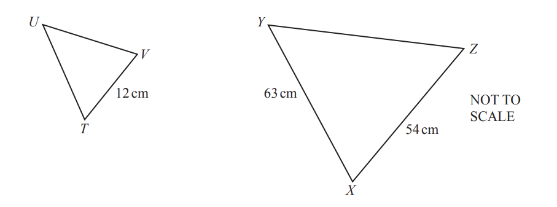

The diagram shows two similar triangles $TUV$ and $XYZ$.

Calculate $UT$.

$UT$ = ............................................ cm

*Source: Nov 2020 0580/12 Q23*

### Q2 — hard — 2 marks

**Q2** [2 marks]

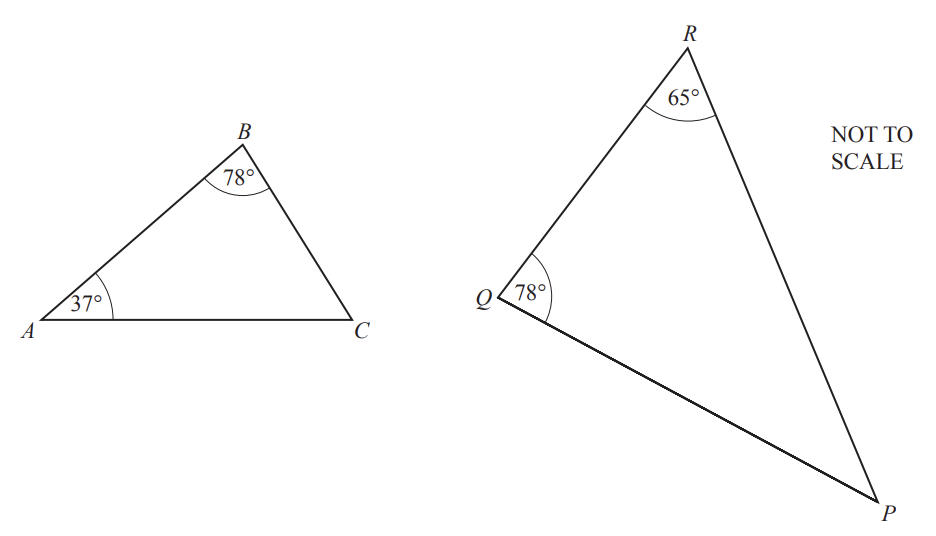

Explain why triangle $ABC$ is similar to triangle $PQR$.

*Source: June 2020 0580/11 Q23*

### Q3 — hard — 2 marks

**Q3** [2 marks]

Triangle $ABC$ is similar to triangle $PQR$.

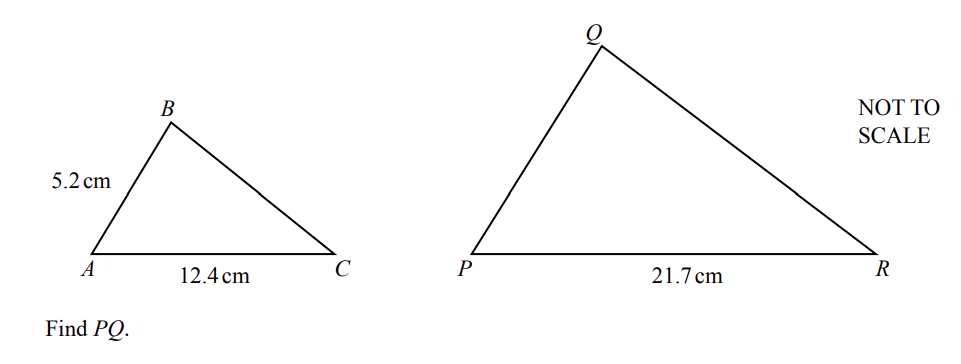

$PQ$ = ......................................... cm

*Source: Specimen 2020 0580/01 Q22*

### Q4 — hard — 2 marks

**Q4** [2 marks]

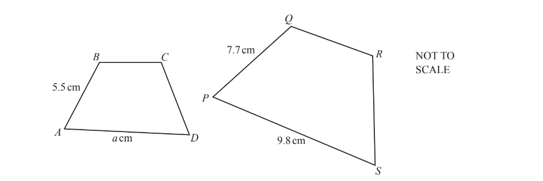

Shape $ABCD$ is similar to shape $PQRS$.

Work out the value of $a$.

$a=$ ................................

*Source: May/June 2019 0580/13 Q18*

### Q5 — hard — 2 marks

**Q5** [2 marks]

The diagram shows two mathematically similar plant pots.

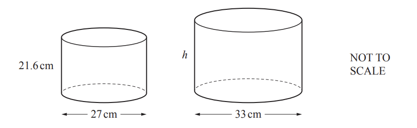

The smaller pot has height 21.6 cm and diameter 27 cm. 
The larger pot has diameter 33 cm.

Find the height, $h$, of the larger pot.

$h$ = ............................................ cm

*Source: Nov 2020 0580/33 Q4D*

### Q6 — medium — 2 marks

**Q6** [2 marks]

Soraya designs two mathematically similar flags.

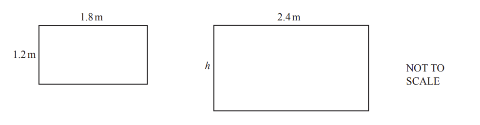

Calculate the height, $h$, of the larger flag.

$h$= ............................................... m

*Source: Nov 2019 0580/31 Q7D*

### Q7 — medium — 3 marks

**Q7** [1 mark]

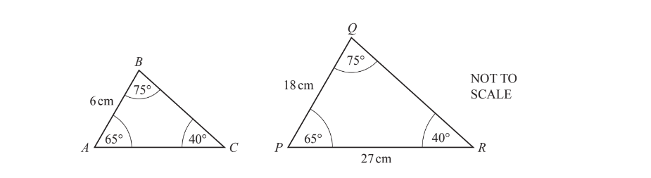

Explain why triangle $ABC$ and triangle $PQR$ are similar.

*Source: June 2019 0580/11 Q17A*

**Q7** [2 marks]

Find $AC$.

$AC$ = ............................. cm

*Source: June 2019 0580/11 Q17B*

### Q8 — medium — 3 marks

**Q8** [3 marks]

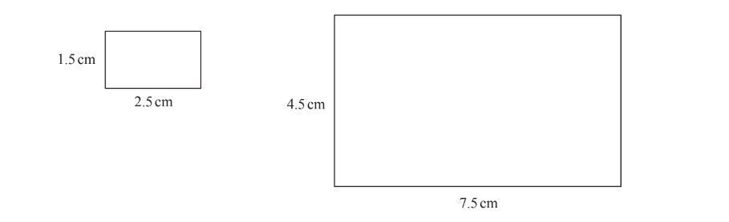

i) Explain why these rectangles are mathematically similar.

[1]

ii) How many times bigger is the area of the large rectangle than the area of the small rectangle?

[2]

*Source: March 2018 0580/32 Q1A*

### Q9 — medium — 2 marks

**Q9** [2 marks]

The diagram shows two similar triangles, $ABC$ and  $DEF$.

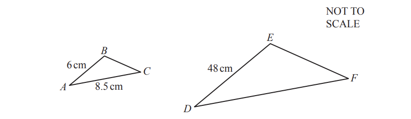

Calculate $DF$.

$DF$ = ............................................. cm

*Source: Nov 2019 0580/33 Q7D*

### Q10 — medium — 2 marks

**Q10** [2 marks]

Triangle $ABC$ and triangle $DEF$ are similar.

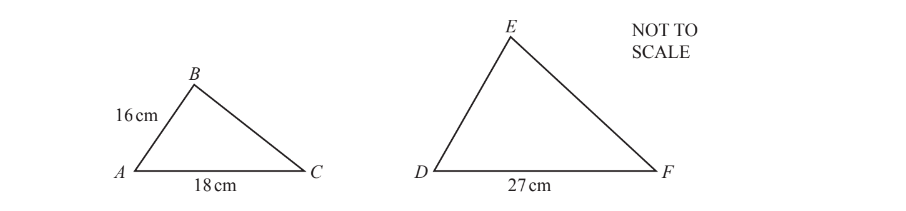

Find $DE$.

$DE$ = ............................... cm [2]

*Source: Oct/Nov 2018 0580/12 Q6*

### Q11 — easy — 1 marks

**Q11** [1 mark]

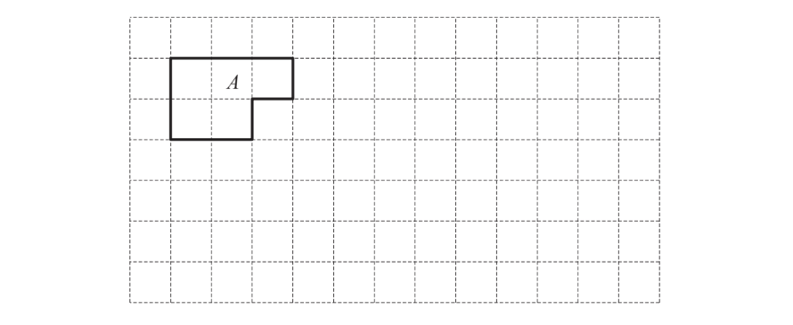

On the grid, draw a shape that is congruent to shape $A$.

*Source: June 2020 0580/13 Q2*

### Q12 — easy — 3 marks

**Q12** [3 marks]

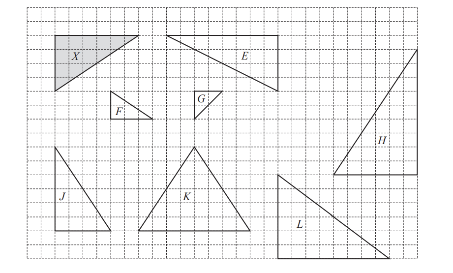

For the triangles shown on the grid, write down the letter of each triangle that is

i) congruent to triangle $X$,

[1]

ii) similar to triangle $X$.

[2]

*Source: March 2020 0580/32 Q6B*

### Q13 — easy — 1 marks

**Q13** [1 mark]

Pick the word that describes two polygons that are the same shape and size.

| hexagon | regular | perpendicular | congruent | isosceles |
|---|---|---|---|---|

*Source: Nov 2020 0580/11 Q2*

### Q14 — easy — 2 marks

**Q14** [1 mark]

Quadrilaterals ................. and ................. are congruent.

*Source: Nov 2019 0580/12 Q21C*

**Q14** [1 mark]

Quadrilaterals ................. and ................. are similar.

*Source: Nov 2019 0580/12 Q21D*

### Q15 — easy — 1 marks

**Q15** [1 mark]

The diagram shows four shapes $A,B,C$and $D$.

Which shapes, if any, are congruent to shape $D$?

Give a reason for your answer.

*Source: Specimen 2020 0580/03 Q9C*

