# Exam Questions — Volume & Surface Area
**Lengths, Areas & Volumes** · Cambridge (CIE) IGCSE maths (0580 & 0980)
> Source: [https://www.savemyexams.com/igcse/maths/cie/25/core/topic-questions/](https://www.savemyexams.com/igcse/maths/cie/25/core/topic-questions/) · 28 questions across 1 sets

## Exam Questions (28 questions)

### Q1 — medium — 6 marks

**Q1** [6 marks]

The diagram shows the net of a cuboid.

(i) Find the volume of the cuboid.

......................................... cm3 [2]

(ii) Show that the total surface area of the cuboid is 122 cm2.

[2]

(iii) Calculate the total length of the edges of the cuboid.

.......................................... cm [2]

### Q2 — hard — 4 marks

**Q2** [2 marks]

A sphere has a volume of 381 cm3.

Show that the radius of the sphere is 4.50 cm, correct to 3 significant figures.

**Q2** [2 marks]

**Extract:**

A sphere has a volume of 381 cm^3^.

Show that the radius of the sphere is 4.50 cm, correct to 3 significant figures.

Calculate the surface area of the sphere.

........................................ cm2

### Q3 — medium — 1 marks

**Q3** [1 mark]

Write down a factor of 18 greater than 2.

### Q4 — medium — 8 marks

**Q4** [1 mark]

Write down the name of the 3D shape in the diagram.

**Q4** [4 marks]

Calculate the surface area of the shape.

Include units in your answer.

**Q4** [3 marks]

Work out the volume of the shape.

Include units in your answer.

### Q5 — medium — 2 marks

**Q5** [2 marks]

Calculate the exact volume of a sphere with diameter $10$ cm. Give your answer in the form $\frac{a}{b}π$ where $a$ and $b$ are positive integers.

### Q6 — easy — 6 marks

**Q6** [3 marks]

A cuboid measures 5cm by 4 cm by 2cm.

Calculate the volume of this cuboid.

Give the units of your answer.

*Source: Nov 2019 0580/31 Q2C*

**Q6** [3 marks]

**Extract:**

A cuboid measures 5cm by 4 cm by 2cm.

On the 1 cm2 grid, draw an accurate net of this cuboid.

One face has been drawn for you.

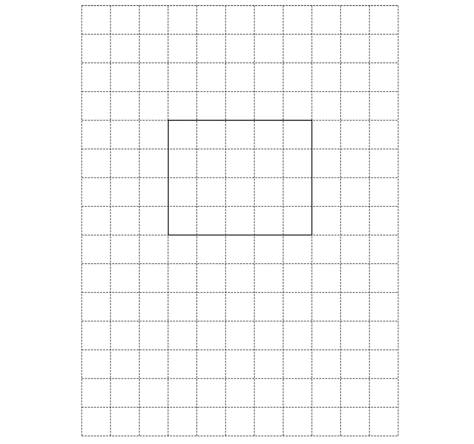

*Source: Nov 2019 0580/31 Q2C*

### Q7 — hard — 2 marks

**Q7** [2 marks]

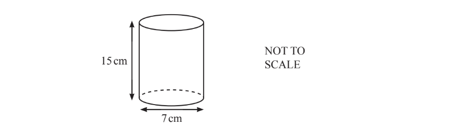

Another glass is in the shape of a cylinder.

The cylinder has height 15cm and diameter 7cm.

Calculate the volume of the glass.

............................................. cm3

*Source: n 0580/32 Q4D*

### Q8 — hard — 6 marks

**Q8** [6 marks]

A cake is made by putting a small cylinder of cake on top of a large cylinder of cake.

The radius of the large cylinder is 15cm. The radius of the small cylinder is 8cm. The height of each cylinder is 10cm.

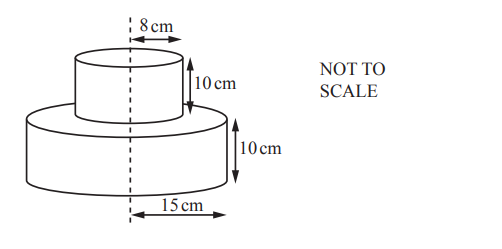

i) Calculate the total volume of the cake.

................................cm3 [3]

ii) Nora wraps a ribbon around the large cylinder. The ribbon is 4 cm longer than needed to go all the way around this cylinder.

Calculate the length of this ribbon.

.............................. cm [3]

*Source: Oct/Nov 2018 0580/31 Q7B*

### Q9 — hard — 7 marks

**Q9** [7 marks]

The diagram shows a hollow metal pipe in the shape of a cylinder.

i) This diagram shows the cross-section of the pipe.

Work out the shaded area.

............................cm2 [3]

ii)The cylinder is 18cm long. Work out the volume of the metal.

.........................cm3 [1]

iii) Work out the curved surface area of the outside of the pipe.

.............................cm2 [3]

*Source: Oct/Nov 2018 0580/32 Q5E*

### Q10 — hard — 3 marks

**Q10** [3 marks]

A cube has a volume of 1000cm3 . 
Calculate the surface area of the cube.

......................................... cm2

*Source: Specimen 2020 0580/01 Q8*

### Q11 — hard — 4 marks

**Q11** [4 marks]

A solid cylinder has radius 3cm and height 4.5cm.

Calculate the **total **surface area of the cylinder.

.......................................... cm2

*Source: June 2020 0580/13 Q21*

### Q12 — medium — 8 marks

**Q12** [3 marks]

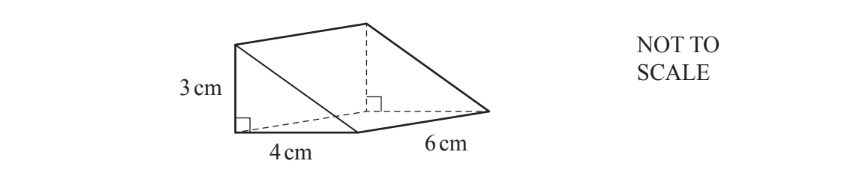

The diagram shows a right-angled triangular prism.

On the 1 cm2 grid, complete the net of the prism.

One face has been drawn for you.

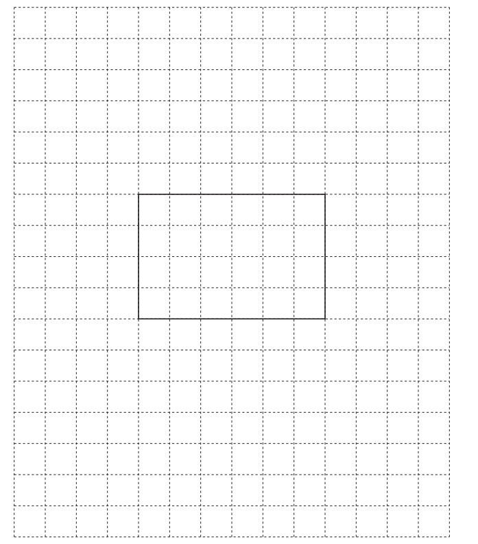

*Source: Nov 2020 0580/31 Q6A*

**Q12** [3 marks]

**Extract:**

The diagram shows a right-angled triangular prism.

Work out the surface area of the prism.

.......................................... cm2 

*Source: Nov 2020 0580/31 Q6B*

**Q12** [2 marks]

**Extract:**

The diagram shows a right-angled triangular prism.

Work out the volume of the prism.

.......................................... cm3

*Source: Nov 2020 0580/31 Q6C*

### Q13 — medium — 2 marks

**Q13** [2 marks]

The radius of a sphere is 5.2cm.

Work out the surface area of this sphere.

[The surface area, $A$, of a sphere with radius $r$ is $A$= 4$πr$2.]

......................................... cm2

*Source: Specimen 2020 0580/01 Q21*

### Q14 — medium — 2 marks

**Q14** [2 marks]

A cylinder has a radius of 6 cm and a height of 17 cm.

Show that the volume of this cylinder is 1923 cm3, correct to 4 significant figures.

*Source: June 2019 0580/31 Q8A*

### Q15 — medium — 6 marks

**Q15** [1 mark]

The diagram shows the net of a triangular prism on a 1cm2 grid.

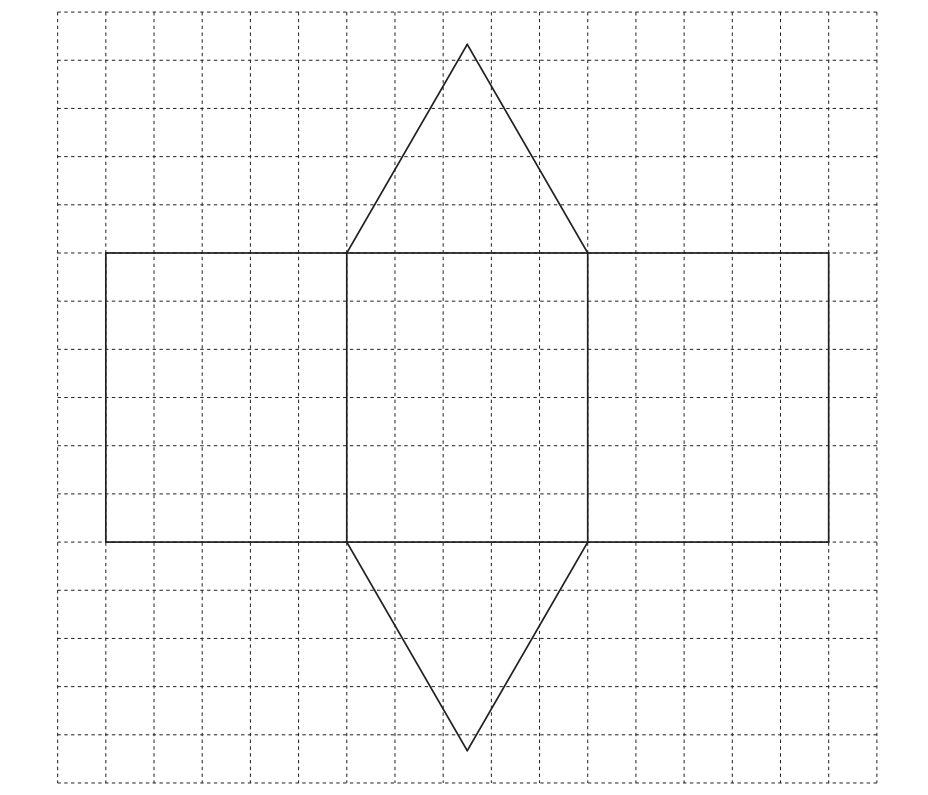

Write down the mathematical name for the type of triangle shown on the grid.

*Source: June 2020 0580/31 Q3A*

**Q15** [5 marks]

**Extract:**

The diagram shows the net of a triangular prism on a 1cm^2 grid.

i) Measure the perpendicular height of the triangle.

............................................ cm [1]

ii) Calculate the area of the triangle.

.......................................... cm2 [2]

iii) Calculate the volume of the triangular prism.

.......................................... cm3 [2]

*Source: June 2020 0580/31 Q3B*

### Q16 — medium — 6 marks

**Q16** [3 marks]

A cube has a surface area of 384cm2.

Find the length of one of its sides.

............................................ cm

*Source: June 2020 0580/32 Q6B*

**Q16** [3 marks]

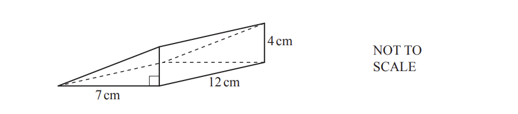

The diagram shows a right-angled triangular prism.

Work out the volume of the prism.

.......................................... cm3

*Source: June 2020 0580/32 Q6C*

### Q17 — medium — 2 marks

**Q17** [2 marks]

The volume of a cuboid is 180 cm3.

The base is a square of side length 6cm.

Calculate the height of this cuboid.

....................................... cm

*Source: June 2019 0580/11 Q6*

### Q18 — medium — 2 marks

**Q18** [2 marks]

A cone has radius 4.5 cm and height 10.4 cm.

Calculate, in terms of $π$, the volume of the cone.

[The volume, $V$, of a cone with radius $r$ and height $h$ is $V=\frac{1}{3}πr^{2}h$]

.......................................... cm3

*Source: June 2020 0580/11 Q11*

### Q19 — medium — 2 marks

**Q19** [2 marks]

A plant pot is a cylinder with radius 15 cm and height 24 cm.

Calculate the volume of the pot.

.......................................... cm3

*Source: Nov 2020 0580/33 Q4C*

### Q20 — easy — 3 marks

**Q20** [3 marks]

These two cuboids have the same volume.

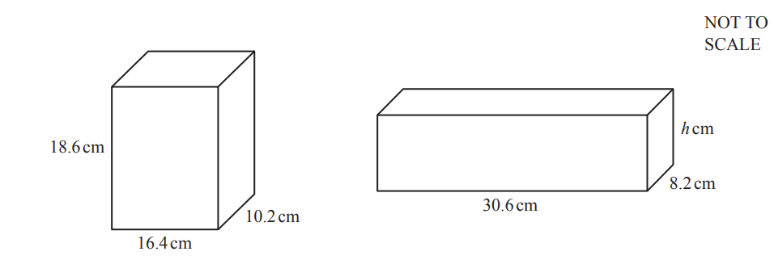

Find the value of $h$.

$h$= ...................................................

*Source: Nov 2019 0580/33 Q7C*

### Q21 — easy — 3 marks

**Q21** [3 marks]

A cuboid measures 5cm by 7cm by 9.5 cm.

Work out the surface area of this cuboid.

............................................. cm2

*Source: Nov 2019 0580/13 Q16*

### Q22 — easy — 2 marks

**Q22** [2 marks]

A closed box in the shape of a cuboid has length 5cm, width 4 cm and height 2cm.

Calculate the volume of the box.

................................. cm3

*Source: May/June 2019 0580/13 Q22A*

### Q23 — easy — 2 marks

**Q23** [2 marks]

The length of the edge of a cube is 8 cm. 
Calculate the surface area of this cube.

............................................. cm2

*Source: Nov 2019 0580/31 Q2B*

### Q24 — easy — 1 marks

**Q24** [1 mark]

The diagram shows a solid cuboid made of identical cubes.

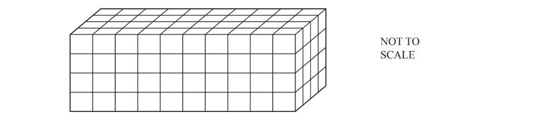

Work out the number of cubes in the cuboid.

*Source: June 2019 0580/12 Q14A*

### Q25 — easy — 3 marks

**Q25** [3 marks]

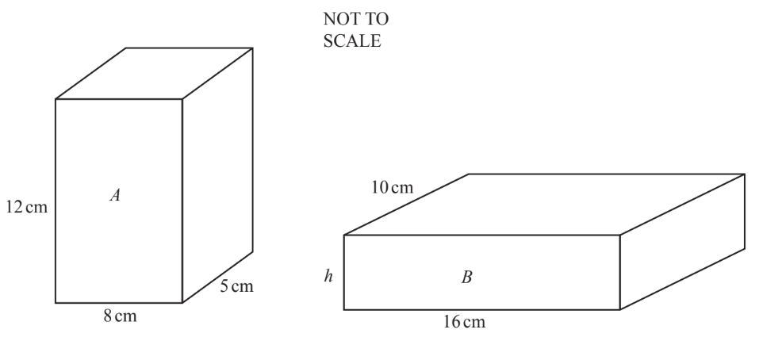

The diagram shows cuboid $A$ and cuboid $B$. 
Cuboid A has the same volume as cuboid$B$.

Calculate the height,$h$, of cuboid $B$.

$h=$ ...................................... cm

*Source: Nov 2020 0580/12 Q11*

### Q26 — easy — 3 marks

**Q26** [3 marks]

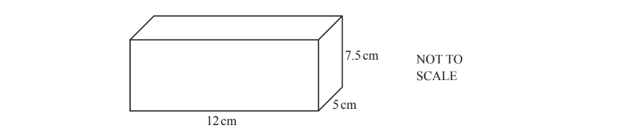

Calculate the total surface area of the cuboid.

................................cm2

*Source: March 2019 0580/12 Q21*

### Q27 — easy — 3 marks

**Q27** [3 marks]

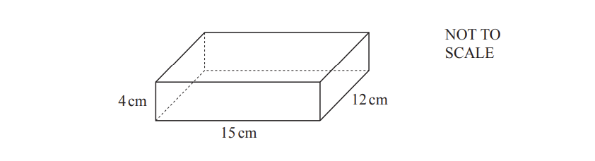

The diagram shows a cuboid measuring 15cm by 12 cm by 4 cm.

Calculate the surface area of the cuboid.

............................................. cm2

*Source: Nov 2019 0580/12 Q16*

### Q28 — easy — 6 marks

**Q28** [6 marks]

The diagram shows a cuboid.

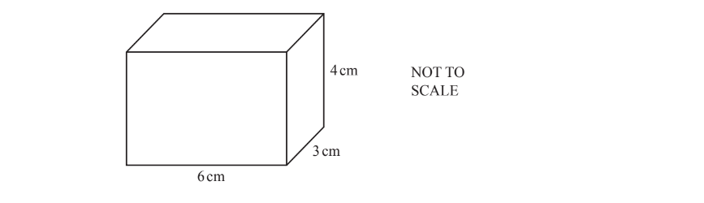

i) Work out the surface area of this cuboid.

.......................... cm2 [3]

ii) Work out the volume of this cuboid.

.............................. cm3 [2]

iii) Write down the dimensions of a different cuboid that has the same volume as this cuboid.

..................... cm by ..................... cm by ..................... cm [1]

*Source: March 2018 0580/32 Q1C*

