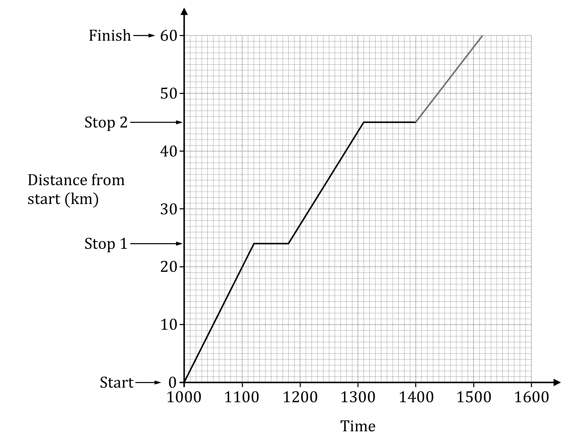

# Mark Schemes — Compound Measures
**Number** · Cambridge (CIE) IGCSE maths (0580 & 0980)

## Exam Questions (16 questions)

### Q1
> **[exam-tip]**
> To calculate average speed, use
> 
> $\mathrm{speed}=\frac{\mathrm{distance}}{\mathrm{time}}$

Find the distance

- The vertical axis goes up in 1 km increments, so the distance from 'Start' to 'Stop 1' is

*24 km*

Find the time

- The horizontal axis has ten divisions per hour
- That means you can read the time off directly as decimal hours

*1.2 hours*

Calculate the speed

$\mathrm{speed}=\frac{24}{1.2}=20$

**Final answer:** **20 km/h**

**[B1]**
(i)

> **[exam-tip]**
> The formula $\mathrm{speed}=\frac{\mathrm{distance}}{\mathrm{time}}$ can be rearranged to give
> 
> $\mathrm{time}=\frac{\mathrm{distance}}{\mathrm{speed}}$

The distance from 'Stop 2' to 'Finish' is

$60-45=15\mathrm{km}$

Therefore the time taken, in hours, is

$\mathrm{time}=\frac{15}{13}$

**[M1]**

$=1.153846...\mathrm{hours}$

You need to convert 0.153846... hours to minutes

- There are 60 minutes in an hour, so multiply by 60

$60\times0.153846...=9.230769...\mathrm{minutes}$

Round to the nearest minute

- The '2' after the decimal point tells you to leave the '9'unchanged

**Final answer:** **1 hour  9 minutes**

**[A1]**

> **[mark-scheme]**
> **M1**: For $\frac{15}{13}$ or 1.153... .
> 
> **A1**: For 1 [hour] 9 [mins].

(ii)

You can try to mark the correct time point on the 'Finish' line at the top of the graph

- It will be about one and a half small divisions to the right of 1500

However it's easier to use the fact that he is travelling 13 km/h

- If he is at distance 45 km at time 1400

  - then he is going to be at distance 58 km (45+13) at time 1500
- So mark the point time 1500, distance 58 on the graph

  - and draw a straight line through it starting at time 1400, distance 45
  - and carrying on until it hits the 'Finish' line

**[B1]**

> **[mark-scheme]**
> **B1**: For a line from (1400, 45) to 'Finish' passing through (1500, 58).

### Q2
> *The density of the block of wood must be calculated, and then compared to the density of water*

> *To find the density, use *$\mathrm{Density}=\frac{\mathrm{Mass}}{\mathrm{Volume}}$

> *The density of water is given in **grams **per **cm**3**, so convert the dimensions of the cuboid to **cm **by multiplying each dimension by 100 Then find the volume*

*Volume = *$20\times20\times10=4000\mathrm{cm}^{3}$

> *Convert the mass to grams by multiplying by 1000*

*Mass = *$3000\mathrm{grams}$

**Converting at least 1 measurement correctly ****[1]**

> *Put the values into the formula to find density*

$\mathrm{Density}=\frac{3000}{4000}=0.75\mathrm{grams} \mathrm{per} \mathrm{cm}^{3}$

**[1]**

> *Compare to density of water and make a conclusion*

**The density of the wood is 0.75 g/cm****3**** which is lower than the density of water,**** ****so the object will float ****[1]**

### Q3
i) *Use Pythagoras' theorem *$c^{2}=a^{2}+b^{2}$* to determine the length of *$AB=c$* where *$a=300km$* and *$b=225km$

$c^{2}=300^{2}+225^{2}$

**[1]**

$c=\sqrt{300^{2}+225^{2}}$

**[1]**

$c=375km$

ii) *Determine the time of the flight by substituting the known values of Speed = *$450 \text{km} ⁄ \mathrm{h}$* and Distance = *$375\mathrm{km}$* into the formula: Time = *$\frac{\mathrm{Distance}}{\mathrm{Speed}}$

*Time = *$\frac{375}{450} = 0.8 \dot{3}$* hours*

**[1]**

> *Convert the number of hours into minutes by multiplying the time by *$60$

$0.8 \dot{3} \times 60$

$=50$* minutes*

**[1]**

> *Add the time on to the departure time for the arrival time*

$1445+50$* minutes*

**[1] **

$1535$ **[1]**

### Q4
> *Use the formula  *$\mathrm{Pressure}=\frac{\mathrm{Force}}{\mathrm{Area}}$

> *The pressure is 0.6 N/cm**2** and the force is 300 N*

> *Write the area as an expression*

*Area = *$20\timesx=20x$

> *Substitute the values into the formula*

$0.6=\frac{300}{20x}$

**Forming an equation in terms of **$x$** [1]**

> *Multiply both sides by *$20x$

$\begin{gathered} 0.6 \times 20 x & = 300 \\ 12 x & = 300 \end{gathered}$

**Method to solve equation**** [1]**

> *Solve for *$x$* by dividing both sides by 12*

$x=25$ **[1]**

### Q5
> *Find the diameter of the wheel by doubling its radius*

$d=2\times25=50\mathrm{cm}$

> *Determine the circumference of the circle (leaving your answer in terms of *$π$*)*

$\begin{array}{rcl} C = \mathrm{\pi } \times d \\ C = 50 \mathrm{\pi } \text{cm} \end{array}$

**[1]**

> *Determine the distance travelled by the car (in centimetres)*

> *Multiply the speed of the car by 100 000 to find the speed in centimetres per hour*

$45\times100000=4500000$

> *Divide the speed by 60 to find the speed in metres per minute*

$4500000+60=75000$* *

> *Multiply the speed of the car by the number of minutes it has travelled for to find the distance that it has travelled in centimetres*

$75000\times5=375000$

**[1]**

> *Determine the number of revolutions by dividing the distance travelled by the circumference of the wheel (in centimetres)*

$\frac{375000}{50π}$

**[1]**

$=2387.324146...$

**[1]**

> *Round down to the nearest integer for the number of full revolutions*

$2387$** [1]**

### Q6
> *Substitute **distance = 8352 **and **speed = 783 **into *$\mathrm{time}=\frac{\mathrm{distance}}{\mathrm{speed}}$* to work out how long the flight takes.*

> * *

$8352\div783=10.666...$

* ***[1]**

> *Multiply 0.666... by 60 to convert into minutes.*

> * *

$0.666...\times60=40$

*10 hours 40 minutes*

**[1]**

> * *

> *Add 10 hours 40 minutes onto 09:52.*

> * *

> $09:52+10\mathrm{hours}=19:52\,\,19:52+40\mathrm{minutes}=20:32$* *

> * *

> *Subtract 2 hours because of the time difference.*

> * *

$20:32-2\mathrm{hours}=18:32$

**[1]**

** **

**18:32**** ****[1]**

### Q7
> *Convert metres into kilometres by dividing by 1000.*

> * *

$2460\div1000=2.46$

> * *

> *Convert minutes into hours by dividing by 60.*

> * *

$33\div60=0.55$

**[1]**

$\mathrm{speed}=\frac{\mathrm{distance}}{\mathrm{time}}$

> *Divide distance (2.46) by time (0.55).*

> * *

$\frac{2.46}{0.55}=4.4727...$

* ***[1]**

> *Round to 3 significant figures.*

> * *

**4.47 km/h** **[1]**

> *answers between 4.472 and 4.473 also accepted*

### Q8
> *Use the formula *$\mathrm{Pressure}=\frac{\mathrm{Force}}{\mathrm{Area}}$

> *To be able to use this formula, find the area of the rectangle first*

$0.8\times1.2=0.96m^{2}$

**[1]**

> *Substitute the values into the formula*

$200=\frac{F}{0.96}$

**[1]**

> *Multiply both sides by 0.96 to find **F*

$F=200\times0.96$

$F=192N$* ***[1]**

### Q9
> *The difference between 09:45 am and 11:15 am is 1 hour and 30 minutes. 30 minutes is the same as half an hour. *
*Convert to hours because the units required are km/h.*

*1 hour and 30 minutes = 1.5 hours*

> *The formula for speed is *$\mathrm{speed}=\frac{\mathrm{distance}}{\mathrm{time}}$*.*

$\mathrm{speed}=\frac{135}{1.5}=90$

**[1]**

**90 km/h ****[1]**

### Q10
> *Convert the speed from metres per second to kilometres per minute*

$20 \times 60 = 1200 \mathrm{m} ⁄ \min$

$1200 \div 1000 = 1.2 \text{km} ⁄ \min$

> *Use the formula Time = *$\frac{\mathrm{Distance}}{\mathrm{Speed}}$* to determine the time in minutes of the journey*

$T = 10 \div 1.2 = 8. \dot{3} \text{mins}$

**[1]**

> *Convert *$0. \dot{3}$* minutes to seconds by multiplying by *$60$

$0. \dot{3} \times 60 = 20 \text{secs}$

**[1]**

> *Write the time in minutes and seconds*

$8$** minutes **$20$** seconds*** ***[1]**

### Q11
> *The density of the block of wood must be calculated, and then compared to the density of water*

> *To find the density, use *$\mathrm{Density}=\frac{\mathrm{Mass}}{\mathrm{Volume}}$

> *The mass is 1360 grams, so we just need to find the volume of the cuboid*

*Volume = *$8\times20\times10=1600\mathrm{cm}^{3}$

**[1]**

> *Put the values into the formula to find density*

$\mathrm{Density}=\frac{1360}{1600}=0.85\mathrm{grams} \mathrm{per} \mathrm{cm}^{3}$

**[1]**

> *Compare to density of water and make a conclusion*

**The density of the wood is 0.85g/cm****3**** which is lower than the density of water, so the object will float ****[1]**

### Q12
> *Convert the time to hours by dividing by *$60$

$20\div60=\frac{1}{3}$

> *Use the formula: Speed = *$\frac{\mathrm{Distance}}{\mathrm{Time}}$* to determine the speed*

$1.5\div\frac{1}{3}$

* *

$4.5$** ****km/h ****[1]**

### Q13
> *Multiply 84 by 1000 to convert into metres (1 km = 1000 m).*

> * *

$84\times1000=84000$

> * *

> *Divide by 60 to convert from hours into minutes.*

> * *

$84000\div60=1400$

* ***[1]**

**1400 m/min** **[1]**

### Q14
> *Use the speed, distance, time triangle to work out the formula for speed.*

> * *

$\mathrm{speed}=\frac{\mathrm{distance}}{\mathrm{time}}$

> * *

> *3 hours 30 minutes = 3.5 hours.*

> *Substitute time = 3.5 and distance = 315 into the formula for speed.*

> * *

$\begin{array}{rcl} \text{speed} = \frac{315}{3.5} \end{array}$

> * *

> *Type into a calculator.*

$\begin{gathered} 315 \div 3.5 & = 90 \end{gathered}$

> * *

**90 km/h ****[1]**

### Q15
> *Use the formula *$\mathrm{Pressure}=\frac{\mathrm{Force}}{\mathrm{Area}}$

$P=\frac{300}{5}$

**[1]**

$P=60$

**[1]**

> *The force was measured in Newtons, and the area was measured in m**2*

> *So the units for force divided by area will be N/m**2*

**60 N/m****2** **[1]**

### Q16
> *There are 60 minutes in an hour, so 12 hours 30 minutes = 12.5 hours.*

> *Substitute **distance = 10050** and **time = 12.5 **into *$\mathrm{speed}=\frac{\mathrm{distance}}{\mathrm{time}}$

> * *

$\frac{10050}{12.5}=804$

> * *

**804 km/h**** ****[1]**
