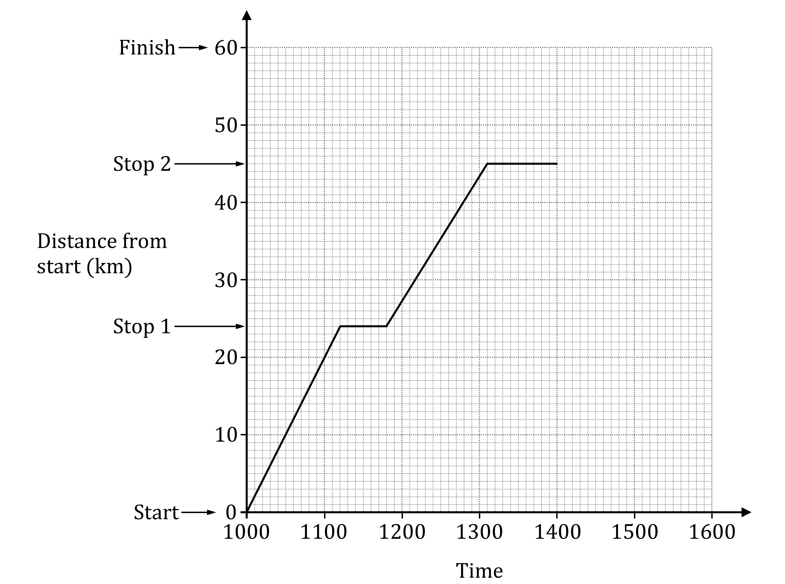
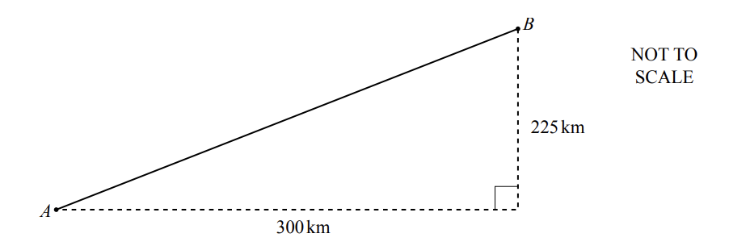

# Exam Questions — Compound Measures
**Number** · Cambridge (CIE) IGCSE maths (0580 & 0980)
> Source: [https://www.savemyexams.com/igcse/maths/cie/25/core/topic-questions/](https://www.savemyexams.com/igcse/maths/cie/25/core/topic-questions/) · 16 questions across 1 sets

## Exam Questions (16 questions)

### Q1 — medium — 4 marks

**Q1** [1 mark]

Andy is doing a 60 kilometre sponsored cycle ride.

He leaves the starting point at 1000, stops briefly at the first stopping point, and then cycles on to the second stopping point.

The travel graph shows Andy's journey.

Find Andy’s average speed, in kilometres per hour, from 'Start' to 'Stop 1'.

....................................... km/h

**Q1** [3 marks]

**Extract:**

Andy is doing a 60 kilometre sponsored cycle ride.

He leaves the starting point at 1000, stops briefly at the first stopping point, and then cycles on to the second stopping point.

The travel graph shows Andy's journey.

Graph showing distance over time, with stops at 24 km and 45 km. Vertical axis (distance) goes from 0 km to 60 km, horizontal axis (time) goes from 1000 to 1600. Part of journey from Start to Stop 2 is shown. 'Finish' is marked at 60 km.

Andy leaves 'Stop 2' at 1400.
He continues to the Finish point at a constant speed of 13 kilometres per hour.

(i) Calculate the time Andy takes to travel from 'Stop 2' to 'Finish'.
`space space space space`Give your answer in hours and minutes, correct to the nearest minute.

....................... h ....................... min [2]

(ii) On the travel graph, complete Andy's journey.

[1]

### Q2 — hard — 3 marks

**Q2** [3 marks]

$\mathrm{Density}=\frac{\mathrm{Mass}}{\mathrm{Volume}}$

If an object has a lower density than water, it will float.

A cuboid-shaped block of wood measures 0.2 **m **wide, 0.2 **m **long, and 0.1 **m **high, and has a mass of 3 **kilograms**.

Assuming the density of water is 1 **gram** per **cm****3**, determine if the block of wood will float or not.

Show your working clearly.

### Q3 — hard — 6 marks

**Q3** [6 marks]

The diagram shows the path of a plane from airport $A$ to airport $B$.

i) Show that the distance between $A$and $B$ is 375km.

[2]

ii) The plane flies at an average speed of 450km/h. It leaves $A$ at 1445 and flies directly to $B$.

Work out the time the plane arrives at $B$.

[4]

*Source: Specimen 2020 0580/03 Q8D*

### Q4 — hard — 3 marks

**Q4** [3 marks]

$\mathrm{Pressure}=\frac{\mathrm{Force}}{\mathrm{Area}}$

A force of 300 N is exerted on a rectangle of width 20 cm, and length $x$ cm.

The pressure on the rectangle is 0.6 N/cm2.

Find the value of $x$.

### Q5 — hard — 5 marks

**Q5** [5 marks]

A car travels at a constant speed of 45 kilometres per hour for 5 minutes. 
Each wheel of the car has radius 25 centimetres.

Calculate the number of complete revolutions that a wheel makes during the 5 minutes.

*Source: March 2020 0580/12 Q19*

### Q6 — hard — 4 marks

**Q6** [4 marks]

The plane flies from Melbourne to Tokyo at an average speed of 783 km/h. 
The distance from Melbourne to Tokyo is 8352 km. 
The plane leaves Melbourne at 0952 local time. 
The local time in Tokyo is 2 hours behind the local time in Melbourne.

Find the local time in Tokyo when the plane arrives.

*Source: June 2020 0580/32 Q2C*

### Q7 — medium — 3 marks

**Q7** [3 marks]

Ramond walks 2460 metres in 33 minutes.

Work out Ramond’s average speed in kilometres per hour.

........................................ km/h

*Source: Nov 2020 0580/13 Q18*

### Q8 — medium — 3 marks

**Q8** [3 marks]

$\mathrm{Pressure}=\frac{\mathrm{Force}}{\mathrm{Area}}$

A force, *F* Newtons, is applied to a rectangle which is 0.8 m wide, and 1.2 m long.

The pressure on the rectangle is 200 N/m2.

Find the value of *F*.

*F* = ......................................... N

### Q9 — medium — 2 marks

**Q9** [2 marks]

Kiran leaves home at 9.45 am. 
She drives 135 km to visit a friend. 
She arrives at her friend’s house at 11.15 am.

Work out her average speed in km/h.

........................................... km/h

*Source: Nov 2019 0580/12 Q11*

### Q10 — medium — 3 marks

**Q10** [3 marks]

A car travels at a constant speed of 20 m/s.

Work out the time it takes for the car to travel 10 km. 
Give your answer in minutes and seconds.

..................... minutes ..................... seconds

*Source: June 2019 0580/11 Q18*

### Q11 — medium — 3 marks

**Q11** [3 marks]

$\mathrm{Density}=\frac{\mathrm{Mass}}{\mathrm{Volume}}$

If an object has a lower density than water, it will float.

A cuboid-shaped block of wood measures 8 cm wide, 20 cm long, and 10 cm high, and has a mass of 1360 grams.

Assuming the density of water is 1 gram per cm3, determine if the block of wood will float or not.

Show your working clearly.

### Q12 — easy — 1 marks

**Q12** [1 mark]

Ivan walks 1.5 km from his home to Kingswood Park. 
He takes 20 minutes.

Work out Ivan’s average speed in kilometres per hour.

....................................... km/h

*Source: Specimen 2020 0580/03 Q1B*

### Q13 — easy — 2 marks

**Q13** [2 marks]

A speedboat travels at 84 kilometres per hour.

Change this speed into metres per minute.

...................................... m/min

*Source: June 2020 0580/33 Q9A*

### Q14 — easy — 1 marks

**Q14** [1 mark]

George drives 315 km from the café to the airport. 
The journey takes 3 hours 30 minutes.

Calculate his average speed.

......................................... km/h

*Source: Nov 2020 0580/32 Q1F*

### Q15 — easy — 3 marks

**Q15** [3 marks]

$\mathrm{Pressure}=\frac{\mathrm{Force}}{\mathrm{Area}}$

An object exerts a force of 300 N on an area of 5 m2.

Find the pressure on the area, stating appropriate units.

### Q16 — easy — 1 marks

**Q16** [1 mark]

The distance between Madrid and Buenos Aires is 10050km. Diego’s return flight takes 12 hours 30 minutes.

Calculate the average speed, in km/h, for the return flight.

........................................ km/h

*Source: June 2020 0580/11 Q6C*

