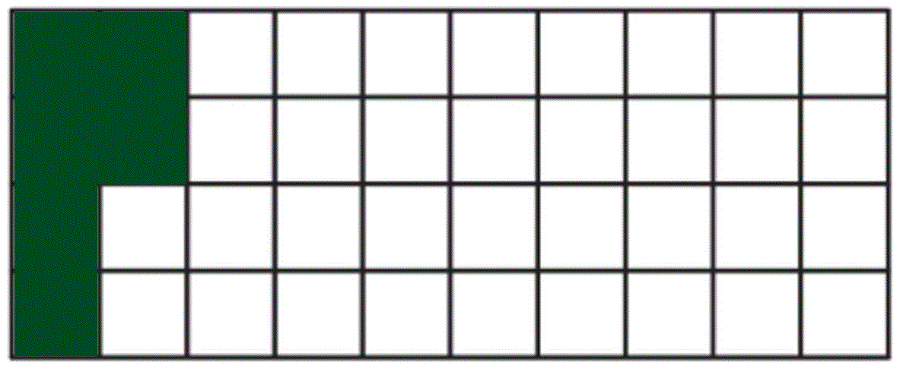

# Mark Schemes — Fractions, Decimals & Percentages
**Number** · Cambridge (CIE) IGCSE maths (0580 & 0980)

## Exam Questions (27 questions)

### Q1
> *In a calculator, write*

$\frac{3}{10}\times100$

`30 percent sign`

**[B1]**

### Q2
> *Convert all the numbers into the same form*

$0.510.50.5010.480.4$

**[M1]**

> *Now order the numbers by comparing the decimals*

$0.40.480.50.5010.51$

`2 over 5 space space space space space 48 percent sign space space space space 0.5 space space space space 0.501 space space space space 0.51`

**[A1]**

### Q3
> *"percent" means "out of *$100$*", therefore*

`45 percent sign`* = *$\frac{45}{100}$

> *To simplify, find a common factor of *$45$* and *$100$* and divide both by the factor*

$\frac{45\div5}{100\div5}$

$\frac{9}{20}$

> **[exam-tip]**
> Remember to check to see if there are any more common factors. For these numbers, there are not.

$\frac{9}{20}$

**[B1]**

### Q4
> *Using a calculator turn the fraction into a decimal by doing the division*

`6 over 11 equals 0.5 with dot on top 4 with dot on top`

> *Turn the percentage into a decimal by dividing the number by 100 *$54\frac{1}{2}=54.5$

$54.5\div100=0.545$

> *Write the three numbers to the same number of decimal places and compare*

`0.5500 comma space 0.54 5 with dot on top 4 with dot on top comma space 0.5450`

`0.5450 less than 0.54 5 with dot on top 4 with dot on top less than 0.5500`

> *Write the original numbers in the order of smallest to largest*

`bold 54 bold 1 over bold 2 bold percent sign bold comma bold space bold 6 over bold 11 bold comma bold space bold 0 bold. bold 55`* ***[1]**

### Q5
> *Convert each number to a decimal to make them easier to compare*

> *Use your knowledge of recurring decimals to rewrite *$\frac{7}{9}$* as a decimal Alternatively you could work this out using short division, and noticing that the same remainder will be left after each step*

`7 over 9 equals 0.777... equals 0.7 with dot on top`

> *Use equivalent fractions to rewrite *$\frac{4}{5}$* in a format which is easier to calculate*

$\frac{4}{5}=\frac{8}{10}=0.8$

> *Use equivalent fractions to rewrite *$\frac{17}{20}$* in a format which is easier to calculate*

$\frac{17}{20}=\frac{17\times5}{20\times5}=\frac{85}{100}=0.85$  *or *$\frac{17}{20}=\frac{8.5}{10}=0.85$

> *Rewrite 78% as a decimal by dividing by 100*

$78\div100=0.78$

*Write all the numbers as decimals to compare them* *It can help to write them all to the same number of decimal places*

$0.77...,0.80,0.85,0.78$

*In order: *$0.77...,0.78,0.80,0.85$

> *For the final answer, rewrite in their original format*

`bold 7 over bold 9 bold comma bold space bold 78 bold percent sign bold comma bold space bold 4 over bold 5 bold comma bold space bold 17 over bold 20` **[2] **
**1 mark for 3 numbers in correct order**

### Q6
> *Use a calculator to convert the fractions to decimals*

$\frac{22}{7}=3.1428...$

$\frac{333}{106}=3.1415...$

> *Write each number using 4 decimal places*

`table row cell 22 over 7 space end cell equals cell 3.1428... end cell row cell 3.142 end cell equals cell 3.1420 end cell row cell 333 over 106 end cell equals cell 3.1415... end cell row cell 3.1416 end cell equals cell 3.1416 end cell end table`

**[1]**

> *Write in order from smallest to largest by comparing the place value columns*

$\frac{333}{106},3.1416,3.142,\frac{22}{7}$**[1]**

### Q7
(i) *An increase of 12.5% means we need to find 112.5% of the number of seats in section A*

> *Find the multiplier by dividing 112.5 by 100*

> $112.5\div100=1.125$*  *

> *Multiply the number of seats in section A, 152, by 1.125*

$152\times1.125=171$

*171** ***[1]**

(ii) *Find the number of seats in section C by finding *$\frac{3}{8}$* of 152*

$152\times\frac{3}{8}=57$

* ***[1]**

> *Add together the numbers of seats from sections A, B and C*

$152+171+57=380$

**380** **[1]**

### Q8
> *Convert all of the numbers into decimals using a calculator*

> *Type *$\frac{13}{201}$* into a calculator*

$\frac{13}{201}=0.0646...$

> *Divide 5.6% by 100 to express as a decimal*

$5.6\div100=0.056$

> *0.065 is already expressed as a decimal*

> *Type *$\frac{5}{89}$* into a calculator*

$\frac{5}{89}=0.0561...$

> * *

> *Order the numbers 0.0646... , 0.056, 0.065 and 0.0561... from smallest to largest*

> * *

$0.0560.561...0.0646...0.065$

> * *

> *Use this to write the numbers **from the question **in order on the answer line*

> * *

`bold 5 bold. bold 6 bold percent sign bold comma bold space bold 5 over bold 89 bold comma bold space bold 13 over bold 201 bold comma bold space bold 0 bold. bold 065`* ***[2]**

**One mark for three numbers in the correct order**

### Q9
> *Use a calculator to convert each value to a decimal to compare*

$5.7\times10^{-1}=0.57$

`4 over 7 equals 0.5 with dot on top 7142 8 with dot on top`

$\sqrt{0.33}=0.5744562647$

`57.2 percent sign equals 0.572`

**[1]**

> *Compare these numbers*

`0.57 less than 0.5 with dot on top 7142 8 with dot on top less than 0.572 less than 0.5744562647`

> *Write the original numbers in this order*

`bold 5 bold. bold 7 bold cross times bold 10 to the power of bold minus bold 1 end exponent bold less than bold 4 over bold 7 bold less than bold 57 bold. bold 2 bold percent sign bold less than square root of bold 0 bold. bold 33 end root` **[2] **
**1 mark for any 3 in the correct order**

### Q10
> *Convert each number to a decimal then compare*

`5 over 27 equals 0.1 with dot on top 8 5 with dot on top`

`18.4 percent sign equals 0.184`

$1.83\times10^{-1}=0.183$

$5^{-1}=\frac{1}{5^{1}}=\frac{1}{5}=0.2$

`bold 1 bold. bold 83 bold cross times bold 10 to the power of bold minus bold 1 end exponent bold less than bold 18 bold. bold 4 bold percent sign bold less than bold 5 over bold 27 bold less than bold 5 to the power of bold minus bold 1 end exponent` **[2]**

**1 mark for any 3 correct conversions to a decimal**

### Q11
> *Convert all of the numbers into decimals using a calculator*

> *Divide 27 by 100 to express as a decimal.*

$27\div100=0.27$

> *Type *$\frac{5}{17}$* into a calculator*

$\frac{5}{17}=0.2941...$

> *0.268 is already expressed as a decimal*

> *Type *$\frac{7}{29}$* into a calculator*

$\frac{7}{29}=0.2413...$

> * *

> *Order the numbers 0.27, 0.2941..., 0.268 and 0.2413... from smallest to largest.*

> * *

$0.2413...0.2680.270.2941...$

> * *

> *Use this to help write the numbers **from the question **on the answer line.*

> * *

`bold 7 over bold 29 bold comma bold space bold 0 bold. bold 268 bold comma bold space bold 27 bold percent sign bold comma fraction numerator bold space bold 5 over denominator bold 17 end fraction`* ***[2]**

**One mark for three numbers in the correct order**

### Q12
> *Determine *`18 percent sign`* of the total number of cakes using a multiplier of 0.18 on your calculator*

$600\times0.18=108$

**[1]**

> *Find *$\frac{2}{3}$* of the total number of cakes using your calculator*

$600\times\frac{2}{3}=400$

> *Subtract the number of cakes given out from the total number of cakes to determine how many there are left*

`600 minus open parentheses 108 plus 400 close parentheses`

**[1]**

$92$ **[1]**

### Q13
> *Convert each number to a decimal to make them easier to compare*

> *Use equivalent fractions to rewrite *$\frac{18}{20}$* in a format which is easier to calculate*

$\frac{18}{20}=\frac{9}{10}=0.9$

*or* $\frac{18}{20}=\frac{18\times5}{100}=\frac{90}{100}=0.9$

> *To convert 91% to a decimal, divide by 100*

$91\div100=0.91$

> *0.89 is already a decimal*

> *Use equivalent fractions to rewrite *$\frac{44}{50}$* in a format which is easier to calculate*

$\frac{44}{50}=\frac{88}{100}=0.88$

*Write all the numbers as decimals to compare them* *It can help to write them all to the same number of decimal places*

$0.90,0.91,0.89,0.88$

*In order: *$0.88,0.89,0.90,0.91$

> *For the final answer, rewrite in their original format*

`bold 44 over bold 50 bold comma bold space bold 0 bold. bold 89 bold comma bold 18 over bold 20 bold comma bold space bold 91 bold percent sign` **[2] **
**1 mark for 3 numbers in correct order**

### Q14
> *When comparing fractions, decimals, and percentages, convert them all to decimals first to make them easier to compare Type any fractions into your calculator as a division*

$\frac{5}{7}=5\div7=0.7142...$

$\frac{7}{8}=0.875$

**[1]**

> *To convert a percentage to a decimal, divide by 100*

`78 percent sign space divided by space 100 space equals space 0.78`

> *0.8 is already a decimal*

> *Write these in order in their decimal form*

$0.7142...,0.78,0.8,0.875$

> *Write these in their original form*

`bold 5 over bold 7 comma space space bold 78 bold percent sign bold comma bold space bold space bold 0 bold. bold 8 bold comma bold space bold 7 over bold 8` **[1]**

### Q15
> *Convert all of the numbers into decimals using a calculator*

> *Type *$\frac{11}{27}$* into a calculator*

$\frac{11}{27}=0.4074...$

> * *

> *Divide 41 by 100 to express as a decimal*

$41\div100=0.41$

> *0.4 is already expressed as a decimal*

> *Type *$\frac{16}{39}$* into a calculator*

$\frac{16}{39}=0.4102...$

> * *

> *Order the numbers 0.4074..., 0.41, 0.4 and 0.4102... from smallest to largest*

> * *

$0.40.4074...0.410.4102...$

> * *

> *Use this to help write the numbers **from the question **on the answer line*

> * *

`bold 0 bold. bold 4 bold comma fraction numerator bold space bold 11 over denominator bold 27 end fraction bold comma bold space bold 41 bold percent sign bold comma fraction numerator bold space bold 16 over denominator bold 39 end fraction`* ***[2]**

**one mark for three numbers in the correct order**

### Q16
> *If comparing a mixture of fractions, decimals, and percentages, convert everything to decimals first*

> *Using a calculator*

$\frac{9}{19}=0.4737...$

$\frac{3}{7}=0.4286...$

> *To convert a percentage to a decimal, divide by 100*

$37\div100=0.37$

> *0.43 is already a decimal*

> *To write decimals in order of size, write them in a column with their digits lined up *
*It can be useful to fill in the zeros so they have the same number of decimal places*

$0.4737...\,0.4286...\,0.3700\,0.4300$

** ****[1]**

> *Looking at the tenths column, we can clearly see that 0.37 is the smallest. Looking at the hundredths column, we can see that 2 is the smallest number in that column, so 0.4286... is the next smallest. Next we have 0.43, and finally 0.4737... Writing these in order in decimal form, we have*

$0.37<0.4286...<0.43<0.4737...$

> *Writing these in their original form we have*

`bold 37 bold percent sign bold space bold less than bold space bold 3 over bold 7 bold space bold less than bold space bold 0 bold. bold 43 bold space bold less than bold 9 over bold 19` **[1] **

### Q17
> *Use a calculator to convert each of these values to a decimal*

$\frac{3}{4}=0.75$

`76 percent sign equals 0.76`

`11 over 15 equals 0.7333... equals 0.7 3 with dot on top`

**[1]**

> *The decimal equivalent of each number listed are*

`0.75 comma space 0.749 comma space 0.76 comma space 0.7 3 with dot on top`

> *Each number contains 7 tenths but a different hundredths place value digit so order these from smallest to largest using this digit*

`0.7 3 with dot on top comma space 0.749 comma space 0.75 comma space 0.76`

> *Write the original values for the solution*

`bold 11 over bold 15 bold comma bold space bold 0 bold. bold 749 bold comma fraction numerator bold space bold 3 over denominator bold 4 end fraction bold comma bold space bold 76 bold percent sign`** [1]**

### Q18
> *Convert each fraction to a decimal *

`1 third equals 0.33333... equals 0.3 with dot on top`

$\frac{3}{10}=0.3$

> *Convert the percentage to a decimal by dividing by 100*

`33 percent sign equals 33 over 100 equals 0.33`

> *All of the decimal values are:*

`0.3030 comma space 0.3 with dot on top comma space 0.0330 comma space 0.3 comma space 0.33`

> *It can help to write them to the same number of decimal places*

$0.3030,0.3333...,0.0330,0.3000,0.3300$

> *The largest decimal number is *`0.3 with dot on top`* which is the fraction *$\frac{1}{3}$

$\frac{1}{3}$ **[1]**

### Q19
> *Write an equivalent fraction with the denominator of *$100$

$\frac{2}{5}=\frac{2\times20}{5\times20}=\frac{40}{100}$

> *Write down the numerator with a % sign*

`bold 40 bold percent sign` **[1]**

### Q20
> *Convert each number to a decimal to make them easier to compare*

$\frac{3}{4}$* is a common result, and one you should remember* *Alternatively you can write it as a fraction out of 100 instead*

$\frac{3}{4}=\frac{75}{100}=0.75$

> *To convert 72% to a decimal, divide by 100*

$72\div100=0.72$

> *0.78 is already a decimal*

> $\frac{8}{10}$* can be found by simply dividing 8 by 10, or by writing as a fraction out of 100*

$\frac{8}{10}=\frac{80}{100}=0.8$

*Write all the numbers as decimals to compare them* *It can help to write them all to the same number of decimal places*

$0.75,0.72,0.78,0.80$

*In order: *$0.72,0.75,0.78,0.80$

> *For the final answer, rewrite in their original format*

`bold 72 bold percent sign bold comma bold space bold 3 over bold 4 bold comma bold space bold 0 bold. bold 78 bold comma bold space bold 8 over bold 10` **[2] **
**1 mark for 3 numbers in correct order**

### Q21
> $0.45$* is the same as *$45$* hundredths which is written as *

$\frac{45}{100}$

> *Divide both parts of the fraction by the highest common factor, *$5$

$\frac{45\div5}{100\div5}=\frac{9}{20}$

$\frac{9}{20}$** [1]**

### Q22
> *To convert 0.75 to a percentage, multiply by 100*

`0.75 space cross times space 100 space equals space 75 percent sign`

> *To convert 20% to a fraction, write it over 100 (because "percent" means "out of 100"), and then simplify*

`20 percent sign thin space equals 20 over 100 space equals 10 over 50 equals 1 fifth`

> *To convert 8% to a decimal, divide by 100*

$8\div100=0.08$

| Fraction |   | Decimal |   | Percentage |
|---|---|---|---|---|
| $\frac{3}{4}$ | = | 0.75 | = | **75%** |
| $\frac{1}{5}$ | = | 0.2 | = | 20% |
| $\frac{2}{25}$ | = | **0.08** | = | 8% |

**1 mark for each correct value*** ***[3]**

### Q23
> $\frac{1}{4}$* is a common fraction. It is half of a half.*

**0.25**** ****[1]**
> *Divide the numerator and denominator by the same number. *

$\frac{36\div4}{124\div4}=\frac{9}{31}$

> *There are no more common factors.*

$\frac{9}{31}$ **[1]**
> *Work out *$\frac{1}{8}$* by dividing by 8.*

$128\div8=16$

> *Work out *$\frac{5}{8}$* by multiplying by 5.*

$16\times5=80$

**80**** ****[1]**

### Q24
(i) *Divide 15% by 100 to express as a decimal.*

> * *

$15\div100=0.15$

> * *

$0.15$* ***[1]**

(ii) *Work out how many squares are in the grid by multiplying the length by the width*

> * *

$10\times4=40$

> * *

> *Work out 15% of 40*

> * *

`table attributes columnalign right center left columnspacing 0px end attributes row cell 10 percent sign space of space 40 space end cell equals cell space 4 end cell row cell 5 percent sign thin space of space 40 space end cell equals cell space 2 end cell row cell So space 15 percent sign space of space 40 space end cell equals cell space 4 plus 2 equals 6 end cell end table`

> * *

> *Shade 6 squares.*

> * *

**[1]**

### Q25
i) *To convert from a percentage to a decimal, divide by 100*

$\frac{26}{100}=0.26$

**0.26**** ****[1]**

ii) $0.48$* is the same as *$48$* hundredths*

$\frac{48}{100}$ **[1] **
**Or equivalent answers, e.g. **$\frac{24}{50},\frac{12}{25}$
i) *Multiply the numerator and the denominator by the same value*

$\frac{5\times2}{9\times2}=\frac{10}{18}$

$\frac{10}{18}$** [1] **
**Or any other equivalent fraction, e.g. **$\frac{15}{27}$

ii) *The first *$7$* odd positive numbers are*

$1,3,5,7,9,11,13$

$13$ **[1]**

iii) *Write each number with 1 extra decimal place to help determine a value between these numbers*

$0.04670$* to *$0.04680$

$0.04675$ **[1]**

### Q26
> *This should be a result you know from memory Writing as a fraction out of 100 can also help*

$\frac{3}{4}=\frac{3\times25}{4\times25}=\frac{75}{100}$

** 0.75** **[1]**

### Q27
> *Use equivalent fractions*

$\frac{2}{5}=\frac{4}{10}$

> *Now find 4 divided by 10 *

$0.4$* ***[1]**
