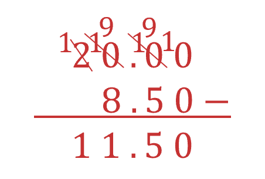
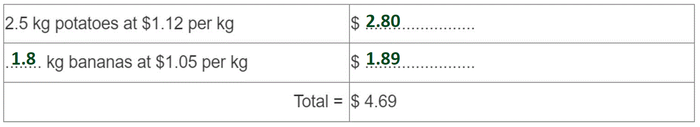
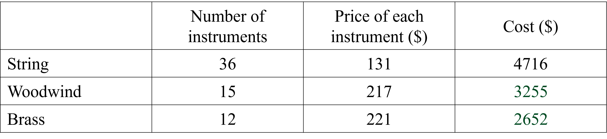

# Mark Schemes — Money Calculations
**Number** · Cambridge (CIE) IGCSE maths (0580 & 0980)

## Exam Questions (24 questions)

### Q1
> *Multiply the hours worked by how much he is paid per hour*

$26\times13.5=351$

`£ 351`

**[B1]**
> *Each extra hour, he is paid*

$13.5\times1.5=20.25$

> *The total amount Jimmy is paid for the additional 10 hours*

$20.25\times10=202.5$

**[M1]**

> *The total amount jimmy is paid *

$351+202.5=553.5$

`£ 553.50`

**[A1]**

### Q2
> *Total cost of the meal is *

$5.49+1.50=6.99$

**[M1]**

> *Find the change left from £10*

$10-6.99=3.01$

`£ 3.01`

**[A1]**

### Q3
> *Divide the total amount by the price of each item*

$13\div1.9=6.84...$

> **[exam-tip]**
> Because there can only be a whole number of bottles, you could also multiply 1.9 by a whole number to find how many bottles Mark is able to purchase.
> 
> $1.9\times5=9.5\,1.9\times6=11.4\,1.9\times7=13.3$
> 
> Mark only has \$13 to spend, therefore he can only purchase six bottles.

**[M1]**

> *There can only be a whole number of bottles, therefore Mark can buy *$6$* bottles*

> *To calculate Marks total purchase, multiply the number of bottles by the price per bottle*

$6\times1.9=11.4$

> *To find the amount Mark has left over, subtract this from his initial amount*

$13-11.4=1.6$

**Final answer:** **Mark can purchase 6 bottles and will have **`$`**1.60 left over**

**[A1 A1]**

### Q4
> *Using a calculator*

$4.79\times6=28.74$

`£ 28.74`

**[B1]**
> *The group requires 12 burgers but since they can get four for the price of three, they only need to pay for nine*

$4.79\times9=43.11$

**[M1]**

> *Dividing this by 12 to get the price per person*

$43.11\div12=3.59$

`£ 3.59`

**[A1]**

### Q5
> *Divide the total distance by the distance per litre*

$320\div10=32$

**Final answer:** **Total litres needed is 32 L**

**[B1]**
> *Multiply the litres she will need by the price per litre*

`32 cross times 1.5 equals £ 48`

**[B1]**

### Q6
> *The tank is a quarter full, so it needs three quarters of a tank to fill it up.*

> *Find *$\frac{3}{4}$* of 52 by multiplying the number by the fraction.*

> * *

$52\times\frac{3}{4}=39$

**[1]**

> *Multiply 39 by the cost per litre, \$2.18.*

> * *

$39\times2.18=85.02$

* ***[1]**

** ****\$85.02 ****[1]**

### Q7
i) *Determine the time duration of his visit*

*11:40 + 20 minutes = 12:00*

*12:00 + 3 hours = 15:00*

*15:00 + 30 minutes = 15:30*

*20 minutes + 3 hours + 30 minutes*

*= 3 hours and 50 minutes*

> * *

> *Read the value from the table for the time taken between 2 and 4 hours*

`bold $ bold 4 bold. bold 50`** [1]**

iia) *The earliest time possible is the longest time prior to 17:50 that costs \$8.50.*

> *From the table, subtract 8 hours from this time*

*17:50 - 8 hours = 09:50*

**09:50**** ****[1]**

iib) *Subtract *`$ 8.50`* from *`$ 20`* using a formal written method*

**\$ 11.50**** [1]**

iii) *Use the table to determine the cost for each time*

$17$* minutes = Free*

$6\frac{1}{2}$* hours = *`$ 8.50`

$11$* hours = *`$ 12.00`

$9\frac{1}{4}$* hours = *`$ 12.00`

> *Determine the total cost by adding these together*

`8.50 plus 12 plus 12 equals $ 32.50`

**[1]**

> *Subtract the cost of the weekly ticket from this amount*

`32.50 minus 26.00 equals $ 6.50`

**[1]**

`bold $ bold 6 bold. bold 50` **[1]**

### Q8
> *Multiply the cost of leeks by how many kilograms of leeks he buys.*

> * *

`$ 2.65 cross times 2.8 equals $ 7.42`

**[1]**

> *Subtract the cost of leeks from the total cost.*

> * *

`$ 13.72 minus $ 7.42 equals $ 6.30`

> * *

> *Divide the cost of the potatoes by how many kilograms he bought.*

> * *

`$ 6.30 divided by 3.6 equals $ 1.75`

**[1]**

`bold $ bold 1 bold. bold 75`* ***[1]**

### Q9
i) *Calculate the cost of each parcel*

*55 g lies in the group *$0<m\leq60$*, this small parcel costs \$0.76*

*0.3 kg = 300 g lies in the group *$250<m\leq1000$*, this extra large parcel costs *
*\$5.60*

*875 g lies in the group *$250<m\leq1000$*, this extra large parcel costs \$5.60*

*250 g lies in the group *$100<m\leq250$*, this large parcel costs \$2.20*

**[1]**

> *Find the total amount by adding the cost of each parcel*

$0.76+5.60+5.60+2.20=14.16$

**[1]**

> *Subtract this amount from *`$ 20`* to calculate the change*

$20-14.16=5.84$

**[1]**

**\$5.84*** ***[1]**

** **iia) *Calculate *`5 percent sign`* of *`$ 5.60`* by dividing by 100 and multiplying by 5.*

> $\frac{5}{100}\times5.60=0.28$* *

**\$ 0.28**** [1]**

iib) *A percentage of an amount is directly proportional to the amount*

**A 5% increase will be less for a lower priced item than a higher priced item**** [1] **

### Q10
> *Calculate the area of paint covered per tin by multiplying the area covered per litre by the number of litres in a tin*

$4.5\times2.5=11.25$

**[1]**

> *  Calculate the number of tins needed (rounded to the nearest whole number) by dividing the total area of the wall by the amount of wall covered per tin  *

`53 divided by 11.25 equals 4.7 1 with dot on top`* tins*

**[1]**

*5 tins*

**[1]**

** **

> *Calculate the total cost by multiplying the number of tins by the cost per tin*

*   *$5\times24.75$

**   ****\$123.75**** [1]**

### Q11
> *Calculate the cost of 2 adults and 4 children*

$32.40+32.40+24.40+24.40+24.40+24.40=162.40$

**[2]**

**1 mark each for calculating the cost of the adult tickets or the child tickets**

> *Calculate the cost of a family ticket plus one extra child ticket*

$115+24.40=139.40$

> *Calculate the difference between these values to determine the saving*

$162.40-139.40=23$

**[1]**

`bold $ bold space bold 23 bold. bold 00`** [1]**
> *Determine the number of minutes from 12:40 to 13:00*

*12:40 + 20 minutes = 13:00*

> *Determine the number of hours between 13:00 and 17:00*

*13:00 + 4 hours = 17:00*

> *Determine the number of minutes between 17:00 and 17:35*

*17:00 + 35 minutes = 17:35*

> *Add these times together*

*4 hours + 20 minutes + 35 minutes = 4 hours 55 minutes*

**4 h 55 min ****[1]**
> *Divide the number of ringgits by the exchange rate*

$318\div4.24=75$

**[1]**

`bold $ bold space bold 75 bold. bold 00`** [1]**

### Q12
> *Multiply 2.5 by 1.12 to work out the cost of potatoes.*

$2.5\times1.12=2.8$

> * *

> *Subtract 2.80 (cost of potatoes) from the total cost, 4.69.*

> * *

$4.69-2.80=1.89$

> * *

> *Divide 1.89 (cost of bananas) by 1.05 (cost per kg).*

> * *

$1.89\div1.05=1.8$

> * *

> *Put the values into the correct places in the table.*

> *2.8 is a cost in dollars, so it needs 2 decimal places.*

> * *

**one mark for each ****[3]**

### Q13
> *i) Add together the cost of one adult ticket and two children's tickets*

`$ 15.30 space plus thin space $ 6.50 space plus thin space $ 6.50`

**[1]**

**\$28.30** **[1]**

> *ii) Find the cost of two programmes*

`2 space cross times space $ 3.75 space equals space $ 7.50`

> *Subtract this from \$10*

`$ 10 space minus space $ 7.50`

**[1]**

**\$2.50** **[1]**

> *iii) Work out the answer as a decimal by using your calculator to divide the numbers, then multiply by 100 to convert it into a percentage*

$\frac{540}{630}\times100=85.714...$

**Final answer:** ** ****85.7% ****[1]**

> *iv) To add 1 hour and 50 minutes, add 2 hours, and then subtract 10 minutes.*

*14:55 pm + 2 hours = 16:55 pm*

*16:55 pm - 10 minutes = 16:45 pm*

**16 45**** ****[1]**

> *v) The journey took 1 hour and 12 minutes. 1 hour = 60 minutes. Convert the minutes into hours.*

$12\div60=0.2\mathrm{hours}$

**[1]**

> *The total time is 1.2 hours. Using the formula speed = distance ÷ time,*

$66\div1.2=55\mathrm{km} \mathrm{per} \mathrm{hour}$

**[1]**

**55 km/h**** ****[1]**

### Q14
> *Multiply the price for a **cup of tea** by **2**.*

> * *

$2.20\times2=4.40$

> * *

> *Add on the price of a **bottle of juice **and the price of a** bottle of water**.*

> * *

$4.40+1.50+1.35=7.25$

> * *

> *Subtract from **\$10** to find the amount of change.*

> * *

$10-7.25=2.75$

**[1]**

* **\$2.75 ***[1]**

### Q15
> *Work out the total number of hours worked.*

$4\times38+2\times50=202\mathrm{hours} \mathrm{worked}$

> *Multiply by the amount paid per hour.*

`202 space cross times space 11.40 space equals space $ 2302.80`

** ****[1]**

**\$2302.80** **[1]**

### Q16
> *Work out the cost of the parking for the weekdays by multiplying the number of weekdays (9) by the cost per day (\$14).*

> * *

$9\times14=126$

**[1]**

** **

> *Work out the cost for the weekends by multiplying the number of weekend days (3) by the cost per day (\$8).*

> * *

$3\times8=24$

> * *

> *Add the costs together.*

> * *

$126+24=150$

* ***[1]**

**\$150 ****[1]**
> *Add together the costs and subtract from \$120.*

> * *

`120 minus open parentheses 53 plus 65 close parentheses equals 2`

**[1]**

**\$2** **[1]**

### Q17
> *Work out the cost per litre for each bag by dividing the cost by the number of litres in the bag.*

> * *

*Small bag: *$5.82\div30=0.194$

*Medium bag: *$9.45\div50=0.189$

*Large bag: *$14.50\div75=0.1933...$

* ***[2]**

> *Best value means cheapest per litre, so look for the smallest number.*

> * *

**Medium ****[1]**

> *working out must be shown to gain any marks*

### Q18
i) *Multiply the pay per hour by the number of hours to determine the amount she is paid each week*

$8.25\times34=280.50$

**\$ 280.50 ****[1]**

> *Multiply the pay per hour by *$1.5$* to determine the pay per hour for the extra hours*

$8.25\times1.5=12.375$

> *Multiply this value by the number of extra hours she works*

`12.375 cross times 8 equals $ 99` *extra*

**[1]**

> *Add this extra amount onto her weekly pay*

$280.50+99=379.50$

**\$ 379.50**** ****[1]**

### Q19
> *Determine the total cost of the 6 apples*

`6 cross times 32 equals 192 space cents space equals $ 1.92`

**[1]**

> *Subtract this amount from \$10 to determine the change*

`10 minus 1.92 equals $ 8.08`

**\$ 8.08**** ****[1]**
> *Determine the cost of the green grapes and the red grapes by multiplying the cost by the mass*

`0.6 cross times 3.1 equals $ 1.86`

**[1]**

`3 over 4 cross times 2.8 equals $ 2.10`

> *Add these values together to get the total cost*

`1.86 plus 2.10 equals $ 3.96`

**[1]**

`bold $ bold 3 bold. bold 96`** [1]**
> *Use the formula: Percentage = *$\frac{\mathrm{Amount}}{\mathrm{Total}}$$\times100$* where the amount is *`$ 12`* and the total is *`$ 75`

`12 over 75 cross times 100 equals 16 percent sign`

**Final answer:** **16 % ****[1]**
> *Calculate *`60 percent sign`* of the amount and add this onto the original amount*

`open parentheses 1.5 cross times 0.6 close parentheses plus 1.5 equals $ 2.40`

**[1]**

`bold $ bold 2 bold. bold 40`** [1]**

### Q20
> *Work out the cost of the paint and the brushes.*

`3 space cross times space $ 15.95 space equals space $ 47.85`

`2 space cross times space $ 7.50 space equals space $ 15`

** ****one value correct ****[1]**

> *Add on the cost of the tape to find the total cost and complete the shopping bill.*

`$ 47.85 space plus space $ 15 space plus space $ 2.90 space equals space $ 65.75`

| Item | Cost (\$) |
|---|---|
| 3 tins of paint at \$15.95 each | **\$47.85** |
| 2 brushes at \$7.50 each | **\$15** |
| 1 roll of tape at \$2.90 | 2.90 |
| Total | **\$65.75** |

**[1]**

### Q21
> *Multiply the number of lengths by the donations per length*

$22\times15=330$

**\$ 330**** ****[1]**

### Q22
> *The price of a cup of tea is \$2.35. *
*The price of a slice of cake is \$4.45.*

> *Add these together to determine how much she pays*

*2.35 + 4.45 = 6.80*

**\$ 6.80**** ****[1]**
> *The price of a cup of coffee is *`$ 3.40`*. The price of a biscuit is *`$ 0.85`*.*

> *The cost of two biscuits is calculated by doubling the price of one biscuit*

$0.85\times2=1.70$

> *Add the price of these items together to determine how much he pays*

$3.40+1.70=5.10$

**[1]**

> *Subtract this amount from *`$ 10`

$10-5.10=4.90$

**\$ 4.90**** ****[1]**

### Q23
i) *Multiply the number of instruments in each row by the price of each instrument to determine their cost*

$15\times217=3255\,12\times221=2652$

**[1]**

ii) *Add the cost of all the instruments together from the table*

`4716 plus 3255 plus 2652 equals $ 10 space 623`

**\$ 10 623**** [1]**
> *Calculate 65% of the total cost*

$10623\times0.65=6904.95$

> *Subtract this amount from the total to determine how much more money is needed*

`10623 minus 6904.95 equals $ 3718.05`

**\$ 3 718.05**** [2]**

**1 mark for subtracting 65% of the value from 100%**

### Q24
> *Subtract the deposit (\$6460) from the total cost of the car (\$18160).*

> * *

$18160-6460=11700$

* ***[1]**

> *Divide the rest he has to pay, \$11700, by 24 (equal monthly payments).*

> * *

$11700\div24=487.5$

** [1]**

> *Write to 2 decimal places, because it is money.*

> * *

**\$487.50** **[1]**
