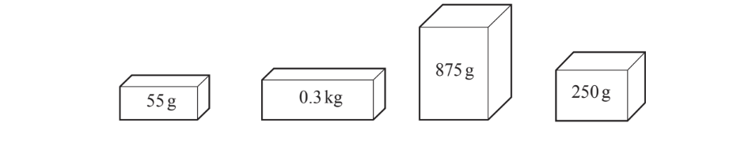
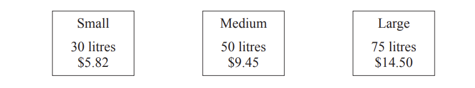

# Exam Questions — Money Calculations
**Number** · Cambridge (CIE) IGCSE maths (0580 & 0980)
> Source: [https://www.savemyexams.com/igcse/maths/cie/25/core/topic-questions/](https://www.savemyexams.com/igcse/maths/cie/25/core/topic-questions/) · 24 questions across 1 sets

## Exam Questions (24 questions)

### Q1 — medium — 3 marks

**Q1** [1 mark]

Jimmy works at a shop for 26 hours in a week.

He is paid £13.50 an hour.

Work out the amount that Jimmy is paid in a week.

**Q1** [2 marks]

Jimmy is working an **extra** 10 hours during a holiday period.

For each extra hour, his employer pays him an extra 50% as an addition to his usual hourly rate.

How much his he paid in total for this week?

### Q2 — easy — 2 marks

**Q2** [2 marks]

Here is a part of the menu at the restaurant

| Menu |   |
|---|---|
| Fries | £3.99 |
| Chicken Wings | £5.49 |
| Cake | £4.99 |
| Cola | £2.00 |
| Water | £1.50 |

How much change would you get from a £10 note if you bought one portion of chicken wings and one water?

### Q3 — medium — 3 marks

**Q3** [3 marks]

Bottles of water cost `$ 1.90` each.

Mark has `$ 13` to purchase as many bottles as possible.

Complete the statement below.

Mark can purchase ............ bottles and will have `$`........... left over.

### Q4 — easy — 3 marks

**Q4** [1 mark]

A burger costs £4.79.

Work out the cost of 6 burgers.

**Q4** [2 marks]

A group of 12 people plan to get one burger each.

The restaurant has a deal, four burgers for the price of three.

They combine their orders so that they can use the deal.

Work out the price each person must pay.

### Q5 — medium — 2 marks

**Q5** [1 mark]

Hannah is planning a road trip. Her car travels 10 kilometres per litre of petrol.

The total distance of her trip is 320 kilometres.

Petrol costs £1.50.

Work out how many litres of petrol she will need for the journey.

**Q5** [1 mark]

Work out the total cost of her journey.

### Q6 — hard — 3 marks

**Q6** [3 marks]

A fuel tank holds 52 litres when full. 
The tank is a quarter full. 
Jim fills the tank with fuel that costs \$2.18 per litre.

Work out how much Jim pays.

\$ .................................................

*Source: Nov 2020 0580/33 Q5D*

### Q7 — hard — 6 marks

**Q7** [6 marks]

The cost of each visit to a car park is shown in the table.

| Length of visit | Cost (\$) |
|---|---|
| Up to 20 minutes | Free |
| More than 20 minutes and up to 2 hours | 2.50 |
| More than 2 hours and up to 4 hours | 4.50 |
| More than 4 hours and up to 8 hours | 8.50 |
| More than 8 hours and up to 24 hours | 12.00 |

i) Samarth arrives at 11 40 and leaves at 1530.

Find the cost of his visit.

\$ ................................ [1]

ii) Radhika leaves the car park at 1750 and pays \$8.50.

a) Work out the earliest time she could have arrived at the car park.

[1]

b) Work out the change she receives from a \$20 note.

\$ ............................... [1]

iii) Dhruv bought a weekly car park ticket for \$26. 
That week, he visited the car park four times.
 These are the lengths of time he parked his car for.

$17\mathrm{minutes}6\frac{1}{2}\mathrm{hours}11\mathrm{hours}9\frac{1}{4}\mathrm{hours}$

Work out how much he saved by buying a weekly ticket.

\$ .................................. [3]

*Source: March 2019 0580/32 Q4D*

### Q8 — hard — 3 marks

**Q8** [3 marks]

Rangan buys 3.6 kg of potatoes and 2.8kg of leeks. 
The total cost is \$13.72. 
Leeks cost \$2.65 per kilogram.

Find the cost of 1 kg of potatoes.

\$................................

*Source: Nov 2020 0580/11 Q11*

### Q9 — hard — 6 marks

**Q9** [6 marks]

Navja works in a post office.

The table shows the costs of sending parcels by post. 
The cost depends on the mass, *m* grams, of the parcel.

| Type of parcel | Mass (g) | Cost (\$) |
|---|---|---|
| Small | `0 less than m less-than or slanted equal to 60` | 0.76 |
| Medium | `60 less than m less-than or slanted equal to 100` | 0.95 |
| Large | `100 less than m less-than or slanted equal to 250` | 2.20 |
| Extra large | `250 less than m less-than or slanted equal to 1000` | 5.60 |

i) Sai sends each of these four parcels by post.

He pays with a \$20 note.

Work out how much change he receives.

\$ ................................................. [4]

On 1 April, the cost of sending any parcel increases by 5%.

iia) Show that the increase in the cost of sending an **Extra large** parcel is \$0.28 .

[1]

iib) Avani says

“As the cost of an **Extra large **parcel increases by \$0.28 then the cost of a **Large **parcel will also increase by \$0.28 to \$2.48.”

Explain why Avani is incorrect.

[1]

*Source: March 2020 0580/01 Q1A*

### Q10 — hard — 1 marks

**Q10** [1 mark]

Pranav paints a wall of area 53 m2. 
One litre of paint covers an area of 4.5 m2. 
Paint is sold in 2.5 litre tins, each costing \$24.75 . 
Pranav buys the least number of tins to paint this wall.

Work out the cost of the paint.

\$ .................................................

*Source: March 2020 0580/32 Q4B*

### Q11 — hard — 7 marks

**Q11** [4 marks]

Mr Razif travels by bus from Singapore to Kuala Lumpur with his wife and his four children.

| Ticket Price |   |
|---|---|
| Adult | \$32.40 |
| Child | \$24.40 |
| Family (2 adults and 3 children) | \$115.00 |

Work out how much Mr Razif saves if he buys a family ticket and one child ticket rather than six individual tickets.

\$ ............................

*Source: May/June 2019 0580/33 Q9A*

**Q11** [1 mark]

The bus leaves Singapore at 1240 and arrives in Kuala Lumpur at 1735.

Work out, in hours and minutes, the time this journey takes.

.................... h ...................min

*Source: May/June 2019 0580/33 Q9B*

**Q11** [2 marks]

Mr Razif changes some dollars into Malaysian ringgits. 
He receives 318 ringgits when the exchange rate is `$ 1 space equals 4. space 24` ringgits.

Work out how many dollars he changes.

\$ ..............................

*Source: May/June 2019 0580/33 Q9C*

### Q12 — medium — 3 marks

**Q12** [3 marks]

Complete this bill.

| 2.5 kg potatoes at \$1.12 per kg | \$ ........................ |
|---|---|
| ........ kg bananas at \$1.05 per kg | \$ ........................ |
| Total = | \$ 4.69 |

*Source: Nov 2020 0580/13 Q2*

### Q13 — medium — 9 marks

**Q13** [9 marks]

Jodie and her two children go to a football match.

i) Ticket prices are \$15.30 for an adult and \$6.50 for a child.

Calculate the total cost of the three tickets.

\$.................................................... [2]

ii) A match programme costs \$3.75 . Jodie buys two match programmes.

Calculate the change she receives from a \$10 note.

\$.................................................... [2]

iii) 540 tickets out of 630 are sold for this match.

Calculate the percentage of tickets sold.

[1]

iv) The match starts at 1455 and ends 1 hour 50 minutes later.

Work out the time the match ends.

[1]

v) Jodie travels 66km to get home after the match. She leaves at 5pm and arrives home at 6.12pm.

Calculate her average speed in kilometres per hour.

........................................... km/h [3]

*Source: Nov 2019 0580/31 Q1B*

### Q14 — medium — 2 marks

**Q14** [2 marks]

The café also sells drinks.

| Drinks |   |
|---|---|
| Cup of tea  Cup of coffee Bottle of juice Bottle of water | \$2.20  \$2.80  \$1.50  \$1.35 |

Johan buys 2 cups of tea, 1 bottle of juice and 1 bottle of water.

Calculate the change he receives from a \$10 note.

\$ .................................................

*Source: Nov 2020 0580/32 Q1B*

### Q15 — medium — 2 marks

**Q15** [2 marks]

Nadira pays 6 people to work in a shop.

In one week

- 4 people each work for 38 hours
- 2 people each work for 25 hours.

They are each paid \$11.40 for each hour they work.

Calculate the total amount Nadira pays these 6 people in one week.

\$ ..................................................

*Source: Nov 2019 0580/32 Q1C*

### Q16 — medium — 5 marks

**Q16** [3 marks]

Jeremy goes on holiday. 
He parks his car in the airport car park from

1000 on Tuesday 17 July to 1700 on Saturday 28 July.

The car park charges are shown below.

| Monday to Friday           \$14 per day    Saturday and Sunday    \$8 per day                    Part days are charged as full days |
|---|

Find the total cost of parking his car.

\$ .................................................

*Source: June 2020 0580/32 Q2A*

**Q16** [2 marks]

At the airport, Jeremy buys a ring for \$53 and a watch for \$65.

Work out how much change he receives from \$120.

\$ .................................................

*Source: June 2020 0580/32 Q2B*

### Q17 — medium — 3 marks

**Q17** [3 marks]

A shop sells bags of compost in three different sizes.

Work out which size of bag gives the best value. 
Show how you decide.

*Source: Nov 2020 0580/33 Q4E*

### Q18 — medium — 2 marks

**Q18** [2 marks]

Harriet works at a café for 34 hours each week. She is paid \$8.25 for each hour.

i) Work out the amount she is paid each week.

\$ .............................................. [1]

ii) One week she works 8 hours extra. The extra hours are paid at 1.5 times her usual rate of \$8.25 for each hour.

Work out the total amount she is paid for that week.

\$ .............................................. [2]

*Source: June 2019 0580/31 Q1C*

### Q19 — medium — 8 marks

**Q19** [2 marks]

Mr Lester has a fruit and vegetable shop.

Apples cost 32 cents each. Suki buys 6 apples.

Work out the change Mr Lester gives Suki when she pays with a \$10 note.

\$ ...................................................

*Source: June 2019 0580/32 Q3A*

**Q19** [3 marks]

Green grapes cost \$3.10 per kilogram. 
Red grapes cost \$2.80 per kilogram. 
Work out the total cost of buying 0.6kg of green grapes and $\frac{3}{4}$ kg of red grapes.

\$ ..................................................

*Source: June 2019 0580/32 Q3B*

**Q19** [1 mark]

George spends \$12 on fruit each week.
 The total amount he spends on food is \$75.

Work out the percentage of the \$75 he spends on fruit.

.................................................%

*Source: June 2019 0580/32 Q3C*

**Q19** [2 marks]

Mr Lester buys pineapples for \$1.50 each. 
He makes 60% profit when he sells them.

Work out the selling price of a pineapple.

\$ ..................................................

*Source: June 2019 0580/32 Q3D*

### Q20 — easy — 2 marks

**Q20** [2 marks]

Henry decorates a room.

Complete Henry’s shopping bill.

| Item | Cost (\$) |
|---|---|
| 3 tins of paint at \$15.95 each |   |
| 2 brushes at \$7.50 each |   |
| 1 roll of tape at \$2.90 | 2.90 |
| Total |   |

*Source: Nov 2019 0580/32 Q2A*

### Q21 — easy — 1 marks

**Q21** [1 mark]

Jodi swims 22 lengths of a swimming pool to raise money for charity. 
She receives \$15 for each length she swims.

Calculate how much money Jodi raises for charity.

\$ .................................

*Source: March 2019 0580/12 Q5*

### Q22 — easy — 3 marks

**Q22** [1 mark]

Here is part of the menu for Jamie’s café.

| Menu |   |
|---|---|
|   | Price (\$) |
| Tea | 2.35 |
| Coffee | 3.40 |
| Lemonade | 1.80 |
| Cake | 4.45 |
| Biscuit | 0.85 |

Sue has one tea and one cake.

Calculate how much she pays.

\$ ..............................................

*Source: June 2019 0580/31 Q1A*

**Q22** [2 marks]

**Extract:**

| Menu |
|   | Price (\$) |
| Tea | 2.35 |
| Coffee | 3.40 |
| Lemonade | 1.80 |
| Cake | 4.45 |
| Biscuit | 0.85 |

Derrick has one coffee and two biscuits.

How much change does he receive from a \$10 note?

\$ ..............................................

*Source: June 2019 0580/31 Q1B*

### Q23 — easy — 4 marks

**Q23** [2 marks]

A music teacher buys all the instruments for a school orchestra.

|   | Number of instruments | Price of each instrument (\$) | Cost (\$) |
|---|---|---|---|
| String | 36 | 131 | 4716 |
| Woodwind | 15 | 217 |   |
| Brass | 12 | 221 |   |

i) Complete the table.

[1]

ii) Find the total cost of all the instruments.

\$ .............................. [1]

*Source: May/June 2019 0580/33 Q3E*

**Q23** [2 marks]

**Extract:**

ii) Find the total cost of all the instruments.

\$ .............................. [1]

The school is given 65% of the total cost of all the instruments.

Find how much more money is needed.

\$ ..............................

*Source: May/June 2019 0580/33 Q3F*

### Q24 — easy — 3 marks

**Q24** [3 marks]

Robert buys a car for \$18160.

He pays a deposit of \$6460. 
He pays the rest of the money in 24 equal monthly payments.

Work out the amount of each monthly payment.

\$ .................................................

*Source: Nov 2020 0580/33 Q5C*

