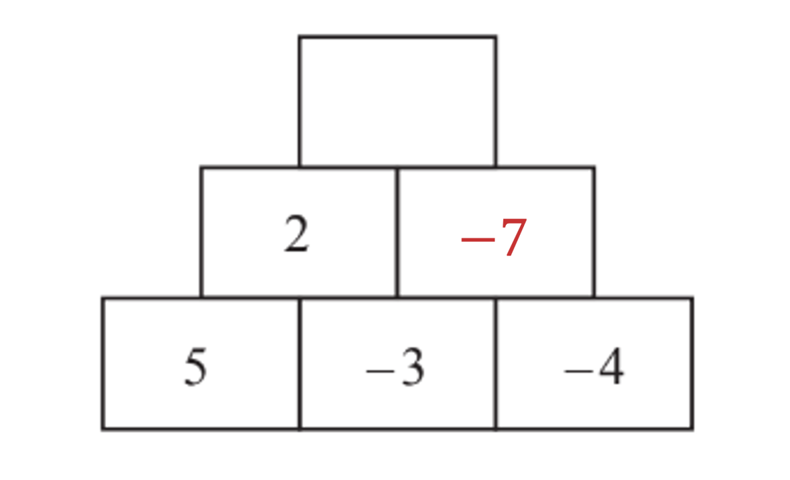
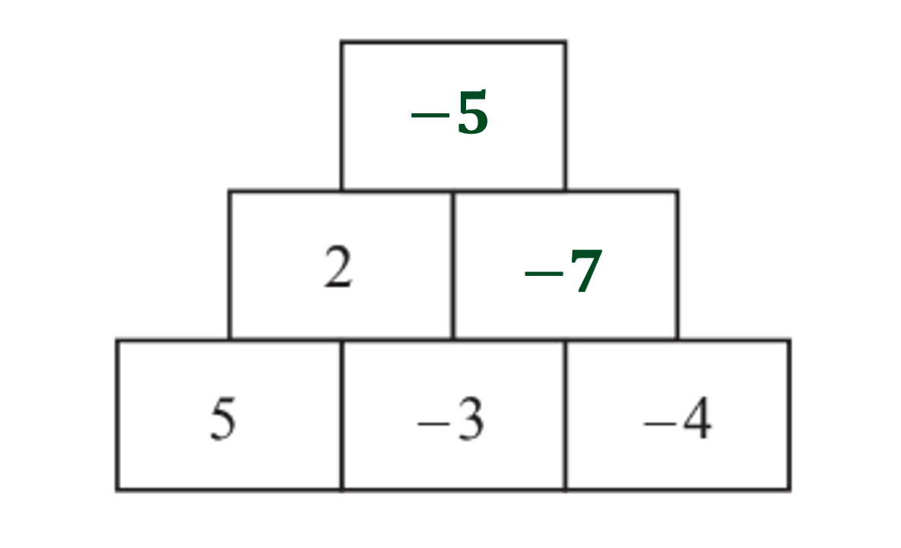
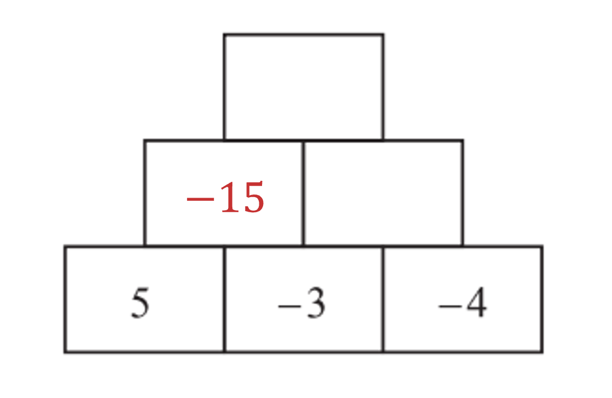
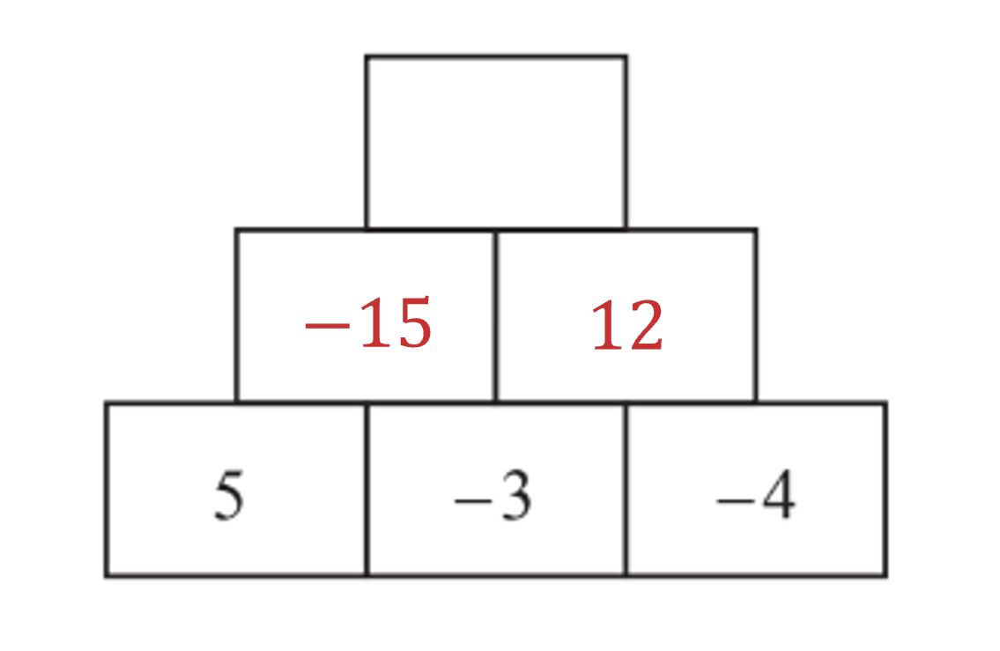
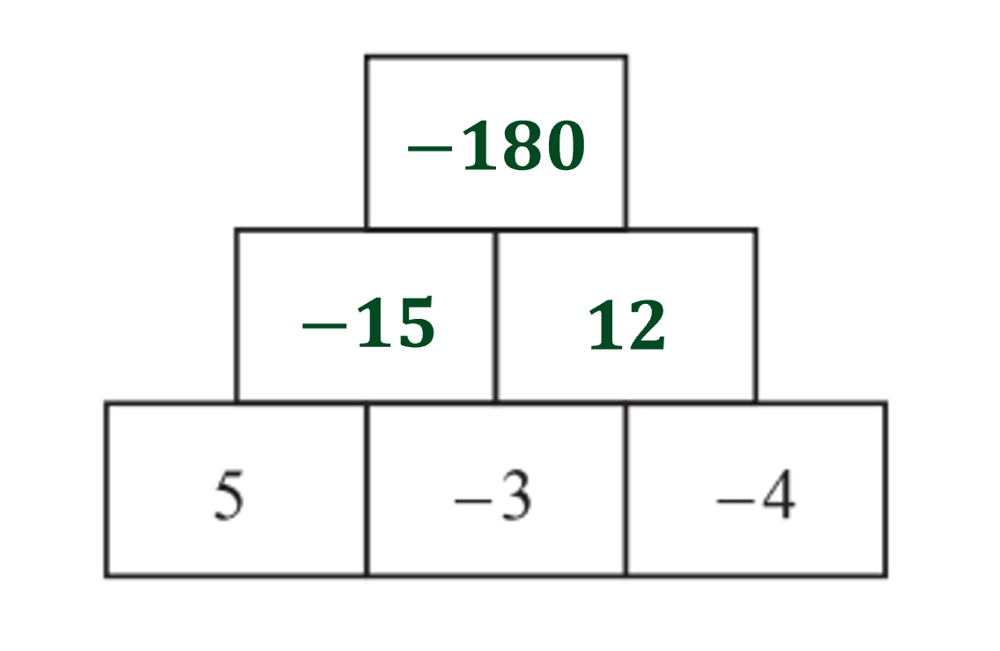

# Mark Schemes — Operations with Numbers & Decimals
**Number** · Cambridge (CIE) IGCSE maths (0580 & 0980)

## Exam Questions (21 questions)

### Q1
Insert brackets in different places and test the results

- Remember that 'brackets' happens first in BIDMAS/BODMAS
- and multiplication happens before addition and subtraction

`open parentheses 9 plus 4 close parentheses minus 3 cross times 7 equals 13 minus 3 cross times 7 equals 13 minus 21 equals negative 8`

`9 plus open parentheses 4 minus 3 close parentheses cross times 7 equals 9 plus 1 cross times 7 equals 9 plus 7 equals 16`

`9 plus 4 minus open parentheses 3 cross times 7 close parentheses equals 9 plus 4 minus 21 equals 13 minus 21 equals negative 8`

`open parentheses 9 plus 4 minus 3 close parentheses cross times 7 equals open parentheses 13 minus 3 close parentheses cross times 7 equals 10 cross times 7 equals 70`

`9 plus open parentheses 4 minus 3 cross times 7 close parentheses equals 9 plus open parentheses 4 minus 21 close parentheses equals 9 plus open parentheses negative 17 close parentheses equals 9 minus 17 equals negative 8`

> **[exam-tip]**
> You can type the left-hand side of the equation into your calculator, with the brackets in different locations, to calculate the answers.

Only the fourth of those possibilities gives the correct answer

`open parentheses 9 plus 4 minus 3 close parentheses cross times 7 equals 70`

**[B1]**

### Q2
Adding a negative number makes the original number get smaller

`table row blank blank cell 4 plus open parentheses negative 11 close parentheses end cell row blank equals cell 4 minus 11 end cell end table`

$=-7$

**[B1]**

### Q3
Follow the order of operations

- Multiplications and divisions first

`table row blank blank cell open parentheses 6 cross times 3 close parentheses plus open parentheses 24 divided by 4 close parentheses end cell row blank equals cell 18 plus 6 end cell end table`

**[M1]**

$=24$

**[A1]**

> **[mark-scheme]**
> **M1**: For attempting to calculate the multiplication and division first.
> 
> **A1**: Correct answer.

### Q4
Subtract the numbers to find out how many seats are left

`Error converting from MathML to accessible text.`

**Final answer:** **883**

**[B1]**

### Q5
> *Correctly square root*

$\sqrt{144}=12$

**[M1]**

> *Multiplying out the power*

$2^{2}=4$

> *Multiplying the *$4\times2$

$4\times2=8$

**[M1]**

> *Dealing with the bracket*

$9+4-8=5$

$5+12=17$

**[A1]**

### Q6
*Use BIDMAS to decide on the order of operations* 
*Find the value of the brackets first*

`18 divided by open parentheses 6 close parentheses minus 11 cross times 4 plus 9 cross times open parentheses 7 close parentheses`

> *Carry out the division next*

`3 minus 11 cross times 4 plus 9 open parentheses 7 close parentheses`

> *Carry out the multiplications next*

$3-44+63$

> *Finally, work out the subtraction and addition working from left to right*

$22$ **[1]**

### Q7
> *To make 1, 16 needs to be divided by 16.*

> $8+4\times2=16$* (because we perform the multiplication before the addition):*

$8+4\times2=8+8=16$

> * So the brackets need to go around *$8+4\times2$*.*

> * *

$16\div(8+4\times2)=1$* ***[1]**
$16\div8+4=6$ *(because we perform the division before the addition):*

$16\div8+4=2+4=6$

> $6\times2=12$*, so the brackets need to go around *$16\div8+4$*.*

> * *

$(16\div8+4)\times2=12$* ***[1]**

### Q8
> *As *$5+27=32$*, *$3\times9=27$* and *$10-1=9$* place brackets around *$10-1$

$5+3\times(10-1)=32$* ***[1]**
> *As *$6--3=9$* and *$4-7=-3$*, place brackets around *$4-7$

$3\times2-(4-7)=9$* ***[1]**

### Q9
**In line 1,  **$(3^{2}\times2+3)$** has been incorrectly calculated to be **$40$**     **** ****The addition has incorrectly been carried out first**** ****[1]**

**In line 3,  **$3\times2^{3}$** has been incorrectly calculated to be **$6^{3}$**     **** ****The multiplication has incorrectly been applied first**** ****[1]**

> *Carry out the correct working*

> *Inside the bracket first, starting with the index, then the multiplication, then the addition*

`3 cross times 2 cubed plus square root of 25 cross times open parentheses 3 squared cross times 2 plus 3 close parentheses
3 cross times 2 cubed plus square root of 25 cross times open parentheses 9 cross times 2 plus 3 close parentheses
3 cross times 2 cubed plus square root of 25 cross times open parentheses 18 plus 3 close parentheses
3 cross times 2 cubed plus square root of 25 cross times open parentheses 21 close parentheses`

> *Evaluate the indices, then multiplication, then addition*

`3 cross times 8 plus 5 cross times open parentheses 21 close parentheses
24 plus 5 cross times open parentheses 21 close parentheses
24 plus 105`

$129$ **[1]**

### Q10
> *i) Try putting brackets around different groups of numbers. Follow the order of operations (brackets, division/multiplication, addition).*

`open parentheses 24 space divided by space 6 close parentheses space plus thin space 2 space cross times space 3 space equals space 4 space plus space 2 space cross times space 3 space equals space 4 space plus space 6 space equals space 10`

`24 space divided by space open parentheses 6 space plus thin space 2 close parentheses space cross times space 3 space equals space 24 space divided by space 8 space cross times space 3 space equals space 3 space cross times space 3 space equals space 9`

> *This is the number we want.*

$24\div(6+2)\times3$ **[1]**

> *ii) Continue to try different groups*

`24 space divided by space 6 space plus space open parentheses 2 space cross times space 3 close parentheses space equals space 24 space divided by space 6 space plus space 6 space equals space 4 space plus thin space 6 space equals space 10`

> *Try putting brackets around a group of 3 numbers.*

`open parentheses 24 space divided by space 6 space plus thin space 2 close parentheses space cross times space 3 space equals space open parentheses 4 space plus thin space 2 close parentheses space cross times space 3 space equals space 6 space cross times space 3 space equals space 18`

`24 space divided by space open parentheses 6 space plus thin space 2 space cross times space 3 close parentheses space equals space 24 space divided by space open parentheses 6 space plus space 6 close parentheses space equals space 24 space divided by space 12 space equals space 2`

$24\div(6+2\times3)$ **[1]**

### Q11
> *Try putting the brackets in different places*

`open parentheses 4 cross times 6 close parentheses minus 2 plus 1 equals 24 minus 2 plus 1 equals 23
4 cross times open parentheses 6 minus 2 close parentheses plus 1 equals 4 cross times 4 plus 1 equals 17
4 cross times 6 minus open parentheses 2 plus 1 close parentheses equals 24 minus 3 equals 21`

$4\times(6-2)+1=17$* ***[1]**

### Q12
> *As  *$42=7\times6$*,  place brackets around the 5 and the 3 as*

$5-2+3=6$

$7\times(5-2+3)=42$ **[1]**

### Q13
i) *Calculate the box above *$-3$* and *$-4$

`open parentheses negative 3 close parentheses plus open parentheses negative 4 close parentheses equals negative 3 minus 4 equals negative 7`

**[1]**

> *Calculate the box above *$2$* and *$-7$

`2 plus open parentheses negative 7 close parentheses equals 2 minus 7 equals negative 5`

**[1]**

ii) *Calculate the box above *$5$* and *$-3$

`5 cross times open parentheses negative 3 close parentheses equals negative open parentheses 5 cross times 3 close parentheses equals negative 15`

**[1]**

> *Calculate the box above *$-3$* and *$-4$

`open parentheses negative 3 close parentheses cross times open parentheses negative 4 close parentheses equals 3 cross times 4 equals 12`

**[1]**

> *Calculate the box above *$-15$* and *$12$

`open parentheses negative 15 close parentheses cross times 12 equals negative open parentheses 15 cross times 12 close parentheses equals negative 180`

**[1]**

### Q14
> *As *$3+16=19$* and *$2\times8=16$*, insert the brackets around *$12-4$* as *$12-4=8$

$3+2\times(12-4)=19$* ***[1]**

### Q15
> *Test by putting brackets around different pairs of numbers until you get 28. Remember to follow the order of operations (brackets, multiplication, subtraction/addition).*

`open parentheses 8 space plus thin space 6 close parentheses space minus space 2 space cross times space 5 space equals space 14 space minus space 2 space cross times space 5 space equals space 14 space minus space 10 space equals space 4`

`8 space plus thin space open parentheses 6 space minus space 2 close parentheses space cross times space 5 space equals space 8 space plus thin space 4 space cross times space 5 space equals space 8 space plus thin space 20 space equals space 28`

$8+(6-2)\times5=28$ **[1]**
> *Test the final pair*

`8 space plus thin space 6 space minus space open parentheses 2 space cross times space 5 close parentheses space equals space 8 space plus thin space 6 space minus space 10 space equals space 4`

> *Now try putting brackets around groups of 3*

`open parentheses 8 space plus space 6 space minus space 2 close parentheses space cross times space 5 space equals space 12 space cross times space 5 space equals space 60`

$(8+6-2)\times5=60$ **[1]**

### Q16
> *1 million is written as 1 000 000.*

> *Subtract 123 from this number using a formal written method*

> *Or subtract in stages*

*1 000 000 - 100 = 999 900*

*999 900 - 20 = 999 880*

*999 880 - 3 = 999 877*

**999 877**** ****[1]**
> *Carry out the subtraction*

*2 - 9 = -7*

**-7 ****[1]**

### Q17
> *Use BIDMAS to calculate in the correct order*

> *First calculate the bracket*

$3+2\times2$

> *Next, the multiplication*

$3+4$

> *Lastly the addition*

$7$ **[1]**

### Q18
> *Calculations above and below the division need to be kept separate to follow order of operations/BIDMAS.*
* *

** She's ignored the order of operations. She needs to add brackets to make it correct, it should be **$(68+18)\div(9-5)$** ****[1]**
> *Type *`open parentheses 68 plus 18 close parentheses divided by open parentheses 9 minus 5 close parentheses`* into a calculator. *

> `open parentheses 68 plus 18 close parentheses divided by open parentheses 9 minus 5 close parentheses equals 21.5`* *

**21.5** **[1]**

### Q19
> *The first operation to calculate is division*

$48\div3=16$

> *The calculation is now*

$16-5\times2$

> *The next operation to calculate is multiplication*

$5\times2=10$

> *The calculation is now*

$16-10$

**6**** ****[1]**

### Q20
> *Use BIDMAS to calculate in the correct order*

> *First calculate the values inside the brackets*

`7 cross times open parentheses 8 close parentheses plus 8 cross times open parentheses 8 close parentheses`

**[1]**

> *This is now two multiplications, added together*

> *Calculate the results of the multiplications*

$56+64$

> *Calculate the addition*

$120$* ***[1]**

### Q21
> *When there is an addition or subtraction as the numerator or denominator in a fraction, it can be considered as a bracket*

`1.09 plus fraction numerator 7.85 over denominator open parentheses 6.21 minus 4.37 close parentheses end fraction`

*Now apply the order of operations; BIDMAS* *You can use your calculator in this question* *First the bracket*

$1.09+\frac{7.85}{1.84}$

> *Next the division*

$1.09+4.266304348...$

**[1]**

> *Lastly the addition*

$5.356304348...$

> *Round to 1 decimal place*

$5.4$ **[1]**
