# Mark Schemes — Prime Factors, HCF & LCM
**Number** · Cambridge (CIE) IGCSE maths (0580 & 0980)

## Exam Questions (23 questions)

### Q1
Type the number as written into your calculator

$2^{5}\times7^{2}=1568$

**Final answer:** **1568**

**[B1]**
Start by finding the prime factor decomposition for 168

- Use a factor tree
- Pull out factors of 2 for as long as you can

**[M1]**

So $168=2\times2\times2\times3\times7$

- and $N=2\times2\times2\times2\times2\times7\times7$

Make a 'factors Venn diagram' for these two numbers

The HCF is all the numbers in the overlap multiplied together

$2\times2\times2\times7=56$

**Final answer:** **56**

**[A1]**

> **[mark-scheme]**
> **M1**: For 2, 2, 2, 3, 7, or a correct factor tree or list/table for 168.
> 
> **A1**: For correct answer.
Use the 'factors Venn diagram' from part (b)

The LCM is all the numbers in the diagram multiplied together

$3\times2\times2\times2\times7\times2\times2\times7=4704$

**Final answer:** **4704**

**[B1]**

### Q2
> *Prime factor decomposition of 20 and 15*

**[M1]**

> *Putting the prime factors in a Venn diagram makes working out the HCF and LCM easier but is not necessary*

> *The HCF is found by multiplying all the numbers in the intersection of the Venn diagram*

**Final answer:** **HCF = **$5$

**[A1]**

> *The LCM is found by multiplying all the numbers in the Venn diagram*

**Final answer:** **LCM =**$2\times2\times5\times3=60$

**[A1]**

> **[exam-tip]**
> You can also find the HCF by listing all the factors and finding the highest factor of both numbers.
> 
> You can also find the LCM by writing out some multiples of each number until you find a number that is a multiple of both numbers.

### Q3
> *Find all prime factors of 48*

> *The prime factors (circled) are*

$2,2,2,2,3$

> *Final all prime factors of 80*

> *The prime factors (circled) are*

$2,2,2,2,5$

**[M1]**

> *To find highest common factor, multiply all common prime factors*

$2\times2\times2\times2$

**[M1]**

**Final answer:** **Highest common factor = **$16$

**[A1]**

> **[exam-tip]**
> Using a Venn diagram can be helpful with organising the factors, especially with larger numbers and for finding the lowest common multiple.
> *Find all prime factors of 24*

> *Find all prime factors of 18*

> *List the prime factors in a Venn diagram*

**[M1]**

> **[mark-scheme]**
> The Venn diagram step is not necessary to earn this M1. However, it assists with calculating the lowest common multiple. M1 can be achieved by simply stating the factors clearly.

> *To find the lowest common factor, multiply all the numbers within the Venn diagram together*

$2\times2\times2\times3\times3$

**[M1]**

$72$

**[A1]**

### Q4
> *Write out the multiples of 18 and 24 and find the first number that appears in both lists.*

> * *

$18,36,54,72,90...$

> * *

$24,48,72,96...$

**[1]**

> *Convert the lowest common multiple, 72 minutes, into hours and minutes.*

> *  *

$72\mathrm{minutes}=1\mathrm{hour}12\mathrm{minutes}$

**[1]**

> *Add 1 hour 12 minutes onto 10 47.*

$1047+1\mathrm{hour}12\mathrm{minutes}=1159$

$1159$* ***[1]**

### Q5
> *Use factor trees to find the prime factors of 126 and 180.*

> * *

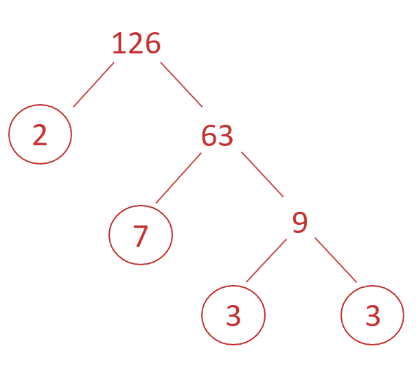

> * *

$126=2\times3\times3\times7$

> * *

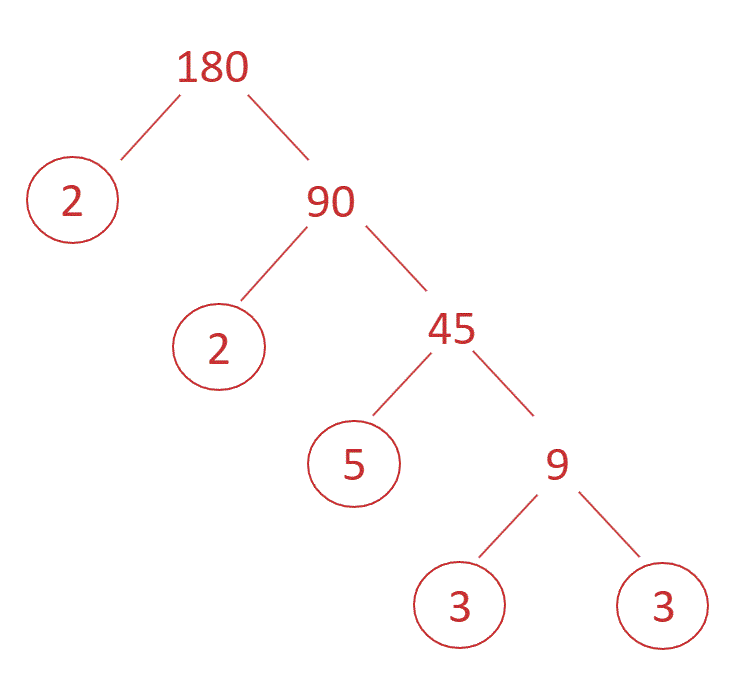

> * *

$180=2\times2\times3\times3\times5$

** ****prime factor decomposition for both numbers*** ***[1]**

** **

> *Identify the prime factors common to **both **lists and multiply them together.*

> * *

$2\times3\times3=18$

$18$* ***[1]**

### Q6
i) *Use prime factor trees to determine the product of prime factors for each number*

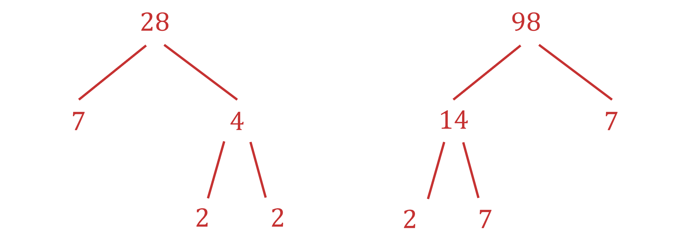

$28=2\times2\times7\,98=2\times7\times7$

**[1]**

> *The highest common factor is the largest factor of both numbers*

$2\times7=14$

**14**** ****[1]**

ii) *The lowest common multiple is the product of the highest common factor, multiplied by the other remaining prime factors*

$14\times2\times7=196$

**[1]**

**196**** [1]**

### Q7
i) *Determine the number of seconds in an hour*

$60\times60=3600$

> *Divide this by the number of seconds it takes for Talan to complete one lap of the track*

$3600\div80=45$* laps*

`open parentheses 60 cross times 60 close parentheses divided by 80`* ***[1]**

**45 ****[1]**

> *Draw a prime factor tree to determine the product of prime factors for *$88$* and *$80$

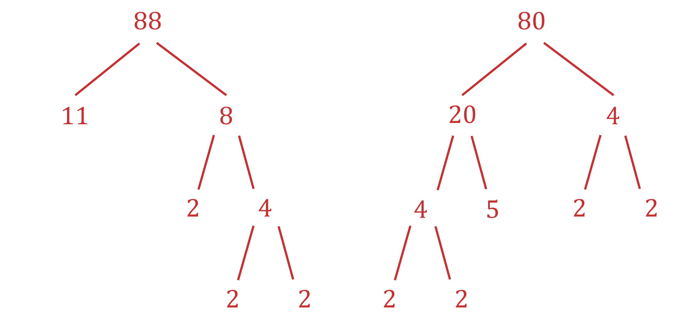

> *The product of prime factors for each number are:*

$88=2\times2\times2\times11$

$80=2\times2\times2\times2\times5$

> *The highest common factor of both numbers is*

$2\times2\times2=8$

> *The lowest common multiple is the product of the highest common factor and the remaining prime factors*

$8\times2\times5\times11=880$* seconds*

**[2]**

> *Divide this time by each person's time to determine the number of laps they would run before arriving at Point *$A$* together again*

*Talan: *$880\div80=11$* laps*

*Naima: *$880\div88=10$* laps*

**Talan ****completes ****11 ****laps and ****Naima**** completes ****10 ****laps**** [1]**

### Q8
> *The first few multiples of 90 are:*

*90, 180, 270, 360, 450, 540, 630, 720*

> *The first few multiples of 105 are:*

*105, 210, 315, 420, 525, 630, 735, 840*

**[1]**

> *The first number to appear in both lists is *

*630*

**[1]**

> *Convert 630 seconds to minutes by dividing by 60*

*630*$\div$*60 = 10.5 minutes*

**10.5 min**** ****[1]**

### Q9
> *i) To find the highest common factor of two numbers, first find all of the factors of each number.*

$36:1,2,3,4,6,9,12,18,36\,90:1,2,3,5,6,9,10,15,18,30,45,90$

> *Some of the numbers are in both lists*

$1,2,3,6,9,18$

**[1]**

> *The highest number that is in both lists is known as the highest common factor*

**18**** ****[1]**

> *ii) To find the lowest common multiple of two numbers, start by listing the first few multiples of each number*

$36:36,72,108,144,180\,90:90,180,270,360$

> *180 is the lowest number that is in both lists.*

**multiple of 180**** [1]**

**180**** ****[1]**

### Q10
> *Determine the prime factors of *$90$* and *$48$* by drawing a factor tree for each*

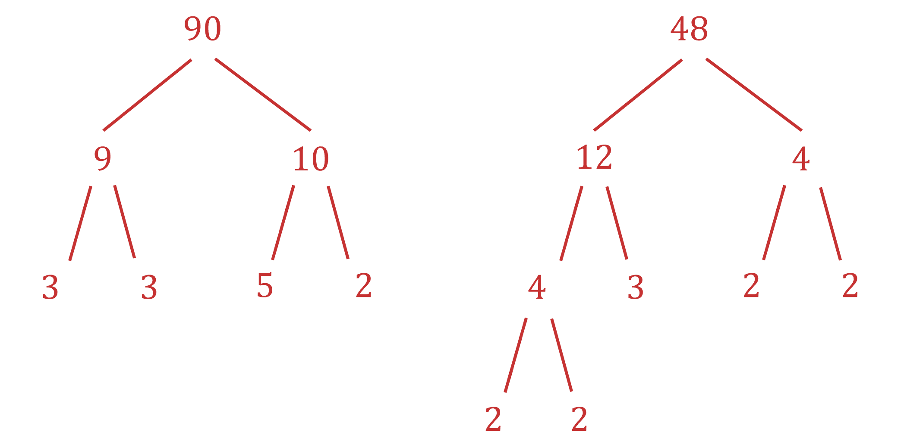

> *The product of prime factors for each number are:*

$90=2\times3\times3\times5$

$48=2\times2\times2\times2\times3$

**[1]**

> *The highest common factor of 90 and 48 is*

$2\times3=6$

**6**** ****[1]**

### Q11
> *Use a calculator to write out the multiples of 48 and the multiples of 60.*

> * *

*Multiples of 48 = 48, 96, 144, 192,**** 240****, 288...*

*Multiples of 60 = 60, 120, 180, ****240****, 300...*

**[1]*** *

> *The smallest number in both lists is 240.*

> * *

**240** **[1]**

### Q12
> *Use a factor tree to find the prime factors of 825. Remember to circle any numbers which are prime.*

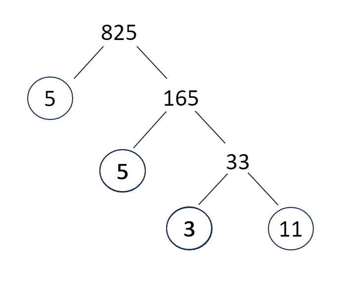

**[1]**

> *Write down all of the circled numbers with multiplication signs between them. Don't miss any of the repeated ones.*

> * *

$825=3\times5\times5\times11$

> * *

$3\times5\times5\times11$* or *$3\times5^{2}\times11$**[1]**

### Q13
i) *Draw a tree diagram to determine the prime factors of *$60$*.*

> *A factor pair of 60 is *

$10\times6$

**Any correct factor pair ****[1]**

> * *

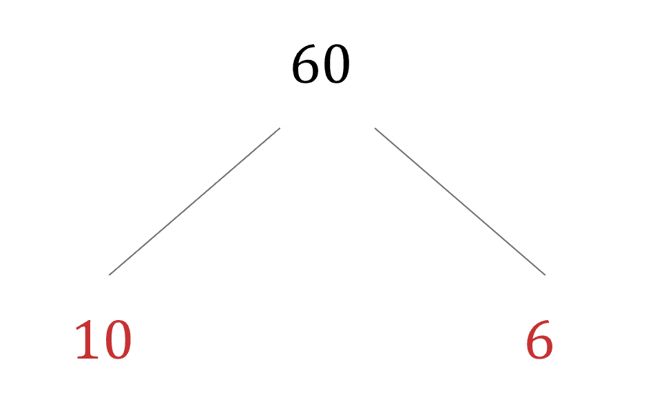

> $10$* and *$6$* are both not prime so express each of these numbers as a product*


$60=2\times2\times3\times5$ **[1]**

** **

ii) *Method 1*

> *The lowest common multiple is the highest common factor of two numbers, multiplied by the remaining factors.*

> *The product of prime factors of *$36$* is*

$36=2\times2\times3\times3$

**[1]**

> *The highest common factor of *$36$* and *$60$* is *

$2\times2\times3=12$

> *The lowest common multiple of *$36$* and *$60$* is*

$12\times5\times3$

$180$* ***[1]**

> *Method 2*

> *The first few multiples of *$60$* are*

$60,120,180,240,300,360,...$

> *The first few multiples of *$36$* are*

$36,72,108,144,180,216,...$

**[1]**

> *The first number that occurs in both lists is the lowest common multiple*

$180$** ****[1]**

### Q14
> *The factors of 108 are*

*1, 2, 3, 4, 6, 9, 12, 18, 27, 36, 54, and 108*

> *The highest number that is a factor of both 24 and 108 is 12.*

**12 **
**Writing a common factor (1, 2, 3, 4, 6, 12)**** [1]** 
**Writing the highest common factor**** [1]**

### Q15
> *The first few multiples of *$28$* are*

$28,56,84,112,140,168$

> *The first few multiples of *$35$* are*

$35,70,105,140,175,210$

**[1]**

> *The first number that appears in each list of multiples is*

$140$** [1]**

### Q16
> *To write a number as the product of its prime factors, use a factor tree. Start with 432 and choose any two numbers that multiply together to make 432. Break it down into these two numbers and circle any prime numbers.*

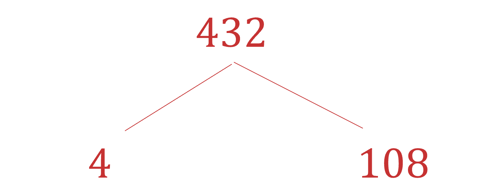

> *Repeat this with the next numbers until all of the values are prime numbers and cannot be broken down any further.*

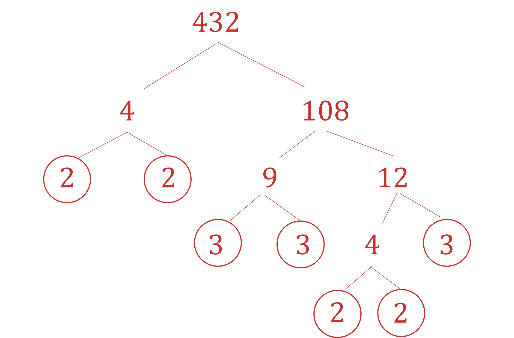

**[1]**

> *The answer will be the same regardless of the factors chosen in the first step.*

> *Write the prime numbers out as a product, any repeated prime numbers can be written as a power.*

$2^{4}\times3^{3}\mathrm{or}2\times2\times2\times2\times3\times3\times3$ **[1]**

### Q17
> *Draw a prime factor tree for 195  *

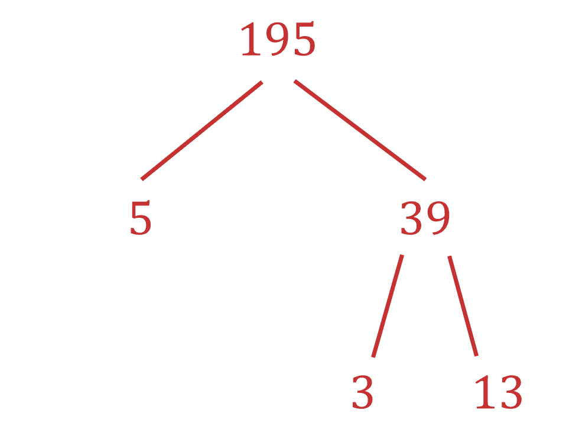

**[1]**

> *Write 195 as a product of prime factors  *

**195 = 3 x 5 x 13**** [1]**

### Q18
> *Use a factor tree. Remember to circle any numbers which are prime.*

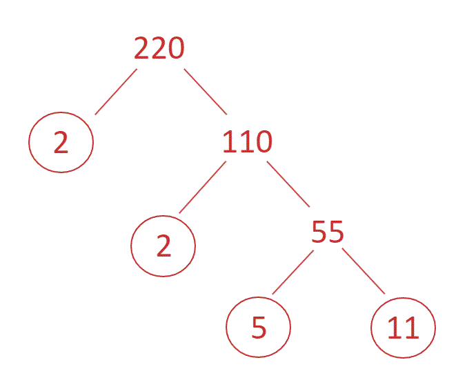

* ***[1]**

> *Write down all of the circled numbers with multiplication signs between them. Don't miss any of the repeated ones.*

> * *

$220=2\times2\times5\times11$

> * *

$2\times2\times5\times11$* or *$2^{2}\times5\times11$* ***[1]**

### Q19
> *Use a factor tree. Remember to circle any numbers which are prime.*

> * *

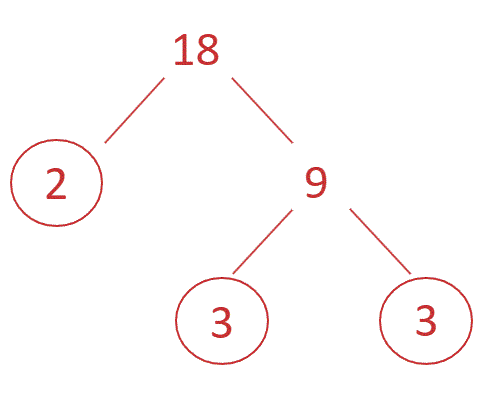

* ***[1]**

> *Write down all of the circled numbers with multiplication signs between them. Don't miss any of the repeated ones.*

> * *

$18=2\times3\times3$

* *$2\times3\times3$*  or** *** **$2\times3^{2}$** ****[1]**

### Q20
> *Use a factor tree to find the prime factors of 54.  Remember to circle the factors that are prime numbers.*

> * *

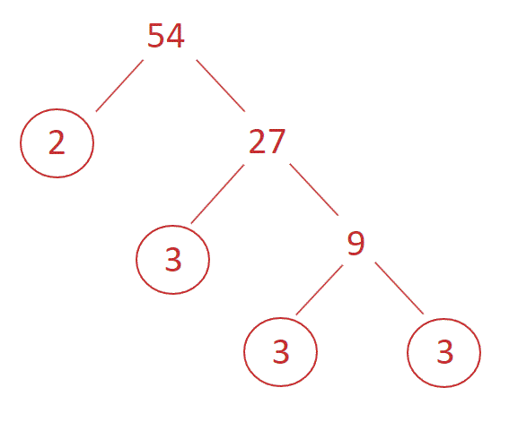

* ***[1]**

> *Write the prime factors with multiplication signs in between.*

> * *

$2\times3\times3\times3$* ***or **$2\times3^{3}$** [1]**

### Q21
> *The lowest common multiple of two numbers is the smallest number that is in both lists when writing out the times tables.*

> *Write out the first few numbers in the 15 times table*

$15:15,30,45,60,75,90,105,120,135...$

> *Write out the first few numbers in the 27 times table*

$27:27,54,81,108,135...$

** [1]**

> *135 is the smallest number that is in both lists.*

**135**** ****[1]**

### Q22
> *List the multiples of 8 and the multiples of 14.*

> * *

*Multiples of 8 = 8, 16, 24, 32, 40, 48, ****56****, 64...*

*Multiples of 14 = 14, 28, 42, ****56****, 70, 84...*

**[1]**

> *The first number that is in both lists is 56.*

** **

**56 ****[1]**

### Q23
> *Write out the factors of 60 and 90.*

*Factors of 60 = 1, 2, 3, 4, 5, 6, 10, 12, 15, 20, 30, 60*

*Factors of 90 = 1, 2, 3, 5, 6, 9, 10, 15, 18, 30, 45, 90*

* *

> *The highest odd number which is a factor of both numbers is 15.*

> * *

**15**** ****[1]**
