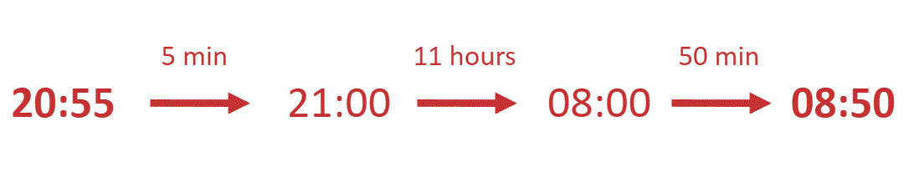

# Mark Schemes — Time, Currency & Conversions
**Number** · Cambridge (CIE) IGCSE maths (0580 & 0980)

## Exam Questions (46 questions)

### Q1
Start by converting to metres per hour

- There are 60 seconds in a minute

  - so the speed in metres per minute is

$15.5\times60=930$

- And there are 60 minutes in one hour

  - so the speed in metres per hour is

$930\times60=55800$

Then convert that speed in metres per hour to a speed in kilometres per hour

- There are 1000 metres in 1 kilometre

  - so divide that speed by 1000

$55800\div1000$

**[M1]**

**Final answer:** **55.8 km/h**

**[A1]**

> **[mark-scheme]**
> **M1**: For $\frac{15.5\times60\times60}{1000}$ or equivalent, or for the figures 558 appearing in the working.
> 
> **A1**: For 55.8 or equivalent.

### Q2
\$1 = 0.8626 euros

- So multiply 650 by 0.8626 to find the amount in euros

$650\times0.8626=560.69$

**Final answer:** **560.69 euros**

**[B1]**

### Q3
Find when the flight arrives using Madrid time

- Add 5 hours onto the local time in Buenos Aires

$04:50+5\mathrm{hours}=09:50$

**[M1]**

Find out the time difference between 21:55 and 09:50 working in chunks of time

$21:55\mathrm{to}22:00\mathrm{is}5\mathrm{minutes}\,22:00\mathrm{to}09:00\mathrm{is}11\mathrm{hours}\,09:00\mathrm{to}09:50\mathrm{is}50\mathrm{minutes}\,\mathrm{Total} \mathrm{time}=5\mathrm{mins}+11\mathrm{hours}+50\mathrm{mins}=11\mathrm{hours}55\mathrm{minutes}$

**Final answer:** **11 hours and 55 minutes**

**[A1]**

> **[mark-scheme]**
> **M1**: For either using the time difference or finding the difference between 21:55 and 04:50.
> 
> **A1**: Correct answer.

### Q4
> *Divide by 1000 when going from metres to kilometres *

$1000m=1\mathrm{km}$

> *Since the question says square metres, you must divide it by 1000 twice*

> *Therefore, the answer is *

$455500000000\div1000^{2}\,455500000000\div1000000=455500\mathrm{km}^{2}$

**[B1]**

> *Rounding to 3 significant figures*

$456000\mathrm{km}^{2}$

**[B1]**

### Q5
> *Converting the price into pounds*

$49980\div195=256.308...$

**[M1 A1]**

> *Rounding the number*

`£ 256`

**[A1]**

> **[mark-scheme]**
> **M1**: For a correct method to convert.
> 
> **A1**: For a correct unrounded number.
> 
> **A1**: For the correct rounded number.

### Q6
> *Break up the journey into days, hours, and minutes*

$33\mathrm{Hours}25\mathrm{Minutes}=1\mathrm{day}9\mathrm{Hours}25\mathrm{Minutes}$

*Adding *$1\mathrm{day}$* to 16:50 on Tuesday gets 16:50 on Wednesday*

*Adding *$9\mathrm{Hours}$* to 16:50 gets 25:50, which rolls over to the new day*

*Now , the time and day is 1:50 on Thursday*

*Adding *$25\mathrm{minutes}$* gets 2:15 on Wednesday *

**Final answer:** **2:15 am on Wednesday**

**[M1 A1]**

### Q7
> *Add 5 hours onto 03:50 to find the time in Madrid when the plane lands.*

> * *

$03:50+5\mathrm{hours}=08:50$

**[1]**

> *Work out the time difference between 20:55 and 08:50 by working in chunks of time.*

> * *

*11 hours + 50 minutes + 5 minutes = 11 hours 55 minutes*

* *

**11 hours 55 minutes** **[1]**
> *To convert from euros to pesos, multiply by 24.8.*

> * *

$200\times24.8=4960$

> * *

**4960 pesos** **[1]**

### Q8
> *The time from 09:30 am to 13:00 am is 3.5 hours. *
*The time from 14:15 am to 20:30 am is 6.25 hours. *

$3.5+6.25=9.75\mathrm{hours} \mathrm{per} \mathrm{day}$

**[1]**

> *The shop is open 6 days a week.*

$6\times9.75=58.5$

**58.5**** ****[1]**

### Q9
> *Convert 7.13 pm to a 24 hour clock by adding 12 hours*

*7.13 pm + 12 hours*

*= 19 13*

> *Calculate the number of minutes to 18 00*

*60 - 58 = 2 minutes*

> *Calculate the number of minutes from 18 00 to 19 13*

*19 13 - 18 00 = 1 hour 13 minutes*

*= 60 minutes + 13 minutes*

*= 73 minutes*

> *Add the 2 minutes onto this time for the total time*

*73 + 2*

**75 minutes ****[1]**

### Q10
> *The formula for speed is*

$\mathrm{speed}=\frac{\mathrm{distance}}{\mathrm{time}}$

> *Rearrange to make time the subject*

$\mathrm{time}=\frac{\mathrm{distance}}{\mathrm{speed}}$

> *Substitute in the values*

$\mathrm{time}=\frac{3840}{720}=5.333...$

**[1]**

> *Convert to hours and minutes.*

$5.333...\mathrm{hours}=5\mathrm{hours}20\mathrm{minutes}$

**[1]**

> *Add the time onto the start time.*

$15:30+5\mathrm{hours}20\mathrm{minutes}=20:50$

**[1]**

> *The time is 2 hours ahead so add on 2 hours.*

$20:50+2\mathrm{hours}=22:50$

**22:50** **[1]**
> *To convert from baht to dollars, divide by 34.8*

$2610\div34.8=75$

**correct calculation ****[1]**

**\$75**** ****[1]**

### Q11
> *Convert \$150 into euros by multiplying by 0.84.*

> * *

$150\times0.84=126$

* ***[1]**

> *Divide the total amount of euros (126) by the cost for each 200g block of cheese (3.45) to find how many the chef can buy.*

> * *

$126\div3.45=36.5217...$

* ***[1]**

> *Multiply the number of blocks of cheese the chef can buy (36.5217...) by the number of grams in each block (200).*

> * *

$36.5217...\times200=7304.3478...$

* ***[1]**

> *Divide by 1000 to convert into kg.*

> * *

$7304.3478...\div1000=7.3043...$

> * *

> *Round to one decimal place.*

> * *

**7.3 kg** **[1]**

### Q12
> *Subtract 12 years from March 2018 to determine those who were born before this date  *

*March 2018 - 12 years = March 2006  *

> *Those who were born before March 2006 are:  *

*Arj, Cala, Elu, and Gani  *

> *Divide 150 by 100 to convert from metres to centimetres  *

*150 cm *$\div$* 100 = 1.5 m  *

> *Of the people listed above, those who are at least 1.5 metres tall are:*

*Arj, Cala, and Elu  *

> *Multiply 0.5 by 1000 to convert from kilometres to metres  *

*0.5 km *$\times$* 1000 = 500 m  *

> *Of the people listed above, those who are able to swim at least 500m are:   *

**Cala** **[1] **
**Elu**** ****[1]**

### Q13
> *There are 1000 g in 1 kg so to convert from kg to g, multiply by 1000.*

$3.5\times1000=3500$

**3500 kg**** ****[1]**

> *There are 100cm in a m so to convert from m**2 **to cm**2**, multiply by 100**2**.*

$1.4\times100^{2}=14000$

**14 000 cm****2**** ****[1]**

### Q14
> *Multiply the number of days by the number of hours in a day by the number of minutes in an hour and by the number of seconds in a minute.*

$31\times24\times60\times60$

**[1]**

$2678400$* ***[1]**

### Q15
> *Divide the number of dollars by the conversion rate to determine the number of rupees*

$\frac{20}{0.016}$

**[1]**

**1250** **[1]**

### Q16
> *To convert from metres to millimetres, multiply by 1000*

**6000** **[1]**
> *To convert from square centimetres to square metres, divide by 10,000 (equal to 100**2**)*

**0.7** **[1]**

### Q17
> *Divide the number of Japanese Yen by the exchange rate to determine the value in dollars*

$9395\div110.27$

**[1]**

$=85.19996373$

**[1]**

**\$ 85.20 ****[1]**

### Q18
> *Convert the cost of the jacket in euros to rupees by multiplying the value by the appropriate conversion rate*

> * *

$165\times76.05=12548.25$

**[1]**

** **

> *Convert the cost of the jacket in dollars to rupees by dividing by the appropriate exchange rate*

> * *

$180\div0.0152$

**[1]**

** **

$=11842.10526$

**[1]**

** **

> *Find the difference between the two values in rupees to determine how much cheaper the blue jacket is than the grey jacket*

$12548.25-11842.10526=706.1447368$

**The blue jacket is cheapest by 706 rupees**** ****[1]**

> *Any value between 706.1 to 706.2 will be accepted*

### Q19
> *Multiply \$575 by the exchange rate for euros*

`575 cross times 0.88 equals € 506`

**[1]**

> *As 45% of the total amount was spent in France, the remaining percentage was not spent in France*

`100 minus 45 equals 55 percent sign`

> *Calculate 55% of the number of euros*

`506 cross times 0.55 equals € 278.30`

**[1]**

> *Convert this amount to pounds sterling by dividing the amount of euros remaining by the conversion rate*

`278.3 divided by 1.15 equals £ 242`

**[1]**

`bold £ bold 242`** [1]**

### Q20
> *Work out how many hours the museum is open.*

> *Monday to Friday, the museum is open for 8 hours per day. *

> * *

$5\times8\mathrm{hours}=40\mathrm{hours}$

> * *

> * Saturday and Sunday, it is open for 6 hours per day.*

> * *

$2\times6\mathrm{hours}=12\mathrm{hours}$

> * *

> *Add together.*

$40+12=52\mathrm{hours}$

**[1]**

> *Multiply the number of hours by the number of guards (4).*

> * *

$52\times4=208$

**[1]**

> *Divide by 30 because each guard can only work 30 hours per week.*

> * *

$208\div30=6.933...$

**[1]**

> *As whole number of guards is needed, round up. *

$7$* ***[1]**

### Q21
> *Convert from *$m^{3}$* to *$\mathrm{cm}^{3}$* by multiplying by *$1000000$* This is equal to 100**3*

$4.1\times1000000=4100000$

**4 100 000 cm****3**** [1]**

### Q22
> *Determine the number of metres covered in 1 minute*

$80\div5=16$* metres per minute*

> *Multiply the number of metres by the number of minutes*

$16\times45=720m$

**720 m**** ****[1]**
> *Convert *$2.8km$* into metres by multiplying by *$1000$

$2.8\times1000=2800m$

> *Divide the number of metres by the number of metres per minute*

$2800\div16=175$* minutes*

**[1]**

**175 min** **[1]**

### Q23
a) *Add 14 minutes to the time  *

*10 50 + 14 minutes*

* *

**11 04**** ****[1]**

** **

ii) *From the timetable, the next bus at City Gate after 11 04 is*

*11 12*

> *Follow the timetable down the column until the row for Kingswood Park*

**11 50**** [1]**

** **

iii) *Subtract the times for one bus at these two places*

*11 50 - 11 12*

**Final answer:** **38 minutes**** [1]**

** **

### Q24
> *Write the exchange rate as a ratio.*

*US Dollars : Hungarian forints*

`$ 1 space colon space 290 space forints`

> *Levante changes 24 650 Hungarian forints so add a line to the ratio*

`$ 1 space colon space 290 space forints`

`$ x space colon space 24 space 650 space forints`

> *Convert 24 650 Hungarian forints to dollars by dividing 24 650 by 290*

`24 space 650 space divided by space 290 space equals space $ 85`

**[1]**

** **`bold $ bold 85 bold space`** [1]**

### Q25
> *Divide the number of dollars by the exchange rate*

$500\div1.0697=467.4207722$

**[1]**

**€ 467.42** **[1]**

### Q26
$1\mathrm{litre}=1000\mathrm{cm}^{3}$

> *Multiply *$4.37$* by *$1000$*.*

$4.37\times1000=4370$

$4370$* ***[1]**

### Q27
> *Partition 36 minutes into 26 minutes and 10 minutes to subtract back across the hour*

*13 26 - 26 mins = 13 00*

*13 00 - 10 mins = 12 50*

> *Subtract 7 hours from this time*

*12 50 - 7 hours = 05 50*

**05 50 ****[1]**

### Q28
> *To convert between yuan and dollars, divide by 6.4*

> * *

$1200\div6.4=187.5$

> * *

`bold $ bold 187 bold. bold 50`** [1]**

### Q29
> *First work out how much Musa has drunk.*

$5\times250\mathrm{ml}=1250\mathrm{ml}$

**[1]**

> *Then work out how much is left in the bottle. There are 1000 ml in a litre, so 2 litres is 2000 ml.*

$2000-1250=750\mathrm{ml}$

**750 ml**** ****[1]**

### Q30
> *For **five days** during the week (Monday to Friday), the cafe is open **10 hours**. On Saturdays it is open for **5.5 hours**.*

> *Multiply 5 by 10 and add on 5.5.*

> * *

`open parentheses 5 cross times 10 close parentheses plus 5.5 equals 55.5 space hours`

* ***[1]**

> *There are no more hours to add on, because the cafe is closed on Sundays.*

> * *

$55.5\mathrm{hours}$* ***[1]**

### Q31
> *The exchange rate is \$1 = 68.14 rupees so to convert from dollars to rupees, multiply by 68.14. To convert form rupees to dollars, divide by 68.14. *

`30 space 000 space divided by space 68.14 space equals space $ 440.27...`

**[1]**

**\$440**** ****[1]**

### Q32
> *The number of hours each day can be calculated by partitioning the time up to and beyond midday (12:00)*

*Monday: 8:30 to 16:00 = 3.5 hours + 4 hours = 7.5 hours*

*Tuesday: 10:00 to 17:00 = 2 hours + 5 hours = 7 hours*

*Thursday: 8:30 to 16:30 = 3.5 hours + 4.5 hours = 8 hours*

*Saturday: 8:00 to 18:30 = 4 hours + 6.5 hours = 10.5 hours*

**[1]**

> *Add these times together for the total number of hours worked*

*7.5 + 7 + 8 + 10.5 = 33*

**33 hours**** [1]**

### Q33
> *Add 6 hours on to 19:46.*

> * *

$19:46+6\mathrm{hours}=01:46$

> * *

> *Add on 25 minutes (use the fact that there are 60 minutes in an hour to help).*

> * *

$01:46+25\mathrm{minutes}=02:11$

> * *

**02:11** **[1]**

### Q34
> *To convert between Krona and Dollars, multiply by 0.0099.*

> * *

$40000\times0.0099=396$

> * *

`bold $ bold 396`* ***[1]**

### Q35
> *There are 1000 m in a km. To convert from metres into kilometres, divide by 1000.*

$560\div1000=0.56$

**0.56 km**** ****[1]**

### Q36
> *1 metre is the same as 100 centimetres.*

$1m=100\mathrm{cm}$

> *To change 4.6 metres into centimetres, multiply 4.6 by 100.*

$4.6m\times100=460\mathrm{cm}$

$460$**cm**** ****[1]**

### Q37
> *There are **24 hours** in **one day**.*

> *Multiply 24 hours by 3.*

$24\times3=72$

$72\mathrm{hours}$* ***[1]**

### Q38
> *Convert from *$\mathrm{mm}$* to *$\mathrm{cm}$* by dividing by *$10$

$645\div10=64.5$

**64.5 cm**** ****[1]**

### Q39
> *Convert 75 minutes to hours and minutes*

*75 mins = 60 mins + 15 mins = 1 hour 15 minutes*

> *Add 1 hour and 15 minutes to 11:10*

*11:05 + 1 hour + 15 mins*

*= 12:05 + 15 mins*

**12:20**** [1]**

### Q40
> *There are 1000 metres in a kilometre.  So to change kilometres into metres, multiply by 1000.*

> * *

$5.3\times1000=5300$

> * *

**5300** **[1]**

### Q41
(i) *The bus leaves at 35 minutes past 7.*

> *Subtract 23 minutes from 35.*

> * *

$35-23=12$

> * *

> *He needs to leave his house at **12 minutes past 7.*

> * *

**07:12**** ****[1]**

(ii) *The bus leaves at 35 minutes past 7.*

> *Add 41 minutes onto 35.*

> * *

$35+41=76$

> * *

> *76 minutes is **1 hour and 16 minutes **(because there are 60 minutes in one hour).*

> *Add this onto 07 00.*

> * *

$700+1\mathrm{hr}16=0816$

> * *

**08:16** **[1]**

### Q42
> *Convert from metres to centimetres by multiplying by 100*

*4365 × 100 = 436 500*

**436 500 cm**** ****[1]**

### Q43
> *To convert from centimetres to metres, divide the amount by *$100$

$3670\div100=36.7$

**36.7 m ****[1]**

### Q44
> *Increase the number of hours by 12*

$3+12=15$

> *Include the minutes within the final answer*

**15 25**** [1]**

### Q45
i) *The second high tide on Wednesday is at *

*15 37*

> *Decrease the number of hours by 12*

*15 - 12 = 3*

> *As 15 37 is after midday, the answer will be "pm" Include the minutes within the final answer*

**  ****3.37 pm*** ***[1]**

** **

ii) *The two low tides on Thursday are:*

*1st low tide at 09 41*

*2nd low tide at 22 07** *

> *Calculate the number of minutes between 9 41 and 10 07*

*(60 - 41) + 7 = 19 + 7 = 26 minutes*

> *Calculate the number of hours between the new time of 10:07 and 22:07*

*22 - 10 = 12 hours*

**12 h  26 min** **[1]**

** **

iii) *Write down the time of the high tide on Tuesday afternoon*

*14 22*

> *Partition 30 minutes into 22 minutes and 8 minutes to subtract back across the hour *

*14 22 - 22 mins = 14 00*
*14 00 - 8 mins = 13 52*

> *Subtract 1 hour from this time *

*13 52 - 1 hour*

* *

**12 52** **[1]**

### Q46
> *To convert from yen to dollars, multiply by 0.0125.*

> * *

$2050\times0.0125=25.625$

**[1]**

** **

> *Round to the nearest dollar.*

> * *

**\$26** **[1]**
