# Mark Schemes — Set Notation & Probability Diagrams
**Probability** · Cambridge (CIE) IGCSE maths (0580 & 0980)

## Exam Questions (19 questions)

### Q1
Find the probability of getting a red from each bag by subtracting the probability of green from 1

$1-0.6=0.4\,1-0.2=0.8$

The bead selected from bag A does not affect the probabilities of selecting each colour bead from bag B

- The two pairs of branches for bag B are identical

**[M1 A1]**

> **[mark-scheme]**
> **M1**: For correctly finding 0.4 or 0.8.
> 
> **A1**: Fully correct.
Find the different combinations of getting one of each colour and multiply the probabilities

*P(G, R) = 0.6 × 0.8 =0.48*

*P(R,G)=0.4 × 0.2=0.08*

**[M1]**

To find the probability of one of these options happening add the two probabilities above

*0.48 + 0.08=0.56*

**Final answer:** **0.56**

**[A1]**

> **[mark-scheme]**
> **M1**: For attempting to multiply relevant probabilities from your tree.
> 
> **A1**: Correct answer. You can also write the answer as a fraction.

### Q2
List the positive integers less than 16

`xi equals open curly brackets 1 comma 2 comma 3 comma 4 comma 5 comma 6 comma 7 comma 8 comma 9 comma 10 comma 11 comma 12 comma 13 comma 14 comma 15 close curly brackets`

List the prime numbers (numbers that only have 2 factors one and themselves) and multiples of 3

- Remember 1 isn't a prime as it's only factor is 1

`X equals open curly brackets 2 comma 3 comma 5 comma 7 comma 11 comma 13 close curly brackets`

`Y equals open curly brackets 3 comma 6 comma 9 comma 12 comma 15 close curly brackets`

Place your numbers in the Venn diagram

- Remember numbers that are in both the X and Y lists are placed in the intersection
- Numbers that are only in $ξ$ need to be placed outside the circles

**[B1 B1]**

> **[mark-scheme]**
> **B1**: At least 10 numbers in the correct place.
> 
> **B1**: All numbers in the correct place.
These are the numbers that are in both sets

- List the numbers in your intersection

**Final answer:** **3 **

**[B1]**

> **[mark-scheme]**
> **B1**: For writing down the numbers in the intersection in **your own** diagram.
$Y'$ means the elements not in $Y$

- The 10 numbers $1,2,4,5,7,8,10,11,13,14$ are not in $Y$

**Final answer:** **10**

**[B1]**

### Q3
> *The events are independent, rolling the dice once does not change the probability of the next*

> $M$*  and *$M'$* are mutually exclusive and exhaustive events meaning that the sum of their probabilities must be 1*

> **[exam-tip]**
> In other words, the branches at a given split must add to 1 and therefore
> 
> `straight P open parentheses M close parentheses plus 2 over 3 equals 1
> straight P open parentheses M close parentheses equals 1 minus 2 over 3
> straight P open parentheses M close parentheses equals 1 third`
> 
> You can also find this by counting the number of possibilities. The number can land on six numbers, two of which are greater than 4.
> 
> $\frac{2}{6}=\frac{1}{3}$

**[B1 B1]**

> **[mark-scheme]**
> **B1**: At least one correct branch.
> 
> **B1:** Fully correct tree diagram.
> *Getting a point twice would require *$M$* to occur twice*

> *Achieving the first *$M$* is a *$\frac{1}{3}$* chance*

> *Achieving the second *$M$* is also a *$\frac{1}{3}$* chance*

> *The probability of *$M$* **and** *$M$* occurring would be the product of the probabilities*

$\frac{1}{3}\times\frac{1}{3}$

**[M1]**

$\frac{1}{9}$

**[A1]**
> *The paths where at least one *$M'$* occurs are:*

$MM'\,M'M\,M'M'$

**[M1]**

> *Multiplying along the paths*

$M\timesM'=\frac{2}{9}\,M'\timesM=\frac{2}{9}\,M'\timesM'=\frac{4}{9}$

> *Adding all these paths together*

$\frac{2}{9}+\frac{2}{9}+\frac{4}{9}=\frac{8}{9}$

$\frac{8}{9}$

**[A1]**

> **[exam-tip]**
> You can also simply subtract the event of on $M'$ occurring, which is the same as the event that two $M$ occur. Since you worked this out in part b, $1-\frac{1}{9}=\frac{8}{9}$

### Q4
> *Identify the elements in both *$A$*and *$B$

$A\capB$`equals open curly brackets 3 comma space 9 close curly brackets`

> *Identify the elements only in *$A$* and only in *$B$

`A intersection B apostrophe equals open curly brackets 6 comma space 10 comma space 12 close curly brackets
A apostrophe intersection B equals open curly brackets 2 comma space 4 comma space 5 comma space 11 comma space 13 comma space 14 close curly brackets`

> *Identify any elements not in either *$A$* or *$B$

`open parentheses A union B close parentheses apostrophe equals open curly brackets 1 comma space 7 comma space 8 close curly brackets`

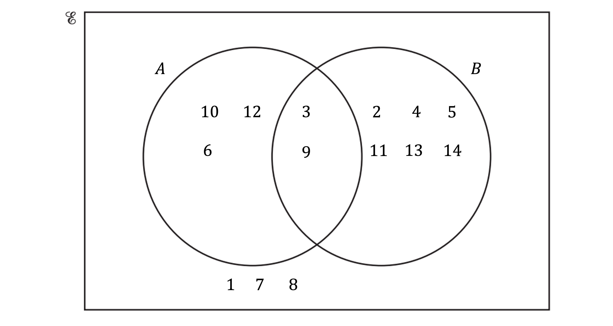

**[B1 B1]**

> **[mark-scheme]**
> **B1**: For at least 6 elements in the correct place.
> 
> **B1**: Fully correct.
> *Recognise *$A\capB$* as the intersection between *$A$* and *$B$

> *There are two elements, 3 and 9*

> *Therefore the number of elements in the intersection, *

`straight n open parentheses A intersection B close parentheses equals 2`

**[B1]**
> *Elements in *$A$

$10,12,6,3,9$

> *Elements not in *$B$* (*$B'$*)*

$10,12,6,1,7,8$

> *Values in *$A$*or outside of*$B$* are a combination of the previous sets, with no duplicates*

$10,12,6,3,9,1,7,8$

> *Therefore the number of elements in the set is *

`straight n open parentheses A union B apostrophe close parentheses equals 8`

**[B1]**

### Q5
> *The number of people who go to the park but do not play golf or tennis is *$25$*. *
*Write this into the Venn diagram*

> *The number of people who play golf or tennis is the difference between the number of people who go to the park, and the number of people who do not play golf or tennis*

$120-25=95$

> *Determine the number of people who play golf and tennis by finding the difference between the number of people who play golf (*$75$*) added to the number of people who play tennis (*$50$*), and the calculated number of people who play golf or tennis (*$95$*)*

`open parentheses 75 plus 50 close parentheses minus 95 equals 30`

> *Write this value into the Venn diagram at the intersection of the two sets*

* Any two correct values in the Venn diagram*** [1]**

> *As *$50$* people play tennis, subtract the *$30$* people who also play golf to determine the number of people who only play tennis*

$50-30=20$

> *Write this value into the Venn diagram in the left crescent*

> *Repeat this process for the number of people who only play golf*

$75-30=45$

> *Write this value into the Venn diagram in the right crescent*

*All four values in the Venn diagram correct*** [1]**
> *The number of people who play tennis and golf is the number in the intersection of the two circles in the diagram*

$30$ **[1]**

### Q6
> *Subtract the number of girls studying German from the total number of students studying German to find the number of boys studying German*

*53 - 32 = 21*

> *Add together the number of boys and girls studying Spanish to find the total number of students studying Spanish*

*48 + 54 = 102*

> *Find the number of girls studying Italian by subtracting the number of boys studying Italian from the total number of students studying Italian*

*30 - 19 = 11*

> *Find the number of boys studying Japanese by subtracting the numbers of boys studying French, German, Italian and Spanish from the total number of boys*

*123 - 27 - 21 - 48 - 19 = 8*

> *Find the total number of students studying Japanese by adding together the number of boys and girls studying Japanese*

*8 + 12 = 20*

> *Find the total number of students studying French by subtracting the total number of students studying German, Spanish, Italian and Japanese from the total number of students*

*262 - 53 - 102 - 30 - 20 = 57*

> *Find the total number of girls studying French by subtracting the number of boys studying French from the total number of students studying French*

*57 - 27 = 30*

> *Find the total number of girls by subtracting the total number of boys from the total number of students*

*262 - 123 = 139*

> *Complete the two-way table with your values*

|   | French | German | Spanish | Italian | Japanese | Total |
|---|---|---|---|---|---|---|
| Boys | 27 | **21** | 48 | 19 | **8** | 123 |
| Girls | **30** | 32 | 54 | **11** | 12 | **139** |
| Total | **57** | 53 | **102** | 30 | **20** | 262 |

> *1 mark for 3,4 or 5 correct values, *
*   ** **2 marks for 6 or 7 correct values,   *
* ** **3 marks for all correct values **[3]*
i) *The probability that a randomly picked female student studies Spanish is the total number of girls studying Spanish over the total number of girls*

$\frac{54}{139}$ **[1]**

ii) *The probability that a randomly picked male student studies French or Italian is the total number of boys studying French or Italian over the total number of boys*

$\frac{27+19}{123}$

$\frac{46}{123}$* ***[1]**

iii) *The probability that a randomly picked student does **not** study German is 1 - (the probability that a student **does** study German)*

$1-\frac{53}{262}$

$\frac{209}{262}$** [1]**

### Q7
(i) *Write down the factors of 12 (**F**). *

*1, 2, 3, 4, 6, 12 *

> *Write down the odd numbers *$\leq$*15 (**O**). *

*1, 3, 5, 7, 9, 11, 13, 15 *

> *The numbers that are in both lists, **1 **and **3**, go in the intersection of the two circles. *

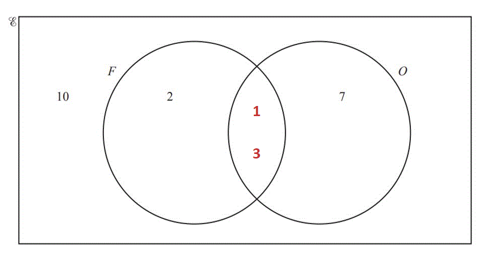

> *Write any numbers between 1 and 15 which are in neither of the lists outside of the circles (**10**, **8**, and **14**). *

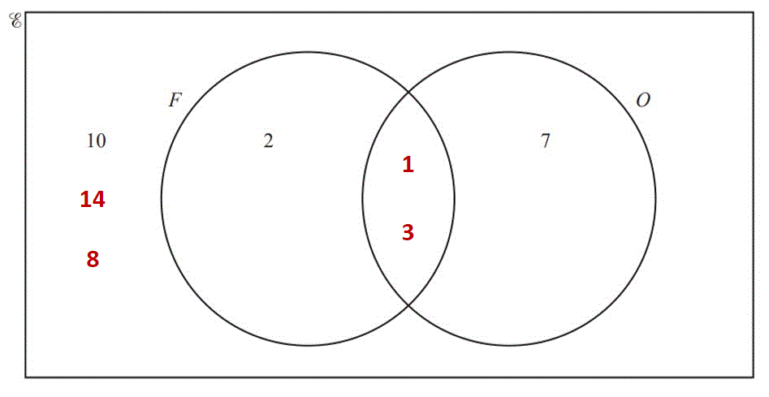

**[1]**

> *  The factors of 12 except 1 and 3 go into the **F **circle. The odd numbers except 1 and 3 go into the **O **circle. *

* A**ll correct*** ****[1]**

** **

* *(ii)*Write down one of the numbers which is in the **O **circle, not including the intersection. *

**5** **[1]**

> *7, 9, 11, 13, 15 also accepted*

> * *

(iii) *Count how many numbers there are in both circles. *

**12** **[1]**

** **

(iv) *Count how many numbers there are in the **O **circle, including the intersection. Write as a fraction of the total number of numbers in the Venn diagram, 15. *

$\frac{8}{15}$* ***[1]**

### Q8
i) *The elements of set *$F$* are factors of 14:*

**1, 2, 7, 14**** ****[2]**

> *1 mark if one number missing or one number extra*

*  *ii) *The elements in set *$P$* are the prime numbers less than 14:*

**2, 3, 5, 7, 11, 13** **[2]**

> *1 mark for one extra number or one number missing*

*  *iiia) *The elements of *$F$* and *$P$* are: *

*2 and 7*

> *These elements appear in the intersection of the two circles*

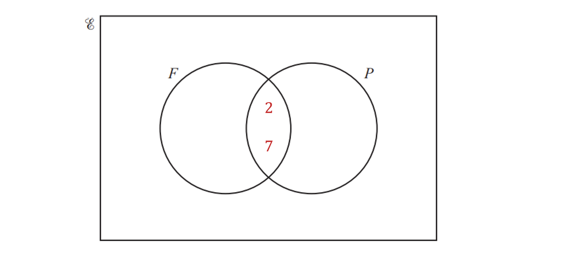

> *The elements of *$F$*  only are:  *

*1 and 14*

> *These elements appear in the left hand crescent of the circle for set *$F$

> *The elements of *$P$*  only are:*

*3, 5, 11 and 13*

> *These elements appear in the right hand crescent of the circle for set *$P$

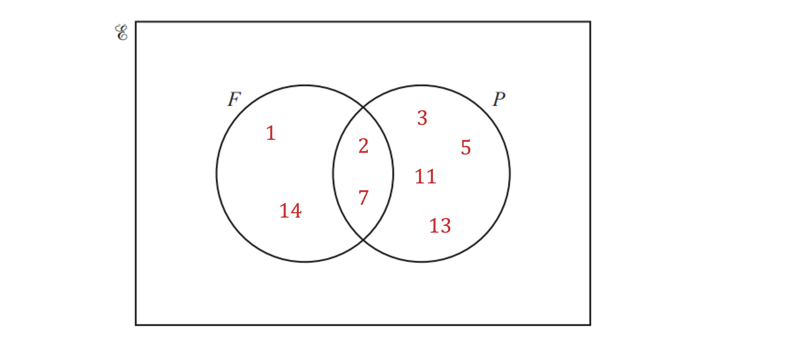

> *The remaining numbers are not in *$F$* or *$P$* so these are placed outside of the two circles:*

*4, 6, 8, 9, 10, 12  *

* For 2 or 3 sections correct*** [1]**
*For all remaining sections correct*** [1]**

iib) $n$*(*$F\capP$*) represents the number of items in the set *$F$* and *$P$*.*

> *The items in set  *$F$* and *$P$*  are*

*2 and 7*

> *The number of items in the set  *$F$* and *$P$*  is*

*2** ***[1]**

iic) *The probability of an event is calculated using the formula:*

> *P(event) = *$\frac{\mathrm{Number} \mathrm{of} \mathrm{events}}{\mathrm{Total} \mathrm{outcomes}}$

> *As the total number of outcomes is 14,  *

*Probability of *$F\cupP=\frac{k}{14}$

**[1]**

> *where the number of events is *$k$

> *The set  *$F\cupP$*  represents those items in *$F$* or *$P$*  *

$1,2,3,5,7,11,13,14$

*The number of items in the set *$F\cupP$*  is  *

$8$

> *The probability that a number is in the set *$F\cupP$*  is  *

$\frac{8}{14}=\frac{4}{7}$* *

$\frac{4}{7}$** [1]**

### Q9
(i) *Count how many numbers there are in the circle A.*

* ***9** **[1]**

** **

(ii) *List the numbers that are in the circle B. *

**3, 6, 9, 12, 15, 18** **[2]**

> *One mark for 4 or 5 correct*

> * *

(iiia) *Count how many numbers are outside the circles and write it as a fraction out of 19 (because there are 19 numbers in total).*

* *$\frac{7}{19}$* ***[1]**

** **

(iiib) *Count how many numbers are in the circles (because *$A\cupB$* is everything that is in either circle) and write it as fraction out of 19 (because there are 19 numbers in total). *

$\frac{12}{19}$* ***[1]**

** **

(iv) $A\capB$* is the numbers that are in both sets, so look at the numbers where the circles overlap.*

> *They are all even (because they are all in set *$A$*), and they are all multiples of 3 (because they are all in set *$B$*). *

**Even and a multiple of 3**** (which is a multiple of 6)****[1]**

** **

### Q10
(i) *Add up all the numbers in the Venn diagram. *

*12 + 8 + 7 + 4 = 31 *

**31**** ****[1]**

** **(ii) *Add together the two numbers in the **B** circle. *

*8 + 7 = 15 *

**15** **[1]**

** **(iii) `n open parentheses A union B close parentheses`* means the number of students who like apples **or **bananas.*

> *Add together the three numbers from inside both circles. *

*12 + 8 + 7 = 27 *

**27**** ****[1]**

** **(iv) *Add together the numbers in the **A **circle to work out how many students like apples, then subtract the number of students who like bananas, 15. *

*(12 + 8) - 15 = 5 *

**5** **[1]**

** **(v) *Add together all of the numbers in the Venn diagram to work out how many students there are in total. *

*12 + 8 + 7 + 4 = 31 *

> *Express the number of students who liked neither apples or bananas, 4 (outside the circles), as a fraction of the total number of students, 31.  *

$\frac{4}{31}$* ***[1]**

### Q11
> *Put 10 (the number who only like football) into the correct place in the Venn diagram.*

** **

> *Subtract 10 (the number who only like football) from 24 (the total number who like football) to find the number of students who like both sports. *

> $24-10=14$* *

> *Put 14 into the section where both circles overlap.*

**[1]**

> *Subtract 14 (the number who like both sports) from 19 (the total number who like cricket) to find out how many students like only cricket. *

$19-14=5$

> *Put 5 into the correct place in the Venn diagram.*

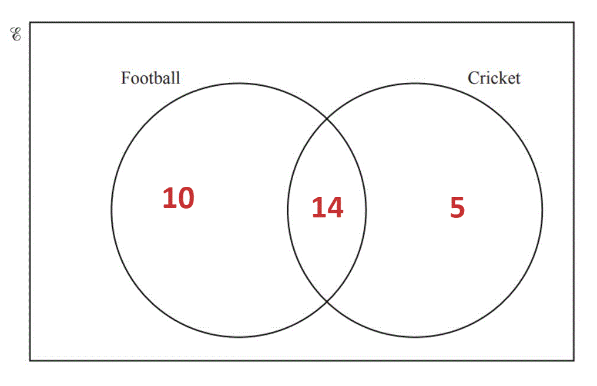

**[1] *** *

> *Add together all the numbers inside the circles and subtract from the total number of students, 40. *

> `40 minus open parentheses 10 plus 14 plus 5 close parentheses equals 11`* *

> *Put 11 into the box, outside the circles.*

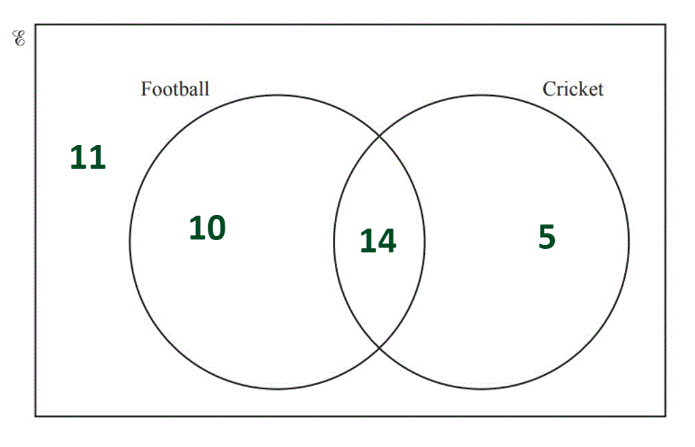

**[1]**

### Q12
> *The hamster circle has to add up to 27.*

> *Subtract 16 from 27 to find the number of children who own both a hamster and a rabbit. *

> $27-16=11$* *

> *Put in the Venn diagram in the correct place.*

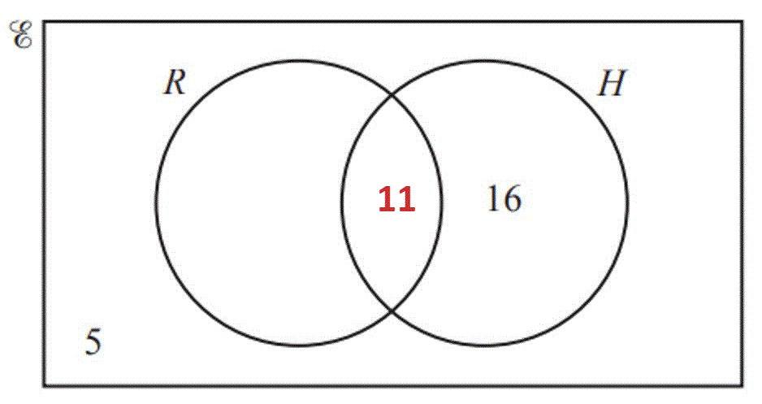

> *  *

> *The rabbit circle has to add up to 19.*

*Subtract 11 from 19 to find the number of children who only own a rabbit. *

$19-11=8$

> *Put in the Venn diagram in the right place. *

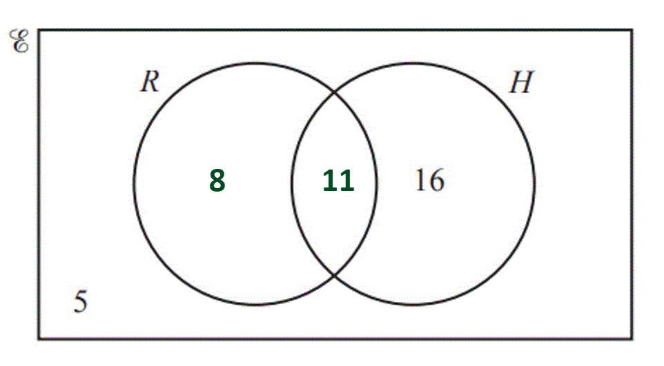

**One mark for each ****[2]**
> *This is the number of children who own both a hamster **and **a rabbit.  It is found where the circles overlap.*

> * *

**11** **[1]**

### Q13
(i) *Identify the square numbers in the list: *

> $4,16,64$* *

> *Identify the cube numbers in the list: *

> $8,64$* *

> *64 is in both lists so it goes in the middle, where the two circles overlap.*

> *4 and 16 go into the A circle. 8 goes into the B circle. *

> *2 and 32 are neither square, or cube, so they both go outside the circles, within the box. *

**All correct ****[2]**
**One mark for 4 or 5 numbers in the correct place**

(ii) $P\cupQ$* means "P **or **Q", shade in both circles (including the overlap). *

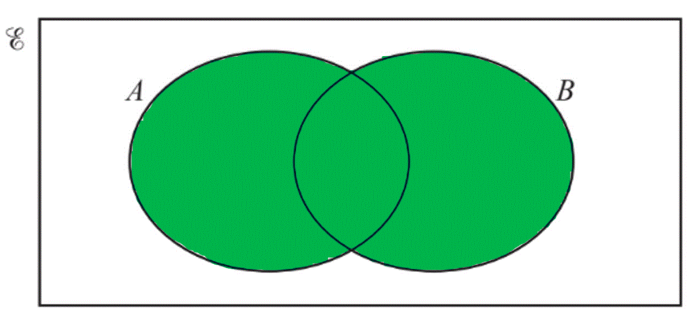

**[1]**

### Q14
i) *Subtract the number of female adults from the total number of adults to find the umber of male adults*

*225 - 129 = 96*

> *Subtract the number of male children from the total number of children to find the number of female children*

*275 - 144 = 131*

> *Complete the values in the table*

|   | Adult | Child | Total |
|---|---|---|---|
| Male | **96** | 144 | 240 |
| Female | 129 | **131** | 260 |
| Total | 225 | 275 | 500 |

**[1]**

ii) *Subtract the total number of adults from the total number of children to find out how many more children there were than adults*

*275 - 225 *

*50*** [1]**

iii) *The fraction of visitors you are adults is the total number of adults over the total number of visitors*

$\frac{225}{500}$

**[1]**

> *Simplify by dividing both parts by 25*

$\frac{9}{20}$ **[1]**

iv) *Write the total number of males : total number of females*

*240 : 260*

**[1]**

> *Simplify by dividing both parts by 20*

**12 : 13**** ****[1]**

v) *The probability that a visitor picked at random will be a male child, will be the total number of male children over the total number of visitors*

$\frac{240}{500}$

> *Simplify by dividing both parts by 20*

$\frac{12}{25}$ **[1]**

> *Equivalent values will be accepted*

### Q15
> $A\capB$* means **A **intersect **B **(**A **and **B**).*

> *Shade the intersection of the two circles.*

> * *

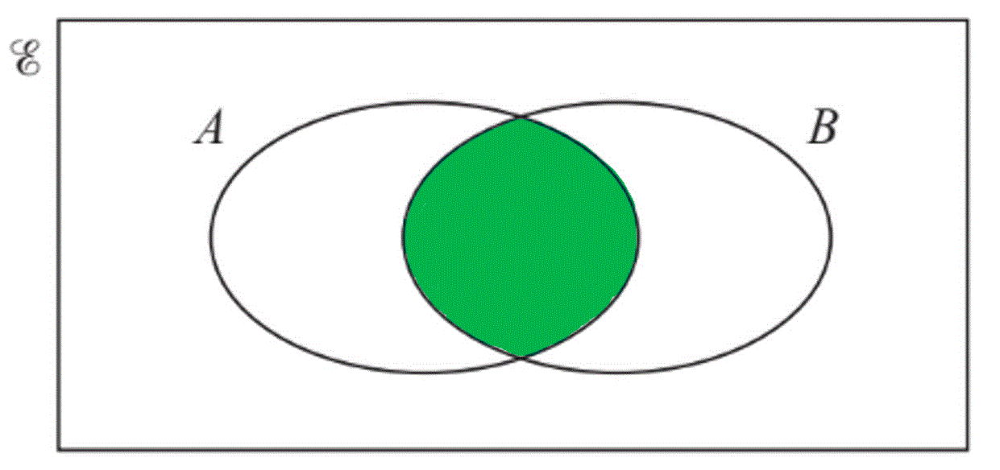

**[1]**
> *The only number which is **even **and **prime** is **2**. Write **2** in the intersection.*

> *The only number between 1 and 6 which is **neither** even nor prime is **1**. Write this outside the circles.*

> *Write the even numbers which are not prime, **4 **and **6**, in the **P **circle.*

> *Write the prime number which are not even, **3 **and **5**, in the **Q **circle.*

> * *

*4 or 5 numbers in the correct place*** [1]**
*All correct** ***[1]**

### Q16
> *For each pair of branches, the probability must add up to 1 *

> *Use this to calculate the two missing probabilities below*

**[1]**

> *We can use the information that "when it does not rain the probability that Amira goes fishing is *$\frac{3}{4}$*" to complete the final two spaces*

**[1]**

### Q17
i) *The probabilities of all possible outcomes of an event add up to 1*

> *The probability that Arun plays football on a Saturday is *$\frac{3}{4}$*, the only other option for Arun is that he does not play football To find the probability that Arun does not play, subtract the probability that he does plays from 1*

`straight P open parentheses Arun space does space not space play close parentheses equals 1 minus 3 over 4 equals 1 fourth`

> *The probability that Bob plays football on a Saturday is *$\frac{2}{5}$*, the only other option for Bob is that he does not play football To find the probability that Bob does not play, subtract the probability that he does plays from 1*

`straight P open parentheses Bob space does space not space play close parentheses equals 1 minus 2 over 5 equals 3 over 5`

> *The probability that Bob plays is not affected by whether or not Arun plays football*

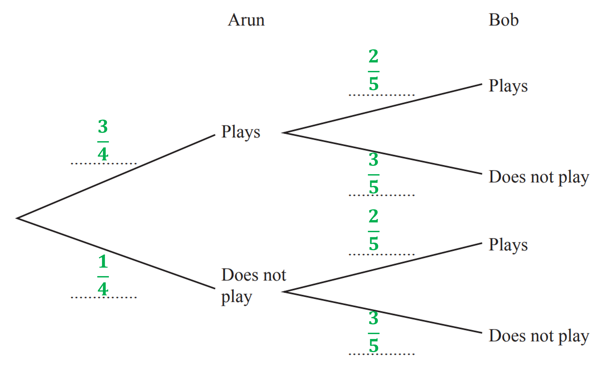

*1 correct pair of branches*** [1] **
*All pairs of branches correct** ***[1]**

ii) *To find the probability that both Arun and Bob play, find the route on the tree diagram and multiply the probabilities of each event together*

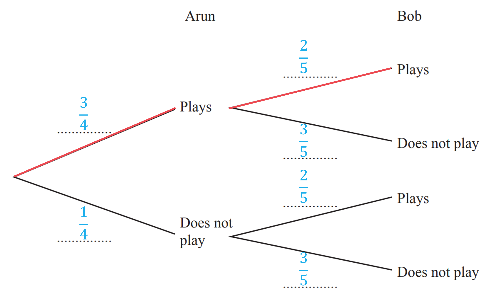

$\frac{3}{4}\times\frac{2}{5}$

**[1]**

$\frac{3}{10}$** [1]**

**It is acceptable to write as a decimal: 0.3**

### Q18
> *The top diagram shows **A **or **B **(**A **union **B**).*

$A\cupB$* ***[1]**

** **

> *The bottom diagram shows **A **and **B **(**A **intersect **B**).*

$A\capB$* ***[1]**

### Q19
> *The region shaded is all elements in *$A$

$A$ **[1]**
> *The region shaded is all of the elements in the set of *$A$* or *$B$*, this is the union of *$A$* and *$B$

$A\cupB$ **[1]**
