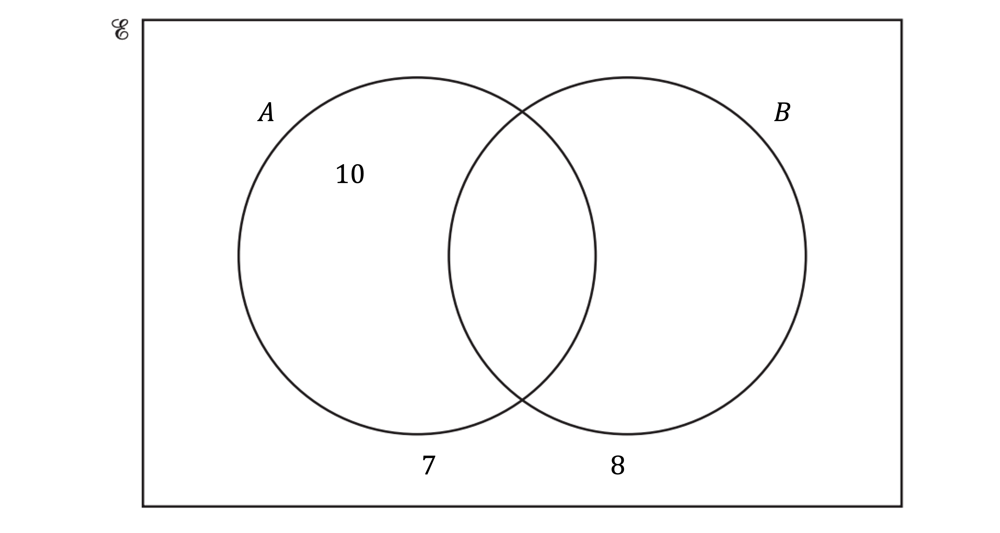
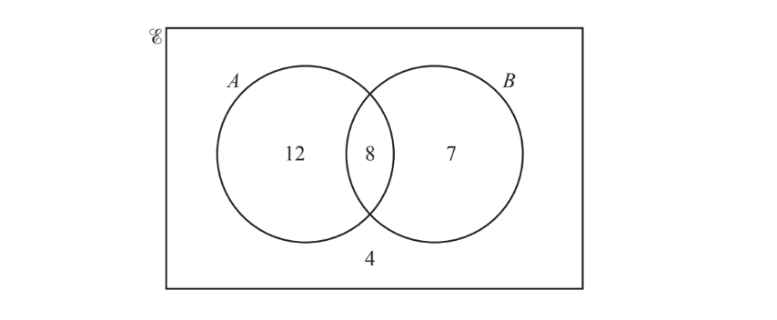
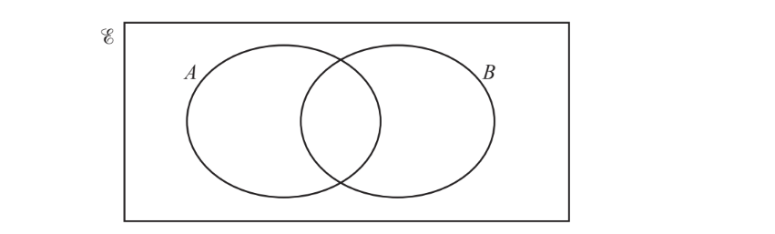
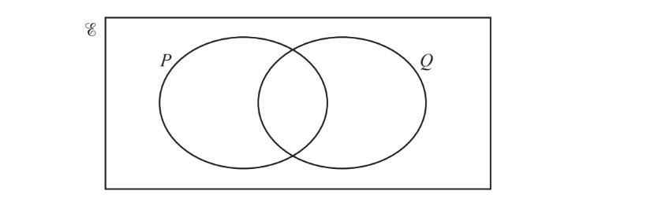
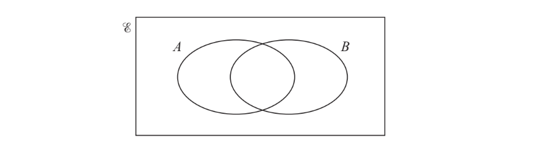
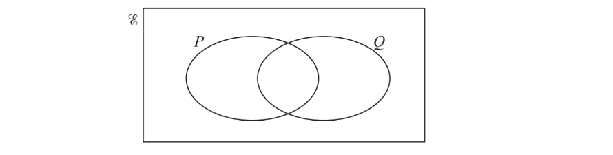
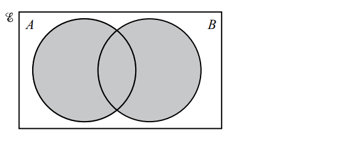

# Exam Questions — Set Notation & Probability Diagrams
**Probability** · Cambridge (CIE) IGCSE maths (0580 & 0980)
> Source: [https://www.savemyexams.com/igcse/maths/cie/25/core/topic-questions/](https://www.savemyexams.com/igcse/maths/cie/25/core/topic-questions/) · 19 questions across 1 sets

## Exam Questions (19 questions)

### Q1 — hard — 4 marks

**Q1** [2 marks]

Two bags, A and B, each contain green beads and red beads only.

The probability of taking a green bead at random from bag A is 0.6.

The probability of taking a green bead at random from bag B is 0.2.

A student takes one bead at random from bag A and one bead from bag B.

Complete the tree diagram.

**Q1** [2 marks]

**Extract:**

Two bags, A and B, each contain green beads and red beads only.

The probability of taking a green bead at random from bag A is 0.6.

The probability of taking a green bead at random from bag B is 0.2.

A student takes one bead at random from bag A and one bead from bag B.

Find the probability he gets one of each colour.

### Q2 — hard — 4 marks

**Q2** [2 marks]

$ξ$= {positive integers less than 16}

$X$ = {prime numbers}

$Y$={multiples of 3}

Use this information to complete the Venn diagram.

**Q2** [1 mark]

**Extract:**

\[\xi\]= {positive integers less than 16}

\[X\] = {prime numbers}

\[Y\]={multiples of 3}

List all the elements of $X\capY$

**Q2** [1 mark]

**Extract:**

ξ = {positive integers less than 16}

X = {prime numbers}

Y = {multiples of 3}

ξ = {1, 2, 3, 4, 5, 6, 7, 8, 9, 10, 11, 12, 13, 14, 15}

Y = {3, 6, 9, 12, 15}

Find `straight n open parentheses Y apostrophe close parentheses`

### Q3 — hard — 6 marks

**Q3** [2 marks]

Ali rolls a fair six-sided dice labelled 1 to 6.

Ali gets a point when the dice lands on a number greater than 4.

Let $M$ denote the event that Ali's dice lands on a number greater than 4 when rolled.

He rolls the dice twice.

Complete the tree diagram.

**Q3** [2 marks]

Calculate the probability that he gets a point twice.

**Q3** [2 marks]

Calculate the probability that he lands on 4 or less at least once.

### Q4 — medium — 4 marks

**Q4** [2 marks]

$ξ$ = {$x:x$ is a natural number less than 15}

$A$* *= {3, 6, 9, 10, 12}

$B$= {2, 3, 4, 5, 9, 11, 13, 14}

Complete the Venn diagram.

**Q4** [1 mark]

Find `straight n open parentheses A intersection B close parentheses`.

**Q4** [1 mark]

Find `straight n open parentheses A union B apostrophe close parentheses`.

### Q5 — hard — 3 marks

**Q5** [2 marks]

$E$= {children who go to the park} 
$T$= {children who play tennis}
$G$ = {children who play golf}

120 children go to the park. 
50 play tennis. 
75 play golf. 
25 do not play tennis or golf.

Complete the Venn diagram.

[2]

*Source: Specimen 2020 0580/01 Q23A*

**Q5** [1 mark]

**Extract:**

![calligraphic E]= {children who go to the park} 

![space T space]= {children who play tennis}

![G] = {children who play golf}

120 children go to the park.

50 play tennis.

75 play golf.

25 do not play tennis or golf.

Find n($T\capG$).

*Source: Specimen 2020 0580/01 Q23B*

### Q6 — hard — 6 marks

**Q6** [3 marks]

The 262 students at a college each study one of the languages shown in the table.

|   | French | German | Spanish | Italian | Japanese | Total |
|---|---|---|---|---|---|---|
| Boys | 27 |   | 48 | 19 |   | 123 |
| Girls |   | 32 | 54 |   | 12 |   |
| Total |   | 53 |   | 30 |   | 262 |

Complete the table.

[3]

*Source: May/June 2018 0580/32 Q6A*

**Q6** [3 marks]

**Extract:**

The 262 students at a college each study one of the languages shown in the table.

|   | French | German | Spanish | Italian | Japanese | Total |
| Boys | 27 |   | 48 | 19 |   | 123 |
| Girls |   | 32 | 54 |   | 12 |   |
| Total |   | 53 |   | 30 |   | 262 |
Complete the table.

Find the probability that

i) a girl, chosen at random, studies Spanish,

[1]

ii)a boy, chosen at random, studies French or Italian,

[1]

iii)a student, chosen at random, does not study German.

[1]

*Source: May/June 2018 0580/32 Q6B*

### Q7 — hard — 5 marks

**Q7** [5 marks]

$E$ = {$x$ : $x$ is a natural number `less-than or slanted equal to`15}

$F$ = {$x$ : $x$ is a factor of 12}

$O$ = {$x$ : $x$ is an odd number}

i) Complete the Venn diagram to show the elements of these sets.

[2]

ii) Write down one number that is in set $O$, but not in set $F$.

[1]

iii) Find `straight n open parentheses F union O close parentheses`.

[1]

iv) A number is chosen at random from $E$.

Work out the probability that this number is in set $O$.

[1]

*Source: June 2020 0580/31 Q9B*

### Q8 — hard — 9 marks

**Q8** [9 marks]

$E$ = {1, 2, 3, 4, 5, 6, 7, 8, 9, 10, 11, 12, 13, 14}
 $F$ = {$x$: $x$ is a factor of 14}
 $P$ = {$x$: $x$ is a prime number less than 14}

i) Write down the elements in set $F$.

$F$ = { ................................................ } [2]

ii) Write down the elements in set $P$.

$P$ = { ................................................ } [2]

iiia) Complete the Venn diagram.

[2]

iiib) Write down  $n$($F\capP$)

[1]

iiic) A number is chosen at random from the universal set $E$.

Write down the probability that the number is in the set  $F\cupP$ .

[2]

*Source: March 2020 0580/32 Q9A*

### Q9 — hard — 6 marks

**Q9** [6 marks]

$E$ = {$x$ : $x$ is a positive integer less than 20} 
A = {$x$ : $x$ is an even number} 
B = {$x$ : $x$ is a multiple of 3}

i) Write down `straight n open parentheses A close parentheses`.

[1]

ii) List the elements of set $B$.

$B$= { ............................................... } [2]

One of these 19 numbers is picked at random.

Work out the probability that this number is

iiia) not in set $A$ and not in set $B$,

[1]

iiib) in $A\cupB$

[1]

iv) Complete the statement.

`A intersection B equals open curly brackets x space colon space x space is space............................... close curly brackets`

[1]

*Source: Nov 2020 0580/32 Q8D*

### Q10 — medium — 5 marks

**Q10** [5 marks]

The Venn diagram shows information about the number of students in a class who like apples ($A$) and bananas ($B$).

i) Work out the number of students in the class.

[1]

ii) Work out the number of students who like bananas.

[1]

iii) Work out  `n open parentheses A union B close parentheses`.

[1]

iv) How many more students like apples than like bananas?

[1]

v) One of the students is chosen at random.

Find the probability that this student does not like apples and does not like bananas.

[1]

*Source: June 2020 0580/33 Q5A*

### Q11 — medium — 3 marks

**Q11** [3 marks]

In a group of 40 students,

- 24 students like football
- 19 students like cricket
- 10 students like football but not cricket.

Complete the Venn diagram.

*Source: Nov 2020 0580/32 Q8C*

### Q12 — medium — 3 marks

**Q12** [2 marks]

$E$ = {children in a group} 
$R$= {children who own a rabbit} 
$H$ = {children who own a hamster}

There are 40 children in the group.
 19 children own a rabbit. 
27 children own a hamster.

Complete the Venn diagram.

*Source: Nov 2020 0580/13 Q21A*

**Q12** [1 mark]

**Extract:**

![R space]= {children who own a rabbit} 

![H] = {children who own a hamster}

Write down `n open parentheses R intersection H close parentheses.`

*Source: Nov 2020 0580/13 Q21B*

### Q13 — medium — 3 marks

**Q13** [3 marks]

i) $E$= {2, 4, 8, 16, 32, 64}

$A$ = {square numbers}

$B$ = {cube numbers}

Use this information to complete the Venn diagram.

[2]

ii) On this Venn diagram, shade the region $P\cupQ$.

[1]

*Source: Nov 2020 0580/31 Q3D*

### Q14 — medium — 7 marks

**Q14** [7 marks]

The table gives some information about the numbers of visitors at a leisure centre one day.

|   | Adult | Child | Total |
|---|---|---|---|
| Male |   | 144 | 240 |
| Female | 129 |   | 260 |
| Total | 225 | 275 | 500 |

i) Complete the table.

[1]

ii) Work out how many more child visitors than adult visitors there are.

[1]

iii) Write down the fraction of visitors that are adults. Give your answer in its lowest terms.

[2]

iv) Write the ratio number of males : number of females. Give your answer in its simplest form.

..................... : ................... [2]

v) One of these visitors is selected at random. Find the probability that this visitor is a male child.

[1]

*Source: Oct/Nov 2018 0580/31 Q3A*

### Q15 — easy — 3 marks

**Q15** [1 mark]

On the Venn diagram, shade the region $A\capB$.

*Source: June 2020 0580/12 Q16A*

**Q15** [2 marks]

$E$ = {1, 2, 3, 4, 5, 6}

$P$= {$x$ : $x$ is an even number}

$Q$ = {$x$ : $x$ is a prime number}

Complete the Venn diagram.

*Source: June 2020 0580/12 Q16B*

### Q16 — easy — 2 marks

**Q16** [2 marks]

On any day the probability that it rains is $\frac{1}{3}$.

When it rains the probability that Amira goes fishing is $\frac{3}{5}$.

When it does not rain the probability that Amira goes fishing is $\frac{3}{4}$.

Complete the tree diagram.

*Source: Specimen 2025 0580/04 Q7B*

### Q17 — easy — 4 marks

**Q17** [4 marks]

On any Saturday, the probability that Arun plays football is $\frac{3}{4}.$ 
On any Saturday, the probability that Bob plays football is $\frac{2}{5}.$

i) Complete the tree diagram.

[2]

ii) Calculate the probability that, one Saturday, Arun and Bob both play football.

[2]

*Source: 2020 May/June 0580/43 Q7A*

### Q18 — easy — 2 marks

**Q18** [2 marks]

Use set notation to describe the shaded region in each Venn diagram.

*Source: June 2020 0580/31 Q9A*

### Q19 — easy — 2 marks

**Q19** [1 mark]

Use set notation to describe the shaded regions in each Venn diagram.

*Source: Specimen 2020 0580/01 Q20A*

**Q19** [1 mark]

*Source: Specimen 2020 0580/01 Q20B*

