# Exam Questions — Pythagoras
**Pythagoras & Trigonometry** · Cambridge (CIE) IGCSE maths (0580 & 0980)
> Source: [https://www.savemyexams.com/igcse/maths/cie/25/core/topic-questions/](https://www.savemyexams.com/igcse/maths/cie/25/core/topic-questions/) · 17 questions across 1 sets

## Exam Questions (17 questions)

### Q1 — hard — 3 marks

**Q1** [3 marks]

A vertical flagpole is set on horizontal ground.
A guy rope of length 6.9 metres is attached to the top of the flagpole, and is also fixed to the ground 3.2 metres from the bottom of the flagpole.

Calculate the height of the flagpole.

............................................ m

### Q2 — hard — 3 marks

**Q2** [3 marks]

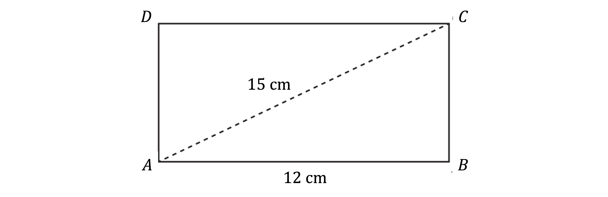

The diagram shows a rectangular piece of wood $ABCD$.

$AB=$ 12 cm and $AC=$ 15 cm.

Calculate $BC$.

### Q3 — hard — 3 marks

**Q3** [3 marks]

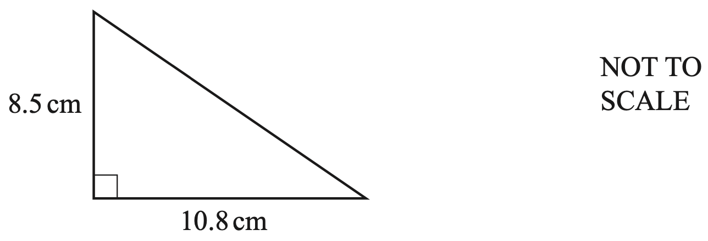

The diagram shows a right-angled triangle.

Calculate the perimeter.

............................................ cm [3]

*Source: 2020 0580/22 Q7B*

### Q4 — hard — 6 marks

**Q4** [6 marks]

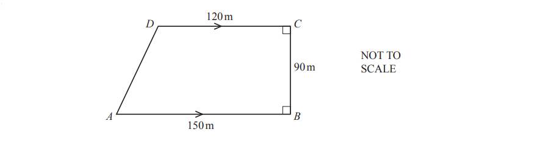

The diagram shows a field in the shape of a trapezium. $AB=150m,BC=90m$ and $CD=120m$. 
Angle $ABC$ = angle $BCD$ = $90^{\circ}$.

i) Show that $AD=95m$, correct to the nearest metre.

[3]

ii)A fence is built around the perimeter of the field.

It costs `$ 48` to build each 5-metre section of the fence. Calculate the cost of building this fence.

`$` .................................... [3]

*Source: Oct/Nov 2018 0580/31 Q9B*

### Q5 — hard — 4 marks

**Q5** [4 marks]

Sam has a rectangular pond, $ABCD$.

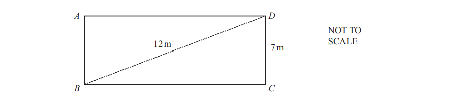

i) Calculate $BC$.

$BC$ = ...............................m [3]

ii) He puts a fence around the edge of the pond. 
Calculate the length of the fence.

................................m [1]

*Source: Oct/Nov 2018 0580/33 Q8B*

### Q6 — hard — 3 marks

**Q6** [3 marks]

The length of one side of a rectangle is 12cm.

The length of the diagonal of the rectangle is 13cm.

Calculate the area of the rectangle.

.......................................... cm2

*Source: Nov 2020 0580/12 Q19*

### Q7 — hard — 3 marks

**Q7** [3 marks]

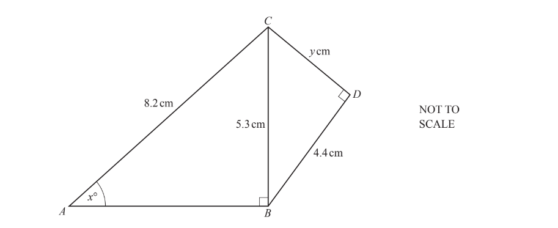

Triangles $ABC$ and $BCD$ are both right-angled triangles.

Calculate the value of $y$.

$y=$................................

*Source: March 2019 0580/12 Q26A*

### Q8 — medium — 2 marks

**Q8** [2 marks]

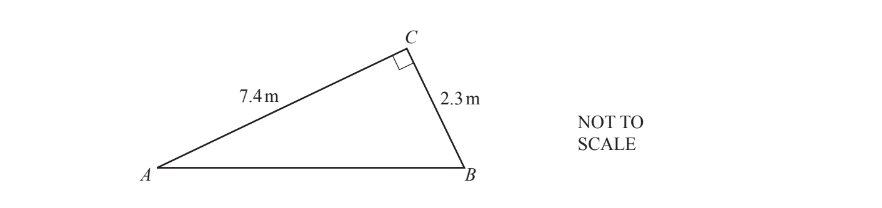

The diagram shows a right-angled triangle $ABC$. 
Calculate the length of $AB$.

$AB$ = ................................................m

*Source: June 2019 0580/32 Q7D*

### Q9 — medium — 3 marks

**Q9** [3 marks]

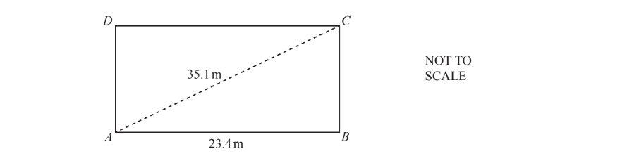

The diagram shows a rectangular playground $ABCD$. $AB=23.4$m and $AC=35.1$m.

Calculate $BC$.

$BC=$ ............................ m [3]

*Source: May/June 2018 0580/12 Q18*

### Q10 — medium — 3 marks

**Q10** [3 marks]

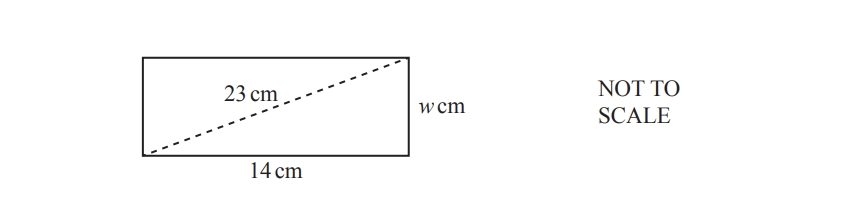

The diagram shows a rectangle 14cm by $w$cm. 
The diagonal is 23 cm.

Calculate the value of $w$.

$w=.................................................$

*Source: June 2020 0580/32 Q7C*

### Q11 — medium — 3 marks

**Q11** [3 marks]

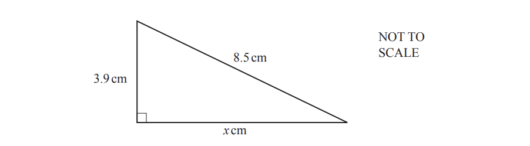

The diagram shows a right-angled triangle.

Calculate the value of $x$.

$x$= ...................................................

*Source: Nov 2019 0580/12 Q19*

### Q12 — medium — 3 marks

**Q12** [3 marks]

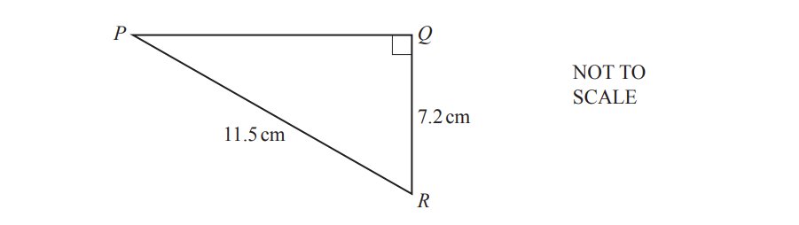

Calculate $PQ$.

$PQ$ = ........................................... cm

*Source: Nov 2020 0580/42 Q22*

### Q13 — easy — 2 marks

**Q13** [2 marks]

Calculate $PR$.

$PR$ = ......................................... cm

*Source: June 2019 0580/31 Q4E*

### Q14 — easy — 2 marks

**Q14** [2 marks]

Calculate $AC$.

$AC=$........................... m

*Source: Feb/March 2018 0580/12 Q23A*

### Q15 — easy — 2 marks

**Q15** [2 marks]

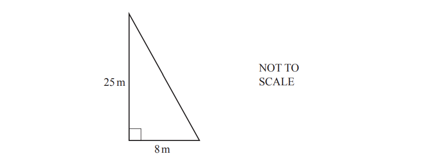

The diagram shows a flagpole in a garden.

The flagpole has height 25 m.

A rope from the top of the flagpole is tied to the ground 8m from its base.

Calculate the length of this rope.

................................................ m

*Source: June 2019 0580/31 Q7E*

### Q16 — easy — 2 marks

**Q16** [2 marks]

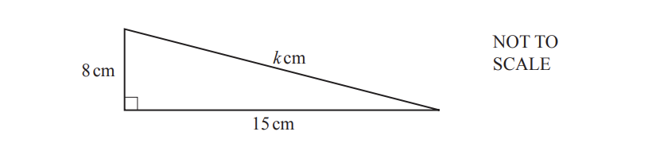

Calculate the value of $k$.

$k=$...............................

*Source: Nov 2020 0580/11 Q21B*

### Q17 — easy — 2 marks

**Q17** [2 marks]

The diagram shows a right-angled triangle.

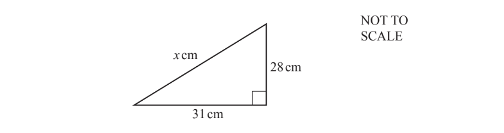

Show that the value of $x$ is 41.8, correct to 3 significant figures.

*Source: Nov 2019 0580/13 Q14*

