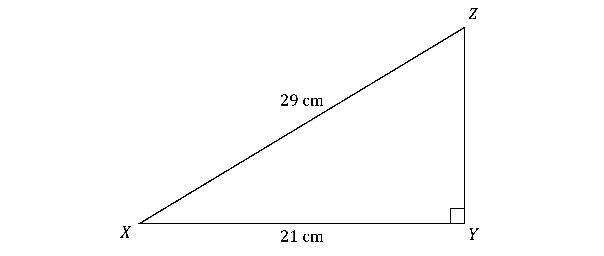
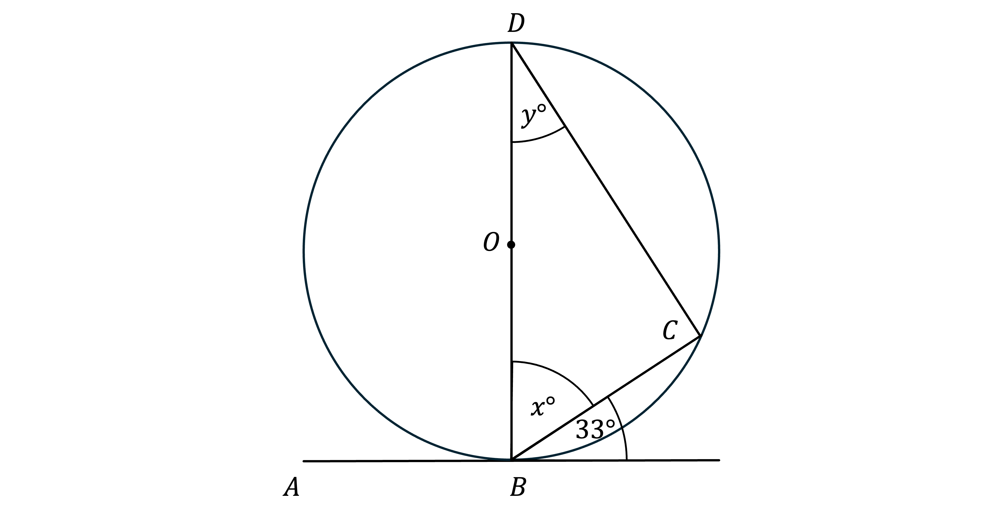
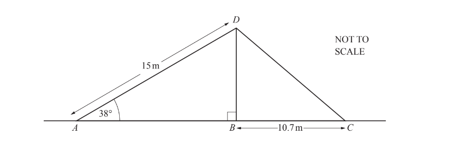
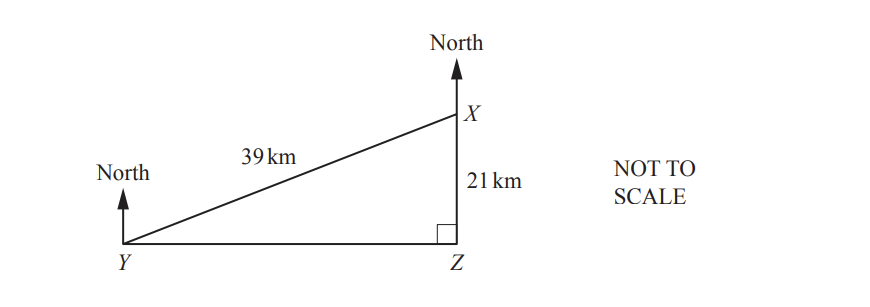
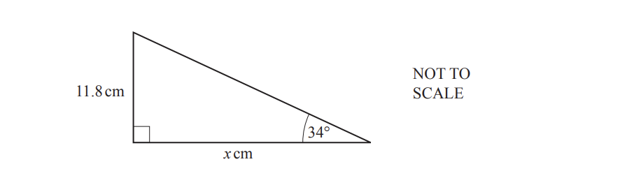
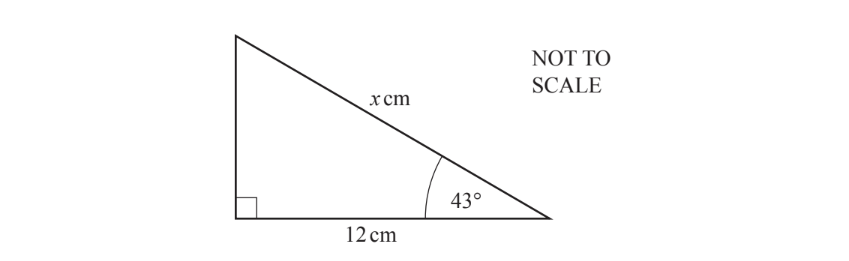
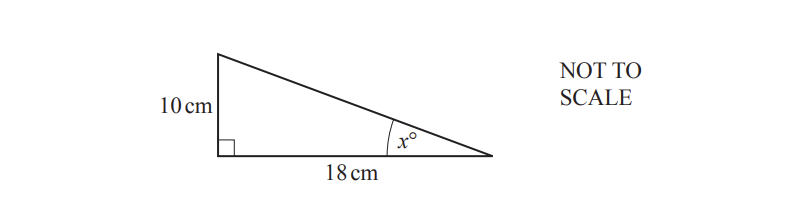
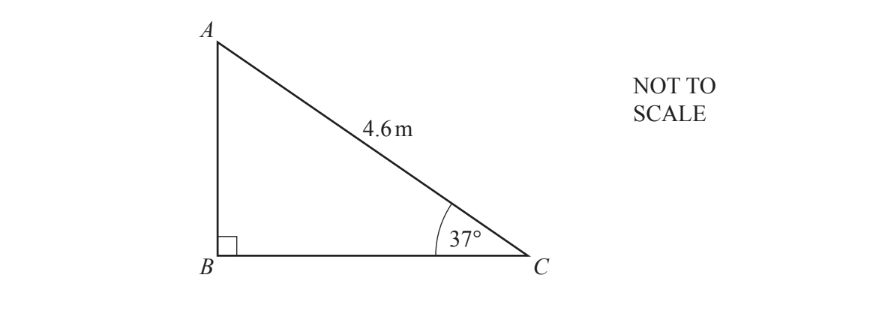

# Exam Questions — Trigonometry
**Pythagoras & Trigonometry** · Cambridge (CIE) IGCSE maths (0580 & 0980)
> Source: [https://www.savemyexams.com/igcse/maths/cie/25/core/topic-questions/](https://www.savemyexams.com/igcse/maths/cie/25/core/topic-questions/) · 19 questions across 1 sets

## Exam Questions (19 questions)

### Q1 — hard — 4 marks

**Q1** [1 mark]

The diagram shows a circle, centre $O$, with diameter $PQ$. 
$R$ is a point on the circumference.

$PR=5.2\mathrm{cm}$, and $PR=\frac{1}{3}PQ$.
Angle $PQR=x^{\circ}$.

Give a geometrical reason why angle $PRQ$ is 90°.

**Q1** [3 marks]

**Extract:**

The diagram shows a circle, centre O, with diameter PQ. 

R is a point on the circumference.

PR = 5.2 cm, and PR = 1/3 PQ.

Angle PQR = x°.

Angle PRQ is 90°.

Find the value of $x$.

$x=$ ..........................................

### Q2 — hard — 4 marks

**Q2** [2 marks]

Calculate the value of the length $YZ$.

**Q2** [2 marks]

Find the interior angle at $X$.

### Q3 — hard — 7 marks

**Q3** [2 marks]

The points $B$, $C$, and $D$ lie on the circumference of the circle, centre $O$.

The line $AB$ is a tangent to the circle at $B$.

Find the value of $x$ and the value of $y$.

**Q3** [3 marks]

$BC$ is $4$cm.

Hence, find the radius of the circle.

Round your answer to 3 significant figures.

**Q3** [2 marks]

Calculate the area of the circle.

Round your answer to 3 significant figures.

### Q4 — hard — 4 marks

**Q4** [2 marks]

A vertical flagpole, $BD$, stands on horizontal ground and is held by two ropes, $AD$ and $CD$.

$AD=15m,BC=10.7m$ and angle $DAB=38^{\circ}$.

Using trigonometry, calculate $BD$.

$BD$ = ...............................m

*Source: May/June 2019 0580/13 Q24A*

**Q4** [2 marks]

**Extract:**

A vertical flagpole, [B D], stands on horizontal ground and is held by two ropes, [A D] and [C D]. [A D = 15 m, B C = 10.7 m] and angle [D A B = 38°].

Calculate $CD$.

$CD=$.......................... m

*Source: May/June 2019 0580/13 Q24B*

### Q5 — hard — 7 marks

**Q5** [7 marks]

The diagram shows a circle, centre $O$, radius 11 cm.

$C,F,G$ and $H$ are points on the circumference of the circle.

The line $AD$ touches the circle at $C$ and is parallel to the line $EG$. $B$ is a point on $AD$ and angle $ABO$ = 140°.

i) Give a reason why angle $BCO$ is 90°.

[1]

ii) Show that$BC$ = 13.11 cm, correct to 2 decimal places.

[3]

iii) Calculate $BH$.

$BH$ = ......................... cm [3]

*Source: June 2020 0580/31 Q6C*

### Q6 — hard — 5 marks

**Q6** [3 marks]

Triangles $ABC$ and $BCD$ are both right-angled triangles.

Calculate the value of $y$.

$y=$................................

*Source: March 2019 0580/12 Q26A*

**Q6** [2 marks]

Calculate the value of $x$.

$x=$ .................................

*Source: March 2019 0580/12 Q26B*

### Q7 — hard — 9 marks

**Q7** [9 marks]

$A,B$ and $C$ are points on the circumference of a circle, centre $O$.

[1]

$AB=20\mathrm{cm} \mathrm{and}AC=52\mathrm{cm}.$

i) Use trigonometry to calculate angle $BAC$.

Angle $BAC$ = ............................. [2]

ii) Show that $BC$ = 48cm.

[2]

iii) Work out the area of triangle $ABC$.

........................... cm2 [2]

iv) Work out the total shaded area.

............................... cm2 [3]

*Source: May/June 2018 0580/31 Q9C*

### Q8 — hard — 6 marks

**Q8** [6 marks]

A speedboat starts at $X$ and travels to $Y$, then to $Z$ and then back to $X$.

$Z$ is due south of $X$ and $Y$ is due west of $Z$.

$XY$ = 39km and $XZ$ = 21 km.

i) Calculate $YZ$.

$YZ=$.............................km [3]

ii) Calculate angle $YXZ$.

Angle $YXZ$ = ......................[2]

iii) Find the bearing of$Y$from $X$.

[1]

*Source: June 2020 0580/33 Q9B*

### Q9 — medium — 3 marks

**Q9** [3 marks]

Calculate the value of $x$.

$x$= .................................................

*Source: Nov 2020 0580/33 Q8C*

### Q10 — medium — 2 marks

**Q10** [2 marks]

Calculate the size of angle $BAC$.

Angle $BAC$ = ............................

*Source: Feb/March 2018 0580/12 Q23B*

### Q11 — medium — 2 marks

**Q11** [2 marks]

Use trigonometry to calculate the value of$p$.

$p$ = ..............................................

*Source: Specimen 2020 0580/03 Q8C*

### Q12 — medium — 2 marks

**Q12** [2 marks]

The diagram shows a right-angled triangle.

Calculate the value of $x$.

$x=$ ..............................................

*Source: June 2019 0580/12 Q13*

### Q13 — medium — 3 marks

**Q13** [3 marks]

Use trigonometry to calculate the value of $x$.

$x$ = ...................................................

*Source: June 2019 0580/11 Q21*

### Q14 — medium — 3 marks

**Q14** [3 marks]

Show that the value of $x$ is 27.2, correct to 3 significant figures.

*Source: Nov 2020 0580/12 Q22*

### Q15 — easy — 2 marks

**Q15** [2 marks]

The diagram shows a right-angled triangle.

Use trigonometry to calculate the value of $x.$

$x=$ .............................. [2]

*Source: Oct/Nov 2018 0580/12 Q7*

### Q16 — easy — 2 marks

**Q16** [2 marks]

Calculate the value of $x$.

$x=$............................

*Source: Nov 2020 0580/11 Q21A*

### Q17 — easy — 2 marks

**Q17** [2 marks]

The diagram shows a right-angled triangle 
 Calculate AB.

..........................m

*Source: March 2020 0580/12 Q17*

### Q18 — easy — 2 marks

**Q18** [2 marks]

The diagram shows a right-angled triangle.

Calculate the value of $x$.

$x=$............................ [2]

*Source: May/June 2018 0580/13 Q16*

### Q19 — easy — 2 marks

**Q19** [2 marks]

The diagram shows a right-angled triangle.

Calculate the value of $x$.

$x$ = .....................................

*Source: June 2019 0580/11 Q12*

