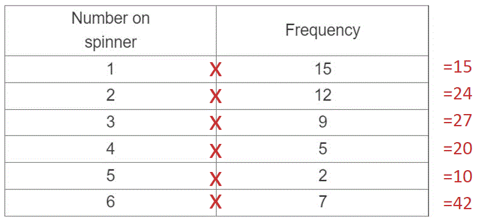
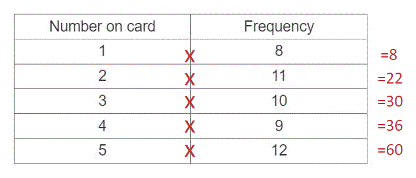

# Mark Schemes — Averages & Range
**Statistics** · Cambridge (CIE) IGCSE maths (0580 & 0980)

## Exam Questions (23 questions)

### Q1
> **[exam-tip]**
> To calculate a mean you use
> 
> $\mathrm{mean}=\frac{\mathrm{total} \mathrm{of} \mathrm{values}}{\mathrm{number} \mathrm{of} \mathrm{values}}$
> 
> For a question like this, that can be rearranged into the form
> 
> $\mathrm{total} \mathrm{of} \mathrm{values}=\mathrm{mean}\times\mathrm{number} \mathrm{of} \mathrm{values}$

Find the total number of points scored in the first 20 games

$76.25\times20=1525$

**[M1]**

Find the total number of points scored in the next 12 games

$80.25\times12=963$

So the total number of points scored in the 32 games is

$1525+963=2488$

The mean number of points per game is thus

$\frac{2488}{32}=77.75$

**Final answer:** **77.75 points per game**

**[M1 A1]**

> **[mark-scheme]**
> **M1**: For $76.25\times20$ or $80.25\times12$ or equivalent.
> 
> **M1**: For $\frac{76.25\times20+80.25\times12}{32}$ or equivalent.
> 
> **A1**: For 77.75 0160 .

### Q2
The median is the 'middle number' of a set of data

- For 29 data values it is going to be the 15th value
- But it is easier just to tick pairs of data values off from either end, until only one or two values are left in the middle

  - If only one value is left, that value is the median
  - If two values are left, the median is halfway between those values

**Final answer:** **73**

**[B1]**
Note that the newly-calculated median is still 73!

Add a 62 to the diagram (a '2' leaf in the row for the '6' stem)

- and follow the same process to find what the new median would be

So if the new score was a 62

- the new median would be halfway between 71 and 73

*72*

**[M1]**

That means that John cannot be right

- Write your answer, giving a reason

**Final answer:** **If the new score were a 62, then the new median would be 72.**
**So John's claim cannot be correct.**

**[A1]**

> **[mark-scheme]**
> **M1**: For working out the new median if a 62 is added to the data set.
> 
> **A1**: For 'no' with a valid reason given.

### Q3
The modal score is the most popular score

**Final answer:** **36**

**[B1]**
The median is the middle number when in order

- Place the numbers in order smallest to largest

* 14,  24, 25, 26, 27, 33, 34 ,36, 36, 40*

- Find the middle of the data

*The middle is between 27 and 33*

$\frac{27+33}{2}=\frac{60}{2}$

**Final answer:** **30**

**[A1]**
The range is the largest number subtract the smallest number

*40-14=26*

**Final answer:** **26**

**[B1]**

### Q4
> *Add all the numbers together*

$10+15+12+20+13=70$

> *Divide by how many numbers there are*

$\frac{70}{5}=14$

**[M1]**

**Final answer:** **Mean = **$14$

**[A1]**

### Q5
> *Multiply the mean by the number of data values to determine the sum of the values*

$9.4\times5=47$

**[1]**

> *Subtract the known values from the sum to determine the missing value*

`47 minus open parentheses 3 plus 5 plus 10 plus 12 close parentheses equals 17`

**[1]**

> *The range is the difference between the highest and the lowest data values*

$17-3=14$

**[1]**

$14$ **[1]**

### Q6
> *Multiply the mean (16) by 7 (the number of values) to find the total of all the values. *

$16\times7=112$

* ***[1]**

> *Add up the numbers we already know. *

> $12+20+19+10+21+13=95$* *

> *Subtract 95 from the total, 112. *

> $112-95=17$* *

$17$* ***[1]**

### Q7
> *Work out the total of the three numbers*

$150\times3=450$

> *The sum of the numbers must be equal to 450 so form an equation*

`361 space plus thin space 2 n space plus thin space open parentheses n minus 1 close parentheses space equals space 450`

**for 361 + 2n + n - 1**** ****[1] **

*correct equation*** ****[1]**

> *Collect like terms*

$360+3n=450$

> *Subtract 360 from both sides*

$3n=90$

> *Divide by 3*

$n=30$

**n**** = 30** **[1]**

### Q8
(i) *The mode is the number which occurred **most often**. Look in the table for the outcome which has the highest frequency.*

> * The number 1 has the highest frequency (of 15).*

$1$* ***[1]**

(ii) *The median is the **middle **piece of data. There are 50 pieces of data, so the median value will be between the 25th and 26th.*

*1 was spun 15 times, and 2 was spun 12 times. This adds up to 27 pieces of data. *

> *So, the 25th and 26th pieces of data are both **2**, and halfway between them will also be **2**.*

$2$* ***[1]**

(iii) *Multiply each number on the spinner by its frequency. *

> * Add together the results. This gives us the total of all our data added together. *

$15+24+27+20+10+42=138$

**[1]**

> * There are 50 pieces of data, so divide by 50.*

> * *$138\div50=2.76$

**[1]**

> * *

$2.76$* ***[1]**

### Q9
(ia) *The most common number is 82. *

**82 g** **[1]**

(ib) *Range = largest number (103) - smallest number (78)*

> * *$103-78=25$

** ****25 g** **[1]**

(ic)*Write the numbers in order from smallest to largest.*

* **78, 82, 82, 88, 94, 103*

* ***[1]**

> *Keep crossing a number off the beginning and the end of the list to find the middle. *

`up diagonal strike 78 comma space up diagonal strike 82 comma space 82 comma space 88 comma space up diagonal strike 94 comma space up diagonal strike 103`

> * The median is halfway between 82 and 88. *

**85 g** **[1]**

(ii)*Add together the 7 numbers, including Toni's apple, to work out the total weight. *

*78 + 82 + 82 + 88 + 94 + 103 + *$x$* = 527 + *$x$

* ***[1]**

> *Mean (89) = total (527 + *$x$*) *$\div$* how many pieces of data (7).*

> * *`89 equals open parentheses 527 plus x close parentheses divided by 7`

> * Multiply both sides of the equation by 7.*

`table row cell 89 cross times 7 end cell equals cell 527 plus x end cell row blank blank blank row 623 equals cell 527 plus x end cell end table`

* ***[1]**

> *Subtract 527 from both sides. *

`table row cell 623 minus 527 end cell equals x row blank blank blank row 96 equals x end table`

** ****96 g** **[1]**

> * *

### Q10
i) *The range is the difference between the highest value and the lowest value *

*Highest number of examinations = 8*

*Lowest number of examinations = 5*

*8 - 5 = 3 *

**3**** ****[1]**

** **

ii)*The position of the median for an even set of data is calculated using the formula: *

> *Median position = *$\frac{n+1}{2}$

> *As *$n=196$*,*

$\frac{196+1}{2}=98.5$

> *As the data is grouped, the position of the median lies in the group that contains the 98.5**th** candidate in the ordered set of data*

> *Using the cumulative frequency, *

| *Number of Examinations* | *Cumulative Frequency* |
|---|---|
| *5* | *27* |
| *6* | *27 + 42 = 69* |
| *7* | *69 + 63 = 132* |
| *8* | *132 + 64 = 196* |

> *98.5 lies between 69 and 132 and so the 98.5**th** candidate takes 7 examinations *

**7** **[1]**

iii)*The mean is the sum of all the data points, divided by the total frequency*

> *The sum of all the data points is calculated by multiplying the number of examinations by their frequency, and adding these together*

`open parentheses 27 cross times 5 close parentheses plus open parentheses 6 cross times 42 close parentheses plus open parentheses 7 cross times 63 close parentheses plus open parentheses 8 cross times 64 close parentheses`

**[1]  **

$=135+252+441+512$

$=1340$

> *Dividing the total number of examinations by the number of candidates gives us the average number of examinations per candidate*

$1340\div196=6.836734694...$

**[1]**

$6.84$ **[1]**

**An answer of **$6\frac{41}{49}$** or an answer between 6.836-6.837 will also be accepted **

iv)*To calculate the probability of an event, use the formula:*

> *The probability of an event = *$\frac{\mathrm{Number} \mathrm{of} \mathrm{desired} \mathrm{outcomes}}{\mathrm{Total} \mathrm{number} \mathrm{of} \mathrm{outcomes}}$

*The number of desired outcomes is: *$27+42+63=132$

**[1]**

** ***The total number of outcomes is *$196$

*Place these values into the formula*

$\frac{132}{196}$ **[1]**

### Q11
i) *The mode is the number with the highest frequency*

$4$ **[1]**

** **

ii)*The mean is the sum of all the data points, divided by the total frequency*

> *The sum of all the data points is calculated by multiplying the number on the spinner by the frequency of spins, and adding these together*

`open parentheses 3 cross times 2 close parentheses plus open parentheses 2 cross times 3 close parentheses plus open parentheses 4 cross times 6 close parentheses plus open parentheses 5 cross times 4 close parentheses plus open parentheses 6 cross times 5 close parentheses`

$=86$

**[1]**

> *Dividing the sum by the number of spins gives us the average number per spin*

$86\div20$

**[1]**

$4.3$ **[1]**

** **

iiia) *The formula used to determine the angle of a sector is:* *Angle = *$\frac{\mathrm{Frequency}}{\mathrm{Total} \mathrm{Frequency}}$$\times360$

> *Substitute the known values into the formula to obtain the angle*

$\frac{3}{20}\times360=54^{\circ}$ **[1]**

** **

iib) *The formula used to determine the angle of a sector is:*

> *Angle =*$\frac{\mathrm{Frequency}}{\mathrm{Total} \mathrm{Frequency}}$$\times360$

> *Substitute the known values into the formula to obtain the angle*

$\frac{5}{20}\times360$

**[1]**

$90^{\circ}$* ***[1]**

### Q12
i)*The range is the difference between the highest value and the lowest value*

$6-0=6$

**6**** ****[1]**

ii) *The position of the median of an even set of data is determined using the formula * $\frac{n+1}{2}$*  where *$n=50$

$\frac{50+1}{2}=25.5$*th** value*

> *Using the cumulative frequency of the number of bananas bought, the cumulative frequency values are*

$14,14,16,21,32,40,50$

> *The median value is between the 21**st** and 32**nd** item of data. This is the data value *$4$

**4**** [1]**

** **

iii) *The mean of a set of data is calculated by dividing the sum of all the data values by the total number of data values*

`open parentheses 0 cross times 14 close parentheses plus open parentheses 1 cross times 0 close parentheses plus open parentheses 2 cross times 2 close parentheses plus open parentheses 3 cross times 5 close parentheses plus open parentheses 4 cross times 11 close parentheses plus open parentheses 5 cross times 8 close parentheses plus open parentheses 6 cross times 10 close parentheses equals 163`**[1]**

$163\div50=3.26$

**[1]**

**3.26** **[1]**

### Q13
(i)

*The modal group is the group with the highest frequency* *The highest frequency is 44 for the group with 1 person per car*

**1**** ****[1]**

(ii)

> *The mean of a set of data is calculated by dividing the sum of all the data values by the total number of data values*

> *Find the total number of people in the cars by multiplying the number of people in a car by the frequency*

*1 x 44 + 2 x 43 + 3 x 30 + 4 x 25 + 5 x 8 = 360*

**[1]**

> *Divide by the number of cars (150)*

*360 ÷ 150*

**[1]**

**2.4**** [1]**

### Q14
> *Multiply each card number by its frequency. *

> * *

> *Add together the results. This gives us the total of all our data added together. *

$8+22+30+36+60=156$* ***[1]**

> *Divide by how many pieces of data there are, 50. *

$156\div50=3.12$

* ***[1]**

**3.12** **[1]**

### Q15
> *Add up all the temperatures. *

> $9+11+15+19+23.5+27.5+29+28+25+19.5+14.5+10=231$* *

> *Divide by how many there are, 12. *

$231\div12=19.25$

**[1]**

$19.25^{\circ}C$ **[1]**

### Q16
> *To find the median, first write the numbers from smallest to biggest*

$8,14,14,27,32,38,47,55,73,93$

**[1]**

> *The median is the middle number. Find it by crossing off the numbers from either end in turn. There are an even number of numbers in this case, so there will be two middle numbers.*

`up diagonal strike 8 comma space up diagonal strike 14 comma space up diagonal strike 14 comma space up diagonal strike 27 comma space circle enclose 32 comma space 38 end enclose comma space up diagonal strike 47 comma space up diagonal strike 55 comma space up diagonal strike 73 comma space up diagonal strike 93`

> *The median is halfway between these numbers. Halfway between 32 and 38 is 35.*

**35**** ****[1]**
> *The range is the difference between the largest and smallest numbers. The largest number is 93. The smallest number is 8.*

$93-8=85$

**85**** [1]**

### Q17
i) *First write the numbers in order*

$1,1,2,2,3,3,4,4,4,5,5,7$

**[1]**

> *Find the middle number(s) by crossing out numbers from both ends*

`up diagonal strike 1 comma space up diagonal strike 1 comma space up diagonal strike 2 comma space up diagonal strike 2 comma space up diagonal strike 3 comma space 3 comma space 4 comma space up diagonal strike 4 comma space up diagonal strike 4 comma space up diagonal strike 5 comma space up diagonal strike 5 comma space up diagonal strike 7`

> *The median is halfway between 3 and 4*

**3.5** **[1]**

ii) *The mode is the most common piece of data*

**4** **[1]**

iii) *The range is the difference between the largest and smallest number*

$7-1=6$

**6** **[1]**
i) *Add an extra column to the table and multiply the number of letters in a word (**x**) by the number of words (**f**).*

| Number of letters in a word | Number of words | *xf* |
|---|---|---|
| 1 | 3 | *1 x 3 = 3* |
| 2 | 1 | *2 x 1 = 2* |
| 3 | 5 | *3 x 5 = 15* |
| 4 | 8 | *4 x 8 = 32* |
| 5 | 6 | *5 x 6 = 30* |
| 6 | 2 | *6 x 2 = 12* |

> *Find the sum of the **xf** column. This is the total number of letters altogether.*

$3+2+15+32+30+12=94$

**[1]**

> *Divide by the total number of words.*

$94\div25=3.76$

*dividing by 25*** ****[1]**

**3.76**** ****[1]**

ii) *Add together the number of words with 4, 5, or 6 letters.*

$8+6+2=16$

**[1]**

> *Divide by the total number of letters. Write as a fraction.*

$\frac{16}{25}$ **[1]**

### Q18
(i) *Range = highest time (14.9 seconds) - lowest time (7.1 seconds) *

$14.9-7.1=7.8$

** ****7.8 seconds*** ***[1]**

(ii) *Order the maximum power values.*

> * *$44,51,52,55,77,85,90,103,110,135$

* ***[1]**

> *Median = middle value. *

`up diagonal strike 44 comma space up diagonal strike 51 comma space up diagonal strike 52 comma space up diagonal strike 55 comma space 77 comma space 85 comma space up diagonal strike 90 comma space up diagonal strike 103 comma space up diagonal strike 110 comma space up diagonal strike 135`

> *The middle value is halfway between 77 and 85. Add together the two numbers and divide by 2. *

> `open parentheses 77 plus 85 close parentheses divided by 2 equals 81`* *

**81 kW**** ****[1]**

### Q19
i) *The range is the difference between the highest value and the lowest value of data*

*The highest value is *$104$

*The lowest value is *$18$

$104-18$* *

**86**** ****[1]**

ii) *The median is the middle value in an ordered set of data.*

> *Order the data from smallest to largest*

$18,27,31,45,60,72,104$

**[1]**

> *Select the middle item of data in the list*

**45*** ***[1]**

iii) *The mean of a set of data is the sum of all the items of data, divided by the total frequency*

$104+18+72+31+27+45+60=357$

**[1]**

> *The number of items of data is *$7$

$357\div7$

**51**** [1]**

### Q20
> *The mode is the piece of data that appears the most. There are two 8s but only one of the other numbers.*

**8**** ****[1]**
> *To calculate the mean, add up the numbers and divide by how many numbers there are. *

$\frac{18+13+15+8+9+17+12+8+6+14}{10}$

**[1]**

$\frac{120}{10}=12$

**12** **[1]**

### Q21
(i) *Order the data from smallest to largest.*

> * *$95,175,182,194,200,238,250,256,280,1180$

**[1]**

> * Find the middle. *

> `up diagonal strike 95 comma space up diagonal strike 175 comma space up diagonal strike 182 comma space up diagonal strike 194 comma space 200 comma space 238 comma space up diagonal strike 250 comma space up diagonal strike 256 comma space up diagonal strike 280 comma space up diagonal strike 1180`* *

> *Halfway between 200 and 238 is 219.  (You can find that by adding 200 and 238 together and dividing by 2.)*

** ****219** **[1]**

(ii)*Add all the data together.*

> * *$280+200+175+1180+95+182+238+256+194+250=3050$

> * Divide by how many pieces of data there are, 10.*

> * *$3050\div10=305$

* ***[1]**

$305$* ***[1]**

(iii)*The mean is not suitable when there is data which is much higher or lower than the rest.*

> *In this office, there is one piece of data which is much larger than the others, 1180.*

> *When this is included, it will make the mean much higher. *

**One extreme value (1180) makes the mean higher** **[1]**

### Q22
(i) *Order the numbers from smallest to largest.*

* **1, 1, 1, 2, 2, 2, 3, 3, 3, 3, 4, 4*

* ***[1]**

> *Cross off the smallest and largest numbers to find the middle.*

> * *`up diagonal strike 1 comma up diagonal strike 1 comma space up diagonal strike 1 comma space up diagonal strike 2 comma space up diagonal strike 2 comma space 2 comma space 3 comma space up diagonal strike 3 comma space up diagonal strike 3 comma space up diagonal strike 3 comma space up diagonal strike 4 comma space up diagonal strike 4`

> * The median is halfway between 2 and 3.*

** ****2.5** **[1]**

(ii)*The most common number is 3.*

** ****3**** ****[1]**

(iii) *Add up all the numbers and divide by how many there are, 12.*

> * *`open parentheses 1 plus 1 plus 1 plus 2 plus 2 plus 2 plus 3 plus 3 plus 3 plus 3 plus 4 plus 4 close parentheses divided by 12 equals 2.41666...`

**[1]**

** ****2.42** **[1]**

(iv) *Range = biggest value (4) - smallest value (1).*

> * *$4-1=3$

** ****3** **[1]**

### Q23
> *The mode can be determined from categorical data, as well as numerical data. The mean and median can only be calculated from numerical data*

**Mode** **[1]**
